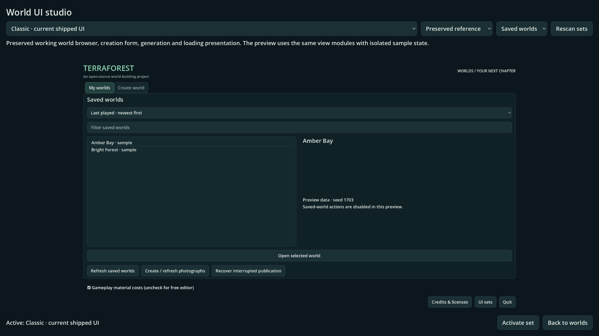
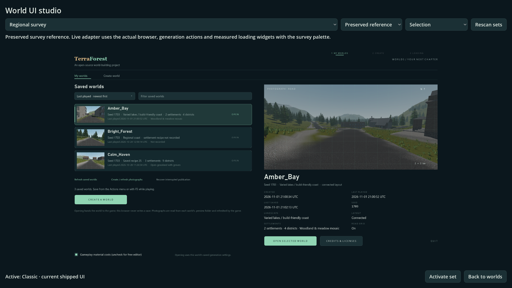
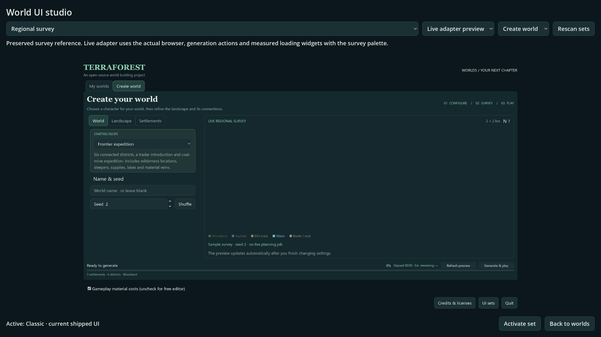
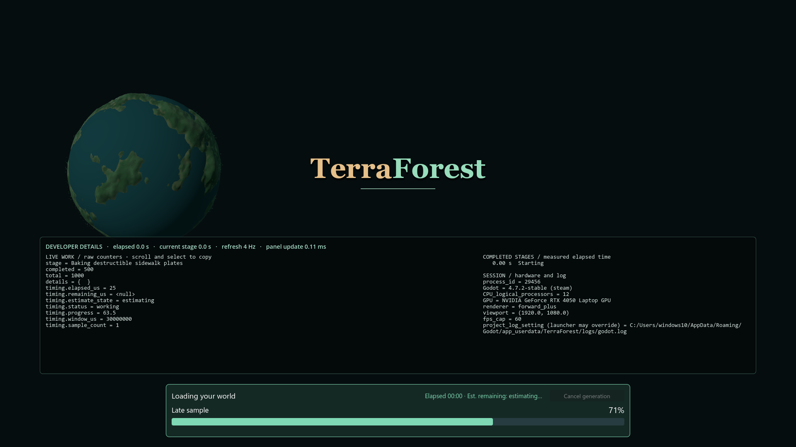

# Modular world-screen UI and mockup studio

- Status: Implemented and installed; source/executable checks pass; player review pending.
- Updated: 2026-11-05.
- User review: Requested preserved, selectable, pluggable mockup/UI sets. Explicit scope: world screens first.
- Symptom: Current world UI was built inside controllers; alternatives were unrelated standalone mockups without discovery or activation.

## Changes

The current browser construction is extracted into the Classic set while its
controller retains library data, recipes, actions and async jobs. Five manifest
Resources register the original Classic, Planet, Survey, Diorama and Campfire
references. The studio discovers folders and presents the reference or isolated
live-adapter preview, with page names and canvas sizes declared in each manifest.
The world browser provides the **UI sets** entry and **Back to worlds** applies
an explicit activation. Selection persists independently of world saves; removing
or invalidating a selected module falls back to Classic.

Working browser/creation/generation/Last World/gameplay loading hosts resolve
presentation scripts through the registry. A new set can inherit missing roles
and override only its own modules; no set-ID dispatch table needs editing. The
registry validates identity, inheritance, role base types and required APIs before
activation. [Authoring contract and examples](../../addons/ui_sets/README.md).

Three runtime choices are provided: Classic, Survey and Planet. **Survey and
Planet live adapters reuse the functional layouts with their palette/type, and
Planet reuses its loading portrait. Their complete reference layouts are not
claimed as ported.** The full references stay available for design work. Diorama
and Campfire remain reference-only because their sample stages are not connected
to real progress. They cannot silently become live loading displays.

Preview input is isolated; the actual Classic view is constructed in a sample
controller mode without the library or generation/photo jobs. Original layouts
and scenes are preserved. Two reference media functions now use import-aware
access, so source-only/local photographs can be absent in a PCK without errors;
existing imported survey art loads normally. No personal world photograph or
report folder is bundled to fill those missing samples.

## Images and verification

[Exact checks and retained failures](evidence.json). Source/executable checks
cover discovery/inheritance, persistence/fallback, all three working adapters,
real generation option defaults, monotonic measured loading and isolated gallery
previews. Real Survey open/save/reopen/return/photographs run in one native window.
Live loading/diagnostics and Last World startup cover the shared production hosts.

Images below are captured from the actual studio. They distinguish reference
mockups from the functional adapters; image inspection is scoped layout evidence,
not a declaration that all original art targets have shipped.

Classic view modules displayed in the studio, source 1920x1080 Forward+.

Original Survey reference retained for layout review; source run has local world
photographs. Exported previews leave optional local photographs empty.

Live adapter preview uses real creation widgets with sample state and no jobs.
The original captured survey is labelled as sample seed 2.

Planet adapter retains the working loading panel and diagnostic owner. Percentage
is a controlled test input, not a fabricated runtime progress animation. All images
inspected; [source/hash/provenance](images/manifest.json).

## Remaining / resume here

Player visual/usability review remains pending. Full reference-layout ports for
Survey/Planet and real-progress adapters for loading-only designs remain explicit
art/integration work. Resume them by replacing individual view modules against
the documented controller contract and requiring the same open/generate/cancel/
load/save/reopen checks. In-game HUD, inventory and menus are outside this change
at the user's direction. Larger plugin collections and long-run graphics budgets
are not broadly qualified by five-set previews.

Original module/code/test/tool changes were authored with OpenAI Codex for the
maintainer request under 0BSD. Original manifests/scenes use CC0-1.0; existing
referenced UI/art/planet terms are preserved in place. No external assets/code or
font files were imported. See [origin record](../../addons/ui_sets/ORIGIN.txt).
