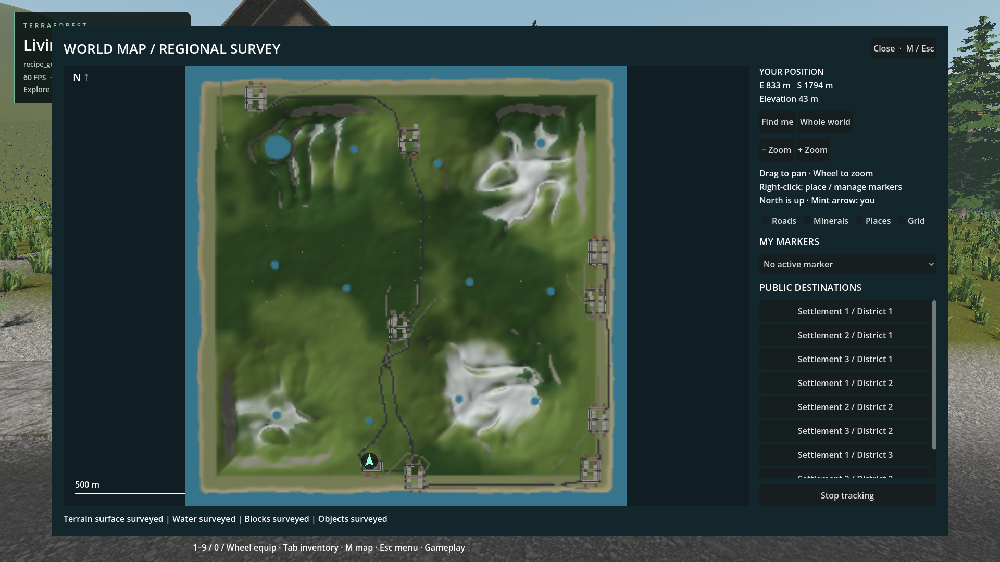
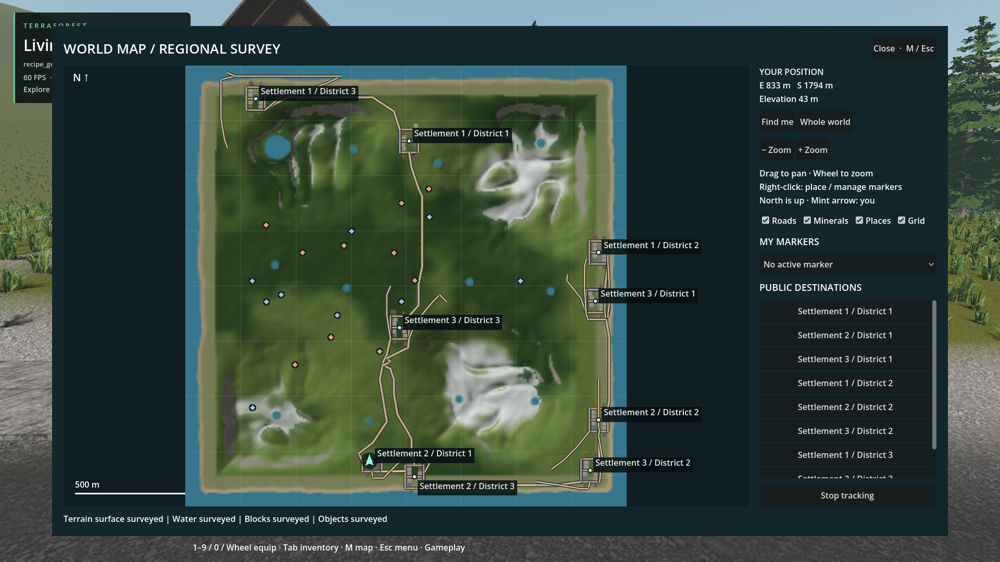
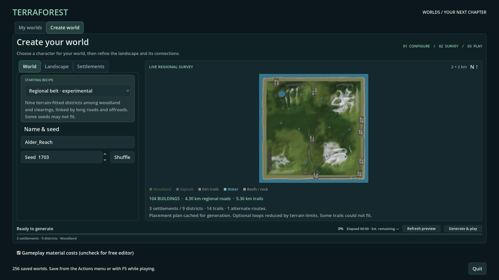

# Natural world-map presentation

- Status: Installed / scoped checks pass. Updated: 2026-10-28.
- User review: Pending. Town clustering is deliberately unchanged per latest instruction.
- Symptom: Gold route lines and large mineral symbols obscured actual generated surfaces; live maps did not show the temperate vegetation field.

## Images

See `images/manifest.json` for source paths, settings, hashes and test runs.
Earlier gold-road imagery remains in [world-generator](../world-generator/README.md).

Installed package, disposable seed-1703 coastal woodland world, 104 buildings.
All four surveys completed, annotations off. Inspected: asphalt/roof/rock colors,
no gold lines or enlarged mineral diamonds. Coarse diagonal-road sampling remains visible.

Same installed world and camera; all four switches enabled. This view is optional,
not the new default. Player waypoints remain independent of these switches.

Source UI, same seed/recipe at 1920×1080. Actual baked surface and prefab tops;
forest coverage is regional shading, not individual tree crowns. No layout change.

## Changes and verification

- Default map shows surveyed terrain, water, material-colored block tops and object footprints. Roads, mineral symbols, place names and grid lines are independent optional annotations, initially off. Player markers and a tracked destination remain navigation UI.
- Creation preview samples the baked density/material field, not lines over ungraded terrain. Roof footprints come from actual prefab cells, not whole-lot rectangles. Runtime terrain edits replace local pixels; destroyed pavement is not repainted from planned route metadata.
- Terrain/roof/ore palette replaces contour bands, uniform beige buildings and purple objects. Gray road/rock/snow pixels are excluded from vegetation tinting. Raw terrain cache stays separate from displayed color data: no texture readback per patch.
- Native C++ owns terrain/material sampling, top-column extraction and raster reduction. Existing bounded worker calls, archive reads and cache checks remain. Derived map version 4 invalidates old appearance caches without changing saved worlds.
- Regional belt now defaults to woodland rather than sparse grassland. Existing recipes and tree identities remain unchanged. The vegetation selector explicitly describes temperate coverage, not unimplemented climates.
- Focused checks cover native material IDs, pavement mining, local color coordinates, default controls, top-surface ownership, archived/resident block colors, water visibility and cache integrity. Legacy visibility hashes remain exact across nine seed/edit cases. New palette hashes are separate fixtures; earlier palette/serial evidence is preserved, not presented as byte-identical after recoloring.
- Early source flow `20261028T114834331041Z` passed its 45 assertions but emitted empty-color hash errors. Empty batches now bypass hashing; that failed run remains evidence, not a clean pass. An initial packaged launcher also combined mutually exclusive default/city fixture flags; retain that failure separately from runtime results.
- Final installed flow [run manifest](../../reports/checks/20261028T120001341951Z_minerals_pack/world_recipe_generation/run.json): **46 assertions, zero diagnostics**, full 104-building generation, photographs, completed map, optional switches, tracked destination, gameplay, save/reload, all four approved house records and one stable native window. Generation phase 74.99 s; complete test 147.13 s on this machine. Cache state and woodland settings differ from earlier timing: not a controlled speedup claim.
- [Ten packaged focused checks](../../reports/checks/20261028T120035379354Z_minerals_pack/summary.json) pass, including 26 natural-map assertions and 26 recipe/scatter assertions. Candidate counts over the fixed scatter fixture: woodland 13,574, mosaic 7,594, sparse grassland 2,035; not actual in-world tree counts after exclusions.
- [Creation UI check](../../reports/checks/20261028T114719743002Z/run.json) passes at 1920×1080 and 1280×720. Source terrain visibility/palette and overview fixtures pass in `20261028T114819707823Z` and `20261028T114820546691Z`. Both native build variants compile; pack export and startup smoke pass. No player world was regenerated or overwritten.

## Remaining / resume here

- This is still regional cartography, not a rendered satellite photo: terrain is 256² (7.8125 m/pixel), objects/blocks 512². Narrow diagonal roads can alias; small props and stones may occupy less than a pixel. Require a higher-resolution, bounded/tiled sampling comparison before claiming exact silhouettes or seamless zoom.
- Woodland shade uses the same coherent coverage field as generation, not individual tree crowns or subsequent tree removal. Actual canopy occupancy and its edit invalidation remain work; verify cut/plant/road exclusions at matching viewpoints before claiming tree-exact mapping.
- Climate biomes (desert, tundra, etc.) are not implemented by this appearance change. They require matching native placement rules, ground/vegetation assets and multi-seed ground-level review, not simply extra map colors.
- Building rendering already merges coplanar faces and pages native chunks. It does **not** supply distance-based geometric building LOD. Profile dense districts first; any future LOD must preserve destructible cells, shape/material boundaries, edit invalidation and collision ownership, with moving-camera transition evidence. No LOD or settlement layout rewrite is included here.
- Pixel/visibility checks and inspected screenshots do not approve town quality, weak-hardware performance or every map edit case. User visual review remains separate.

## Reproduce / code

- Create world → Regional belt, seed 1703, coastal defaults. Preview, generate, open M, inspect with annotations off/on; track a public destination while Places is off. Use only disposable test slots for automated edits.
- `tests/natural_map.gd`, `tests/world_recipe_generation.gd`, `tests/world_creation_ui.gd`, `tests/block_map_survey.gd`, `tests/terrain_map_efficiency.gd`.
- `addons/world_runtime/world_map.gd`, `world_map_view.gd`, `world_generation_plan.gd`, `survey_updates.gd`, `survey_models.gd`, native `surface_map_raster.hpp` and `world_recipe.hpp`.
- `addons/volumetric_terrain/native/survey_map.hpp`; `addons/structures/native/block_map_region.hpp`, `block_prefab.cpp`, `map_material.hpp`.
