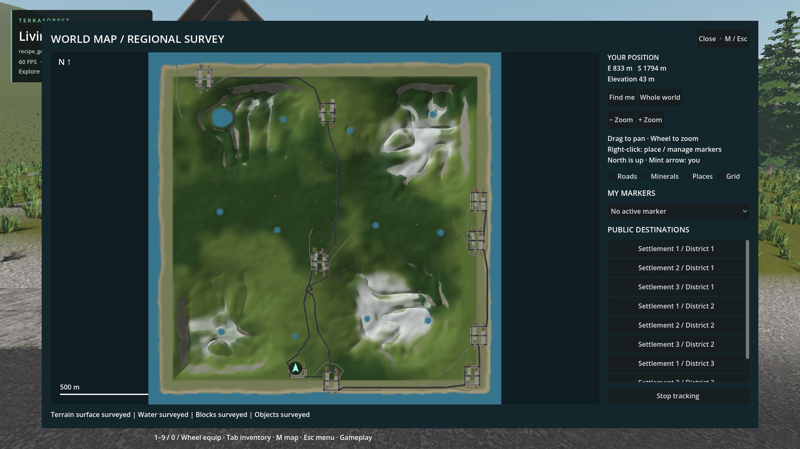
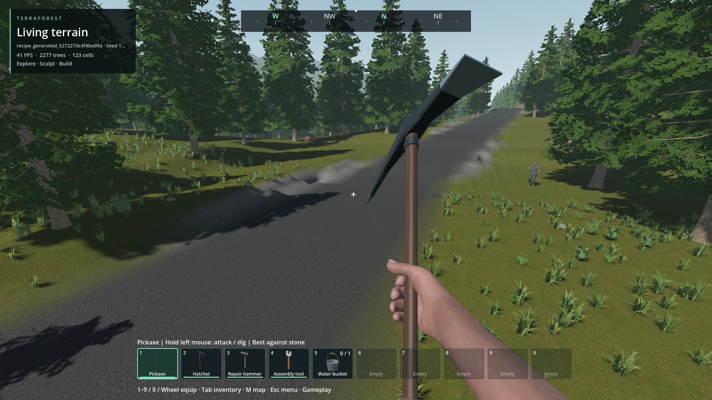
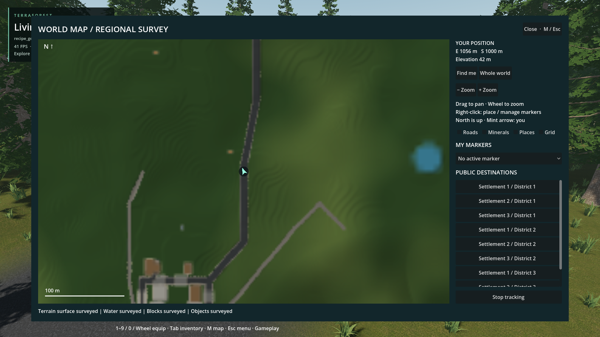
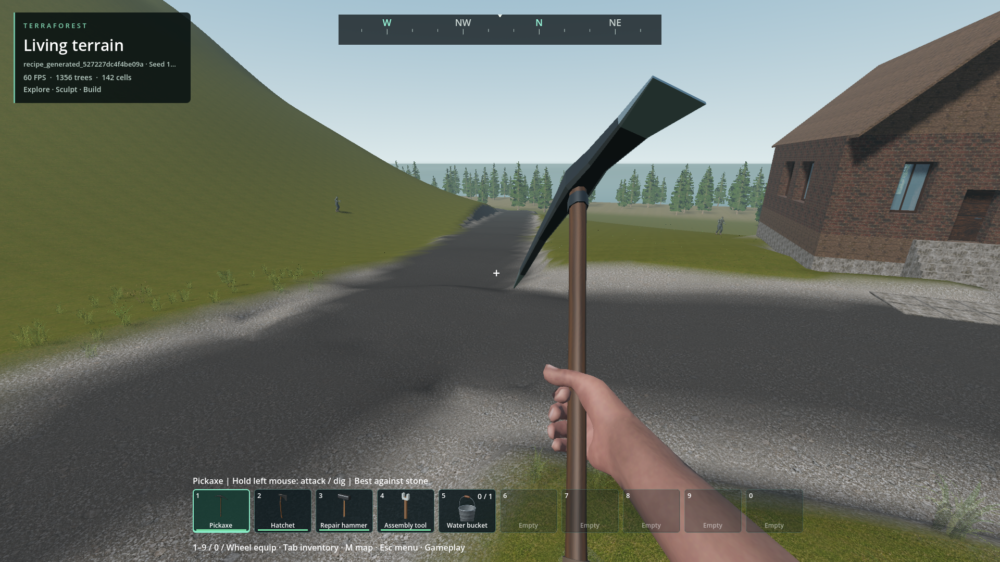

# Natural world-map presentation

- Status: Improved-partial / scoped checks pass. Updated: 2026-10-28.
- User review: Pending. Town clustering is deliberately unchanged per latest instruction.
- Symptom: Delayed water on first M, coarse broken-looking roads, and road shoulders inheriting pavement material; earlier gold annotations obscured the actual surface.

## Images

See `images/manifest.json` for source paths, settings, hashes and test runs.
The detail/readiness follow-up is recorded in `images/manifest-v5.json`.
Earlier gold-road imagery remains in [world-generator](../world-generator/README.md).

Installed v5, seed 1703 / Regional belt, all annotations off. Same recipe as the
earlier baseline, not the same save. All map layers ready on first M; inspected,
not yet user-approved.

Same test world near E1056 / S1000. Continuous asphalt with gravel shoulders;
irregular shoulder contour remains visible rather than hidden by map lines.

Same regional-road location at 6× map zoom. Finite sampling still magnifies;
gray tracks are unpaved terrain, not missing asphalt annotations.

First district street: asphalt joins without later support repainting; approved
house/plate geometry is unchanged. Inspected material continuity, not universal
approval of terrain fit or shoulder shape.

Installed package, disposable seed-1703 coastal woodland world, 104 buildings.
All four surveys completed, annotations off. Inspected: asphalt/roof/rock colors,
no gold lines or enlarged mineral diamonds. Coarse diagonal-road sampling remains visible.

Same installed world and camera; all four switches enabled. This view is optional,
not the new default. Player waypoints remain independent of these switches.

Source UI, same seed/recipe at 1920×1080. Actual baked surface and prefab tops;
forest coverage is regional shading, not individual tree crowns. No layout change.

## Changes and verification

### Water readiness, road materials and detail follow-up

- Coastal water was explicitly excluded from certified cache reads. Ocean residency also discarded its identity despite no authored map change. Both now preserve/reuse the saved logical certificate; actual water edits still invalidate it.
- Normal loading prepares all four map layers before releasing player input. M displays their textures immediately. Unchanged maps stop processing while closed; revised overlays retain the previous image until the replacement is complete. Cache failure remains recoverable rather than trapping the player in loading.
- Runtime terrain is now 1024², four sub-samples per pixel on edited terrain, rather than 256² single-point road sampling. This is 1.953 m/pixel instead of 7.8125 m/pixel. Native jobs are bounded to 16×16 pixels; uploads are batched at most every 200 ms while patches arrive. Object layers use linear filtering instead of nearest-neighbor magnification. Cache v5 rejects older rasters.
- Native asphalt is a shallow pavement layer, not paint through the entire embankment and shoulder. New-world earthwork commands run before asphalt commands so later supports/tracks cannot overwrite crossings. No additional geometry pass or extra command count; no settlement layout, approved house, sidewalk plate or player-save rewrite.
- Native crossing fixture: 41/41 center probes asphalt, shoulder/substrate not asphalt, seamless tile subdivision, actual mining changes pixels. Largest coastal seed-1703 plan: 5,724/5,724 center probes asphalt. Three seeds preserve exact ordinary/batched/paged earthwork serialization and rejection rollback.
- Source full-world flow: [48 assertions](../../reports/checks/20261028T124310604270Z/run.json), no diagnostics. Packaged flow: [51 assertions](../../reports/checks/20261028T125222119969Z_minerals_pack/world_recipe_generation/run.json), no diagnostics, first M **8.374 ms**, **zero** water-source calls and **zero** terrain patches. Reload also has water ready without terrain resurvey. First-open timing is not a total loading-time or weak-hardware guarantee.
- Final installed pack: [51 assertions](../../reports/checks/20261028T125935325321Z_minerals_pack/world_recipe_generation/run.json), no diagnostics; first M **9.222 ms**, again zero water-source calls/terrain patches, plus ground-level and close-up road images. [Eight packaged focused tests](../../reports/checks/20261028T125945358585Z_minerals_pack/summary.json) pass; the ninth initially lacked excluded JSON fixtures in the external test driver and [passes with explicit fixture paths](../../reports/checks/20261028T130146205955Z_minerals_pack/terrain_map_efficiency/run.json). Retain that harness failure separately. [Live mining check](../../reports/checks/20261028T125701773857Z/run.json) updates six local tiles, maximum native call 2.131 ms, without a full-world resurvey or moving terrain streaming focus.
- Earlier failures remain retained: `124033057672Z` missing native binding size limit; `124134890719Z` script type inference; `124242237624Z` mining fixture placed its box above the pavement; `124429018243Z` cache fixture size mismatch. These are not counted as passes.

### Earlier baseline

- Default map shows surveyed terrain, water, material-colored block tops and object footprints. Roads, mineral symbols, place names and grid lines are independent optional annotations, initially off. Player markers and a tracked destination remain navigation UI.
- Creation preview samples the baked density/material field, not lines over ungraded terrain. Roof footprints come from actual prefab cells, not whole-lot rectangles. Runtime terrain edits replace local pixels; destroyed pavement is not repainted from planned route metadata.
- Terrain/roof/ore palette replaces contour bands, uniform beige buildings and purple objects. Gray road/rock/snow pixels are excluded from vegetation tinting. Raw terrain cache stays separate from displayed color data: no texture readback per patch.
- Native C++ owns terrain/material sampling, top-column extraction and raster reduction. Existing bounded worker calls, archive reads and cache checks remain. Derived map version 4 invalidates old appearance caches without changing saved worlds.
- Regional belt now defaults to woodland rather than sparse grassland. Existing recipes and tree identities remain unchanged. The vegetation selector explicitly describes temperate coverage, not unimplemented climates.
- Focused checks cover native material IDs, pavement mining, local color coordinates, default controls, top-surface ownership, archived/resident block colors, water visibility and cache integrity. Legacy visibility hashes remain exact across nine seed/edit cases. New palette hashes are separate fixtures; earlier palette/serial evidence is preserved, not presented as byte-identical after recoloring.
- Early source flow `20261028T114834331041Z` passed its 45 assertions but emitted empty-color hash errors. Empty batches now bypass hashing; that failed run remains evidence, not a clean pass. An initial packaged launcher also combined mutually exclusive default/city fixture flags; retain that failure separately from runtime results.
- Final installed flow [run manifest](../../reports/checks/20261028T120001341951Z_minerals_pack/world_recipe_generation/run.json): **46 assertions, zero diagnostics**, full 104-building generation, photographs, completed map, optional switches, tracked destination, gameplay, save/reload, all four approved house records and one stable native window. Generation phase 74.99 s; complete test 147.13 s on this machine. Cache state and woodland settings differ from earlier timing: not a controlled speedup claim.
- [Ten packaged focused checks](../../reports/checks/20261028T120035379354Z_minerals_pack/summary.json) pass, including 26 natural-map assertions and 26 recipe/scatter assertions. Candidate counts over the fixed scatter fixture: woodland 13,574, mosaic 7,594, sparse grassland 2,035; not actual in-world tree counts after exclusions.
- [Creation UI check](../../reports/checks/20261028T114719743002Z/run.json) passes at 1920×1080 and 1280×720. Source terrain visibility/palette and overview fixtures pass in `20261028T114819707823Z` and `20261028T114820546691Z`. Both native build variants compile; pack export and startup smoke pass. No player world was regenerated or overwritten.

## Remaining / resume here

- Regional cartography is not a rendered satellite photo. Terrain is now 1024²; objects/blocks remain 512² and water 256². Maximum zoom still magnifies finite samples, and small props can occupy less than a pixel. The coarse-road correction is implemented and compared; adaptive close-up detail and exact silhouettes are not claimed.
- Ground-level road images retain irregular voxel-sampled gravel shoulders. Asphalt continuity/material ownership checks do not approve every shoulder contour or all road geometry. Revisit shape/transition standards with matching ground-level views if rejected; do not hide physical defects with map overlays. Existing saved roads are intentionally not repainted or regenerated.
- Woodland shade uses the same coherent coverage field as generation, not individual tree crowns or subsequent tree removal. Actual canopy occupancy and its edit invalidation remain work; verify cut/plant/road exclusions at matching viewpoints before claiming tree-exact mapping.
- Climate biomes (desert, tundra, etc.) are not implemented by this appearance change. They require matching native placement rules, ground/vegetation assets and multi-seed ground-level review, not simply extra map colors.
- Building rendering already merges coplanar faces and pages native chunks. It does **not** supply distance-based geometric building LOD. Profile dense districts first; any future LOD must preserve destructible cells, shape/material boundaries, edit invalidation and collision ownership, with moving-camera transition evidence. No LOD or settlement layout rewrite is included here.
- Pixel/visibility checks and inspected screenshots do not approve town quality, weak-hardware performance or every map edit case. User visual review remains separate.

## Reproduce / code

- Create world → Regional belt, seed 1703, coastal defaults. Preview, generate, open M, inspect with annotations off/on; track a public destination while Places is off. Use only disposable test slots for automated edits.
- `tests/natural_map.gd`, `tests/world_recipe_generation.gd`, `tests/world_creation_ui.gd`, `tests/block_map_survey.gd`, `tests/terrain_map_efficiency.gd`.
- `addons/world_runtime/world_map.gd`, `world_map_view.gd`, `world_generation_plan.gd`, `survey_updates.gd`, `survey_models.gd`, native `surface_map_raster.hpp` and `world_recipe.hpp`.
- `addons/volumetric_terrain/native/survey_map.hpp`; `addons/structures/native/block_map_region.hpp`, `block_prefab.cpp`, `map_material.hpp`.
