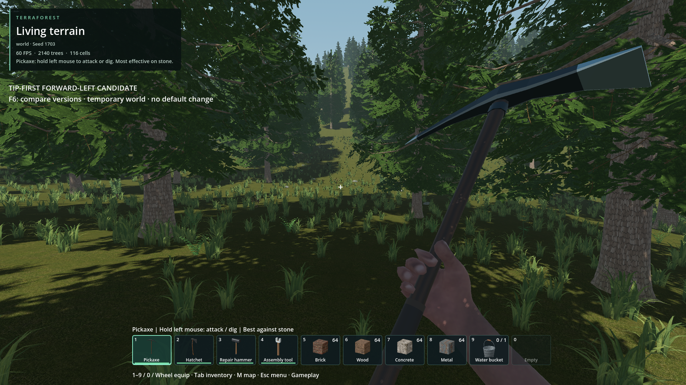
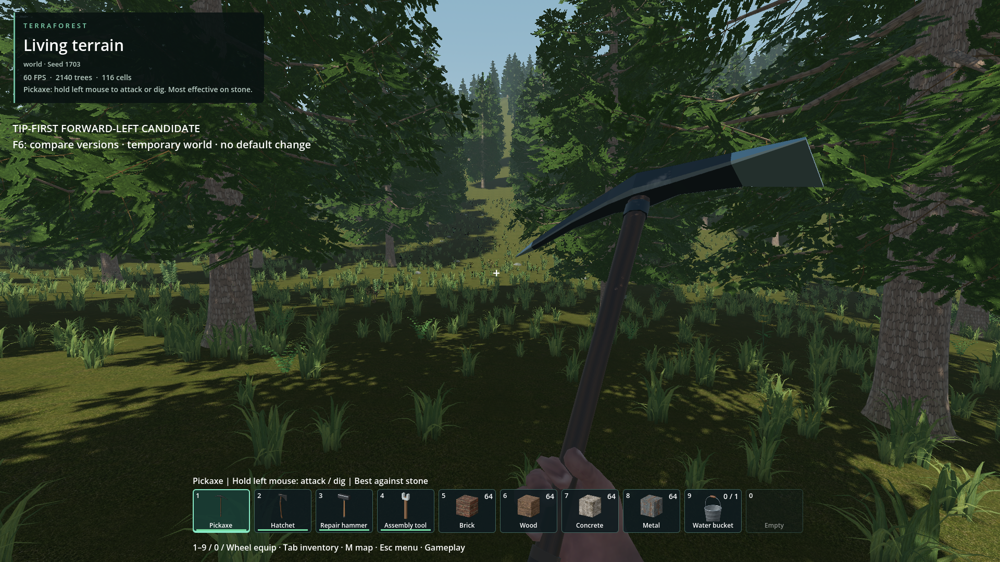
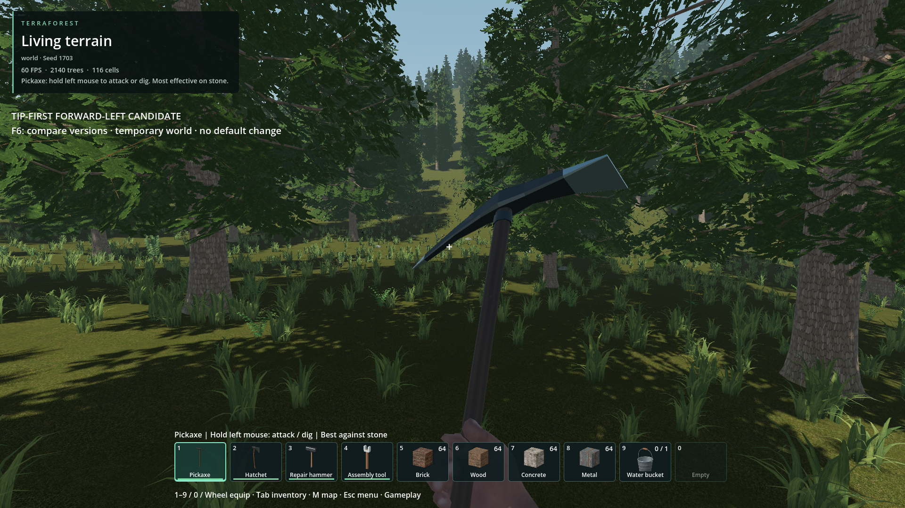
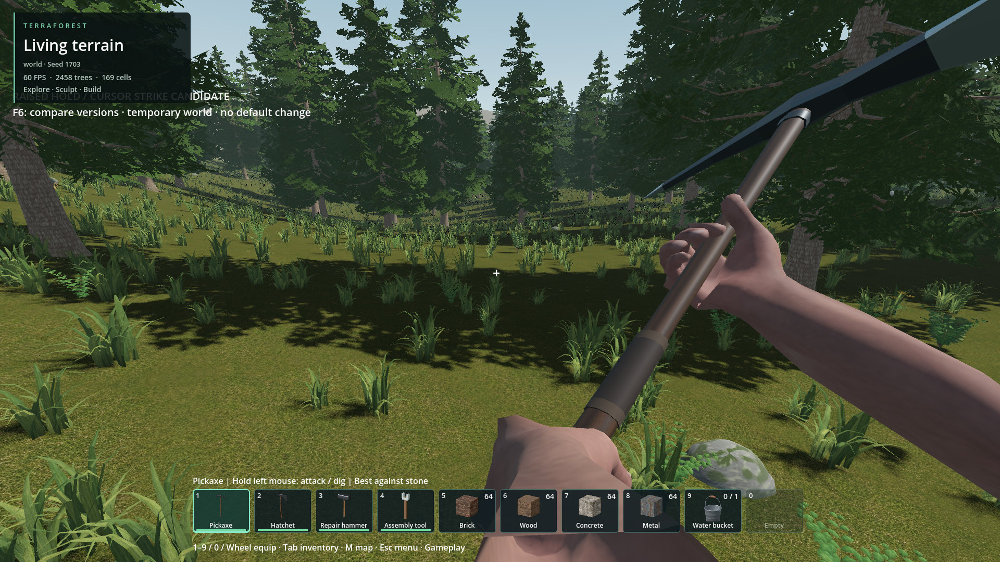
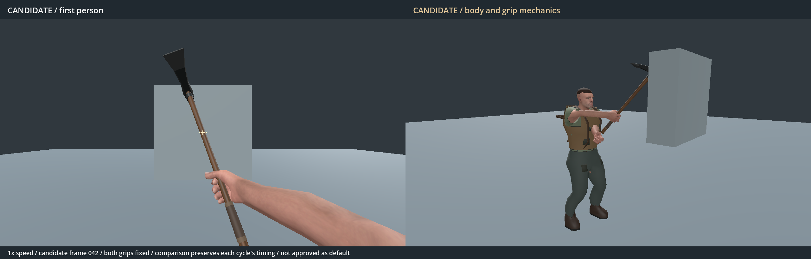

# Separate pickaxe animation study

- Status: Tip-first forward-left revision retained as an alternate. Accepted default remains selected.
- Updated: 2026-10-27. Implementation/evidence: commit adding this record.
- User review: First candidate rejected as “absolutely not what was asked or wanted.”
  User clarified the strike must travel **upper right → lower left**.
- The resulting candidate (`241a4b88`) was also not accepted after playtesting:
  the user wanted the pickaxe held higher toward the top-right corner and the
  strike aimed toward the cursor. Its impact was about 41 cm below camera center.
- The raised version (`bf81f85e`) was rejected for a foreground hand in the
  center, excessive right-side framing and motion that felt like sliding.
  The user's screenshot is retained below. Grip/contact checks missed these
  presentation problems and are not evidence of visual acceptance.
- The rotational version (`13c87bca`) was rejected for appearing to hit with
  the middle/back of the head and sweep sideways. It forced the tip onto the
  cursor while reversing screen lean, but did not qualify the working plane
  or whether the pointed end faced its impact velocity.
- The user chose to keep the current tip-first version for comparison without
  making it the default. It still does not feel as good to them; the specific
  part of the motion causing that impression has not been identified.
- Request: More diagonal holding pose and a descending strike with a firm grip;
  promote only after explicit user approval.

## Images and previews

Latest candidate in the ordinary temporary world, seed 1703, 75-degree FOV.
The supporting hand is below the frame in the ready pose; the upper hand sits
lower and the head stays in the upper-right region. The camera and model scale
are unchanged. [Same-camera accepted hold](images/tip-world-current.png).

The pointed end leads forward-left into the upper-center target area. The
socket and broad back remain behind and to the right, so the tip stays visible.
The finite-length model does not move to every possible gameplay hit distance.

The head continues down-left while both hands stay fixed on the shaft.
Pitch drives the head through a diagonal forward working plane; the shaft no
longer reverses sideways lean. Framing and weight await review.

[Latest comparison video](Pickaxe.tip-first.comparison.mp4)
and [latest first-person/body video](Pickaxe.tip-first.body.mp4).
Two swings at normal speed, one at half speed, then walking. Each version keeps
its own timing. Godot 4.7.2 Forward+, RTX 4050, 2560×820 composite. No world/seed
for these views. Source paths, status and hashes are in `images/manifest.json`.

### Earlier evidence, not accepted

First candidate straightened at impact and read as a forward chop.

Second candidate carried too low and struck below the cursor. Its original
[comparison](Pickaxe.upper-right-to-lower-left.comparison.mp4),
[body video](Pickaxe.upper-right-to-lower-left.body.mp4), and
[contact](images/revised-contact.png) remain intact. These use 4:3 panels and
a target placed at that candidate's contact, so their target mark was not a
central cursor. The latest preview uses 16:9 and an independent central crosshair.

Third candidate (`bf81f85e`): the supporting hand/forearm crowded the lower
center and the motion felt like sliding. Original [comparison video](Pickaxe.raised-cursor.comparison.mp4)
and [body video](Pickaxe.raised-cursor.body.mp4) remain intact, along with its
[hold](images/raised-hold.png) and [contact](images/raised-contact.png).

Fourth candidate (`13c87bca`): the head turned nearly end-on while the shaft
swept sideways. The user saw a middle-of-head hit, not a point-led forward-left
strike. Its [comparison video](Pickaxe.rotational-arc.comparison.mp4),
[body video](Pickaxe.rotational-arc.body.mp4) and world captures remain intact.

## Implementation and verification

Separate Blender source, GLB and AnimationLibrary: `Human.pickaxe_crosscut.*`.
The pose table uses the original R11 rig and static finger wraps; no accepted
swing keys are copied. This revision replaces the sideways lean reversal with
forward pitch in the head's working plane, from backswing through contact. The
supporting hand is lower and farther from the eye, reducing its foreground size.
Both hands stay at fixed stations, -28 cm and 0 cm along the shaft.
The right hand's closed grip is seated 30 degrees farther around the handle
for this version, keeping its elbow lower and farther from the camera. That
orientation is constant throughout the animation; neither hand slides.
It is baked at 120 Hz to keep interpolation drift small during the fast stroke.
Idle, swing, walk, run, jump and derived crouch belong to this candidate.

Ordinary runtime code and the accepted pickaxe libraries are unchanged. Only
the explicit experimental tool-view subclass selects this library. Its contact
is 0.7 seconds (frame 84 at 120 Hz), and its complete cycle is 1.6 seconds.
Gameplay remains on the existing attack/contact/cancellation pipeline.

Qualification results, per-frame measurements and preserved-default hashes are
in `qualification.json` and `verification/`. They verify scoped mechanics;
they do not establish that the new motion is visually better.

31 candidate checks cover 1,902 poses sampled at 240 Hz, including ready-view
framing, the actual skinned point leading the steel, alignment with forward-left
impact velocity, and separation from the socket in the camera view. The previous
exact-center and 75-degree arc checks were replaced because they rewarded the
rejected sideways stroke. These checks still cannot establish good feel.
Grip interpolation must remain below 1 mm / 0.3 degrees; arms must remain
within the wrist/rotation bounds. Thirteen actual-world checks cover excavation and
one durability change at contact, recovery and cancellation. The accepted
pickaxe's 11 checks and locomotion's 24 also pass. Runtime log frame-42 labels
refer to the 60 Hz pose table; the exported action uses frame 84 at 120 Hz.

## Try and compare

From TerraForest, start Godot with `--path . --script
res://tools/playtest_pickaxe_crosscut.gd -- --temporary --gameplay-construction
--ground-cover --no-zombies`. The launcher always uses temporary storage.
**F6** switches between the revised candidate and the accepted default. It
cancels an active stroke before switching. Select the pickaxe and use ordinary
movement/attack controls. Exiting does not promote the candidate or write a
player world. Launching the game normally continues to use the accepted default.

## Remaining / resume here

The user has reviewed and retained this separate version, but has not accepted
its feel. When returning to it, inspect the normal-speed windup, point contact,
follow-through and recovery beside the accepted default, then identify the
specific clip time or pose before revising it. The source character's
skin/clothing finish remains visible. Default promotion requires explicit acceptance;
passing tests, committing the study or running the comparison is not acceptance.

The first four candidates' local source snapshots remain under
`reports/pickaxe_crosscut/rejected_v1/`, `rejected_v2/`, `rejected_v3/` and `rejected_v4/`;
their retained images are in this folder. Revisions two through four are also
recoverable from `241a4b88`, `bf81f85e` and `13c87bca`.
Regenerate the revision using `tools/author_pickaxe_crosscut.py` on the original
`Human.r11.blend`, then `tools/import_pickaxe_crosscut.gd`. Render with
`tools/preview_pickaxe_crosscut.gd` (`-- --stills` for key poses), then encode
with Blender and `tools/encode_pickaxe_crosscut_preview.py`.
Capture the actual temporary-world poses with `tools/preview_pickaxe_crosscut_world.gd`.
