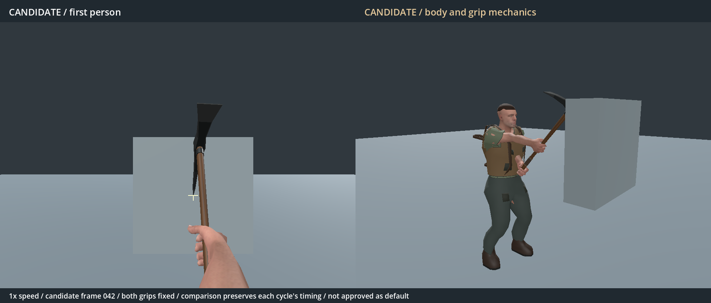
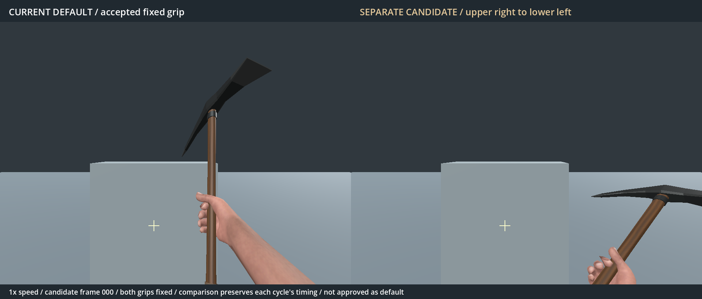
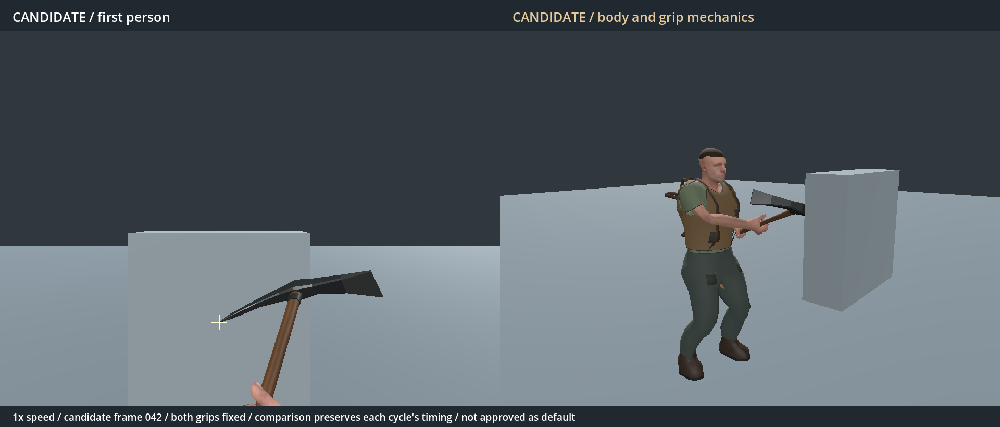
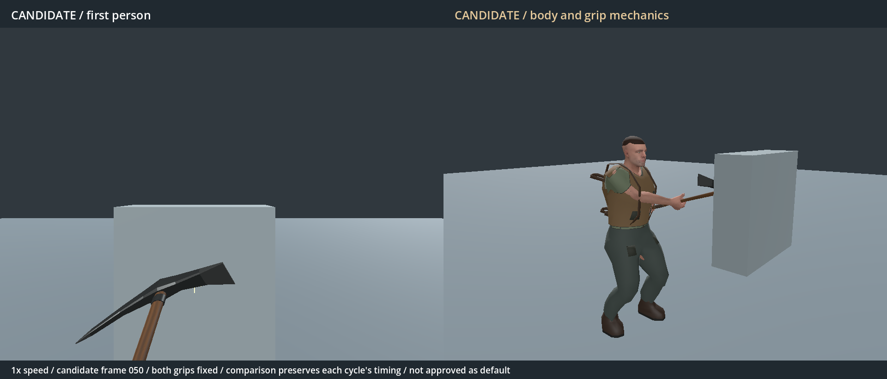

# Separate pickaxe animation study

- Status: Revised candidate, unapproved. Accepted default remains selected.
- Updated: 2026-10-26. Implementation/evidence: commit adding this record.
- User review: First candidate rejected as “absolutely not what was asked or wanted.”
  User clarified the strike must travel **upper right → lower left**.
- Request: More diagonal holding pose and a descending strike with a firm grip;
  promote only after explicit user approval.

## Images and previews

Rejected first candidate: it straightened at impact and read as a forward chop.
This is retained as failed evidence, not a candidate to promote.

Left: accepted default. Right: revised diagonal carry. Same first-person camera,
75-degree vertical FOV and neutral lighting. Original R11 model and pickaxe art.

Revised contact: the shaft stays slanted while the head descends to the left.
Right pane shows the complete body, planted stance and two fixed hand stations.

The follow-through continues down and left instead of straightening upright.
The lower hand and part of the shaft leave the bottom of the first-person view;
the body view makes that motion visible for review.

[Current versus revised video](Pickaxe.upper-right-to-lower-left.comparison.mp4)
and [first-person/body video](Pickaxe.upper-right-to-lower-left.body.mp4).
Two swings at normal speed, one at half speed, then walking. Each version keeps
its own timing. Studio fixture only; the target marks the candidate's contact
point, so it is not a geometric accuracy comparison of the accepted default.
Godot 4.7.2 Forward+, RTX 4050, 1920×820 composite. No world/seed for these views.
Source paths, status and hashes are in `images/manifest.json`.

## Implementation and verification

Separate Blender source, GLB and AnimationLibrary: `Human.pickaxe_crosscut.*`.
The pose table uses the original R11 rig and static finger wraps; no prior swing
keys are copied. The revised trajectory descends from the right shoulder across
the target, with a short follow-through and recovery to the same diagonal hold.
Both hands stay at fixed stations, -22 cm and +11 cm along the shaft.
It is baked at 120 Hz to keep interpolation drift small during the fast stroke.
Idle, swing, walk, run, jump and derived crouch belong to this candidate.

Ordinary runtime code and the accepted pickaxe libraries are unchanged. Only
the explicit experimental tool-view subclass selects this library. Its contact
is 0.7 seconds (frame 84 at 120 Hz), and its complete cycle is 1.6 seconds.
Gameplay remains on the existing attack/contact/cancellation pipeline.

Qualification results, per-frame measurements and preserved-default hashes are
in `qualification.json` and `verification/`. They verify scoped mechanics;
they do not establish that the new motion is visually better.

24 candidate checks pass across 1,902 poses sampled at 240 Hz. Maximum swing
grip interpolation error is 0.31 mm / 0.056 degrees, and wrist bend stays below
33 degrees. Thirteen actual-world checks pass, including one excavation and
one durability change at contact, recovery and cancellation. The accepted
pickaxe's 11 checks and locomotion's 24 also pass. Runtime log frame-42 labels
refer to the 60 Hz pose table; the exported action uses frame 84 at 120 Hz.

## Try and compare

From TerraForest, start Godot with `--path . --script
res://tools/playtest_pickaxe_crosscut.gd -- --temporary --gameplay-construction
--ground-cover --no-zombies`. The launcher always uses temporary storage.
**F6** switches between the revised candidate and the accepted default. It
cancels an active stroke before switching. Select the pickaxe and use ordinary
movement/attack controls. Exiting does not promote the candidate or write a
player world. Launching the game normally continues to use the accepted default.

## Remaining / resume here

User review of the descending motion, diagonal carry, grip, framing and weight
is required. The source character's skin/clothing finish remains visible.
Further pose changes should be driven by the rejected/accepted moment, camera
view and animation time. Default promotion requires an explicit acceptance;
passing tests, committing the study or running the comparison is not acceptance.

The first candidate's complete local source snapshot remains under
`reports/pickaxe_crosscut/rejected_v1/`; its retained images are in this folder.
Regenerate the revision using `tools/author_pickaxe_crosscut.py` on the original
`Human.r11.blend`, then `tools/import_pickaxe_crosscut.gd`. Render with
`tools/preview_pickaxe_crosscut.gd` (`-- --stills` for key poses), then encode
with Blender and `tools/encode_pickaxe_crosscut_preview.py`.
