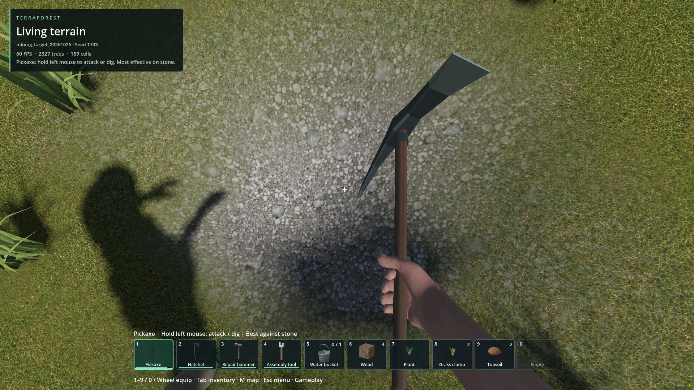
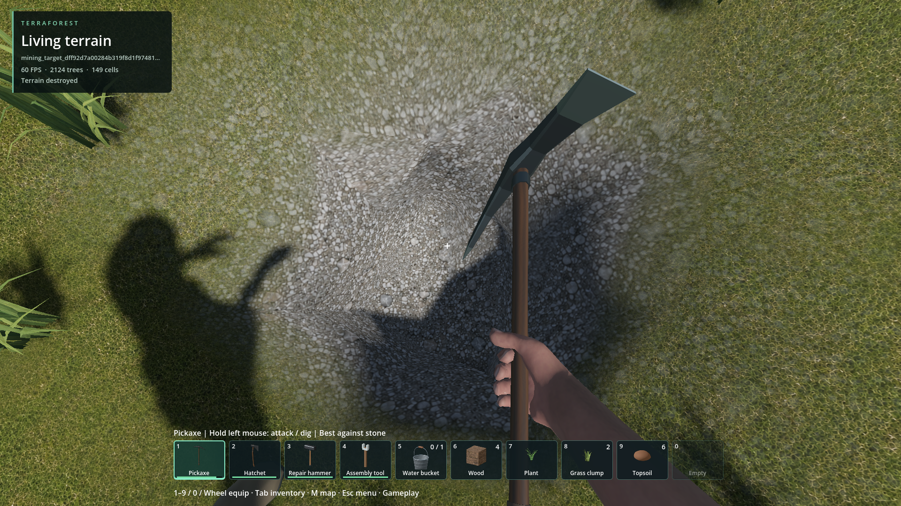

# Pickaxe hits without excavation

- **Status: Fixed for reproduced case.** Not exhaustive terrain qualification.
- Updated: 2026-10-26. Fix `72951f9e`.
- User review: No separate visual acceptance recorded for this specific repair.
- Symptom: Repeated accepted strikes at one visible surface remove nothing.

## Before / after

Calm_Meadow, seed 1703; feet (1066.871, 42.01955, 1097.791), collision hit
(1067.436, 41.87583, 1097.498). Same saved aim. Before repeatedly returned
`changed=false`; after is a packaged excavation replay, not lighting-only.

[Image provenance](images/manifest.json) and
[build/test provenance](../../docs/evidence/terrain_editing/contact_mining/qualification.json).

## Changes / verification

- The small brush missed all remaining solid lattice samples under the face.
  Native player contact mode shifts it minimally to include an exposed sample.
- Animated replay verifies density and matching collision; native checks cover
  resources, wear, empty/protected contacts and persistence.
- Developer brushes, generation, building grid and save format are unchanged.

## Remaining / resume here

- Reopen for another unmineable contact. Retain F5 pose; test actual animation,
  changed samples, collision publication and rewards. Render/focus stalls are separate.
- Code: [native terrain core](../../addons/volumetric_terrain/native/core.cpp), contact edit shape 3.
- Tests: [contact mining](../../tests/terrain_contact_mining.gd),
  [saved-target replay](../../tests/mining_saved_target.gd).

## Reproduce / evidence

`python tools/check_saved_mining.py --slot Calm_Meadow --pack`

Requires the local fixture; the harness tests a copy, never the original save.
[Cause, commands and retained failures](../../docs/evidence/terrain_editing/contact_mining/README.md).
