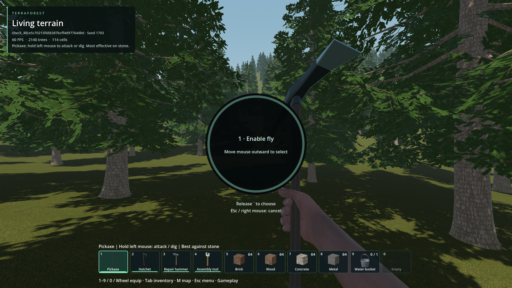
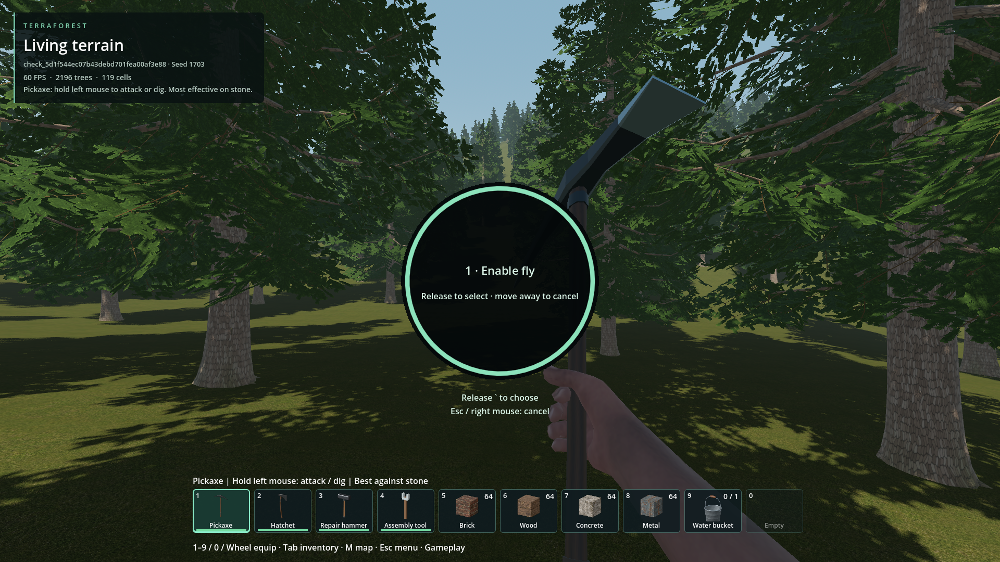

# Fly wheel initial hover

- Status: Fixed for reproduced case / scoped checks.
- Updated: 2026-10-26. Source and exported resource pack updated.
- User review: Not yet playtested by the reporting player.
- Symptom: Holding backtick puts the cursor over Fly, but releasing does nothing until the mouse moves outward.

## Images


Before, temporary seed 1703 at 1080p: cursor approximately five pixels from centre,
selection -1; releasing does not enable flight. The darker ring is unselected.


After, packaged temporary seed 1703 at 1080p: stationary centre selects Fly,
highlighted ring; release enables flight. Separate test slots, not a pixel-identical
world comparison. Original images inspected; [sources/hashes](images/manifest.json).

## Changes and verification

- Removed the single-action wheel's 48-pixel inner dead zone. The existing outer
  cancellation boundary stays unchanged; the vehicle wheel is not modified.
- Refresh selection from the current pointer on release/click, not the previous
  rendered hover state. Updated the outdated outward-motion hint.
- Actual-world source and packaged regressions pass 26 checks: stationary flight
  on/off, stale-hover release, outside cancellation, click, Escape/right-click,
  keyboard selection, short-tap developer mode and unchanged inventory.
- Full packaged ESC-priority regression and export/startup checks pass. Test worlds
  are temporary; no player save is selected or written.

Evidence: [pack result](evidence/pack.json), [pack command/build](evidence/pack-run.json),
[ESC regression](evidence/escape-pack-run.json), [baseline](evidence/before.json).
Earlier failed diagnostics remain: synthetic motion did not move the Windows
cursor, and one ESC launcher expected the wrong completion marker. One packaged
attempt lost the stationary-cursor assumption; its cause was not assigned. The
passing retry records pointer/focus/mode immediately before and after release.

## Reproduce / remaining

Hold backtick without moving the mouse; release to toggle flight. Move outside
the wheel or press Escape/right-click to cancel. A short tap still switches belts.

```powershell
python tools/run_godot_check.py player_action_hover --timeout 100 --require "PLAYER_ACTION_HOVER checks=" -- --gameplay-construction
```

Requires a graphical viewport and a stationary mouse during the initial check.
Other DPI/window configurations and player acceptance remain unreviewed. Reopen
for another focused, stationary release failure using the recorded pointer trace.

Code: [player actions](../../addons/player_runtime/player_actions.gd),
[regression](../../tests/player_action_hover.gd).
