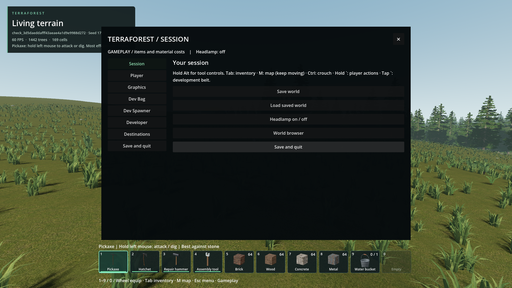
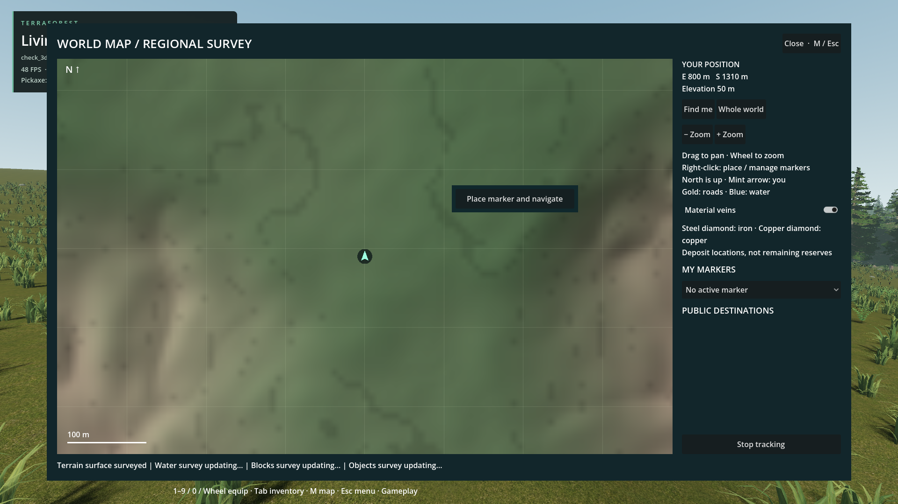
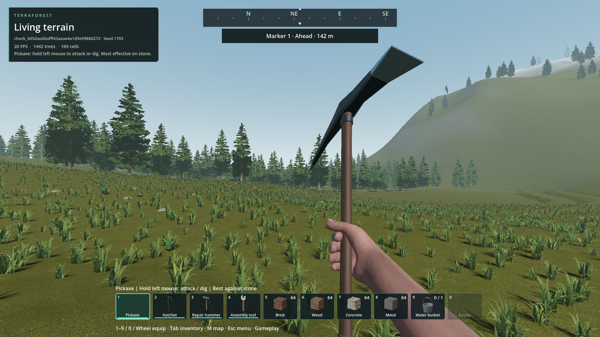

# Player navigation and menu access

- Status: Implemented and installed; six packaged suites pass, 129 assertions. User visual review pending.
- Updated: 2026-10-27. Baseline: `c7b06f5c` plus this update.

## Changes

- Live vehicle spawn moves from Dev Bag to Dev Spawner, preserving its existing single-click, no-aim spawning path. Carried vehicle inventory items remain in Dev Bag.
- ESC menu has a top-right × close button. Its former Resume sidebar button is now an additional Save and quit action, available from every page; it forwards to the same existing shutdown/save path without confirmation. The Session page keeps its original Save and quit action. ESC still closes the menu.
- Right-click the world map to place a marker and navigate. Right-click an existing marker to navigate, stop navigating without deleting it, or remove it. Left-click saved markers or select them in My markers. Creating another mark preserves older marks.
- Top-centre compass sits 28 UI units below the top, with cardinal/intercardinal bearings, a gold destination symbol and distance. Off-screen/behind destinations get an edge direction indicator. Public destination tracking still uses the same guide. This is direct bearing, not pathfinding or auto-movement.
- The map context menu is an embedded Control, not another operating-system window. ESC dismisses it before closing the map. Map walking and developer Ctrl-click teleport remain separate from player marking.

## Storage and cost

- `map_markers_v1` is a per-world archive section: 16-byte header plus 12 bytes per marker, at most 64 markers / 784 bytes. Stable identities, active selection and next identity survive restoration; missing sections default empty for old worlds. Invalid/truncated/nonfinite or duplicate-ID data is rejected transactionally.
- Mutations dirty the normal world save; F5 / Save world / normal Save and quit persist them. No global shared marker file, terrain mutation, height raycast, density rebuild, survey rerasterization or generation pass.
- Compass reads camera/player transforms, redraws only on changed bearings, and never performs terrain queries. Marker hit tests/drawing are bounded at 64 entries while the map is open; caption distance refreshes at 5 Hz only while tracking.

## Verification / remaining

- Source: 19 initial binary/bearing assertions and 38 actual-world menu/map/compass assertions passed. Actual-world checks cover right-click input after pan/zoom, older-marker management, ordinary gameplay, context ESC priority, same-world save-component restoration, camera bearings, resize, X closing, direct quit request and unchanged survey build count/terrain/inventory.
- First integration attempt failed to parse two untyped fixture locals (`20261027T090505066440Z_player_navigation`); typed them explicitly, then passed at `20261027T090543978888Z_player_navigation`. Failed evidence is preserved.
- Final package passes **129 assertions across six suites**: marker storage/bearings (22), actual-world navigation/UI (38), one-click live vehicle spawning (7), developer item/entity tools (19), Player settings (18), and existing Ctrl-click map teleport (25). Native archive publication/readback retains marker identity, position and active selection; worker validation passes. [Exact package, runtime/test hashes and report paths](verification.json).
- Main package run: `reports/checks/20261027T090927944447Z_player_navigation_pack`. The expanded 22-assertion store/disk check was rerun against the identical package at `reports/checks/20261027T091235141750Z_player_navigation_pack`. All 14 native DLL hashes match. Tests use unique temporary worlds/caches; never player saves. Successful derived test caches are removed; logs and images remain.
- User visual acceptance and additional aspect ratios/hardware remain unqualified. No automatic route planning, marker renaming or custom icons are claimed. Resume here if markers are lost across a player save/reload or a compass direction is wrong; retain exact world, view/settings and a safe copied save.

## Reproduce

1. ESC > Dev Spawner: spawn a live vehicle. Dev Bag > Vehicle still grants only an inventory item.
2. From any ESC page, use × to resume; sidebar Save and quit uses normal saving/shutdown immediately.
3. M > right-click map > Place marker and navigate. Close map; turn to align the gold symbol with the compass centre.
4. Reopen map, add another marker, right-click the older one to navigate/untrack/remove it. My markers selects retained marks. Save before leaving; reload to retain them.

Run `python tools/check_player_navigation.py --pack`.

## Images

Packaged temporary seed-1703 gameplay fixture. × resumes from any page; both quit actions forward to normal saving/shutdown.

Right-click after pan/zoom, without developer mode. [Saved marker and selector](images/map_markers.png); [live vehicle action in Dev Spawner](images/dev_spawner.png).

Same temporary world, camera facing the mark. [Behind-you edge indicator](images/compass_behind.png). These unprepared temporary-world scenes qualify UI behavior, not settlement/world quality. Synchronous captures and streaming affect the HUD FPS number; these are not performance benchmarks.

All captures are unedited: [paths, settings and hashes](images/manifest.json).
