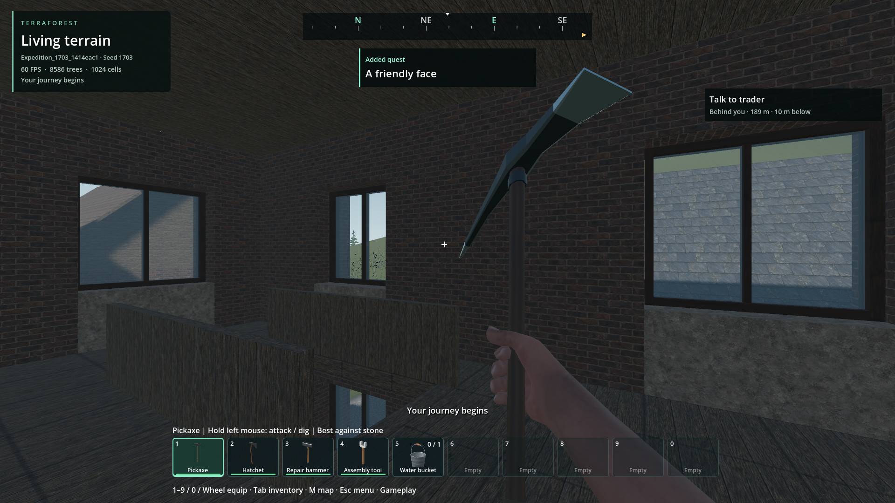
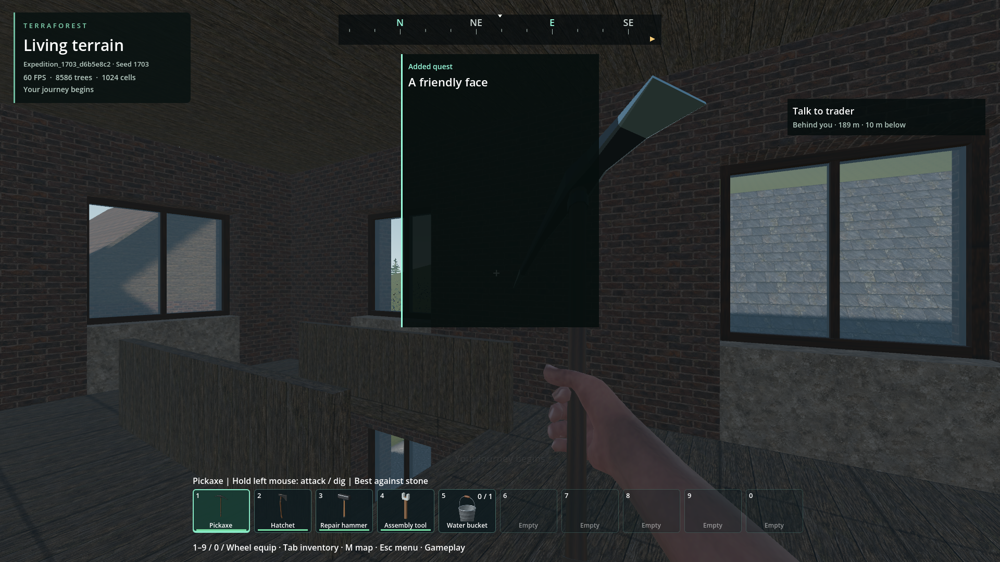

# Player notices and active objective

- Status: Implemented and installed; scoped packaged verification passes.
- Updated: 2026-11-02. User visual review: pending.
- Scope: the requested HUD additions only; no gameplay-HUD performance rewrite.
- Build: changes based on `39f97200`; installed pack `fcafbcee...9360a`.

## Changes

- Animated Added quest card below compass, after the approved wake animation
  returns to the selected item. Focus interruption queues it for return; ordinary
  reloads do not replay it. Accepting the expedition also queues a notice.
- One brief general notice above the toolbar; newer messages replace older ones.
- Compact active objective and smaller guidance text at upper right.
- Notices ignore mouse input, pause behind menus/map/trade/loading, deduplicate
  quests, bound their queue to four, and stop processing when empty.

## Images

Installed build, normal default Frontier expedition / seed 1703, upstairs C1
first spawn after the approved wake returns to the pickaxe. The quest card and
upper-right objective are normal runtime events. The fixture emits the example
general message "Your journey begins" through the same runtime notice API.
1920×1080 Forward+, 60 FPS; visually inspected, not yet player-approved.

Earlier source trial, same seed and upstairs view but a separate generated world.
Rejected: wrapped title layout stretched the card down the screen. Corrected by
bounded title overflow and resetting panel height; compactness is regression-tested.
The general message was also captured at the start of its fade, not full opacity.

See [manifest](images/manifest.json) for original paths, hashes and provenance.
Images remain excluded from imports/exports by `issues/.gdignore` and export rules.

## Verification / remaining

- Installed notice behavior: 12 checks,
  `reports/expedition_motion/20261102T121552585078Z`.
- Installed wake completion / selected-item return: 25 checks,
  `reports/expedition_motion/20261102T121553524830Z`.
- Installed guidance: 7 checks,
  `reports/expedition_motion/20261102T121556046493Z`.
- Actual installed executable, normal Generate & play and durable close: 12 checks,
  [final capture run](../../reports/frontier_expedition/20261102T122547219827Z/run.json).
  51 buildings, 12 lakes; no pointer capture, engine error or leak diagnostic.
- Fresh-process installed reload: 10 checks,
  [receipt](../../reports/frontier_expedition/20261102T121524200377Z/run.json).
  Quest/inventory bytes match; waking and Added quest do not repeat. This reopens
  the preceding same-package notice fixture `20261102T121316659988Z`.

Pack SHA-256: `fcafbcee37ecb0eb33a94c7efcf162d0b93b2a8822064b09755167ad39a9360a`.
Root executable unchanged: `981c1a194797a3ebb3153b5e5ece7bcfc6573e874f4cd6250ed120d309b511a5`.
All 14 native DLLs match. Only owned test saves are created/changed. Early rendered
checks sampled the previous notice's opacity before the new fade; the final
fixture waits for the new notice's age as well as visibility/opacity.

The initial full source route run `20261102T114941576580Z` passed 190 functional
checks but failed cleanup under a rejected resource-loader trial. It remains a
failed run, not packaged route requalification. Current startup loading/cancellation
and clean teardown evidence are in [the browser tracker](../browser-responsiveness/README.md).

Reproduce: generate the default Frontier expedition, wait for waking, then follow
the upper-right trader objective. Open/close inventory while a notification is
active. Save and reload: the introduction notice must not repeat.

Player death/respawn lifecycle remains separate unfinished work; this change
does not complete that feature or change the approved wake animation asset.
Return on player appearance feedback or when adding the death/respawn lifecycle;
require a real death-to-respawn notice/selected-item check rather than inferring
it from initial spawning. Broader resolutions and localization are unqualified.

Code: [notice presenter](../../addons/player_runtime/player_notices.gd),
[wake completion](../../addons/player_runtime/entry_fly_in.gd),
[objective summary](../../addons/player_runtime/destination_guide.gd).
