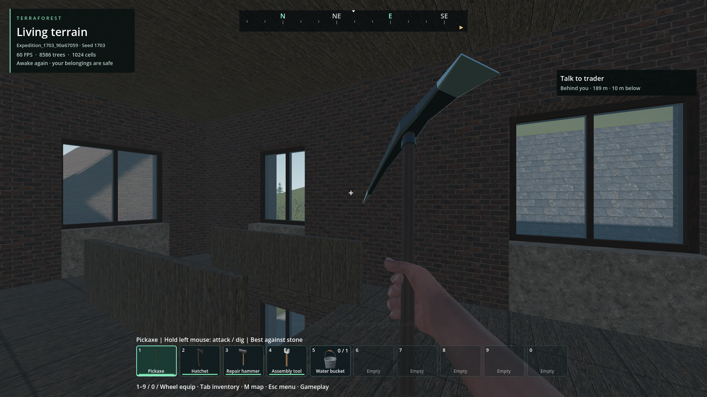

# Persistent player respawn

- Status: Implemented / scoped source and package checks; not universal terrain recovery.
- Updated: 2026-11-02.
- User review: The reused five-second first-person motion is approved; death/balance needs playtest.
- Symptom: Zombie damage only accumulated a diagnostic number; approved waking had no death lifecycle.

## Changes and verification

- Native 56-byte health/shelter/death-count record; validated restore, legacy empty default.
- Actual zombie and explosion target damage reduces 100 health. Death disables movement,
  attacks and terrain/object edits; respawn restores health, retaining inventory/progression.
- New generation saves its introductory upstairs anchor. Old saves retain their current
  location and adopt the first supported, dry, clear on-foot position, not an invented house.
- Two-second active-time delay, streamed collision readiness, capsule/support/water checks;
  blocked shelter tries 48 nearby positions, then surface fallback. No noclip admission.
- Vehicle occupancy and passenger presentation release before returning. Approved wake runs
  once and restores the selected item. Menus/focus/loading suspend the death delay.
- Native checks: `reports/checks/20261102T141855366253Z`; source read-only fatal-hit,
  interrupted restore, obstacle fallback and unchanged inventory/world hash:
  `reports/menu_transition/20261102T143817139626Z`.
- Source actual compound save and fresh-process health/shelter restore:
  `reports/frontier_expedition/20261102T143913478527Z` and `20261102T144220810309Z`.
- Packaged lifecycle/obstruction: `reports/menu_transition/20261102T144551404249Z`.
  Packaged selected-item wake and notices: `reports/expedition_motion/20261102T144719343110Z`
  and `20261102T144723079934Z`. Zero pointer captures; clean shutdown.
- New packaged generation: `reports/frontier_expedition/20261102T144748533257Z`.
  Its actual upstairs anchor is saved before first play. Health 87 and exact shelter
  survive ordinary save and a fresh process; fatal damage returns upstairs, plays
  waking once and preserves inventory: `20261102T145202791226Z` / `20261102T145238142464Z`
  in the same report folder (11 / 14 checks).
- Moving-driver and service-passenger occupancy release passes the existing vehicle
  fixture: `reports/checks/20261102T145932188694Z`. The earlier wrapper failure
  `20261102T145313390842Z` requested the wrong success token; all assertions passed.
  This fixture does not qualify a full physical trader journey interrupted by death.
- Installed PCK: `5b8c7c631d8ada051fa09e86af4563ccfb372bf8e83f025d83149832e0638920`,
  471,060,252 bytes, all 14 native libraries match. Player saves and root executable unchanged.
- The actual root `TerraForest.exe` also passes all 19 native health assertions
  (`reports/player_life_release/`), then repeats ordinary health save and fresh-process
  upstairs death/respawn: `reports/frontier_expedition/20261102T150450107360Z` and
  `20261102T150615762641Z`. These supplement the Godot-hosted package checks above.

## Images and scope

After: new default Frontier expedition, `Expedition_1703_90a67059`, seed 1703,
1920×1080 Forward+, 60 FPS. Fresh-process restored shelter after fatal damage and
approved waking; selected pickaxe and inventory retained. Stairs/window roofs verify
the upstairs location. Inspected engineering evidence, not new user visual approval.
Unedited capture and inherited asset provenance: [manifest](images/manifest.json).

The initial legacy test receipt incorrectly called its anchor "upstairs": that owned
fixture had already travelled roadside. Its assertions prove return to the saved safe
anchor, not indoor generation. The screenshot at
`reports/frontier_expedition/20261102T144220810309Z/respawn-upstairs.png` is retained
with this correction. New test labels distinguish persisted anchors from new-world starts.

## Remaining / resume here

Nearby search is bounded; entirely obstructed/flooded arrival regions report unavailable
instead of placing through geometry. Broad catastrophic terrain destruction, fatal moving
passenger/driver integration, foreground feel and healing/death-penalty balance remain
separate qualification. Return with owned-world obstruction/vehicle scenarios and durable
save/reopen evidence. Neither resource budgets nor this lifecycle prove seamless loading.

## Reproduce

Use `tools/check_menu_transition.py --pack --respawn` for read-only actual damage,
normal respawn and a blocked-anchor repeat. `tools/check_frontier_expedition.py`
has `life_save` / `life_reload` stages restricted to owned Expedition report worlds.
Never use player saves as mutation fixtures.
