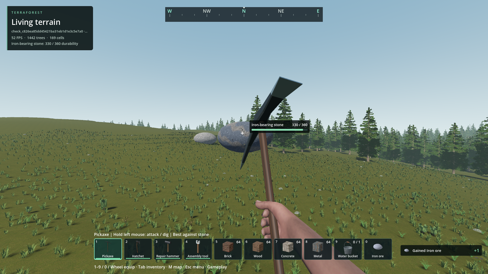
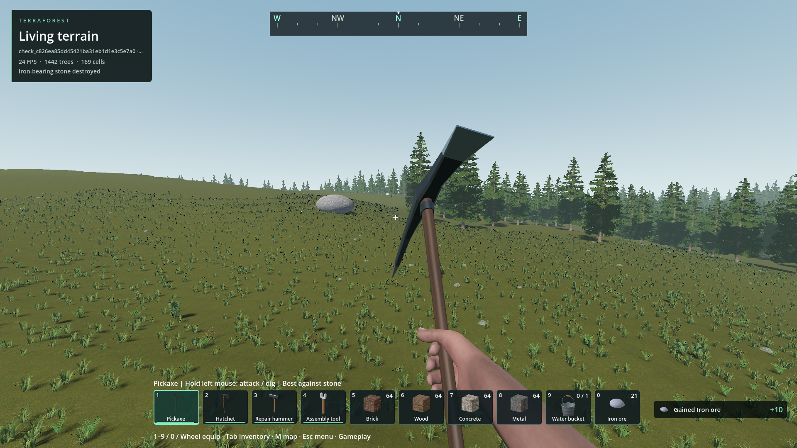

# Resources while harvesting, not only on destruction

- Status: Implemented; scoped native/package checks pass. Player balance/feel review pending.
- Updated: 2026-10-27. Baseline: `d21a09c9` plus this change.
- Cause: natural-object attacks previously only granted resources through the final removal path; ordinary damaging hits updated health and tool wear only.

## Changes

- Native durability now quotes and grants damage-proportional resources at the existing animation contact. Matching pickaxe/hatchet hits grant one item per hit; weaker tools accumulate actual damage toward a whole item. More weak hits cannot multiply a node's yield.
- Final contact grants the normal damage unit, an extra finishing unit and the original destruction reward. Current fresh-node totals:

| Natural resource / appropriate tool | Surviving hits | Final hit | Total |
| --- | --- | --- | --- |
| Tree / hatchet | 2 × 1 wood | 6 wood | 8 wood |
| Iron/copper stone / pickaxe | 11 × 1 matching ore | 10 ore | 21 ore |
| Large boulder / pickaxe | 7 × 1 stone | 26 stone | 33 stone |
| Small stone / pickaxe | 1 stone | 2 stone | 3 stone |
| Low bush / hatchet | 1 bush item | 2 bush items | 3 bush items |
| Woody bush / harvesting strike | 1 wood | 3 wood | 4 wood |

- Other natural plants/twigs retain their catalog material identity and use the same bounded contact path. Ordinary E pickups retain their original payout. Terrain-volume mining keeps its existing per-edit receipts unchanged.
- Player-authored vegetation and repairable/built objects do not receive the new per-hit rewards. Repairs cannot restart a natural-resource reward cycle. Live identity guards reject destroyed/unloaded targets and stale repeated contacts.
- Full inventory rejects a paying hit without consuming health or tool wear. Final-contact preflight includes both rewards; failed actual removal restores provisional damage/items. Normal boulder fractures, tree felling and destruction remain authoritative.
- Native accounting reuses saved sparse damage; no new save format, terrain scan, polling node, bake or shader pass. Old partial saves pay only newly applied damage, not previous damage retroactively.

## Images

Actual packaged 1920×1080 captures, seed 1703 / generator 23, isolated temporary world. An elevated iron-stone fixture makes targeting independent of surrounding vegetation; its floating position is test-only, not generated stone placement. First view shows 330/360 health and +1 ore; final view shows the removed model and +10 ore. Later strikes are accelerated direct calls, not a manual swing-rate or frame-performance demonstration. Image sources/hashes are in `images/manifest.json`.

## Verification

- **130 packaged assertions pass**, plus **15 separate release-library assertions**. See [verification.json](verification.json) for package/native/test hashes and retained reports. Checks cover real animation contact and its duplicate guard, both mineral materials, natural trees/stone/bushes, full inventories, failed-removal rollback, stale targets, boulder fractures, actual save and fresh-process reload.
- Native checks cover old snapshot compatibility, overkill, weak-hit totals, invalid items/settings, stale revisions and full-bag atomicity. No paid damage is replayed after restore.
- Current-machine synthetic sample: 1,000 paying hits among 10,000 damaged nodes took 55.186 ms in the packaged debug-native test and 68.438 ms in the separate release-library run. Includes GDScript looping and 32-slot snapshot retrieval; not isolated C++ timing or a frame-rate guarantee. Actual mineral nonfatal adapter calls measured 0.468–1.926 ms in this run, including inventory/HUD work.
- Failed/unreviewed checks remain retained: early new-test parse error (`102538614952Z_player_navigation`); natural-cover fixtures selected before post-felling reconciliation (`102609006972Z_player_navigation`, `102742792311Z_player_navigation`). The corrected test waits for available live targets instead of changing game readiness rules.
- Broader legacy `world_attack` run (`reports/checks/20261027T103155093038Z`) passed 79 of 80 assertions but found no ready natural-cover fixture after its fixed 30-frame wait. It is **not** a passing suite. Its block/furniture/repair/terrain checks ran; dedicated new packaged checks separately exercise natural cover. Keep that fixture-readiness failure visible for future harness work.
- Player saves were not opened or changed. Boulder persistence uses only the runner's unique `fracture_check_` slot. Successful player-navigation caches are pruned by their owner; failed fixtures/logs/images remain.

## Remaining / resume here

- Player review of reward amounts and ordinary swing feel is pending. Test a natural ore stone with a pickaxe, tree with a hatchet and boulder through all fractures; confirm small immediate gains and a clearly larger finishing gain. Weak/nonmatching tools intentionally need enough accumulated damage for a whole item.
- No exhaustive hardware, multiplayer or long survival-economy qualification is claimed. Resume balance edits in `addons/player_runtime/durability_catalog.gd` / `world_attack.gd`; accounting lives in `native/durability.cpp`. Do not turn repairable objects or authored plants into infinite resource loops.
- Reproduce: `python tools/check_player_navigation.py --pack --checks harvest_hit_native attack_durability harvest_hits_world`, `python tools/check_material_deposits.py --pack --checks material_deposits_world`, and `python tools/check_boulder_fracture.py --pack`.
- Release check: `python tools/test_native_release.py --godot <Godot executable> --addon player_runtime --test harvest_hit_native`. Legacy fixture follow-up needs readiness-aware selection and a passing complete rerun, not a hidden skip.
