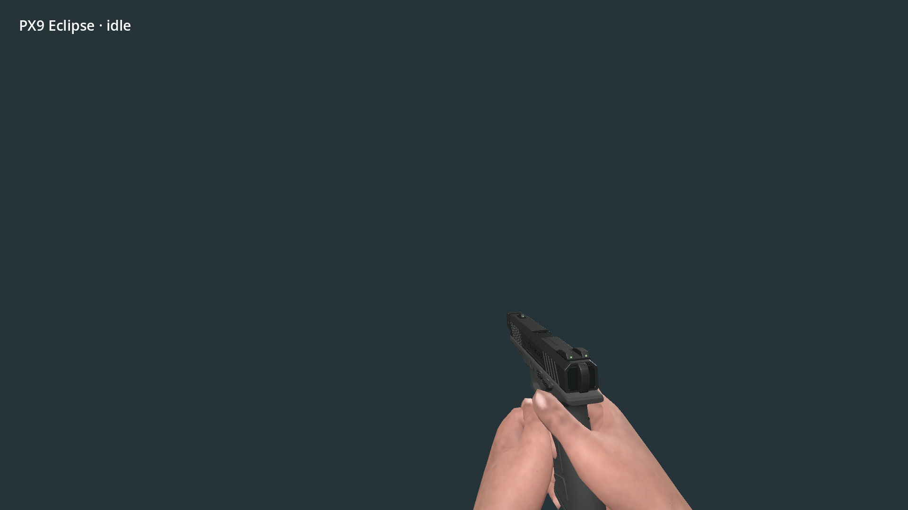
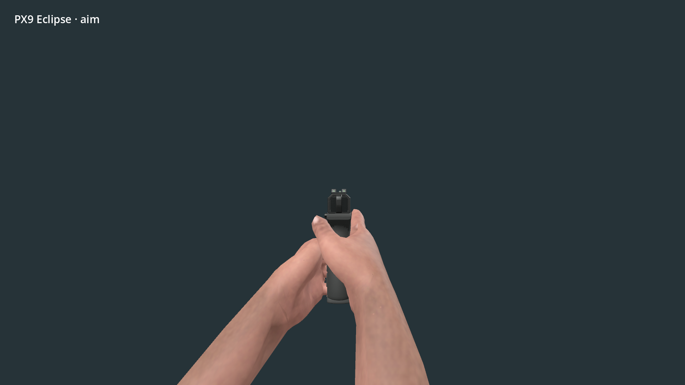
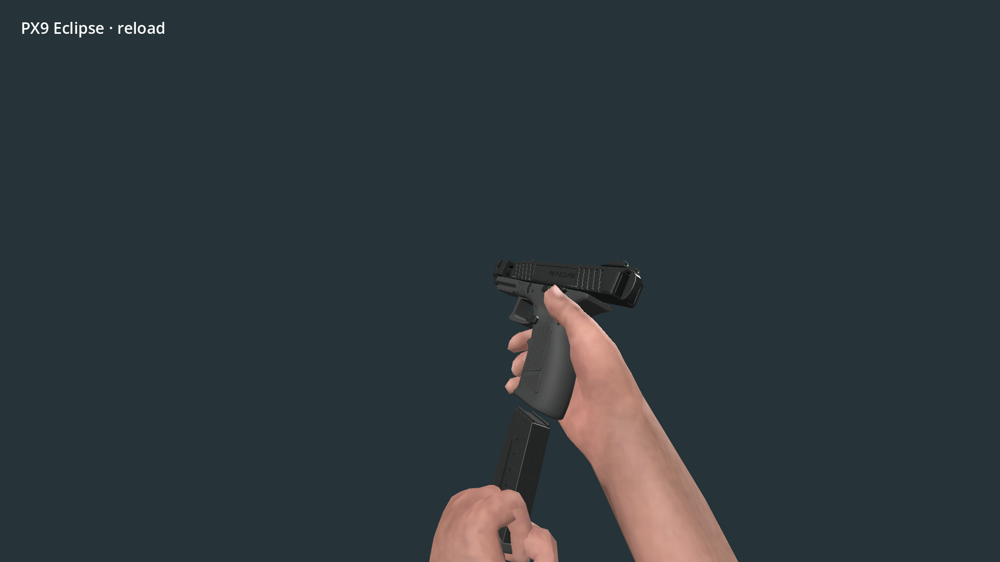

# PX9 Eclipse handgun integration

- Status: Integrated in isolated source worktree / player review pending.
- Updated: 2026-11-09. Branch: `codex/px9-handgun`.
- User review: Not reviewed in TerraForest.
- Symptom: Supplied high-quality handgun and paired animations were absent from the live item/combat systems.

## Images

Actual host first-person idle, neutral studio background, Godot 4.7.2 Compatibility, 75-degree camera. Engineering preview.

Same host/settings, paired aimed hold; sights near screen center. This is not a world-scene capture.

Same host/settings, empty reload at frame 46. Actual separate magazine rig and corrected hand mesh.

[Rack preview](images/rack.png) retains the supplied frame-44 release pose for user review.
Image sources, hashes and camera limits: [manifest](images/manifest.json).

## Changes and verification

PX9 is shared catalog item 9; cartridges are 228. Find both through Dev Bag search `PX9`, crafting or traders. Left mouse fires one shot, right mouse aims, R reloads, I inspects, G uses the universal drop path. Fifteen-round native magazine saves independently from both rifles; snapshots v1–v3 load with an empty pistol magazine.

The unchanged portable CC0 adapters sample all 20 paired body/weapon clips on one clock over existing lower-body locomotion. Equip applies the supplied hand-skin variant; holster restores the original body. Reload completion uses the existing host transaction and cancellation gates. Shot SFX reuse `Pistol Shot 1 - Kaino.wav`; magazine-out plays `Magazine Reload 1 - Kaino.wav`. These are existing project recordings under their retained terms; there are no newly imported sounds.

[Verification and exact logs](verification.json): paired handgun 60, temporary-world gameplay 14, existing combat 79, native release combat 56, universal drop 454, physical drop 79, graphical G-key 32, all zero failures. Debug/release player-runtime DLLs rebuilt. Credits freshness passed. Source behavior was tested on 022b83f2, then the isolated checkout fast-forwarded to the performance checkpoint 64eb3cc7. No installed PCK was changed.

Source intake: [package identity/provenance](../../addons/characters/runtime/px9/PROVENANCE.json), [retained source notices](../../addons/characters/runtime/px9/SOURCE_NOTES.txt), complete CC0 license and editable Blender source retained beside the runtime assets. New host code is 0BSD; the new silhouette icon is CC0.

## Remaining / resume here

User art acceptance and third-person visual qualification remain open; inspect in actual gameplay after selecting the handgun. No dedicated third-person motion set is claimed: the supplied upper-body layer runs over host legs. A dedicated third-person pass is only needed if that review rejects the shared pose. Return with screenshots/video and verify grip, shoulders and transitions before closing that requirement.

Dry-fire, rack and holster have animation but no dedicated selected recording. Add those only when suitable existing or admitted sounds are available; verify event timing by listening. Shot/audio starts at host trigger as with the existing rifles; authored shot/casing signals remain available, but no new physical shell simulation or independent muzzle-light system is added.

World drops intentionally use the standard parcel fallback. Loaded rounds remain per weapon type, matching existing rifles; dropping a gun does not attach its magazine to that individual inventory stack. Old executables cannot read the new v4 combat snapshot. Packaging/export validation remains a separate milestone: run normal preflight and packaged firearm/drop/save checks before installing a build.

## Reproduce / history

Open this worktree's `TerraForest/project.godot`, enter a temporary world, obtain PX9 and PX9 cartridges from Dev Bag or crafting, switch to gameplay belt, equip, reload and fire. Inspect loaded/empty reloads, aiming, final-round lock-open, tool switches and G/recollection. Existing player saves are not required for tests.

Run `godot --headless --path TerraForest --script res://tests/px9_handgun.gd` and `res://tests/px9_world.gd` for focused checks. G-key regression requires a graphical window; headless mouse capture cannot satisfy its input contract. Earlier failed attempts and the final passing evidence are described in verification.json.

## Live first-person grip correction — 2026-11-09

User rejected the live grip in [this screenshot](images/user-rejected-grip.png).
The previous studio preview omitted `first_person_meshes.gd`. Its split renderer
continued drawing the old arms alongside the new full corrected mesh, producing
the apparent extra/deformed fingers. The fix supplies offline body/arm subsets
of the PX9 skin and registers dynamically equipped weapon meshes for the existing
first-person depth renderer. Variant registrations are bounded across re-equips.

[Corrected renderer preview](images/live-renderer-grip.png) uses that split renderer
after 180 live animation updates. The new regression fails on the old renderer
(61/62) and passes with the correction (62/62). The earlier speculation about
competing animation players was disproved by the finger-rotation test; no such
animation rewrite was retained. User gameplay re-review remains pending.
