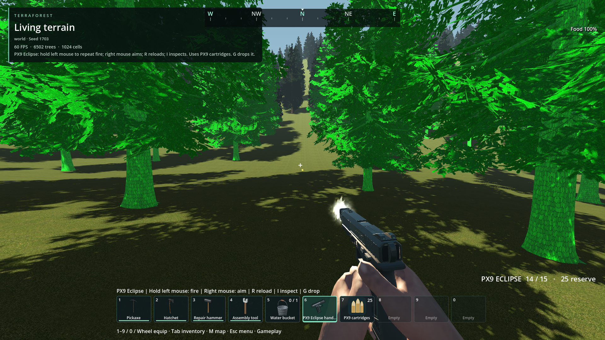

# PX9 Eclipse handgun integration

- Status: Integrated in isolated source worktree / player review pending.
- Updated: 2026-11-09. Branch: `codex/px9-handgun`.
- User review: Not reviewed in TerraForest.
- Symptom: Supplied high-quality handgun and paired animations were absent from the live item/combat systems.

## Images

Actual host first-person idle, neutral studio background, Godot 4.7.2 Compatibility, 75-degree camera. Engineering preview.

Same host/settings, paired aimed hold; sights near screen center. This is not a world-scene capture.

Same host/settings, empty reload at frame 46. Actual separate magazine rig and corrected hand mesh.

[Rack preview](images/rack.png) retains the supplied frame-44 release pose for user review.
Image sources, hashes and camera limits: [manifest](images/manifest.json).

## Changes and verification

PX9 is shared catalog item 9; cartridges are 228. Find both through Dev Bag search `PX9`, crafting or traders. Hold left mouse to repeat fire, right mouse aims, R reloads, I inspects, G uses the universal drop path. Fifteen-round native magazine saves independently from both rifles; snapshots v1–v3 load with an empty pistol magazine.

The unchanged portable CC0 adapters sample all 20 paired body/weapon clips on one clock over existing lower-body locomotion. Equip applies the supplied hand-skin variant; holster restores the original body. Reload completion uses the existing host transaction and cancellation gates. Shot SFX reuse `Pistol Shot 1 - Kaino.wav`; magazine-out plays `Magazine Reload 1 - Kaino.wav`. These are existing project recordings under their retained terms; there are no newly imported sounds.

[Verification and exact logs](verification.json): paired handgun 60, temporary-world gameplay 14, existing combat 79, native release combat 56, universal drop 454, physical drop 79, graphical G-key 32, all zero failures. Debug/release player-runtime DLLs rebuilt. Credits freshness passed. Source behavior was tested on 022b83f2, then the isolated checkout fast-forwarded to the performance checkpoint 64eb3cc7. No installed PCK was changed.

Source intake: [package identity/provenance](../../addons/characters/runtime/px9/PROVENANCE.json), [retained source notices](../../addons/characters/runtime/px9/SOURCE_NOTES.txt), complete CC0 license and editable Blender source retained beside the runtime assets. New host code is 0BSD; the new silhouette icon is CC0.

## Remaining / resume here

User art acceptance and third-person visual qualification remain open; inspect in actual gameplay after selecting the handgun. No dedicated third-person motion set is claimed: the supplied upper-body layer runs over host legs. A dedicated third-person pass is only needed if that review rejects the shared pose. Return with screenshots/video and verify grip, shoulders and transitions before closing that requirement.

Dry-fire, rack and holster have animation but no dedicated selected recording. Add those only when suitable existing or admitted sounds are available; verify event timing by listening. Shot/audio starts at host trigger as with the existing rifles; authored shot/casing signals remain available, with the muzzle burst and light now starting at that same accepted-shot boundary. No new physical shell simulation is added.

World drops intentionally use the standard parcel fallback. Loaded rounds remain per weapon type, matching existing rifles; dropping a gun does not attach its magazine to that individual inventory stack. Old executables cannot read the new v4 combat snapshot. Packaging/export validation remains a separate milestone: run normal preflight and packaged firearm/drop/save checks before installing a build.

## Reproduce / history

Open this worktree's `TerraForest/project.godot`, enter a temporary world, obtain PX9 and PX9 cartridges from Dev Bag or crafting, switch to gameplay belt, equip, reload and fire. Inspect loaded/empty reloads, aiming, final-round lock-open, tool switches and G/recollection. Existing player saves are not required for tests.

Run `godot --headless --path TerraForest --script res://tests/px9_handgun.gd` and `res://tests/px9_world.gd` for focused checks. G-key regression requires a graphical window; headless mouse capture cannot satisfy its input contract. Earlier failed attempts and the final passing evidence are described in verification.json.

## Live first-person grip correction — 2026-11-09

User rejected the live grip in [this screenshot](images/user-rejected-grip.png).
The previous studio preview omitted `first_person_meshes.gd`. Its split renderer
continued drawing the old arms alongside the new full corrected mesh, producing
the apparent extra/deformed fingers. The fix supplies offline body/arm subsets
of the PX9 skin and registers dynamically equipped weapon meshes for the existing
first-person depth renderer. Variant registrations are bounded across re-equips.

[Corrected renderer preview](images/live-renderer-grip.png) uses that split renderer
after 180 live animation updates. The new regression fails on the old renderer
(61/62) and passes with the correction (62/62). The earlier speculation about
competing animation players was disproved by the finger-rotation test; no such
animation rewrite was retained. User gameplay re-review remains pending.

## Running/jumping glitch diagnosis - 2026-11-09

Initial diagnosis: Reproduced before correction; see the following correction entry.
The physics-driven diagnostic uses the real human presentation and split renderer.
In one running jump it selects jump at frame 45, switches back to run while
still airborne at frame 68 (vertical speed 0.33), then restarts jump at frame 71
(vertical speed -0.67). The weapon/hands leave the view in the second capture.
The airborne test incorrectly depends on abs(vertical velocity) > 0.5, so the
apex is treated as running. Jump is also a one-shot returning to idle; longer
flights can restart it. A separate running-only defect has not yet been isolated.

Evidence: [apex](images/motion_068.png), [restarted jump](images/motion_071.png),
[log](logs/px9-motion-diagnostic.log), [diagnostic source](motion_diagnostic.gd).
Fix/resume trigger: proceed with locomotion-state correction after this diagnosis
is reviewed. Verify one jump presentation per airborne interval, stable apex,
landing transitions, longer falls, and running-only continuity in gameplay.

## Running/jumping correction - 2026-11-09

First-person PX9 movement now uses grounded state throughout flight, not a
vertical-speed threshold. Its single jump clip holds its endpoint until landing
instead of returning to idle and restarting. Sprint selection uses horizontal
speed only. The base layer retains animated legs with the original Idle root/hip
baseline and leaves the upper body to the paired weapon clock. This also removes
generic jump root motion that drove the torso through the first-person camera.
Third-person base animation is retained; broader third-person review remains open.

Physics-driven short and long jumps both produce exactly one jump start and one
landing, with 118 held-endpoint frames in the long flight and no failures. Root/hip
poses are checked throughout 400 frames, including continuous running. Existing
handgun checks pass 62/62. Graphical apex/descent/long-flight views were inspected:
[apex](images/motion_fixed_068.png), [descent](images/motion_fixed_071.png),
[long flight](images/motion_fixed_250.png). Prior rejected captures are retained.
Run tests/px9_locomotion.gd for the physics regression and optional graphical
captures. User feel/visual review remains pending in the actual game.

## Held-trigger firing - 2026-11-09

PX9 now repeats fire while left mouse is held, using the shared combat trigger
path and existing interval/recoil admission. Releasing the button stops repetition;
menus, equip actions and reloads retain their existing gates. HUD and item help
now describe holding the button. This supersedes the initial semi-auto input.

Temporary-world regression passes 18/18, including held fire, release and menu
blocking: [log](logs/px9-held-trigger.log).

## Empty-magazine locomotion - 2026-11-09

Fixed: empty ammunition previously selected idle_empty regardless of movement.
The host now builds paired walk_empty/run_empty/jump_empty variants at equip:
human and weapon-root locomotion retain the supplied authored motion, while
mechanical part tracks hold the supplied idle-empty lock-open pose. Source asset
files are untouched. Empty jumping retains the same hold-until-landing behavior.

The 400-frame physics regression passes loaded and empty, including walking,
running, short/long jumps, exact slide-position retention throughout empty motion,
and no movement interruption at the apex. Paired-action/reload/holster checks pass
68/68. The [rendered empty moving pose](images/empty-moving.png) was inspected.
Logs are retained in logs/px9-empty-*.log and logs/px9-loaded-motion.log. Reproduce
with tests/px9_locomotion.gd -- --empty. User gameplay review remains pending.

## Reload/aim priority during held fire - 2026-11-09

Reload can now interrupt PX9 recoil, dry fire and aim transitions with a short
paired-pose blend; it still cannot interrupt holster or an existing reload.
Combat continues to block shots while reload is active. Held shooting waits for
a requested aim-in/aim-out transition before admitting the next round, preventing
recoil from continually taking that transition slot. Movement clips and inherited
source animation data are unchanged. User feel re-review remains pending.

Validation: temporary-world checks 23/23 and paired handgun checks 68/68 pass.
The world regression sends held left/right mouse events, observes aim-in/aim-out
and aimed recoil, starts reload with the trigger held, verifies zero reload-time
shots and resumed fire after completion. Logs: [world](logs/px9-action-priority.log)
and [paired presentation](logs/px9-priority-handgun.log). An initial GDScript type
inference compile error was corrected with an explicit bool before these reruns.

## Automatic empty reload - 2026-11-09

An equipped empty PX9 now reloads automatically when matching reserve rounds are
available. Last-shot recoil finishes first; no further click or held trigger is
required. Triggering an empty gun no longer requests the dry-fire animation.
Without reserve ammunition it remains in its normal empty locomotion/aim pose,
without repeated reload attempts or animation triggers. Empty-reserve inventory
checks are throttled to four per second. Existing action/menu gates still apply.
User gameplay review remains pending.

Temporary-world regression passes 27/27: automatic reload on empty equip and
after the last released-trigger shot, magazine refill, no-reserve/no-dry-fire
behavior, and prior held-fire/aim/reload gates. [Log](logs/px9-auto-reload.log).

## Muzzle flash VFX - 2026-11-09

Original procedural host VFX now follow the supplied `muzzle_socket`: a compact
irregular warm-white gas burst, a brief warm light on nearby surfaces, and faint
cool-grey smoke. The nominal flash decays over 38 ms, with at least one visible
render frame; smoke fades by 550 ms and stays at its shot origin during recoil.
Each shot varies the gas silhouette, roll, size and intensity. Crossed axial
sheets fade when viewed edge-on so they do not produce a flat cross/streak.
The aimed gun naturally occludes the bright centre of the flash.

Only an accepted, ammunition-consuming shot calls the effect, at the existing
projectile/audio start; animation events do not duplicate it. Empty fire, reloads
and blocked input produce no flash. Three flash quads, three reusable smoke
quads and one unshadowed 1.5 m light are allocated at equip; no per-shot nodes or
particle textures are allocated. The effect joins the existing first-person depth
protection and is freed with the weapon. It does not change native simulation.

New code: `addons/characters/runtime/muzzle_flash.gd`, `muzzle_flash.gdshader`,
`muzzle_smoke.gdshader`, and `tools/preview_px9_flash.gd`. These are original
AI-assisted code authored in this chat under 0BSD in response to the user's
request for non-cartoonish gun flash. Geometry, masks and turbulence are defined
in source; no external images, shaders, snippets or new dependencies were imported.
The supplied CC0 gun and socket are used unchanged under their retained provenance.

Validation: graphical temporary-world checks **31/31**, paired handgun checks
**68/68**; no VFX/script errors. The world check covers one burst per shot, held
fire, expiry, and no empty-trigger flash alongside existing aim/reload tests.
[World log](logs/px9-vfx-world.log), [handgun log](logs/px9-vfx-handgun.log).
Hip/aimed bright/dim captures were rendered with Compatibility and default
Forward+; selected captures were inspected. [Compatibility log](logs/px9-vfx-preview.log),
[Forward+ log](logs/px9-vfx-forward.log). An early invisible emissive-only material
and a crossed-plane orientation error were corrected during authoring before
these final captures/checks. The world log retains the pre-existing world-map
raw-image import warning; this is not an export validation.

Confirmed shot in the temporary gameplay world, frozen at flash peak for this
still. The live effect decays immediately. Compatibility renderer.

[Bright hip-fire peak](images/vfx-hip-day.png),
[dim aimed peak](images/vfx-aim-dim.png), and
[dim smoke tail](images/vfx-smoke.png) document the lighting/occlusion scope.
Captions, source timing, renderer and hashes are in [the manifest](images/manifest.json).

Reproduce the studio views with `godot --path TerraForest --script
res://tools/preview_px9_flash.gd`; add `--rendering-method gl_compatibility` for
that renderer. Run the graphical `tests/px9_world.gd -- --vfx-capture` for the
actual-world still and interaction checks. User acceptance of brightness,
briefness and smoke in live play remains pending; return after the next playtest
and adjust from the user's feedback. Third-person art acceptance and packaged
build validation remain in the existing open scope above.

## Continuous held fire through aim - 2026-11-09

User playtest reports that aiming still pauses shooting. The previous priority
fix explicitly gated fire until a complete 0.3 s aim-in/out finished after recoil.
Confirmed shots now interrupt aim-in/out and blend both paired skeletons into
the requested aimed/hip recoil over 60 ms. An aim change admitted directly at
the next shot also blends instead of snapping. Normal recoil, reload, equip,
inspect and holster gates remain in force. Aim transitions still play normally
when the trigger is released.

The world regression now checks actual shot timestamps across held left mouse
and right-button press/release, in addition to the resulting aimed/hip recoil
states. The former assertions requiring full aim-in/out clip starts were replaced
because those clips may now be bypassed by a continuous shot. User feel/visual
acceptance remains pending; retry simultaneous held fire and repeated aim toggles
in the next playtest. Logs below retain exact cadence and pass counts.

Validation passes: [temporary world 32/32](logs/px9-aim-flow-final.log), maximum
shot gap 0.467 s during aim changes (0.4 s authored recoil plus the short blend),
and [paired handgun 68/68](logs/px9-aim-flow-handgun.log). No user saves or installed
builds were modified. This supersedes the earlier full aim-transition priority.

## Independent aim and recoil - 2026-11-09

User rejected the previous transition workaround: aiming still waited for a shot
to finish. That workaround is superseded. A new original 0BSD host pose layer,
`addons/characters/runtime/px9_aim_layer.gd`, samples the supplied hip and aimed
animations at the same action phase and blends both human and weapon skeletons.
Aim weight responds every presentation frame, reaching its target in 160 ms and
reversing immediately when released. It runs during hip/aimed fire and their
last-round variants as well as loaded/empty locomotion. It never restarts or
pauses the action clock, emits events, or consumes a separate aim action slot.
There is no aim-transition shot-admission gate or extra shot-start blend.
Equip/reload/inspect/holster retain their authored action ownership.

Evidence: [72 paired checks](logs/px9-independent-aim.log) include an aim press
40 ms into active recoil, actual firing-hand displacement, and release during
the same shot, with uninterrupted timestamps. [32 world checks](logs/px9-independent-world.log)
measure a maximum shot gap of 0.417 s across aim press/release (normal 0.4 s recoil
plus physics-frame scheduling). Loaded and empty 400-frame movement checks pass:
[loaded](logs/px9-independent-motion.log), [empty](logs/px9-independent-empty.log).
[Rendered timeline](logs/px9-independent-visual.log) keeps action `fire` throughout,
with aim weights 0, .25, .625, 1, .625 at shot times .05, .09, .15, .21, .27 s.

[Mid-recoil aim](images/independent_aim_during_recoil_100ms.png),
[fully aimed during that same recoil](images/independent_aimed_recoil_160ms.png),
and [immediate aim reversal](images/independent_reverse_aim_mid_recoil.png) were
inspected with the live split first-person renderer under Forward+. Reproduce
with `tools/preview_px9_flash.gd -- --aim-flow`. No new third-party material was
imported; supplied CC0 clips remain unchanged. User gameplay feel acceptance
remains pending: next playtest should hold fire while repeatedly pressing and
releasing aim, including near the start and middle of each recoil.
