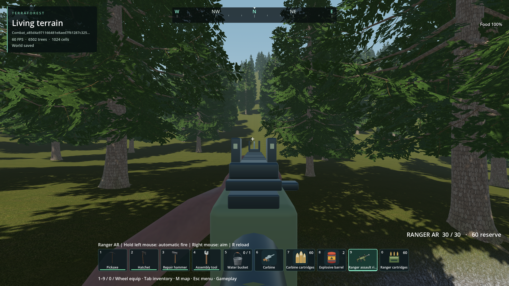
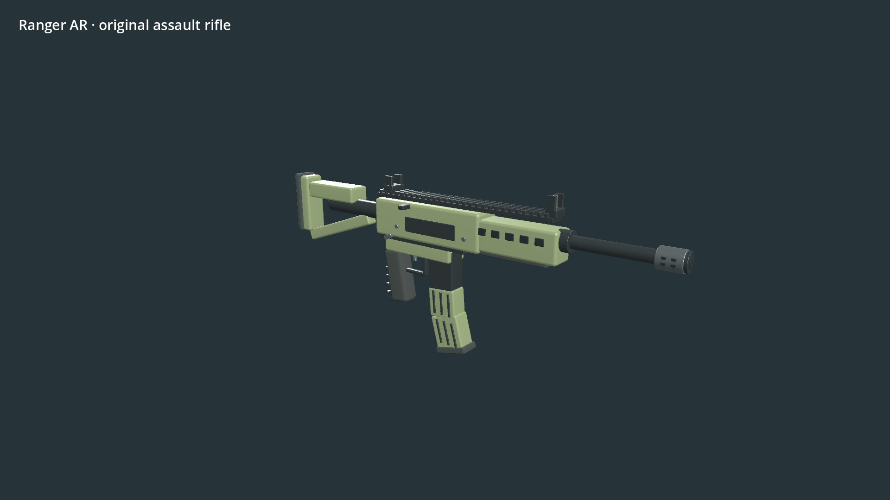
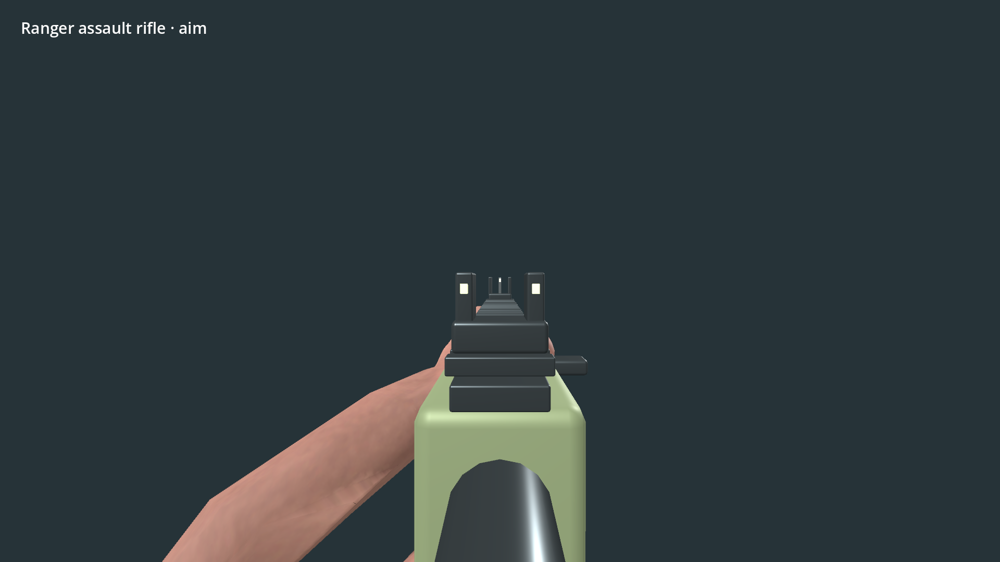
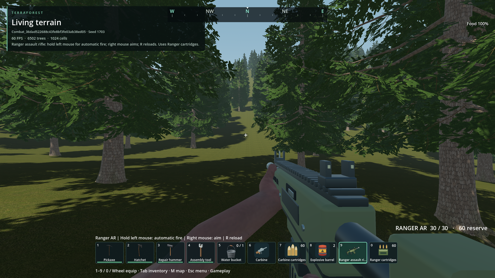
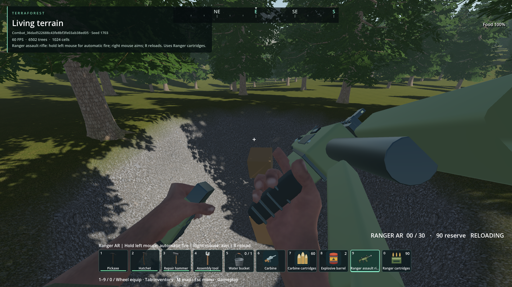
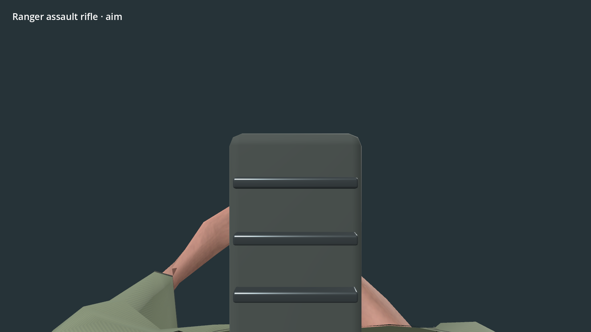

# Ranger automatic assault rifle

- Status: Installed package; scoped engineering checks pass. User visual review separate.
- Updated: 2026-11-01. Source `9b12130f`, combined native artifacts `b4d1c063`. User review: not reviewed.
- Request: author a new automatic assault rifle, superseding the compact SMG choice.

## Images

Actual root executable with final PCK: clear iron sights and independent ammunition HUD.

Final connected magazine geometry follows the reload hand; reserve remains unchanged until completion.

Final source staging model with continuous magazine insertion and stock brace.

Final first-person sight framing. Staging lighting differs from gameplay.

Private seed-1703 source world: newly authored rifle, matching icons, and separate
30-round magazine/reserve HUD. Agent-reviewed; not user visual acceptance.

Same fixture during the reused magazine-removal action. New magazine follows its
own weapon bone and ammunition transfers only after full animation completion.

Initial staging preview, rejected because the stock obscured the sightline. The
final first-person aim moves the presentation below the sightline and brings the
eye ahead of the buttstock; third-person rig placement is unchanged.

Initial isolated model preview exposed a gap at the magazine neck and an incomplete
stock brace connection. Both were corrected in the editable geometry generator.
Sources, hashes, settings and assessment are retained in images/manifest.json.

## Changes and verification

Original CC0 body and curved magazine with separate attachments; olive/steel PBR
materials, iron sights, open stock, icons, synthesized shot and muzzle flash.
Editable Blender source and deterministic geometry script are retained. Existing
rifle movement/equip/holster/aim/reload clips are reused; firing actions are retimed
to 80 ms for the 100 ms shot cadence. No external asset pack was imported.

Item 8 is **Ranger assault rifle**, item 223 is **Ranger cartridges**. Craft or take
them from Esc → Dev Bag. Hold LMB to fire, RMB to aim, R to reload. Each projectile
captures its own damage/speed; switching weapons cannot change a bullet in flight.
Native combat snapshot v3 stores independent carbine and Ranger magazines, retaining
v1/v2 migration, structural-integrity preference and exact pending-blast cursors.
Copies of the same weapon type share a player magazine; this is not per-item storage.

- Source world: **51 creation + 12 fresh-process reopen**, report
  `reports/combat_world/20261101T201510285113Z`. Held trigger cadence, release, exact
  magazine exhaustion, empty firing rejection, reload cancellation on weapon swap,
  matching-ammunition consumption, zombie firearm response and independent saves
  pass alongside existing barrel/terrain/debris/integrity cases. Zero pointer grabs.
- Native state/support: **53 per variant**, reports
  `reports/combat_native/20261101T201844670509Z` and `20261101T201845396349Z`.
- Native + actual animation presentation: **79**, report
  `reports/checks/20261101T201846030321Z`.
- Melee timing **27** and durability **21**: `reports/checks/20261101T201828135854Z`
  and `20261101T201831439121Z`.
- Earlier `reports/checks/20261101T201207647041Z` failed on a newly added test's
  inferred variable type; fixed explicitly and rerun. No runtime change was needed.
- Initial headless import `reports/ranger_import/20261101T201134` completed without
  diagnostics but its wrapper incorrectly required GPU telemetry, so it was not
  counted as a passing resource gate. Later headless import uses the correct gate.
- Initial headless preview waited for a draw callback unavailable in headless mode
  and timed out. All visual acceptance uses completed graphical runs instead.

- Final isolated visual gate: `reports/ranger_preview_runs/20261101T202056476334Z`; model, aim, reload insertion and third-person grip reviewed. Strict sampled resource gate passes.

- Final actual root executable: **51 creation + 12 reopen**, `reports/combat_world/20261101T202958692951Z/run.json`. Final mesh/sight corrections are included. Zero diagnostics and pointer captures; strict resource gates pass (peak sampled private commit 2.66 GiB, dedicated GPU 1.14 GiB). All fourteen native DLLs match the export. PCK SHA-256 `1229d8b836902aa74c67352997ecfb0fc17a58c878c46e6c30b4f93f446da881`; executable remains `981c1a194797a3ebb3153b5e5ece7bcfc6573e874f4cd6250ed120d309b511a5`. Exact identities/results in `verification.json`.

## Remaining / resume here

Requested authoring, integration, installation and scoped verification are complete.
User visual/balance feedback remains separate from scoped engineering evidence.
Existing local support bounds and temporary debris limits remain unchanged.

## Reproduce

`python tools/check_combat.py` creates a private world and reopens it in a fresh
process. `python tools/check_combat.py --executable` uses the installed PCK with the
existing user-owned executable and matching native libraries. Neither overwrites
player saves or the executable. `tools/preview_ranger_rifle.gd` renders staging
views; `tools/author_ranger_rifle.py` regenerates the original geometry in Blender.
