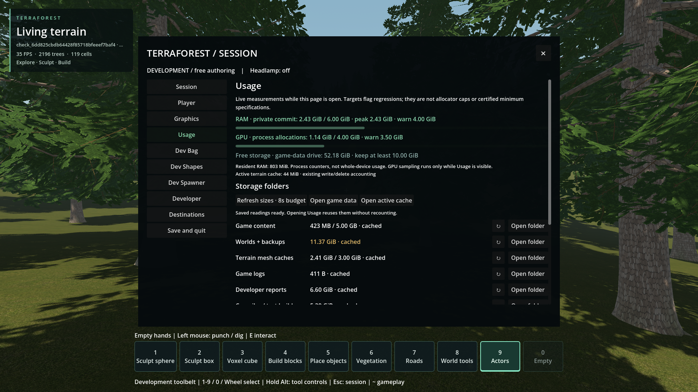
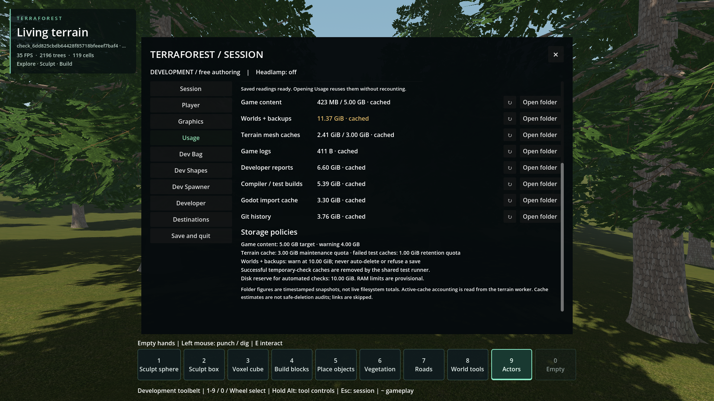
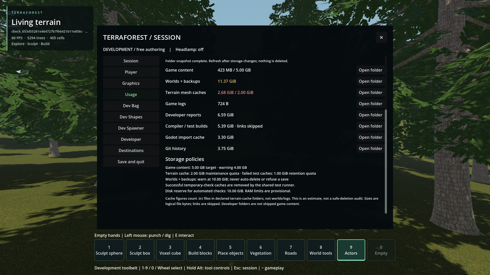

# Resource usage visibility

- Status: Implemented; scoped engineering checks, not user visual approval.
- Updated: 2026-11-02. Builds on resource-budget checkpoint `3e8ae48e`.
- Request: Inspect the sources of storage/memory usage from ESC and see limits.
- Policy follow-up: user raised terrain-cache maintenance from 2 to 3 GiB on
  2026-10-28. The shared policy updates Usage and maintenance together; original
  screenshots/receipts below retain the earlier 2 GiB setting. Other limits stay unchanged.
  Nine resource-policy unit tests and the focused installed-pack policy/Usage-label
  check pass; logs: `reports/cache_policy_3gib/{unit,export,packed}.log`.

## Cached readings and targeted discovery

### Storage recurrence — 2026-11-02

Evening follow-up: the complete main checkout measures 25.36 GiB of logical file
lengths, including 11.37 GiB of reports, 4.13 GiB of build data and 4.41 GiB of Git
objects. Three additional worktrees total 17.11 GiB; Codex session files separately
total 7.63 GiB. The bounded user-data scan remains partial and is not a total-drive
accounting. Windows also reports a 22,264 MiB automatically managed pagefile; it is
not a TerraForest cache and was not modified. Free space changes independently of
this work. These observations do not prove where all the former 100 GB went.

New successful native-baseline, water-patch and building-standard checks now release
their own hash-verified DLL copies after completion. Failed runs, fixtures, logs,
images, installed/source libraries and pre-existing evidence remain. No historical
worktree, played world or compiler cache was removed in this follow-up. This closes
one ongoing source of duplicate test data, not the larger retained-data problem.
Seven retention unit tests pass; the Windows symlink-creation fixture is skipped.
The complete building/export gate and isolated native runs exercise actual cleanup.
[Exact scope and receipts](native-test-retention-20261102.json).

The low-space report was real, not the former export-reserve threshold. A bounded,
read-only audit found 23.29 GiB in worlds, 11.13 GiB in reports, 5.55 GiB in editor
data, 4.02 GiB in build data and 17.11 GiB in additional worktrees. These are
logical-byte snapshots, not a complete attribution of C: or proof that the game
consumed all previously free space. The installed pack and libraries are about
0.45 GiB; development evidence and duplicate worlds are not runtime content.

Two concrete retention defects were identified:
- `reports/` lacked a root `.gdignore`, so Godot imported test screenshots again.
  Root ignores now cover reports and reviews. Only mapped report-image `.ctex`
  and `.md5` products were removed: **5,797,846,445 bytes**. All 6,533 associated
  original images retain their recorded file identities; import mappings remain.
- Successful generation copied its whole working world into the destination but
  retained the original. The approved cleanup removed **89** published working
  copies, **7,806,284,611 bytes**, after checking publication receipts, native
  terrain/building/model/water integrity, saved recipes and identity, unchanged
  root hashes and exclusive world leases. No destination worlds were removed.

Total removed file lengths: **13,604,131,056 bytes (12.67 GiB)**. Free space also
changed independently during the audit; do not equate its net change to these
deletions. No eligible receipt-backed copy remains after this cleanup. The initial
128-name estimate was not a deletion list; unpublished/unverified copies
and failed-test evidence remain. The 3 GiB derived-terrain-cache policy does not
cover worlds, screenshots, editor imports, builds, worktrees or Git.

Native publication now has an explicit generation-only retirement mode, used by
the coordinator. It removes only its generated source after durable destination
publication, while both leases remain held. Ordinary clones retain their source;
failed/interrupted publication, pending saves and unsupported cleanup paths retain
evidence. Cleanup failure is reported separately and never invalidates a published
world. There is no gameplay/background directory scan or global save deletion.

Commands are dry-run by default:
`python tools/cleanup_report_imports.py` and
`python tools/cleanup_generation_copies.py --godot <engine>`.
`--apply --offline` requires the editor/game closed. Receipts stay in reports.
The first native verification pass conservatively retained JSON-float recipe
options; integral options are now converted to native integers before verification,
without relaxing recipe equality. Both source and destination are verified.

Evidence: `reports/report_import_cleanup_20261102T124947088998Z.json`,
`reports/generation_retention_20261102T125508031937Z.json.cleanup.json` and
`reports/generation_retention_20261102T130224152072Z.json.cleanup.json`.
Six import tests and eight retention tests pass; the Windows symlink-creation
fixture is skipped on this machine. Native publication checks pass in
`reports/checks/20261102T131232988382Z`; all 24 archive checks pass in
`reports/checks/20261102T131403538439Z`. The earlier archive harness used a nonexistent
success token, despite zero assertion failures; that failed receipt is preserved.
The initial build encountered this audit's own verification-process DLL lock;
the retry builds both native configurations successfully after verification exits.
Export and its eight building gates pass; the exact installed executable/release
library passes publication checks in
`reports/generation_retention_pack/20261102T131717181085Z`. Pack SHA-256 is
`ec20b6423a25d18865e5d2e12ff5ba6472dd30628a54c0ea907cc1709e3db432`;
all 14 native libraries match. All 89 published root hashes remain unchanged
after cleanup, and the editor/export does not recreate report-image imports.
No new full-world generation or visual/performance qualification is claimed by
these storage checks. [Compact measurements and receipts](retention-20261102.json).

Remaining: persistent automated-test destination worlds, the 11 GiB report archive,
historical build copies and additional worktrees need their own provenance/retention
review and approval before removal or archiving. They were not silently deleted.
The 100 GB free-space goal is **not achieved**. Broader startup/respawn/generation
work remains in the foundation tracker; this cleanup does not complete it.

### Export reserve correction — 2026-11-02

The 10 GiB hard reserve plus 1 GiB estimated export work repeatedly blocked a
roughly 450 MB pack while the drive had over 10 GiB free. The user requested a
resolution instead of more deletion requests. The shared policy now distinguishes
a **10 GiB warning** from a **2 GiB hard reserve plus planned work**. Usage labels
both and colors low-space warnings separately. The export still checks actual
space before publication and retains its pending-pack validation. No saves,
evidence, source or caches were removed to make room; content/GPU/cache limits
are unchanged. Ten Python policy tests and eleven UI boundary assertions pass;
`reports/disk_reserve_units.log`, `reports/checks/20261102T110552972091Z`.
The same eleven UI checks pass against the installed pack:
`reports/disk_reserve/20261102T111025800972Z`. Export succeeds without cleanup:
`reports/upstairs_reserve_export.log`, 449,657,104-byte PCK
`8cd6f0574a9ab6b7ce925c10f712f96d113da7e88187cee0f42ba725acbc4957`.
All 14 native libraries match; the waiting animation correction and fresh-process
reload also pass in that pack. Earlier screenshots below retain the former disk
reserve; they document cached discovery, not this updated threshold.

### Existing cached discovery

Removal commit `fe80b322` was reverted in `fd9c98d6`, as requested. The size
display remains: opening reads a small persisted summary without walking folders.
Export supplies current pack/runtime size, and active terrain size comes from
existing worker accounting, not a second scan. Other readings are explicitly
cached snapshots; their measurement timestamps are available on hover. Known
previous measurements were migrated as historical data, never relabelled live.

Per-folder ↻ refresh avoids unrelated trees. Full refresh is still available,
but both use an eight-second cooperative discovery budget and at most four
native child workers. Only fully measured areas update saved totals; partial,
unavailable and timed-out results stay explicit. Completed/cancelled jobs stop
progress polling. There are no deletion controls.

Installed verification passes 71 assertions and nine resource-policy tests.
Activation takes 51 ms, a targeted content refresh 17 ms; a separate read-only
query completes all 12,210,780,578 saved-world bytes in 1.68 s. These are local,
repeated observations, not cold-device/FPS guarantees. All 14 native hashes match
and cursor captures remain zero. [Exact receipts and limitations](cached-discovery-evidence.json).

Current installed-pack seed-1703 temporary world, 1920×1080: preserved real
measurements labelled cached, live counters, existing active-cache accounting,
and per-folder refresh. No synthetic size fixture was used for these images.

Same run, lower page; 3 GiB quota and folder-opening buttons retained.
Measurement timestamps/source are on each value's tooltip.

## Original implementation and verification

- ESC → Usage displays process-private RAM, resident RAM, process GPU allocation
  when available, free disk space and the shared runtime/tool limits. RAM limits
  are provisional; unavailable GPU counters are never presented as zero.
- A lower-priority C++ worker counts folders read-only. Ordinary play has no
  sampling loop; leaving Usage stops sampling and cancels scanning. Manual refresh
  updates snapshots. Per-area bounds and skipped/inaccessible files stay visible.
- Folder buttons use `OS.shell_open`, with known existing paths only. There are
  no deletion buttons. Tests inject an opener to verify destinations without
  opening Explorer over the user's work.
- Content excludes old packs, source archives and reports. Worlds are separate;
  cache estimates scan only declared terrain-cache roots, skip worlds/logs and
  are explicitly not safe-deletion audits. Development directories are not the
  game's redistributable size.
- Installed-pack verification passes 53 assertions; 15 Python unit tests and the
  process-counter check pass. Both native configurations build; export validates
  14 external DLLs. [Receipts, failed attempts and exact hashes](evidence.json).
  Parser, cold-scan timeout and packed-path failures remain in reports; initial
  compiler/fixture-import errors are summarized in the receipt. New evidence
  folders carry `.gdignore`.

## Original images

1920×1080 installed-pack temporary world, seed 1703, Usage top. Native counters
and completed folder snapshot; offscreen test, no mouse capture. Not a performance
qualification or user-approved design.

Same run, scrolled lower. World warnings do not delete saves. Cache quota is an
offline maintenance policy, not a live allocator cap. [Provenance](images/manifest.json).

## Remaining / resume here

- Historical cost audit before cached discovery: [measurements](cost-audit.json).
  An isolated rendered-page test visits 650,965 entries in about 67 s, with about
  60.5 s in cache roots. All 2,048 sampled geometry-leaf directories across eight
  roots were empty; this is a capped sample, not a census. Earlier file-only cache
  maintenance retains directory trees. No directories were deleted by this audit.
- On the 12-logical-processor machine, the isolated process averages 5.05% total
  CPU scanning, 0.90% with the page settled and 0.77% hidden afterward. Typical
  live refresh is 190 µs once/sec; scan/status refresh 108 µs four times/sec, even
  after completion. First activation costs 64.8 ms. The isolated first-use rise
  is about 111 MiB private / 32 MiB dedicated GPU, including fonts, renderer and
  counter initialization; these are not measured incremental full-game figures.
- Saved totals, targeted requests and completed-job polling suppression are now
  implemented. First-counter initialization and net in-game memory still need
  matched-world profiling. OS calls can exceed the cooperative deadline on a
  stalled device. Empty-directory maintenance remains separate and unrequested.
- Unknown or externally changed trees still require an explicit reconciliation;
  folder metadata is not a recursive byte total. A large cold census may not
  finish in eight seconds; its old cached value is retained with an incomplete
  marker, not presented as newly verified. A complete writer-maintained ledger
  for every legacy cache/external directory is not implemented. Return if fully
  fresh global totals without reconciliation are required; require cross-process
  write/delete, overflow, external-change and recovery evidence before claiming it.
- User review: ESC → Usage, scroll down, and try the folder buttons in normal play.
- Folder totals are snapshots of a changing filesystem, logical bytes rather than
  allocated disk space; linked targets are not included. Large cold directories
  can take time, but counting does not run on the main thread.
- [Resource qualification and storage recovery](../../docs/RESOURCE_BUDGETS.md)
  remain separate: 100 GB free-space goal and physical 4 GiB GPU testing are not
  completed by adding this page.

## Reproduce

- Export first so `dist/usage_content.json` and native libraries match the build.
- `python tools/run_godot_check.py resource_usage --headless --timeout 180 --require "RESOURCE_USAGE PASS"`
- If no saved-size cache exists, the test uses a labelled synthetic world-size
  fixture for persistence assertions; it never treats that value as a real total.
- Rendered checks use the same driver offscreen with a nonactivating window;
  source and installed pack commands and exact hashes are retained in receipts.
- [Native implementation](../../addons/world_runtime/native/resource_usage.cpp),
  [UI](../../addons/player_runtime/usage_panel.gd),
  [regression test](../../tests/resource_usage.gd),
  [player guide](../../docs/PLAYER_UI.md#usage).
