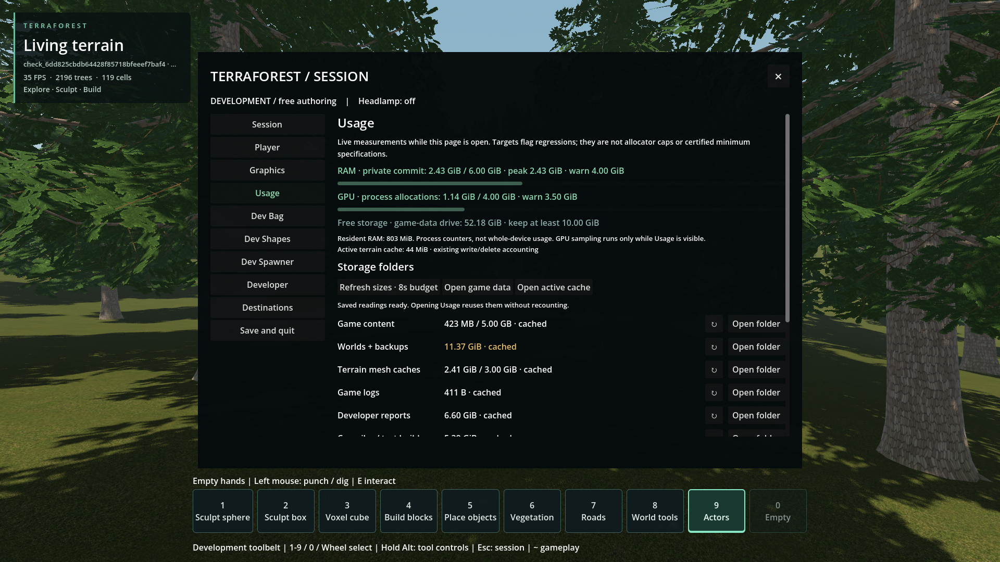
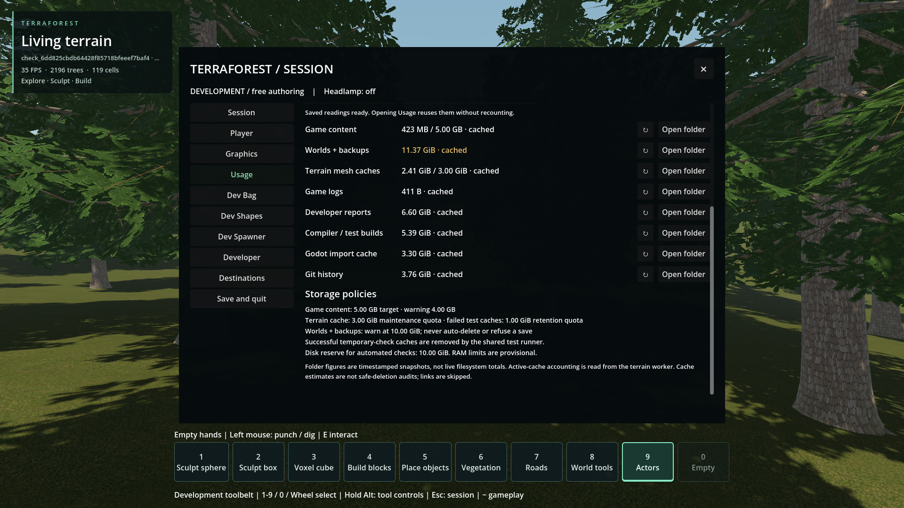
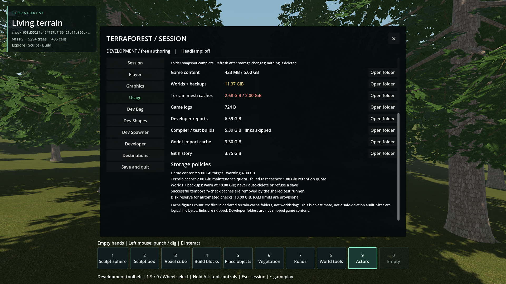

# Resource usage visibility

- Status: Implemented; scoped engineering checks, not user visual approval.
- Updated: 2026-10-28. Builds on resource-budget checkpoint `3e8ae48e`.
- Request: Inspect the sources of storage/memory usage from ESC and see limits.
- Policy follow-up: user raised terrain-cache maintenance from 2 to 3 GiB on
  2026-10-28. The shared policy updates Usage and maintenance together; original
  screenshots/receipts below retain the earlier 2 GiB setting. Other limits stay unchanged.
  Nine resource-policy unit tests and the focused installed-pack policy/Usage-label
  check pass; logs: `reports/cache_policy_3gib/{unit,export,packed}.log`.

## Cached readings and targeted discovery

Removal commit `fe80b322` was reverted in `fd9c98d6`, as requested. The size
display remains: opening reads a small persisted summary without walking folders.
Export supplies current pack/runtime size, and active terrain size comes from
existing worker accounting, not a second scan. Other readings are explicitly
cached snapshots; their measurement timestamps are available on hover. Known
previous measurements were migrated as historical data, never relabelled live.

Per-folder ↻ refresh avoids unrelated trees. Full refresh is still available,
but both use an eight-second cooperative discovery budget and at most four
native child workers. Only fully measured areas update saved totals; partial,
unavailable and timed-out results stay explicit. Completed/cancelled jobs stop
progress polling. There are no deletion controls.

Installed verification passes 71 assertions and nine resource-policy tests.
Activation takes 51 ms, a targeted content refresh 17 ms; a separate read-only
query completes all 12,210,780,578 saved-world bytes in 1.68 s. These are local,
repeated observations, not cold-device/FPS guarantees. All 14 native hashes match
and cursor captures remain zero. [Exact receipts and limitations](cached-discovery-evidence.json).

Current installed-pack seed-1703 temporary world, 1920×1080: preserved real
measurements labelled cached, live counters, existing active-cache accounting,
and per-folder refresh. No synthetic size fixture was used for these images.

Same run, lower page; 3 GiB quota and folder-opening buttons retained.
Measurement timestamps/source are on each value's tooltip.

## Original implementation and verification

- ESC → Usage displays process-private RAM, resident RAM, process GPU allocation
  when available, free disk space and the shared runtime/tool limits. RAM limits
  are provisional; unavailable GPU counters are never presented as zero.
- A lower-priority C++ worker counts folders read-only. Ordinary play has no
  sampling loop; leaving Usage stops sampling and cancels scanning. Manual refresh
  updates snapshots. Per-area bounds and skipped/inaccessible files stay visible.
- Folder buttons use `OS.shell_open`, with known existing paths only. There are
  no deletion buttons. Tests inject an opener to verify destinations without
  opening Explorer over the user's work.
- Content excludes old packs, source archives and reports. Worlds are separate;
  cache estimates scan only declared terrain-cache roots, skip worlds/logs and
  are explicitly not safe-deletion audits. Development directories are not the
  game's redistributable size.
- Installed-pack verification passes 53 assertions; 15 Python unit tests and the
  process-counter check pass. Both native configurations build; export validates
  14 external DLLs. [Receipts, failed attempts and exact hashes](evidence.json).
  Parser, cold-scan timeout and packed-path failures remain in reports; initial
  compiler/fixture-import errors are summarized in the receipt. New evidence
  folders carry `.gdignore`.

## Original images

1920×1080 installed-pack temporary world, seed 1703, Usage top. Native counters
and completed folder snapshot; offscreen test, no mouse capture. Not a performance
qualification or user-approved design.

Same run, scrolled lower. World warnings do not delete saves. Cache quota is an
offline maintenance policy, not a live allocator cap. [Provenance](images/manifest.json).

## Remaining / resume here

- Historical cost audit before cached discovery: [measurements](cost-audit.json).
  An isolated rendered-page test visits 650,965 entries in about 67 s, with about
  60.5 s in cache roots. All 2,048 sampled geometry-leaf directories across eight
  roots were empty; this is a capped sample, not a census. Earlier file-only cache
  maintenance retains directory trees. No directories were deleted by this audit.
- On the 12-logical-processor machine, the isolated process averages 5.05% total
  CPU scanning, 0.90% with the page settled and 0.77% hidden afterward. Typical
  live refresh is 190 µs once/sec; scan/status refresh 108 µs four times/sec, even
  after completion. First activation costs 64.8 ms. The isolated first-use rise
  is about 111 MiB private / 32 MiB dedicated GPU, including fonts, renderer and
  counter initialization; these are not measured incremental full-game figures.
- Saved totals, targeted requests and completed-job polling suppression are now
  implemented. First-counter initialization and net in-game memory still need
  matched-world profiling. OS calls can exceed the cooperative deadline on a
  stalled device. Empty-directory maintenance remains separate and unrequested.
- Unknown or externally changed trees still require an explicit reconciliation;
  folder metadata is not a recursive byte total. A large cold census may not
  finish in eight seconds; its old cached value is retained with an incomplete
  marker, not presented as newly verified. A complete writer-maintained ledger
  for every legacy cache/external directory is not implemented. Return if fully
  fresh global totals without reconciliation are required; require cross-process
  write/delete, overflow, external-change and recovery evidence before claiming it.
- User review: ESC → Usage, scroll down, and try the folder buttons in normal play.
- Folder totals are snapshots of a changing filesystem, logical bytes rather than
  allocated disk space; linked targets are not included. Large cold directories
  can take time, but counting does not run on the main thread.
- [Resource qualification and storage recovery](../../docs/RESOURCE_BUDGETS.md)
  remain separate: 100 GB free-space goal and physical 4 GiB GPU testing are not
  completed by adding this page.

## Reproduce

- Export first so `dist/usage_content.json` and native libraries match the build.
- `python tools/run_godot_check.py resource_usage --headless --timeout 180 --require "RESOURCE_USAGE PASS"`
- If no saved-size cache exists, the test uses a labelled synthetic world-size
  fixture for persistence assertions; it never treats that value as a real total.
- Rendered checks use the same driver offscreen with a nonactivating window;
  source and installed pack commands and exact hashes are retained in receipts.
- [Native implementation](../../addons/world_runtime/native/resource_usage.cpp),
  [UI](../../addons/player_runtime/usage_panel.gd),
  [regression test](../../tests/resource_usage.gd),
  [player guide](../../docs/PLAYER_UI.md#usage).
