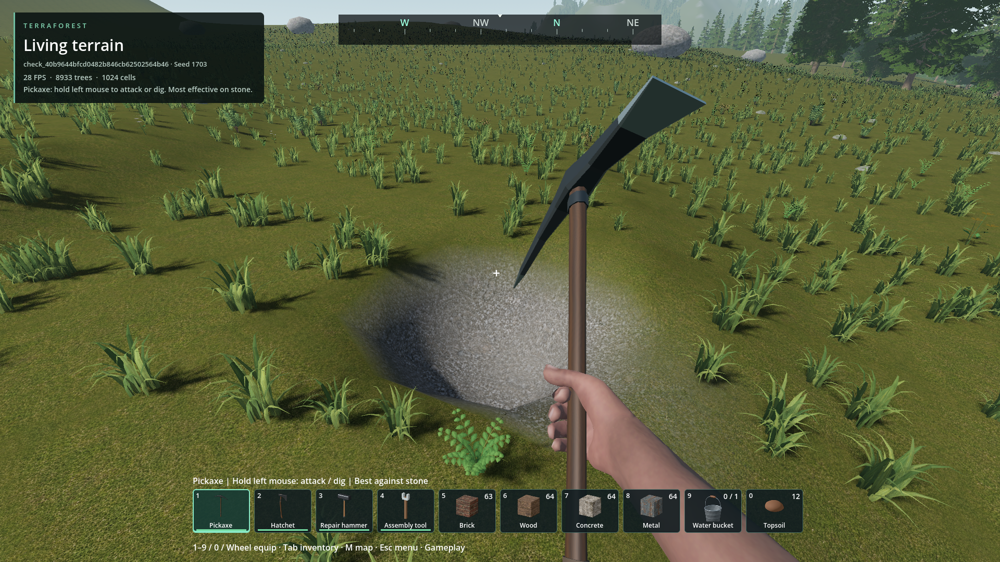
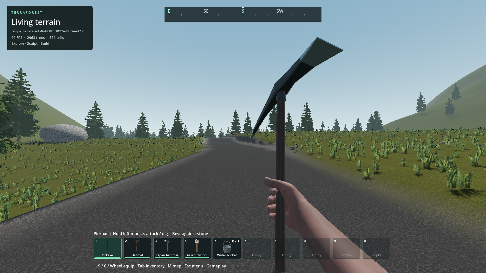

# Runtime performance

[Shared animation cache correction](animation-cache-2026-11-10.md) removes
same-value writes that invalidated all residents' animation caches. The old/new
capped world pair reduces settled physics median 2.612→1.929 ms; behavior,
pose, grounded walking and destruction checks pass in source and the installed
package. A separate 49.358 ms source rendering-heavy frame remains unresolved;
the installed walking capture reaches 25.243 ms. A recorder-off control still
reaches 24.462 ms walking and 26.749 ms after destruction. This is not stable-FPS
acceptance; visible-window presentation and longer movement remain open.

[Rendering API diagnostic](render-api-diagnostic-2026-11-10.md) adds explicit
driver selection to the test launcher with runtime verification. Its first D3D12
capture does not establish a driver advantage; production remains Vulkan.

[Approved pacing policy, 2026-11-10](approved-pacing-2026-11-10.md): the user
reaffirmed the foreground cap, VSync and background cap. The uncommitted limiter
experiment and its changed test expectations were reverted; it never entered
the installed package. Remaining draft optimizations need normal-policy world
validation. Uncapped capacity measurements do not establish stable gameplay.

Latest source correction: [terrain publication budget boundary](terrain-publication-budget-2026-11-09.md)
prevents a completed collision-preparation unit from immediately starting the
atomic swap after its slice is exhausted. The old complete surface stays live;
an ample-budget batch still publishes in the same call. The new regression fails
on old source and all 50 assertions pass with the correction; coverage and recovery
checks also pass. The correction is now installed and the normal-world three-barrel
fixture passes; isolated edit latency and broader rendered continuity remain open.

Latest world fix: [native forest/boulder invalidation](destruction-owner-bounds-2026-11-09.md)
replaces repeated owner scans during local destruction with exact native bounds
queries. The same-package control reduces forest/boulder callback medians from
1.036/0.852 ms to 0.011/0.012 ms while preserving all damage, 96 physical debris
bodies and normal retirement. The real three-barrel default-world fixture and
native/adapter parity checks pass. Whole-frame stalls, collapse, terrain publication,
rendering waits, pursuit and endurance remain open; the report retains rejected
pacing controls and separates test setup from gameplay timing.

Earlier rendering fix: [skip unchanged shadow updates](shadow-updates-2026-11-09.md)
removes redundant native state submissions that queued later renderer work.
Nearby candidate/old/candidate controls reduce selected-frame drawing median
from 13.890 to 6.449/5.311 ms, with geometry, coverage and shadow policy retained.
Debug/release shadow and rendered-partition checks pass; sixteen source/package
views were inspected. A new trace interval separates physics callbacks from
subsequent engine/queue/synchronization work. Both packaged save/shutdown runs
are clean, and all 2,980 traced physics segments close. The recorder-off package
still reaches 24.696 ms outdoors; source arrival/settled tails do not establish
general nonregression. Hardware clocks differ, so total recorder overhead remains
unisolated. Rendering, physics, destruction, pursuit and endurance remain open.

Latest diagnosis: [terrain collision publication](terrain-collision-publication-2026-11-09.md)
measures actual live-body attachment, which the old resource-setup timer omitted.
The 144-check fixture preserves all triangles and distinguishes cold/reused
shapes. A four-run 1024/512/512/1024 default-world comparison now rejects a size
change: shorter typical attachments do not establish improved frame tails, and
resident shape counts increase. All four save/shutdown checks pass without leak
diagnostics; eight views were inspected. A default repeat still reaches 25.081 ms
outdoors while terrain staging stays below 0.139 ms. Production remains at 1024;
physics, rendering/draw waits and total recorder overhead are the next targets.

Latest source follow-up: [native world callback attribution](native-world-process-2026-11-09.md)
separates block residency/upload/collision/occlusion, distant model pages and
pooled lights. The real-world run exposed and fixed late block-owner attachment;
all three providers then capture 6,061 current gameplay frames. Source fixtures,
save/shutdown and eight inspected views pass their scoped checks. A 34.638 ms
frame spends just 0.056 ms in these callbacks; physics, terrain publication and
rendering remain the next targets. Contended timing is not an FPS comparison.
The merged export now passes installed provider/save/shutdown gates across 5,226
frames. A clean sequential recorder-off control still has outdoor p99/max
17.169/27.356 ms. All eight installed images were inspected; bake outputs remain
unchanged. Total recorder overhead, endurance and stable 60 FPS remain unqualified.

Latest: [render-stage attribution](render-stage-attribution-2026-11-09.md) adds
shared render-setup timing and optional bounded device CPU markers in source.
The analyzer correctly maps delayed markers to earlier draw intervals. A 9.409 ms
ordinary-view gap narrows one cost to 3D scene setup; independent draw/before-process
stalls remain. Source recorder/analyzer checks and the installed marker-availability,
save and shutdown gate pass. The matching package includes all 14 native DLLs;
no FPS improvement is claimed for instrumentation itself.

Whole-world follow-up of that ordinary control also isolates travel selection
(cover native p99/max 2.092/2.881 ms) and synchronous surface-result handling
(p99/max 1.988/2.833 ms). Rendering, native streaming/publication and remaining
physics work are the immediate investigation targets; pursuit is one workstream.
These overlapping timers are not an additive budget. Dense destruction and
long-session memory remain required acceptance gates, not deferred successes.

Native cover selection now replaces temporary per-page trees with contiguous
membership arrays. Debug/release placement and rendered partition-continuity
checks pass. One clean old/new pair changes active-selection median 2.058→1.699 ms
and sweep p99 22.346→18.641 ms. All six outdoor comparisons and four installed
captures were inspected. Arrival p99 slightly worsens and final residency differs
by 61 of roughly 68,000 records; general frame-time nonregression remains open.
The first contended sample is excluded. The change is installed and still leaves
independent ~30 ms process/draw stalls, destruction and endurance work.

[Native building occlusion](block-occlusion-2026-11-09.md) reduces the
indoor rendering CPU median from about 5.2 to 2.7 ms in the installed package,
with unchanged visible room geometry. Native lifecycle, destruction, paging,
release and three installed save/shutdown checks pass. Outdoor CPU overhead is
0.18–0.26 ms in installed comparisons; uncapped sweep median/p99/max is
7.647/17.792/34.616 ms. Typical capacity does not establish stable 60 FPS. The
report retains corrected visual-reading and screenshot timing errors. World/player
physics, draw waits, outdoor policy and long-session stability remain open.

[Native structures save capture](structures-save-capture-2026-11-09.md)
moves encoding to the ordered worker. Two packaged captures take 0.782/0.790 ms
versus 7.068–11.572 ms for the legacy provider; exact-data, partial-region and
shutdown checks pass. Whole-frame tails remain variable, including substantial
physics/draw costs and a long wait; the final control overlaps another checkout's
import. Broader world/player pacing and long-session stability remain open.

[Frame-phase CPU work and hardware controls](phase-work-2026-11-09.md)
separate CPU-heavy physics from long draw intervals. Recorder-off gameplay still
has >32 ms frames and ~15 ms GPU work; NVIDIA reports software power/thermal
limiting during that control. Save, physics, rendering and cold pursuit remain
open; no stable-60-FPS claim is made.

[Native route-water footprints](navigation-water-batch-2026-11-09.md)
retain every hazard sample while removing repeated engine-call crossings. The
release comparison preserves all paths and uses 38% fewer thread cycles; saved
tower hazard time falls about 84%. Cold pursuit still takes seconds, and waits,
rendering and an existing cut-cell fixture failure remain open.

[Bounded model and door updates](navigation-model-invalidation-2026-11-09.md)
preserve the graph through actual door destruction and reduce the selected
same-path replan work by 65%. The saved tower passes with all 200 files unchanged;
cold planning, broad/unbounded owner events and frame tails remain open. Per-pass
thread CPU/cycle evidence now accompanies profiled navigation. This extends
[local graph invalidation](navigation-local-invalidation-2026-11-09.md).
[Native cover draw partitions](native-cover-partitions-2026-11-09.md)
retain 74,320 instances while the first integrated arrival GPU median falls from
12.456 to 7.459 ms. Outdoor views, native ownership/continuity and packaged
save/shutdown have scoped verification. Increased travel selection cost, a failed
legacy interaction fixture, slow pursuit and intermittent stalls remain open.

- Status: Improved-partial; 60 FPS with headroom remains open.
- Updated: 2026-11-09. Initial baseline: `5bfe87f4`; maintenance: `304206cc`; readiness: `87afcdfe`.
- User review: Not reviewed. No visual quality reduction intended.

Resource follow-up: [4 GiB GPU / 5 GB content targets and cache policy](../../docs/RESOURCE_BUDGETS.md).

Latest [implemented world/player foundation](foundation-2026-11-09.md): native
destruction batches, exact baked debris collision, native water snapshot sharing,
first-person preparation and worker resource validation are implemented. Actual
64-block destructive calls now cost 0.8–2.1 ms per batch; default-world arrival
223.6 → 26.6 ms. Rendering, later physics/draw stalls and zombie route latency
remain open. The audio export boundary is repaired; package validation is recorded
in the linked evidence. Follow-up fixes the tower's aligned-riser rejection and
native map-decoder worker ownership. A remaining packaged leak was traced to
Dictionary move assignment in the pinned bindings; all native modules now use
the repair, with zero of 80 wrappers retained versus 48 before and four clean
serial packaged save/shutdown runs. Cold planning
still takes about 18 s in the fixture and 35–45 s in the host; point-light shadows
cost about 5 ms and independent draw/scheduling stalls remain. The final ordinary
long control has p99 27.096 ms; a 480 ms interval in the profiled run has no proven
cause and did not recur in that control. No graphics or gameplay limit was reduced.

The [zombie geometry follow-up](anatomy-geometry-2026-11-09.md) removes a measured
46.603 ms first-admission mesh readback using the exact inherited mesh data in a
compressed binary cache. Source anatomy setup is now 2.307 ms in the first repeat;
first-use hit areas and later rendering/planning stalls remain open. Independent
geometry, combat, rest and release checks guard visual/gameplay parity.

[Navigation query profiling and support reuse](navigation-query-cache-2026-11-09.md)
now preserve exact ray answers in a bounded 3 MiB native cache. The fixture avoids
50.36% of rays with all eight paths unchanged; the saved tower still passes its
round trip, but return planning remains about 50 seconds and full-host timing is
mixed. Rolling captures retain every navigation tick before a rendered frame.

[Ground-cover render partition diagnostics](cover-render-partitions-2026-11-09.md)
identify a major rendering cost: whole 32 m cover batches participate in nearby
light shadows. Exact 16 m prototype partitions reduce stationary GPU medians
from about 12 to 7.5 ms and point-shadow buckets from 4.3–4.5 to 1.36 ms.
A full-detail control also improves. This report records the test-only prototype;
the native follow-up above implements its production counterpart. Broader
walking/driving visual checks and draw waits remain open; stable 60 FPS is not
established.

Earlier [fresh-default-world / rolling-trace investigation](rolling-trace-2026-11-09.md):
normal Frontier expedition generation completed; first-person depth activation,
arrival PNG decoding, first zombie admission, parked-prototype preparation and
save capture are now localized. Opt-in [rolling capture](../../docs/FRAME_TRACE.md)
is implemented in source; stable 60 FPS/headroom and independent presentation waits
remain open. Its audio package blocker and old-pack limitation are historical;
the implementation report tracks the repaired boundary and new checks.

Earlier [diagnostic playtest, 2026-11-09](playtest-2026-11-09.md): current source
still fails pacing gates on a populated road fixture. Capped walking/sprinting/
jumping p99: 21.70 / 23.10 / 22.25 ms; maximum 48.08 ms. Uncapped movement
improves but retains an early-idle 68.10 ms outlier. Rendering/presentation waits,
first-use shader/contact work and main-thread streaming/NPC bursts need separate
attribution. Diagnosis only; no runtime/settings change or universal fix claimed.

Cleanup recovered 53.3 GiB net, leaving 54.2 GiB free; the 100 GB goal is not met.
The original 2 GiB recognized-cache quota, 423 MB content and walking-memory gates
pass. World data/history/evidence remain intact. [Resource evidence](resource-budget-evidence.json).
The user raised the provisional terrain-cache quota to 3 GiB on 2026-10-28;
historical receipts are unchanged. Other resource thresholds stay the same.
RAM thresholds remain provisional and physical 4 GiB hardware remains unqualified.

## Movement stall isolation — 2026-11-01

### Async save completion versus optional cache work

The quest integration fixture exposed save-return delay: four five-second waiting
reports despite 1.7–1.8 s durable publication. Idle cache accounting admitted its
next slice while an asynchronous save remained reserved, postponing the worker's
completion delivery. One guard now gives that reservation priority; accounting
resumes after publication. No timeout, data validation or cache-budget reduction.
The deterministic regression fails before and passes after
(`reports/checks/20261101T162058530655Z`, `20261101T162121166420Z`); all 15 async
save barriers pass (`20261101T162123590207Z`). On the same owned world, completion
now measures 2.332 s including 2.070 s publication and 10.409 ms main capture;
the new 620-byte quest component contributes 11 microseconds. Source evidence:
`reports/quests_world/20261101T162547622901Z`, 10 checks. Matching package generation/
fresh-process restore passes 25 + 10 checks at
`reports/quests_world/20261101T165251331454Z`: three save completions 1.844–2.200 s.
The guard is installed. This fixes the reproduced priority defect, not all storage latency
or the separately retained gameplay frame-pacing failures.

- Kept the user's Legion Quiet Mode, graphics, vegetation density, physics solver
  and production 60 FPS/VSync settings unchanged. The user explicitly declined
  removing the FPS cap after the diagnostic comparison. Saves remain read-only.
- Confirmed synchronous zombie-ready logging costs up to **9.644 ms** per call.
  Lifecycle chatter and terrain-hitch console output now require `--verbose`;
  errors, warnings, stage signals and optional interaction traces remain available.
  Measured zombie admission falls from **13.475 ms** in that control to
  **4.071 ms** in the first installed check.
- Terrain delivery previously drained every completed vegetation callback in one
  frame. Background surface replies now share a **1 ms soft gameplay budget**,
  retain FIFO/revision identities, and count toward query admission backpressure.
  Mining, targeting and other non-surface replies go first. Initial loading uses
  the existing terrain-build budget. A single callback is not preemptible.
- Surface-reply frame cost falls from **5.950 ms** in the instrumented control to
  **2.870 ms** in the first installed check. Backlog peaks at six; recovery has
  **100/100 requested cover cells**, with no density/range reduction.
- A repeat caught a **272.535 ms** mining contact, including **243.289 ms** of
  worker queueing behind a background mesh with a **163.668 ms cache write**.
  Gameplay previously cleared the worker input-priority flag. Windup/recovery
  now defers optional writes without pausing vegetation streaming; completion
  and cancellation release priority. Already-started OS I/O is not preempted.
- The focused installed check completes **24 contacts at 22.671–29.497 ms**, with
  worker queueing at most **0.113 ms**, 22 physical jumps and **6,218/6,218 focused
  frames**. It still fails the strict frame-pacing gates; this is not a universal
  mining-latency guarantee.
- Hidden, collision-disabled terrain roots now enter the scene before bounded
  piece preparation, rather than attaching a populated subtree all at once.
  Source comparison: attachment peak **4.520 → 1.535 ms**, staging-frame peak
  **6.298 → 3.868 ms**. Publication remains atomic. That run has 24 successful
  contacts at **23.016–56.123 ms**, so the slower contact is retained too.
- Added opt-in native main-thread work counters and callback timings. Raw CPU
  cycles are not elapsed time; Windows CPU-time readings are quantized. Uncapped,
  mailbox, cap-only and VSync-only runs are diagnostics, not production settings.
- Regression checks: 24 delivery/priority/hidden-preparation assertions, 71 resource
  checks, 33 population checks, 24 actual mining/building vegetation checks,
  74 terrain-tool checks, six Python timing-gate tests, native debug/release builds
  and the export/building-standard checks pass.
- Final updated pack: **6,217 frames, 24 changed contacts at 22.352–34.203 ms,
  22 jumps, 100/100 requested cover cells**; attachment peak 0.237 ms, sampled
  private RAM 3.62 GiB / dedicated GPU 1.40 GiB. This final check is off-screen,
  not another user visual review, and still fails the strict timing gates.

Still **not universally stutter-free**. At the retained 60 FPS cap, focused
walking/sprinting/jumping p99 is **22.741 / 27.526 / 25.385 ms**. The longest focused
interval is 37.686 ms, including 21.948 ms in the drawing interval; GPU time is
6.27 ms with no pipeline-compilation count change. This is not enough to identify
the driver/OS/engine wait. Process-start cadence is steadier than draw-end cadence;
do not claim that the software limiter itself is proven faulty.

Removing only the software cap passes every timing gate in a separate **11,863-frame,
fully focused** installed diagnostic. The user did not watch the comparison and
prefers 60 FPS to avoid extra GPU power, so **that mode is not shipped as a fix**.
Mailbox and disabling VSync with the cap retained do not solve the gates either.
Historical 80–370 ms stalls remain unexplained by mere non-recurrence. Dense
settlements, caves, driving/endurance and subjective movement remain unqualified.

Retained non-passes: an initial harness naming error; a preparation fixture invoked
before SceneTree startup (corrected and rerun); the legacy input suite cannot
capture a mouse in headless mode; the legacy partition probe assumes an admitted
single-mesh partition, but current brick containers reject it. Paired source and
pre-incremental-attachment pack probes confirm that rejection in both builds.
These old fixtures need adaptation before use as regression gates, not assertions
silently removed from passing tests.

Return with 60 FPS presentation/CPU-wait attribution, repeated focused runs and
dense/cave workloads. Preserve failures; do not substitute average FPS or an
uncapped result. [Comparisons, exact builds and retained failures](movement-stutter-evidence.json).

## Mining contact and ordinary movement — 2026-11-01

- Reproduced first-hit presentation blocking ready terrain publication. In the
  uncontended original-effects control, effect construction takes **62.407 ms**;
  first contact-to-draw is **88.438 ms**. The initial 219.940 ms exploratory hit
  overlapped another test workload and is not a clean speedup baseline.
- Prepare the selected effect meshes and motion materials during existing world
  initialization, not on the first impact. Emitters remain lazy and bounded;
  no fake hits, early damage, extra particles or visual-quality reductions.
- First installed run: effect dispatch **0.238 ms**, first contact-to-draw
  **42.493 ms**, all 24 changed contacts **20.892–42.493 ms**, 22 physical jumps.
  A prepared source run also completes 24 strikes at **22.92–31.52 ms**.
  These are contact/publication timings, not mouse-click-to-photon latency.
- The new repeatable workload retains ordinary physical walking, sprinting,
  jumping, AI, foliage and authored pickaxe contact. Its test-only initiation
  bypasses mouse capture/input debounce; production targeting, edits, collision
  publication and rewards still execute. Fixture saves are read-only.
- **Movement is not fully fixed.** Installed walking p99 is 23.513 ms; sprinting
  27.170 ms; jumping 25.432 ms. A 370.927 ms sprint interval spends 357.876 ms
  before the process callback; measured GPU time is 8.219 ms and there is no
  shader-compilation counter change. Its cause is not established. Another
  63.871 ms walking frame includes a 42.225 ms zombie-population update.

All timing failures remain failures: the command prints functional and performance
results separately; `--require-gameplay-performance` also fails its exit status.
The first installed trace reaches the old 6,000-frame cap during recovery; the
driver now allows 12,000 and fails explicitly on truncation. Full repeats retain
6,193 and 6,219 frames, including all eight recovery seconds. Across three pack
runs, **72/72 hits change terrain** and **65 physical jumps** complete. First-hit
latency is **25.967–42.493 ms**. The second run still catches **107.783 ms**
sprinting (87.702 ms in population update) and **80.405 ms** jumping. The final
callback-instrumented run peaks at 37.492 ms without a production change: that
non-recurrence does not fix or explain earlier spikes. Complete results,
exact hashes, retained harness failures and resource checks are recorded in
[gameplay evidence](gameplay-evidence.json). No universal 60 FPS claim.

Reproduce: `python tools/profile_runtime.py --slot recipe_generated_4644d8cfc8f97e43 --gameplay --pack --require-resource-budget`.
Run without competing Godot processes; it does not capture the desktop pointer.
The source/packaging checks preserve pre-existing editor import settings and the
icon receipt byte-for-byte; the export uses verified BG5 import settings.

Six Python timing-gate checks, 171 cover assertions, native page compaction,
both effect styles, 24 rendered block/mining continuity checks and 74 six-tool /
large-edit / persistence checks pass. Packaged gameplay peaks around **3.57 GiB
private RAM / 1.40 GiB dedicated GPU**; installed content is **476.3 MB**, within
current sampled budgets, not proof of compatibility with every 4 GiB GPU.

Packaged temporary-world regression, not a player save. GPU packet readbacks and
screenshots affect its displayed FPS; it is visual/correctness evidence only.
[Road playtest arrival](images/gameplay-arrival.png) and
[existing particle appearance](images/gameplay-effects.png) were also inspected.
Image sources, hashes and captions are in the evidence receipt.

Return with engine/physics/scheduling attribution for the pre-process stall,
zombie admission breakdown, foreground human playtesting, cave/ore/continuous
digging, long-session and weaker-hardware runs. No persistent post-jump slowdown
is demonstrated by these short routes; that does not exclude the player report.

## Collision readiness and actor state — 2026-10-29

- Loaded-model collision queries now prune a native bounds tree instead of
  scanning every loaded region. Exact compound/body checks stay unchanged;
  edits, admission, retirement, proxy changes and reload update the index.
  At the 4,096-group cap, node payload is 352 KiB per collection, plus allocator
  overhead. Incremental retirement also drains the old index incrementally.
- Zombie awareness reads native `state(id)` instead of building full route
  diagnostics every tick. Full diagnostics remain available; optional phase
  profiling is off during ordinary play. No AI, rendering or save rules changed.
- 2,048 readiness queries / 4,096 loaded regions: **37.564 → 1.179 ms**.
  Signed 3D groups **40.520 → 1.363 ms**; extended proxies **34.657 → 0.609 ms**.
  These are synthetic query batches, not whole-frame or city timings.
- 10,000 same-route state reads: full diagnostics **56.675 ms**, lightweight
  state **3.074 ms**; local/regional state equality checked through mutations.

Same disposable seed-1703 road, 248 m walking, 1080p/60 cap, RTX 4050 Laptop.
Baseline is source `87afcdfe` with profiling only; both final runs use the same
installed pack. AI/planning work is not lockstep; retain both repetitions:

| Mean CPU work per update | Before | Installed | Repeat |
| --- | ---: | ---: | ---: |
| Zombie residency/readiness | 0.2120 ms | 0.1146 ms | 0.1228 ms |
| Zombie perception/intent | 0.1477 ms | 0.1062 ms | 0.1138 ms |
| Zombie route planning | 0.1852 ms | 0.5043 ms | 0.3202 ms |
| Whole zombie update | 0.6328 ms | 0.8161 ms | 0.6511 ms |
| Whole-frame p95 | 19.940 ms | 20.089 ms | 21.085 ms |

Readiness and state-reading work improve, but **no total zombie-update or frame
speedup is demonstrated**: the final runs perform more route-planning work.
No density/distance/quality reductions. Both pack runs preserve the save hash,
capture no mouse and pass resource gates; peaks up to 3.88 GiB private RAM /
1.65 GiB dedicated GPU. Installed content 422.7 MB; both native builds rebuilt.

- **721 assertions across 11 runs pass**, plus export/native-hash smoke and
  both packaged walking checks. Includes 100,000-instance admission, edits,
  compound collision, retirement, reload, ground cover and zombie behavior.
- Existing regional-navigation tower/storey fixture fails the same two checks
  on old `87afcdfe` and current code. Not fixed or hidden: inspect its geometry,
  support and route trace, then require full fixture and real floor-to-floor travel.
- One admission run exceeded its timing gate (6.114 / 18.949 ms); the unchanged
  retry passed at 0.489 ms maximum. Cause remains unestablished; both retained.
- Rejected additional exclusion rewrites: one regressed a dense group from
  20.163 to 208.893 ms; batching still regressed small cases. Original exclusion
  code retained. Intermediate profiles are not final performance evidence.

[Measurements, hashes, tests and retained failures](readiness-evidence.json).
Dense per-object collision checks, publication, planning variability and earlier
endurance/cold-arrival/hardware/stall requirements remain open.

Baseline `87afcdfe`, seed 1703: 2,963 trees / 376 owners.

Same road route and counts; camera/wind differ slightly. Engineering inspection,
not user visual approval. Saves and generated content are unchanged.

## Maintenance pass — 2026-10-29

- Native terrain planning reuses validated state for over-budget eviction, protecting
  the newly selected coverage. Unchanged cuts no longer rebuild collision columns
  or revisit scene entries; visible mesh replacements and reload invalidate reuse.
- Vegetation exclusion reuses the existing unavailable-model bounds tree, with
  per-candidate pruning and first-overlap exit. No extra spatial index or background
  scan. Existing conservative bounds, authoring, streaming and save rules remain.
- Same disposable seed-1703 save and 248 m route, 1080p/60 cap, RTX 4050 Laptop:
  mean terrain schedule/cut/evict **1.923 → 1.149 ms/update** (40% less CPU);
  idle **1.716 → 1.011 ms**. These are subsystem costs, not frame times.
- Synthetic 4,096-region exclusion: 1,024 two-candidate batches **21.017 → 0.875 ms**;
  signed axes, sparse coordinates, extended meshes and transforms pass too. This
  is in-memory query cost, not disk streaming or whole-city performance.
- **1,379 assertions + 15 Python checks pass**, plus packaged walking, native-hash
  smoke and resource gates. Source snapshot hashes stay unchanged, zero mouse
  captures. Both native configurations rebuilt; installed content 422.7 MB,
  observed pack peaks 3.89 GiB private RAM / 1.65 GiB dedicated GPU.

Walking frame p95 **20.035 → 20.168 ms**: no demonstrated whole-frame improvement.
The GPU, visual settings, density and distances are unchanged. Remaining costs
include surface-result publication and zombie updates; the historical unexplained
199 ms stall is not claimed fixed. Maximum-city, cold-arrival, loading/generation,
mining endurance and weaker-hardware qualification remain open. Resume with matched
frame traces and finer stage attribution, not reduced visuals or loosened budgets.
[Exact measurements, hashes, tests and rejected trials](maintenance-evidence.json).

Baseline `304206cc`, road arrival: 2,963 trees / 376 owners.

Same route and counts; inspected for regressions, not user-approved or pixel-identical.

## Changes

- Forest residency refreshes only when its cell/radius/limit changes; settled
  forests skip full-owner searches. Edit resampling and reconciliation still run.
- Ground cover skips settled scheduling and obsolete constant-density scans.
  Density, draw distance, shadows and bounded retirement remain unchanged.
- Native terrain planning computes requests and coverage from one validated
  state, rather than decoding the same dictionaries twice. No cross-frame cache.
- Static collision readiness uses the existing unloaded-region bounds tree,
  including transformed extents and empty-region handling. Structure queries
  reuse the registered model array instead of allocating it on every call.

## Measurements

Same seed-1703 disposable save, approximately 248 m of actual walking along the
same asphalt route; 8 s idle, 45 s walking, 8 s recovery. RTX 4050 Laptop GPU,
1920×1080, 60 FPS cap, offscreen/no mouse capture. Saves unchanged. AI and timing
are not lockstep; these are scoped samples, not a general FPS guarantee.

| CPU work | Before | After |
| --- | ---: | ---: |
| Forest scheduler, mean walking frame | 202 µs | 79 µs |
| Forest scheduler, mean idle frame | 135 µs | 4 µs |
| Ground-cover coordinator, mean walking frame | 181 µs | 153 µs |
| Terrain schedule/coverage/eviction, mean update | 2.20 ms | 1.93 ms |
| Native request + available-coverage microbenchmark, median | 0.324 ms | 0.219 ms |
| 2,048 collision queries against 4,096 unloaded regions | 43.37 ms | 0.66 ms |

Walking frame p95 was **21.48 → 22.20 ms**, so this is not a demonstrated overall
frame-p95 improvement. A single 199 ms baseline interval did not repeat in the
first updated run (37.5 ms maximum); its cause is not established or closed.
GPU cost is not optimized by this change.

Installed-pack repetition: 248.18 m walked, forest 76 µs/frame, cover
137 µs/frame, terrain update 1.94 ms; frame p95 21.85 ms, maximum 43.64 ms.
Both native configurations build; export validates all 14 external DLL hashes.
The read-only source-save hash and zero-cursor-capture checks pass again.
[Packaged run and summaries](../../reports/runtime_performance/20261028T181805414845Z_packaged_roads/run.json).

[Baseline frames](../../reports/runtime_performance/20261028T175902800822Z_baseline_roads/frames.json),
[updated frames](../../reports/runtime_performance/20261028T180747834274Z_optimized_roads/frames.json),
[old-pack collision benchmark](../../reports/runtime_performance/old_pack_collision_retry/model_focus_discovery.json),
[new collision benchmark](../../reports/checks/20261028T181340947816Z/console.log).

## Verification and images

- 332 planner assertions, including fused/separate equality for stationary,
  targeted, travelling and navigation-interest cases over dirty/partial states.
  [Latest planner run](../../reports/checks/20261028T181803359516Z/run.json).
- 158 cover assertions: identical settled records, edits, harvest, partial and
  reversed replies, teleport retirement, reset and retry. Tree budget checks
  include idle, radius changes, reload, resampling and reconciliation.
  [Cover](../../reports/checks/20261028T181137770427Z/run.json),
  [trees](../../reports/checks/20261028T180714976009Z/run.json).
- 58 spatial-discovery assertions, 100,000-placement metadata reload, streamed
  terrain collision, density queries, vegetation support and edit recovery pass.
  [Metadata](../../reports/checks/20261028T180942617211Z/run.json),
  [terrain coverage](../../reports/checks/20261028T181326196848Z/run.json),
  [edit recovery](../../reports/checks/20261028T180945872140Z/run.json),
  [support](../../reports/checks/20261028T180947070513Z/run.json),
  [model regions](../../reports/checks/20261028T181959238763Z/run.json).
- Earlier failed harness runs are retained under `reports/runtime_performance`
  and `reports/checks`: bridge route accidentally started under its deck; old
  mocks/signatures and obsolete immediate-retirement expectations were corrected.
  The bridge trial is not a walking-performance baseline.

Baseline arrival near (896, 57, 1500), seed 1703. 2,963 tree roots / 376 owners.

Updated arrival on the same route with the same tree/owner counts. Camera
position and wind phase differ slightly; not a pixel-equality comparison.

## Remaining / reproduce

Run `python tools/profile_runtime.py --slot <disposable recipe_generated slot>`;
add `--pack` for the installed build. It rejects ordinary player-save names,
uses read-only loading, records hashes/timings, and removes only its own passed
temporary derived cache. Use a populated generated test fixture with asphalt roads.

Multi-hour walking/mining/driving, maximum cities, cold fast-travel and lower-end
hardware remain unqualified. Zombie phase timing is now available; return with
repeated frame traces and publication/planning attribution for the isolated stall;
do not treat an absent recurrence
as a fix. Loading/generation wall-time and GPU-bound rendering need separate
matched benchmarks before further changes. Preserve the same visual settings.
