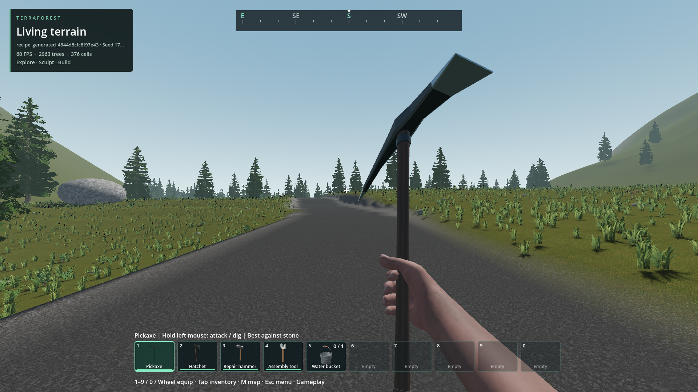

# Runtime performance

- Status: Improved-partial; installed and packaged walking verified.
- Updated: 2026-10-29. Initial baseline: `5bfe87f4`; maintenance: `304206cc`; readiness: `87afcdfe`.
- User review: Not reviewed. No visual quality reduction intended.

Resource follow-up: [4 GiB GPU / 5 GB content targets and cache policy](../../docs/RESOURCE_BUDGETS.md).
Cleanup recovered 53.3 GiB net, leaving 54.2 GiB free; the 100 GB goal is not met.
The original 2 GiB recognized-cache quota, 423 MB content and walking-memory gates
pass. World data/history/evidence remain intact. [Resource evidence](resource-budget-evidence.json).
The user raised the provisional terrain-cache quota to 3 GiB on 2026-10-28;
historical receipts are unchanged. Other resource thresholds stay the same.
RAM thresholds remain provisional and physical 4 GiB hardware remains unqualified.

## Collision readiness and actor state — 2026-10-29

- Loaded-model collision queries now prune a native bounds tree instead of
  scanning every loaded region. Exact compound/body checks stay unchanged;
  edits, admission, retirement, proxy changes and reload update the index.
  At the 4,096-group cap, node payload is 352 KiB per collection, plus allocator
  overhead. Incremental retirement also drains the old index incrementally.
- Zombie awareness reads native `state(id)` instead of building full route
  diagnostics every tick. Full diagnostics remain available; optional phase
  profiling is off during ordinary play. No AI, rendering or save rules changed.
- 2,048 readiness queries / 4,096 loaded regions: **37.564 → 1.179 ms**.
  Signed 3D groups **40.520 → 1.363 ms**; extended proxies **34.657 → 0.609 ms**.
  These are synthetic query batches, not whole-frame or city timings.
- 10,000 same-route state reads: full diagnostics **56.675 ms**, lightweight
  state **3.074 ms**; local/regional state equality checked through mutations.

Same disposable seed-1703 road, 248 m walking, 1080p/60 cap, RTX 4050 Laptop.
Baseline is source `87afcdfe` with profiling only; both final runs use the same
installed pack. AI/planning work is not lockstep; retain both repetitions:

| Mean CPU work per update | Before | Installed | Repeat |
| --- | ---: | ---: | ---: |
| Zombie residency/readiness | 0.2120 ms | 0.1146 ms | 0.1228 ms |
| Zombie perception/intent | 0.1477 ms | 0.1062 ms | 0.1138 ms |
| Zombie route planning | 0.1852 ms | 0.5043 ms | 0.3202 ms |
| Whole zombie update | 0.6328 ms | 0.8161 ms | 0.6511 ms |
| Whole-frame p95 | 19.940 ms | 20.089 ms | 21.085 ms |

Readiness and state-reading work improve, but **no total zombie-update or frame
speedup is demonstrated**: the final runs perform more route-planning work.
No density/distance/quality reductions. Both pack runs preserve the save hash,
capture no mouse and pass resource gates; peaks up to 3.88 GiB private RAM /
1.65 GiB dedicated GPU. Installed content 422.7 MB; both native builds rebuilt.

- **721 assertions across 11 runs pass**, plus export/native-hash smoke and
  both packaged walking checks. Includes 100,000-instance admission, edits,
  compound collision, retirement, reload, ground cover and zombie behavior.
- Existing regional-navigation tower/storey fixture fails the same two checks
  on old `87afcdfe` and current code. Not fixed or hidden: inspect its geometry,
  support and route trace, then require full fixture and real floor-to-floor travel.
- One admission run exceeded its timing gate (6.114 / 18.949 ms); the unchanged
  retry passed at 0.489 ms maximum. Cause remains unestablished; both retained.
- Rejected additional exclusion rewrites: one regressed a dense group from
  20.163 to 208.893 ms; batching still regressed small cases. Original exclusion
  code retained. Intermediate profiles are not final performance evidence.

[Measurements, hashes, tests and retained failures](readiness-evidence.json).
Dense per-object collision checks, publication, planning variability and earlier
endurance/cold-arrival/hardware/stall requirements remain open.

Baseline `87afcdfe`, seed 1703: 2,963 trees / 376 owners.

Same road route and counts; camera/wind differ slightly. Engineering inspection,
not user visual approval. Saves and generated content are unchanged.

## Maintenance pass — 2026-10-29

- Native terrain planning reuses validated state for over-budget eviction, protecting
  the newly selected coverage. Unchanged cuts no longer rebuild collision columns
  or revisit scene entries; visible mesh replacements and reload invalidate reuse.
- Vegetation exclusion reuses the existing unavailable-model bounds tree, with
  per-candidate pruning and first-overlap exit. No extra spatial index or background
  scan. Existing conservative bounds, authoring, streaming and save rules remain.
- Same disposable seed-1703 save and 248 m route, 1080p/60 cap, RTX 4050 Laptop:
  mean terrain schedule/cut/evict **1.923 → 1.149 ms/update** (40% less CPU);
  idle **1.716 → 1.011 ms**. These are subsystem costs, not frame times.
- Synthetic 4,096-region exclusion: 1,024 two-candidate batches **21.017 → 0.875 ms**;
  signed axes, sparse coordinates, extended meshes and transforms pass too. This
  is in-memory query cost, not disk streaming or whole-city performance.
- **1,379 assertions + 15 Python checks pass**, plus packaged walking, native-hash
  smoke and resource gates. Source snapshot hashes stay unchanged, zero mouse
  captures. Both native configurations rebuilt; installed content 422.7 MB,
  observed pack peaks 3.89 GiB private RAM / 1.65 GiB dedicated GPU.

Walking frame p95 **20.035 → 20.168 ms**: no demonstrated whole-frame improvement.
The GPU, visual settings, density and distances are unchanged. Remaining costs
include surface-result publication and zombie updates; the historical unexplained
199 ms stall is not claimed fixed. Maximum-city, cold-arrival, loading/generation,
mining endurance and weaker-hardware qualification remain open. Resume with matched
frame traces and finer stage attribution, not reduced visuals or loosened budgets.
[Exact measurements, hashes, tests and rejected trials](maintenance-evidence.json).

Baseline `304206cc`, road arrival: 2,963 trees / 376 owners.

Same route and counts; inspected for regressions, not user-approved or pixel-identical.

## Changes

- Forest residency refreshes only when its cell/radius/limit changes; settled
  forests skip full-owner searches. Edit resampling and reconciliation still run.
- Ground cover skips settled scheduling and obsolete constant-density scans.
  Density, draw distance, shadows and bounded retirement remain unchanged.
- Native terrain planning computes requests and coverage from one validated
  state, rather than decoding the same dictionaries twice. No cross-frame cache.
- Static collision readiness uses the existing unloaded-region bounds tree,
  including transformed extents and empty-region handling. Structure queries
  reuse the registered model array instead of allocating it on every call.

## Measurements

Same seed-1703 disposable save, approximately 248 m of actual walking along the
same asphalt route; 8 s idle, 45 s walking, 8 s recovery. RTX 4050 Laptop GPU,
1920×1080, 60 FPS cap, offscreen/no mouse capture. Saves unchanged. AI and timing
are not lockstep; these are scoped samples, not a general FPS guarantee.

| CPU work | Before | After |
| --- | ---: | ---: |
| Forest scheduler, mean walking frame | 202 µs | 79 µs |
| Forest scheduler, mean idle frame | 135 µs | 4 µs |
| Ground-cover coordinator, mean walking frame | 181 µs | 153 µs |
| Terrain schedule/coverage/eviction, mean update | 2.20 ms | 1.93 ms |
| Native request + available-coverage microbenchmark, median | 0.324 ms | 0.219 ms |
| 2,048 collision queries against 4,096 unloaded regions | 43.37 ms | 0.66 ms |

Walking frame p95 was **21.48 → 22.20 ms**, so this is not a demonstrated overall
frame-p95 improvement. A single 199 ms baseline interval did not repeat in the
first updated run (37.5 ms maximum); its cause is not established or closed.
GPU cost is not optimized by this change.

Installed-pack repetition: 248.18 m walked, forest 76 µs/frame, cover
137 µs/frame, terrain update 1.94 ms; frame p95 21.85 ms, maximum 43.64 ms.
Both native configurations build; export validates all 14 external DLL hashes.
The read-only source-save hash and zero-cursor-capture checks pass again.
[Packaged run and summaries](../../reports/runtime_performance/20261028T181805414845Z_packaged_roads/run.json).

[Baseline frames](../../reports/runtime_performance/20261028T175902800822Z_baseline_roads/frames.json),
[updated frames](../../reports/runtime_performance/20261028T180747834274Z_optimized_roads/frames.json),
[old-pack collision benchmark](../../reports/runtime_performance/old_pack_collision_retry/model_focus_discovery.json),
[new collision benchmark](../../reports/checks/20261028T181340947816Z/console.log).

## Verification and images

- 332 planner assertions, including fused/separate equality for stationary,
  targeted, travelling and navigation-interest cases over dirty/partial states.
  [Latest planner run](../../reports/checks/20261028T181803359516Z/run.json).
- 158 cover assertions: identical settled records, edits, harvest, partial and
  reversed replies, teleport retirement, reset and retry. Tree budget checks
  include idle, radius changes, reload, resampling and reconciliation.
  [Cover](../../reports/checks/20261028T181137770427Z/run.json),
  [trees](../../reports/checks/20261028T180714976009Z/run.json).
- 58 spatial-discovery assertions, 100,000-placement metadata reload, streamed
  terrain collision, density queries, vegetation support and edit recovery pass.
  [Metadata](../../reports/checks/20261028T180942617211Z/run.json),
  [terrain coverage](../../reports/checks/20261028T181326196848Z/run.json),
  [edit recovery](../../reports/checks/20261028T180945872140Z/run.json),
  [support](../../reports/checks/20261028T180947070513Z/run.json),
  [model regions](../../reports/checks/20261028T181959238763Z/run.json).
- Earlier failed harness runs are retained under `reports/runtime_performance`
  and `reports/checks`: bridge route accidentally started under its deck; old
  mocks/signatures and obsolete immediate-retirement expectations were corrected.
  The bridge trial is not a walking-performance baseline.

Baseline arrival near (896, 57, 1500), seed 1703. 2,963 tree roots / 376 owners.

Updated arrival on the same route with the same tree/owner counts. Camera
position and wind phase differ slightly; not a pixel-equality comparison.

## Remaining / reproduce

Run `python tools/profile_runtime.py --slot <disposable recipe_generated slot>`;
add `--pack` for the installed build. It rejects ordinary player-save names,
uses read-only loading, records hashes/timings, and removes only its own passed
temporary derived cache. Use a populated generated test fixture with asphalt roads.

Multi-hour walking/mining/driving, maximum cities, cold fast-travel and lower-end
hardware remain unqualified. Zombie phase timing is now available; return with
repeated frame traces and publication/planning attribution for the isolated stall;
do not treat an absent recurrence
as a fix. Loading/generation wall-time and GPU-bound rendering need separate
matched benchmarks before further changes. Preserve the same visual settings.
