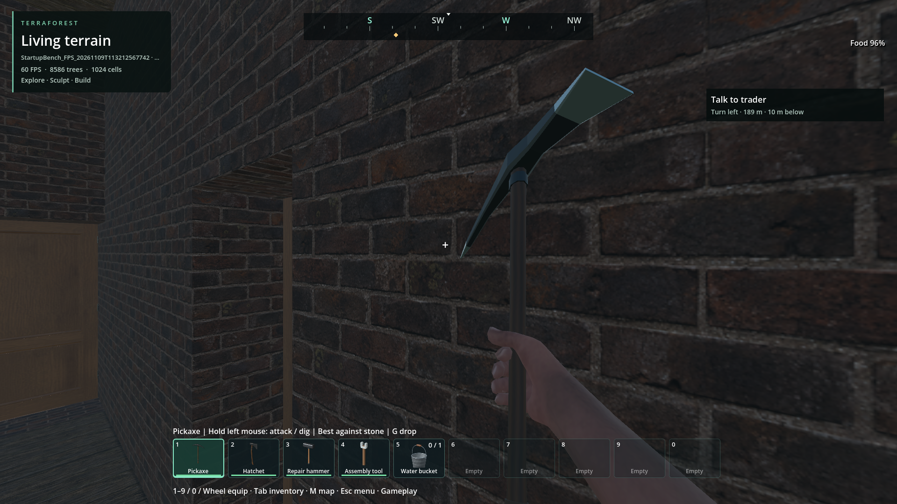
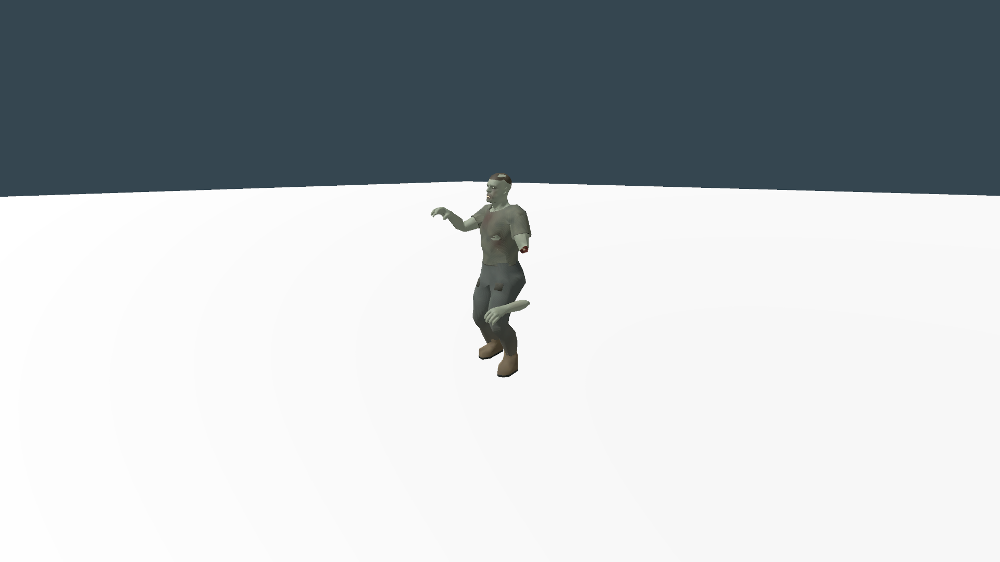
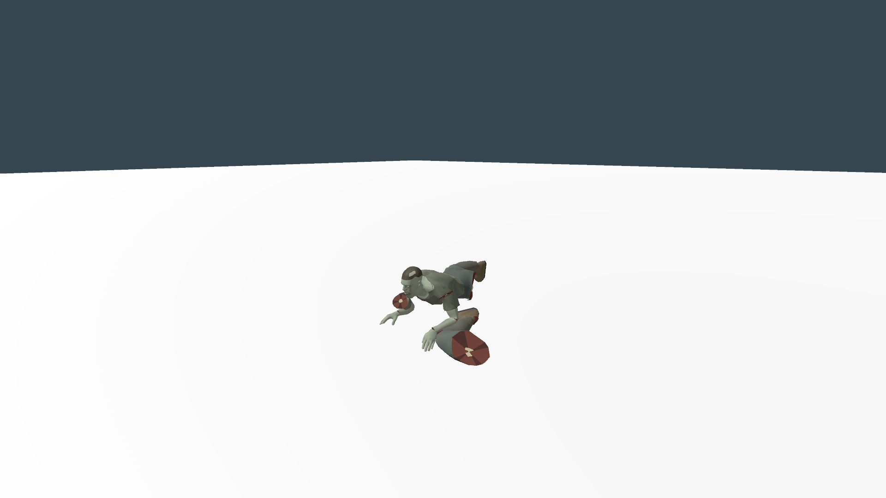
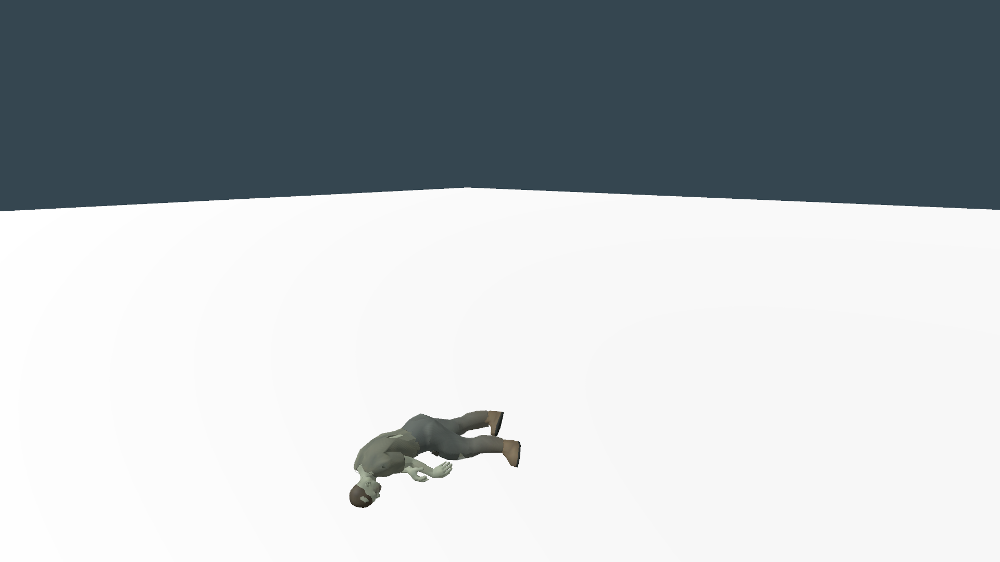

# Zombie admission: remove render-mesh readback

Status: reproduced admission stall improved; **60 FPS with headroom remains open**.
Continues the [world/player foundation](foundation-2026-11-09.md).
Implementation: `72379f7c`, debug/release libraries and matching resource pack.

The first zombie's anatomy setup synchronously fetched arrays from fourteen
render meshes. In the instrumented default-world baseline, those calls consumed
**46.603 ms of 57.864 ms** of anatomy setup. Subsequent residents reused geometry
and had zero readback. This is a measured source of the first-admission stall,
not an explanation for every later draw or scheduling stall.

`Zombie.geometry.res` now stores the same 12,082 vertices, indices, skin weights
and morph arrays in a 339,622-byte compressed binary resource. Startup dependency
preparation loads it with the model. Native anatomy validates the mesh identity,
format, dimensions and numeric bounds, then constructs the bind mapping from
the live rig. A model-scoped cache shares geometry and fitted shapes; health,
wounds, pose and scene ownership remain per actor. Different or invalidated
assets retain the live path. No mesh simplification, hit-region removal, ragdoll
limit, animation change or rendering setting is involved.

The first source Vulkan repeat records **2.307 ms anatomy setup, zero readback**;
fitted-shape retrieval is 0.019 ms. Initial hit-area construction still takes
11.508 ms. Other first-use costs vary with caches and driver state, so the whole
admission improvement is not attributed solely to this change. Triggered gameplay
windows still have p99 22.278 ms and maximum 36.280 ms, with mean root GPU 13.962 ms.
This does not establish continuous 60 FPS or GPU headroom.

The bake tool records source/engine/output hashes and runs during pack export.
After changing the model, import settings or anatomy preparation, rebuild native
code and run `tools/bake_zombie_geometry.gd` before source playtesting; its
`--check-only` mode rejects stale provenance. The binary data is a representation
of the existing inherited character within GAP-002, with its qualified character
notice retained. New preparation/test code is 0BSD; no new third-party content.

## Verification and retained failures

- Baseline: `reports/performance_changes/20261109T111548973735Z_anatomy_readback_baseline`.
- First baked source run: `reports/performance_changes/20261109T113212567742Z_anatomy_baked1`.
  Both use isolated copies of the generator-29/seed-1703 default world, 1080p
  Vulkan Forward+, unchanged production settings. Save/exit and strict lifetime
  checks pass. Triggered windows overlap and are deduplicated by frame; they are
  not unbiased whole-session statistics.
- Geometry bake: 19 checks, exact convex points/offsets, independent animated
  vertex reference, hand/contact parity, malformed-data rejection and asset
  invalidation. The existing geometry cache has 30 checks including independent
  health, retirement, changed rigs and live geometry fallback. Both pass against
  debug and release DLLs. Source anatomy/combat/rest regressions also pass.
- The first invalidation test crashed when a cache callback released a native
  listener during the same signal emission. The cache now marks refresh pending
  and keeps the old listener alive until subsequent preparation. The failed
  receipt `reports/checks/20261109T112849211570Z` remains retained.
- The first isolated release test lacked extension discovery in its temporary
  project. Its driver now explicitly loads the extension, like other isolated
  native tests. `reports/anatomy_geometry_release_missing_extension.log` retains
  that setup failure; it is not a runtime pass.

The [machine-readable evidence](anatomy-geometry-2026-11-09.json) records 18 run
manifests, source/trace/build/package hashes and two isolated release results.
Source checks pass 19 bake + 30 cache + 52 anatomy + 39 combat + 33 rest assertions.
Matching-package checks pass 19 bake + 30 cache + 39 graphical combat assertions,
plus 14 moving-target replanning and 11 corridor/retaliation assertions. This
package includes fourteen matching native DLLs; all these shutdown checks are clean.

Two serial packaged default-world repeats retain zero readback, first anatomy
2.118/2.048 ms and hit-area construction 9.628/19.121 ms. Their triggered-window
gameplay p99 values are **32.333/32.261 ms**, maxima **33.453/40.257 ms**, and mean
root GPU **14.368/14.120 ms**. These are not an overall frame-pacing improvement
claim: earlier package repeats ranged differently, and rendering/cache/driver
variation remains. In the second repeat's worst frame, draw is 34.143 ms and
zombie update 0.633 ms, with no new draw pipelines. The original 46.603 ms admission
readback is removed; independent later rendering/scheduling costs remain.

Reproduce the focused checks with `tools/check_zombie_ragdolls.py --pack --checks
zombie_geometry_bake zombie_geometry_cache`; use `--pack --graphical --offscreen
--checks zombie_combat_regions` for retained combat images. The two world receipts
are `reports/performance_changes/20261109T114157357162Z_anatomy_geometry_pack1`
and `reports/performance_changes/20261109T114302555644Z_anatomy_geometry_pack2`.

## Remaining / resume here

First-use hit areas, scene attachment and animation setup still need bounded
admission or preparation with unchanged readiness/gameplay. Cold multi-floor
planning still takes tens of seconds; regional invalidation currently clears
the entire shared graph even for a small edit. Investigate affected-region
invalidation and route work with retained stairs, clearance, hazards and moving
target tests. Point-light shadow/opaque rendering and unexplained draw/scheduling
tails remain separate requirements. See the foundation's continuation table for
the full backlog, including endurance and multiplayer qualification.

## Inspected visual evidence

Same default-world view, generator 29/seed 1703, 1080p Vulkan, unchanged settings.
No new visible difference found in this view. The existing pickaxe grip appearance
is present in both; this is not overall art approval or a screenshot-based FPS gate.

Matching-package combat fixture: retained mesh/caps, crawling after limb loss and
articulated corpse rest. Images were inspected alongside the independent vertex,
contact, detachment and wake-up checks. Source paths and hashes are in
`images/manifest.json`; inherited character appearance remains separately unapproved.
