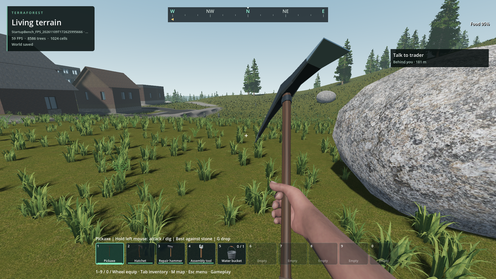
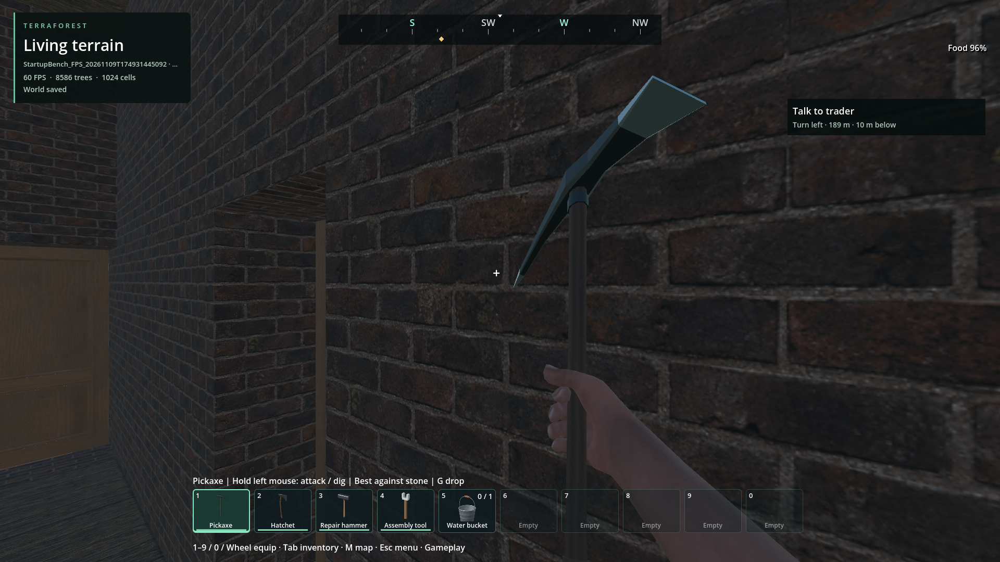

# Native building occlusion and broad frame costs

Status: implemented in `1f1d7521`; source debug/release/render checks and three
installed save/shutdown checks pass. Stable 60 FPS with headroom and universal
nonregression remain open.
User visual review: not requested or received. Exact receipts and image hashes:
[evidence JSON](block-occlusion-2026-11-09.json).

The investigation now targets whole-world rendering and frame stalls. In the
retained default Frontier world (generator 29, seed 1703), an upstairs view still
submitted thousands of draws behind opaque building walls. An exact-mesh probe
reduced rendering CPU time and draw calls without changing authored geometry.

[BlockOcclusion](../../docs/BLOCK_OCCLUSION.md) implements that result as an optional
native component. It reuses the existing CPU mesh arrays, preserves openings,
invalidates immediately on edits/destruction, and bounds admission to 128 nearby
chunks and 2 MiB of accounted geometry. Each chunk has a 256 KiB input limit.
The normal rendered world enables its viewport and restores its prior state on
exit. No generation, save, collision, material, shadow or visibility-distance
setting changes. No GDScript gameplay mesh scanning or GPU readback was added.

Publication is limited to one occluder per step; retirement to four. The 0.5 ms
elapsed gate is soft: source runs reached 2.07–2.12 ms for a step. These limits
bound inputs and queue work, not engine allocation or acceleration-build time.
The rolling trace includes native queue, geometry and timing counters.

## Measured source results

Each stationary comparison uses off/on/on/off phases, two seconds of settling
and five seconds of measurement per phase, with normal world/player services at
1920×1080. Construction and image readback are outside measured phases.

| View / metric | Off A | On B | On B repeat | Off A repeat |
| --- | ---: | ---: | ---: | ---: |
| Indoor rendering CPU median, ms | 5.657 | 2.674 | 2.618 | 5.630 |
| Indoor GPU median, ms | 14.641 | 13.655 | 13.782 | 15.125 |
| Indoor draw calls | 5,418 | 1,783 | 1,783 | 5,418 |
| Indoor frame p99, ms | 20.478 | 20.670 | 20.097 | 22.875 |
| Outdoor rendering CPU median, ms | 2.814 | 2.926 | 2.751 | 2.612 |
| Outdoor GPU median, ms | 14.220 | 14.000 | 13.751 | 14.407 |
| Outdoor draw calls | 2,487 | 2,414 | 2,414 | 2,487 |
| Outdoor frame p99, ms | 20.892 | 21.279 | 20.628 | 20.498 |

This supports a substantial indoor CPU improvement, not a general frame-time
win. Outdoors, average phase CPU medians increase about 0.13 ms; that tradeoff
needs wider traversal evidence. The outdoor sweep still reaches 37.218 ms,
with 26.446 ms p99. Native residency is 86 / 75 occluders and 746,772 / 695,220
accounted geometry bytes in these indoor/outdoor views.

GPU clocks and limiting flags vary markedly between runs. The earlier diagnostic
prototype had 7.3–7.4 ms off and 5.8–5.9 ms on GPU medians at much higher clocks;
do not compare those absolute GPU values with the source-native run as a code
regression. Retained hardware CSVs record the conditions. No power settings were
changed, and absence of another TerraForest run is not proof of an idle host.

## Installed package and headroom

The installed PCK is 556,867,068 bytes, SHA256
`112c554377f8693b2ad37af9a47d3807a512039bcaadb08e105f829a89b0a176`.
All fourteen native libraries match. Export building/content/light checks pass.
Three serialized default-world clones save, restore viewport state and exit with
no error or leak diagnostics. Sampled peak private commit is 3.94–3.97 GB and
dedicated GPU memory is 1.47–1.48 GB. These short runs do not prove leak freedom.
Debris and shape-icon receipts refreshed their source hashes; output geometry
and icon bytes are unchanged.

The installed indoor comparison reproduces the CPU gain: off medians are
5.219/5.170 ms; on medians are 2.734/2.737 ms. Draws fall from 5,418 to 1,783.
GPU medians fall from 7.835/7.623 to 5.787/5.860 ms at the observed higher clocks.
On-phase frame p99 is 18.044/18.967 ms, still above the 16.67 ms target.

The capped outdoor comparison has an approximately 0.26 ms increase in average
rendering CPU medians and no clear GPU gain. Its outdoor sweep p99/max is
27.244/31.049 ms; another stationary outdoor phase reaches 55.159 ms. This is
an explicit regression candidate/tradeoff, not a universal performance pass.

The follow-up disables VSync and the limiter for diagnosis only. Outdoor sweep
median is 7.647 ms, p99 17.792 ms and maximum 34.616 ms. Stationary off-phase
rendering CPU medians are 2.610/2.632 ms versus 2.762/2.833 ms on; GPU medians
remain near 6.1 ms. Typical frames have capacity, but travel tails still fail
60 FPS and the open-view occlusion overhead remains a follow-up requirement.
Normal gameplay defaults were not uncapped.

At uncapped sweep frame 6114, measured process/draw intervals are 10.216/19.031
ms, GPU 5.359 ms and native occlusion publication step 0.0137 ms with no upload.
At settled frame 12237, the 26.795 ms sample has no physics callback, a 1.052 ms
process interval and 25.272 ms draw interval. Those stalls cannot be assigned to
zombie recalculation from this evidence. Intervals overlap, GPU measurements can
lag and CPU counters are quantized; exact render/engine scheduling ownership
remains to be resolved. The receipt retains the joined rolling rows.

## Correctness and visual evidence

The native fixture passes 24 checks in source, isolated release and rendered
execution: exact arrays/transforms, an independent ray through a doorway, wall
closure, immediate blast invalidation, region unload/reload, forty edit/blast
cycles, node/accounting stability, disable, count/byte/publication limits, travel
eviction and dense-chunk fallback. Existing block-region (73), destruction (25),
collision-stream and rolling-trace checks pass. These are short checks, not
endurance leak qualification. The rendered doorway's open/on, open/off, closed
and destroyed captures were inspected.

The four indoor and outdoor source comparison images were inspected. An initial
claim that the nearby boulder became smaller was a visual-reading error. The
original PNGs have a pixel-identical 500×350 interior rock patch in every phase
of all three runs. Sampled edge positions differ by at most one pixel in the
first comparison and match exactly in the two controls. The all-culling-off
control also has identical camera, instance-buffer hashes and material eye
parameters throughout. No boulder workaround or production change was made.
All original images and the correction receipt are retained.

Source default Frontier room, 1920×1080, culling off; comparison baseline.

Same source room and camera, culling on. Scoped inspection found no missing
visible room geometry; this does not qualify every structure or viewpoint.

Source default Frontier outdoor endpoint, culling on. The boulder size allegation
was rejected after checking original pixels; vegetation animation varies.

Installed PCK, same default room, culling on. All four comparison captures were
inspected; visible room surfaces remain present.

Installed outdoor endpoint, culling on. All seven capped sweep/comparison views
and all seven uncapped views were inspected. No obvious missing geometry at
these sampled views; continuous traversal and user visual acceptance remain open.

## Retained failed and invalid trials

- Initial native fixture: one of 24 checks failed because its focus lay exactly
  between chunk centers. The corrected focus tests the intended nearest chunk.
- Initial isolated release launch omitted its explicit extension load; that log
  is retained. The corrected fixture passes all 24 release checks.
- `--profiling` alone did not start the script profiler. The tool now requests
  the debugger explicitly and verifies `BEGIN PROFILING`. Debug profiler output
  materially perturbs pacing and is used for script attribution only.
- The first indoor source comparison charged a final PNG readback to the first
  save frame (800.911 ms). The diagnostic now drains the screenshot boundary
  before changing phase. The corrected outdoor save maximum is 23.993 ms. This
  explains that test artifact only; the earlier independent 702.654 ms wait
  remains unexplained.

## Remaining work and return criteria

- Extend the installed short comparisons to normal traversal. Require repeated ordinary
  frame distributions with hardware telemetry, unchanged visible content, save
  and teardown checks. A capped FPS counter is insufficient evidence of headroom.
- Attribute CPU-heavy physics and independent draw/presentation waits. Debug
  attribution places six zombie body callbacks around 2.1–2.75 ms versus about
  0.37–0.45 ms central planning; those measurements do not account for all physics
  cost, and nested/worker times must not be added. Profile world/player work too.
- Revisit the occlusion input/selection policy if dense structures exceed the
  step allowance or outdoor CPU overhead is repeatable; preserve exact openings.
- Dense barrel/collapse chains, long-session allocation growth, cold pursuit,
  cover travel-selection overhead, weak hardware and future multiplayer scale
  remain open. Preserve the six existing water-cut failures and legacy 81-cell
  interaction failure; this change does not fix or waive them.

Reproduce with `python tools/check_frame_trace_world.py --short --save
--block-occlusion`, adding `--outdoor-cover` for the outdoor route and
`--executable` for the matching package. The harness clones its owned retained
fixture and does not overwrite player saves. New implementation, fixtures and
diagnostics are original AI-assisted 0BSD code; no external material or
dependency was imported.
