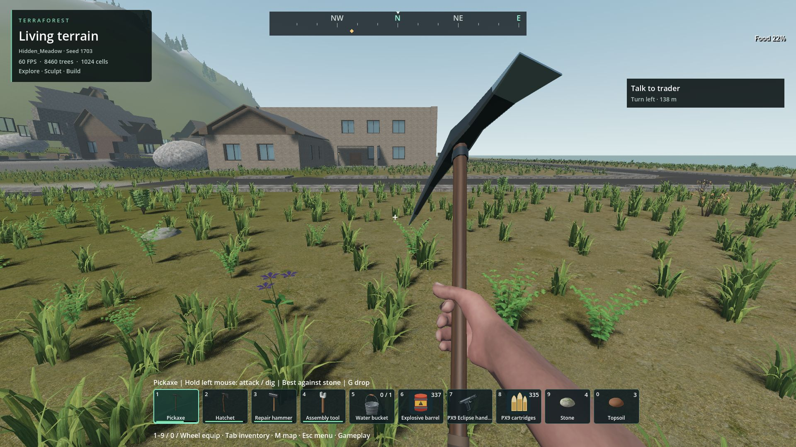

# Corpse restoration and terrain publication — 2026-11-26

Status: work reductions and admission fixes verified; overall frame p99 remains open.
This follows [frame-tail attribution](frame-tail-2026-11-26.md).

## Admission correctness and replay provenance

The old population preflight tested a 2 × 9 × 2 m footprint, while authored
resident admission required 5 × 5 × 5 m. The queue consumed a candidate before
that larger footprint was ready. Work diagnostic `20261126T072831062892Z`
records resident 2551 failing during loading with `full_coverage=false`.
Commit `da6e5837` shares the actual admission bounds between preflight and support
validation. Pending coverage retains the queue cursor; fully ready but unsuitable
geometry still rejects normally. A regression exercises both cases.

Corrected repeats `20261126T073452516239Z` and `20261126T073808085280Z`
have identical resident and corpse identities at all six checkpoints. The second
run is excluded from timing acceptance: a separately launched human game started
during it, and post-run retention correctly refused to run until gameplay exited.
The human session saved new positions. Its new source hash is
`12fe7b19bccd0c9e9e6475a7e6efc1f4620794ba3ac7336d9d81ff6b0d4c41ec`;
the earlier hash was
`b5c310dba6521eae0219d1cceed7c65022c7178ecf23214e2aca0becd62408ee`.
Do not interpret different populations across those hashes as replay drift.
The analyzer now also compares sorted resident identities/alive state and corpse
identities at every checkpoint. This is stronger than counts, but not a claim of
bitwise deterministic navigation or full human-input replay. Replay identity,
focus and bounded capture tooling is committed as `803ac02b`.

## Removing actual construction and query work

Saved corpses now construct only their surviving physical bodies, retain the
body offsets needed to decode the saved pose, and install collision and joints
only for the final pose. Rest-pose shapes and joints were previously built and
immediately discarded. Live deaths keep their existing path. Missing limbs,
finger compounds, geometry sampling, contact properties and final activation
remain unchanged (`6d3304f8`). Partial restoration remains hidden and cannot collide, be
picked or enter persistence. This removes allocations and physics setup rather
than changing per-frame budgets.

The apparent terrain-publication cost was largely ground-cover structure
exclusion. Diagnostic `072831` attributes 813.68 ms across 1,429 callbacks to
that mask (mean 0.569 ms, maximum 0.969 ms). Complete surface-batch callbacks
consumed 1,683.01 ms across 1,633 callbacks. These scopes overlap.
Each structure collection used to revalidate the same placement batch, transform
the same bounds, allocate another mask and merge it. Each model collection also
scanned all collision groups despite already maintaining a spatial index.

A per-call native query packet (`c5b5f63d`) now validates once and shares local candidate
boxes among consecutive collections with the same exact transform. Collections
accumulate into one mask and traverse the existing collision-bounds tree,
pruning remote subtrees. Only the most recent frame is retained, so memory stays
O(candidates), bounded by the existing 65,536-candidate limit. There is no new
cross-call geometry cache or invalidation protocol. Different transforms,
compound gaps, unloaded archive pages and fail-closed pending/unavailable
results retain their semantics. The same service benefits every placement-query
caller, including future collections; it does not defer the work to another frame.

## Exact collision positions instead of render seams

The first matched candidate (`20261126T075820533579Z`) changed frame p99 only
from 21.200 to 21.095 ms. This is not a convincing overall improvement. The
remaining hull cost warranted a separate experiment rather than a pacing change.

Probe `20261126T080421276360Z` rebuilt the same head clouds with alternating
order and fresh physics resources. After the existing interior-point filter,
rest/attack/morphed clouds still contained 525/524/508 repeated positions from
render seams (2,908/2,927/2,865 inputs). Exact duplicate removal reduced typical
installation by about 0.3–0.5 ms; that probe excluded duplicate detection cost.

Commit `4b25ff19` normalizes dense, nondegenerate collision inputs after interior
filtering. A native position set keeps the first source occurrence and removes
only exactly equal positions. Diagnostic equality certificates refer directly
to retained source vertices. Signed zero hashes consistently; nearby distinct
vertices, morphs and boundary points are not rounded or snapped. The existing
small/degenerate fast paths remain. The set is transient O(input) memory, not a
persistent posed-shape cache. Final gameplay timings include this preparation.
The native test's head preparation grew from 0.497 to 0.649 ms in the rest case;
its fresh installation dropped from roughly 2.47 to 2.06 ms. Those are scoped
construction measurements, not a claim about overall frame time.

## Verification

- Native debug and release builds completed for both structures and world runtime.
  All four source/dependency/output fingerprint checks pass. A Zig compiler-cache
  `failed to link with LLD: FileNotFound` failure was retried with verbose compiler
  diagnostics, without changing source or optimization settings.
- `20261126T075759555322Z`: 55 shared-query/paging assertions pass, including
  exact same-frame transform reuse, spatial pruning, mixed transforms, edits,
  compound gaps, invalid packets and unloaded-page lifetime handling.
- `20261126T080809912856Z`: 20 final corpse lifecycle assertions pass, including exact
  sampled hull/finger equality, authored joints, absent-body omission and safe
  cancellation/suspension.
- `20261126T080824707009Z`: final saved missing-anatomy restoration passes with no
  discarded debris construction.
- `20261126T080754570475Z`: 80 convex/equality-certificate and independent engine
  contact assertions pass, including nearby distinct vertices, signed zero,
  attack poses, morphs, degeneracy and geometry invalidation.
- `20261126T080840146191Z`: 33 resting/support-loss assertions pass.
- `20261126T075611823581Z`: full contact and reactivation checks pass.
- Six Python capture/retention/comparison tests pass, including equal counts
  with different resident identities being rejected and receipt-owned image retention.

Preserved failed harness checks: `075038675151Z` completed all 19 assertions but
used an incorrect required log string; `075500835240Z` caught a parse error in
the modified cost fixture, corrected before the passing rerun. Neither is a
passing launcher receipt.

## Cadence

Same two hotspots, six 600-tick legs, 1920 × 1080 Forward+, normal desktop,
fullscreen and focused, 60 Hz physics, VSync and 60 FPS cap. Godot 4.7.2
(`ed1daf0bf`), RTX 4050 Laptop and i5-12450H. No population, geometry,
simulation-distance or presentation-quality reduction. The baseline already
includes the population-admission fix; it retains the previous corpse/query paths.

| Capture | Frame count | p99 ms | Maximum ms | Intervals >33.333 / >50 ms |
| --- | ---: | ---: | ---: | ---: |
| Baseline `20261126T074428989907Z` | 3,600 | 21.200 | 39.352 | 1 / 0 |
| Corpse/query changes, before exact compaction `20261126T075820533579Z` | 3,600 | 21.095 | 31.898 | 0 / 0 |
| Final, gameplay image verified `20261126T082710388209Z` | 3,599 | 21.633 | 29.207 | 0 / 0 |
| Final repeat, contended, excluded from timing claims `20261126T083027403130Z` | 3,588 | 22.628 | 88.885 | 1 / 1 |

All four match source hash, seed, route endpoints, settings, focus and resident/
corpse identity checkpoints. Each admits 26 ragdolls. The final clean run has
no intervals above 33.333 ms, but **does not improve p99**. These capped runs do
not establish uncapped headroom or a general reduction in rare stalls.

The clean final run includes ten newly registered, unplaced Homestead 01 models
from concurrent catalog work, recorded in its dirty-checkout receipt. The source
world is unchanged; nevertheless this is an additional build difference, so
small timing changes cannot be attributed solely to the performance changes.
The final repeat overlaps the separate `homestead_02_pack` check
`20261126T083110884614Z`. Its engine log spans 08:31:39.844–08:31:40.761 UTC,
within our measured 08:31:11.270–08:32:13.378 interval. This invalidates an isolated
timing comparison, but does not explain the 88.885 ms frame at 08:31:11.270;
that unfavorable frame is preserved, not attributed to the other process.

| Measured work | Baseline | First candidate | Final clean run |
| --- | ---: | ---: | ---: |
| Surface-batch total / callbacks | 1,610.77 ms / 1,578 | 972.47 ms / 1,099 | 976.61 ms / 1,090 |
| Maximum surface callback | 2.448 ms | 2.508 ms | 2.948 ms |
| Mean corpse-restore work per frame | 0.1009 ms | 0.1005 ms | 0.0998 ms |
| Corpse-restore p99 / maximum | 3.372 / 5.240 ms | 3.190 / 4.977 ms | 3.143 / 6.687 ms |
| Mean completed ragdoll work | 9.350 ms | 9.611 ms | 9.503 ms |
| Mean retained head points | 2,593.0 | 2,610.4 | 2,212.6 |
| Mean head preparation / install / total | 0.480 / 2.696 / 3.362 ms | 0.556 / 2.797 / 3.508 ms | 0.631 / 2.421 / 3.182 ms |

Surface callback counts and asynchronous completion timing differ, so their
totals are route observations, not an isolated per-call speedup. Head poses also
vary: the exact paired-cloud experiment above is the stronger evidence for
duplicate-removal cost. Removal of redundant constructors is verified by lifecycle
assertions; it has not yielded a clear net restoration-time gain in this route.

Overall main-thread cycle means are 31.86 million before and 32.15 million after;
the draw portion is 15.43 versus 15.99 million. There is no measured overall CPU
cycle gain. In the slowest 36 frames, mean physics callbacks fall from 5.05 to
4.64 ms, while process grows from 4.03 to 5.53 ms and draw from 8.00 to 8.71 ms.
Corpse work above 2 ms occurs in 16 versus 10 of these frames; surface work above
1 ms occurs in 22 versus 19. These scopes overlap and cannot be added as a causal
decomposition. The remaining process/draw bursts and engine synchronization
need attribution; lower construction work alone does not clear the frame tail.

## Replay validity and startup failures

The first final-build repeats `20261126T081041629103Z` and
`20261126T081301910256Z` match each other, at 20.421 and 20.517 ms p99, but were
unfocused throughout. The analyzer rejects comparison with the focused baseline.
An initial focus-wait variant (`20261126T081543824610Z`, 21.685 ms p99) allowed
simulation to advance during two setup frames. It restored an extra corpse 31
at `site0_back` and admitted 27 ragdolls, so it is also rejected.

The final driver pauses game processing during those setup frames, requests
focus once on the interactive desktop, and asserts focus before measurement.
It does not force focus during playback or on the isolated diagnostic desktop.
The accepted final runs match all six checkpoint populations and identities.
This fixes the observed admission/setup drift; full-world determinism is still
unqualified, and checkpoint equality cannot prove identical intervening poses.

The user's observation of launches not reaching gameplay corresponded to real
startup failures. `20261126T081841924156Z` could not load an in-progress
Homestead 01 bed resource; `20261126T082235436773Z` then failed catalog lookup
because a JSON numeric ID was used without integer normalization. Normalizing
the recipe lookup to `names[int(...)]` fixed that startup error. The catalog
belongs to the parallel house-pack work and is not included in these performance
commits. Both failed launches remain failed receipts, despite engine exit code 0.
The subsequent clean run loaded the actual save and completed all six route legs.



Captured after timing ended in `20261126T082710388209Z`, using
`--capture-replay-view`; visually inspected to confirm the first-person Hidden
Meadow scene, HUD and world geometry rather than the world selector. This is
execution evidence, not world-design acceptance. The 364,505-byte JPEG is copied
unchanged from that receipt's `replay_view.jpg`, SHA-256
`b60cdf9b4642701663cd46927a49e08ab1822ae3f04b0d2cd2c6f12bd6f6b421`.
It depicts existing project assets and retains their recorded provenance and
licenses; capture does not relicense them. `issues/.gdignore` excludes it from
game imports/exports. The optional framebuffer is capped at 1 MiB, admitted before
launch and archived with its owning capture; screenshot work is outside timing.

## Reproduction and remaining gate

Run from the project directory with the existing unchanged Hidden Meadow save:

```text
python tools/run_godot_check.py physics_residency_world --godot "<Godot executable>" --visible-render --timeout 300 --require "PHYSICS_RESIDENCY failures=0" -- --capture-replay-view
python tools/analyze_physics_residency.py reports/checks/20261126T074428989907Z reports/checks/20261126T082710388209Z
```

The driver encodes the same idle/S/W and idle/A/D route from hotspots
(1882, 44.05, 1491) and (1815, 44.05, 1844), with fixed tick-indexed yaw.
It opens the canonical save read-only and verifies its hash after the route.
The result is a representative repeatable workload, not a recording of arbitrary
human input. A changed source save requires a new matched baseline.

The work-reduction and admission changes are complete and verified in scope.
Overall p99 and the 60 FPS headroom gate remain open. Return with a stable catalog,
exclusive Godot test window, equivalent recorded state/settings and retained
worst-frame windows to attribute the remaining process/draw/engine waits. Closing
the gate requires repeated matched normal-desktop measurements and recorder-off/
uncapped headroom evidence, without reducing population or quality. Full human
replay additionally needs retained initial state, tick-indexed actions and full
state checks; normal-exit capture acknowledgement also remains outstanding.

Receipts, logs and compact summaries remain in `reports/checks/<run>/`.
Cadence follows the existing two-ready-capture archival lifecycle; cold captures
are hash-verified by the analyzer. No source save or exported build is created.
