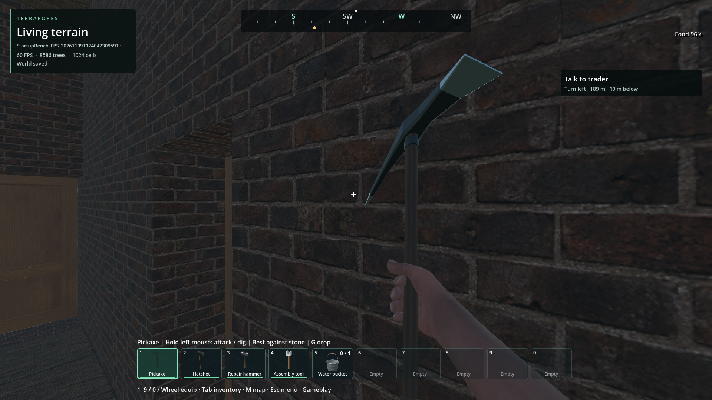

# Ground-cover shadow submission waste

Status at capture: cause supported by controlled diagnostics. The subsequent
[native production correction and remaining acceptance work](native-cover-partitions-2026-11-09.md)
are recorded separately; this report preserves the prototype evidence.
Updated 2026-11-09. Diagnostic commit `a973da7e`; these captures use the verified
navigation package `2e730410`. New diagnostic code is
original 0BSD. [Exact evidence](cover-render-partitions-2026-11-09.json) retains
run/package hashes, metrics, controls and the unresolved stall.

## Cause and controlled comparisons

The default world uses 32 m native cover groups. Their MultiMeshes can overlap
nearby room lights even when most contained instances are outside the light.
The post-capture scene inventory finds one 693-instance group overlapping all
four 8 m room lights, while only 2–26 individual bounds overlap each light.
These are conservative AABB candidates, not actual GPU submission counts;
shader deformation, LOD and light cubemap faces are not represented by that
estimate. Godot documents [all-or-none MultiMesh visibility](https://github.com/godotengine/godot-docs/blob/master/tutorials/performance/using_multimesh.rst).

A test-only probe copies the exact nearby instance records, materials and shadow
settings into smaller draw groups. It keeps the originals for rollback, verifies
unchanged buffers, and runs original / partitioned / partitioned / original
five-second phases with two-second warmups. Gameplay and actors remain active.
No density, light, wind, shadow-distance or saved preference changes are made.

| Probe | Original GPU medians A / A2 | Partitioned GPU medians B / B2 | Cost / scope |
| --- | --- | --- | --- |
| 8 m, normal LOD | 12.822 / 14.408 ms | 7.621 / 6.904 ms | 30 batches become 275; 4,709 unchanged instances; about 225 additional draws |
| 8 m, **full-detail diagnostic** | 27.205 / 26.125 ms | 22.008 / 21.630 ms | Automatic LOD disabled in every phase; isolates benefit beyond selecting a coarser mesh LOD |
| 16 m, normal LOD | 12.143 / 11.750 ms | 7.490 / 7.475 ms | 29 batches become 100; 4,707 unchanged instances; about 54 additional draws |

The 16 m probe is the better starting point for production integration: similar
GPU headroom with fewer draw nodes. Its GPU pass buckets support shadow cost as
the main source: point shadows change from **4.460/4.296 ms to 1.361/1.355 ms**;
directional/spot shadows from **1.417/1.384 to 0.783/0.783 ms**; opaque rendering
from **3.910/3.828 to 3.372/3.342 ms**. These are approximate profiler intervals,
not independent additive frame measurements. All three runs shut down cleanly.

Smaller bounds can change automatic mesh LOD selection even with the same
source mesh. The full-detail control still saves roughly 4.5–5 ms, supporting
spatial batching waste independently of that effect. Outdoor detail and motion
quality remain unreviewed. The synchronous script prototype duplicates buffers
and creates nodes in a burst; it must not become the gameplay implementation.

## Inspected images



Original 32 m batches, latest default fixture seed 1703, generator 29, 1080p,
normal 60 FPS cap/VSync. Indoor wall, doorway, materials and held item inspected.


Same camera with test-only 16 m partitions. Indoor appearance remains consistent
in this view. HUD status changes with elapsed play. The wall obscures vegetation;
this does not qualify outdoor grass, wind, silhouettes or human visual approval.

## Remaining / resume here

The next milestone is a **native render-partition layer independent of the
authoritative 32 m storage/collision groups**. Use the 16 m result as the initial
candidate, then measure it in moving outdoor and indoor scenes. Requirements:

- Preserve identities, exact transforms/custom data, appearance birth times,
  removals, source meshes, materials and current parent-group shadow policy.
  Do not accidentally shorten shadow coverage when computing smaller bounds.
- Keep draw ownership separate from archive/collision ownership. Do not change
  saved region keys or repurpose authoritative grouping to obtain a GPU gain.
- Bound CPU publication, uploads and memory, including old/new pages during
  replacement. Keep old coverage until replacement pages are ready. Updating a
  cell must not recreate all neighbours or hide instances to fit a new page cap.
- Include conservative shader-deformation bounds. Existing cover bends and sways;
  tighter bounds must not clip it at the frustum or shadow boundary.
- Verify exact instance/fade parity through add, remove, movement, unload/reload
  and reset; no storage, picking, boulder collision or harvesting regression.
  Check native debug/release, packaged saves/shutdown and moving-world traces.
- Inspect outdoor near/far detail, wind, silhouettes, shadows, turns, walking and
  driving. The indoor ABBA images are insufficient visual evidence.

Frame pacing is a separate unresolved requirement. The 8 m run captures a
**97.573 ms frame**, with **89.706 ms draw**, reported GPU **7.634 ms**, native
planning **15 us**, one physics tick, no new pipeline counts and no active trace
writer. The 16 m normal phases still reach 38–42 ms and p99 around 28–29 ms.
Do not claim stable 60 FPS merely because GPU headroom improves. The exact cause
of the remaining draw waits still requires investigation.

Reproduce with an owned clone (the wrapper preserves the source fixture):

```text
python TerraForest/tools/check_frame_trace_world.py --executable --short --legacy-cover --render-inventory --gpu-profile --label render_inventory
python TerraForest/tools/check_frame_trace_world.py --executable --short --legacy-cover --render-partition 16 --gpu-profile --label cover_partition16
python TerraForest/tools/check_frame_trace_world.py --executable --short --legacy-cover --render-partition 8 --render-full-detail --label cover_partition_full_detail
```

Run one game at a time. Do not compare the full-detail control against normal
graphics settings as a performance regression. All diagnostics use retained
offscreen clones; no runtime option or user preference was changed.
