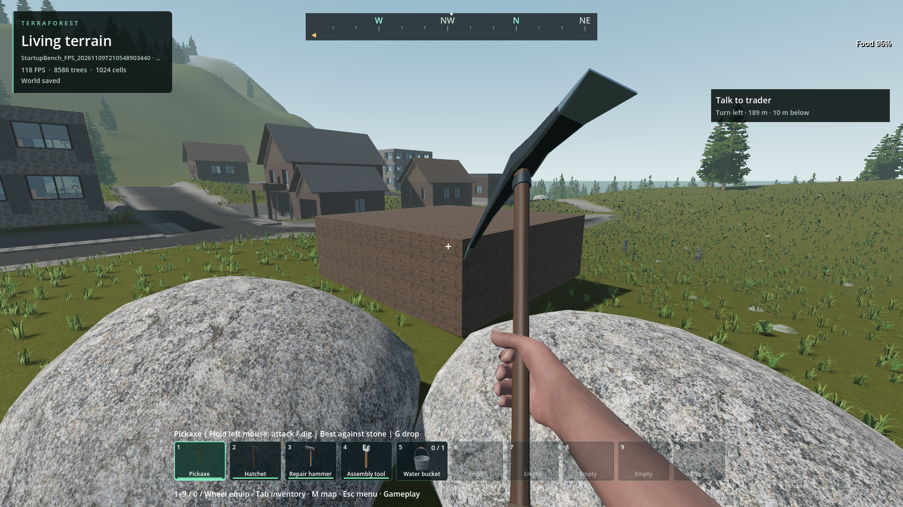
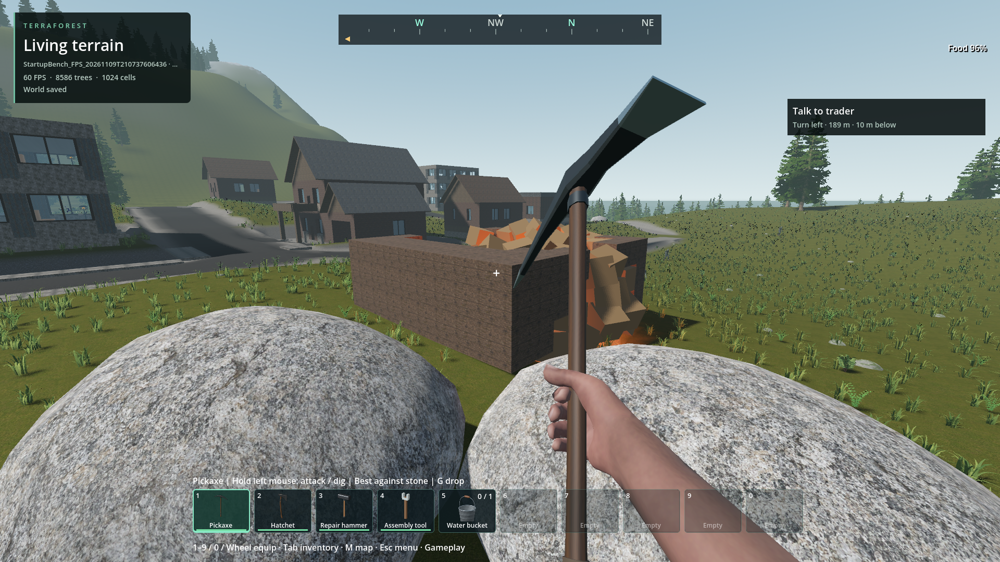

# Local forest and boulder invalidation during destruction

Status: Improved-partial. The native owner index is built, installed and verified
in the packaged world. Stable 60 FPS with headroom remains open.
User visual review: not yet requested or received for this change.
New implementation, diagnostics and tests are original AI-assisted 0BSD code;
no dependency, asset, license exception or engine implementation was imported.

## Confirmed cause and correction

Each local block/model change synchronously scanned the cached forest and boulder
owners in GDScript, before the existing bounded reconciliation could even start.
The 1,024-owner default world made these repeated scans appreciable during a barrel
chain. A native `NativeOwnerBoundsIndex` now queries the existing AABB tree for
affected owners. Forest uses its exact cached 3D coverage; boulders retain their
original horizontal footprint and 8 m padding. The queued work and scheduling
order are unchanged. Unknown bounds remain conservative, empty owners remain
inactive, and retirement/reset release derived coverage. Invalid admission disables
the index and retains the original scan fallback, rather than silently omitting work.

The source diagnostic measured forest callback median 1.046 ms → 0.008 ms and
boulder callback 0.824 ms → 0.009 ms (11 calls each). The containing structure
publication median was 2.058 ms → 0.110 ms (8 calls). These scopes overlap and
must not be added. They are localized callback measurements, not whole-frame gains.
The original scan remains available as a diagnostic control in the same package.
Implementation: [native index](../../addons/structures/native/owner_bounds.cpp),
[forest adapter](../../addons/world_ecosystem/world_ecosystem.gd),
[boulder adapter](../../addons/world_ecosystem/boulder_horizon.gd) and
[real-world destruction probe](../../tests/destruction_load_probe.gd).

The subsequent same-package repeat confirms forest 1.036 → 0.011 ms, boulders
0.852 → 0.012 ms and containing publication 2.294 → 0.149 ms. Both runs keep
VSync disabled and the cap at zero, with no competing engine/compiler observed.
They retain identical runtime package and source hashes. The first blast interval
still included diagnostic setup, so it is excluded from gameplay-only conclusions.

## Installed frame timings

The final recorder-on/off runs drain observer setup before ignition and exclude
validation/readback from gameplay phases. No pacing drift or competing engine or
compiler was observed. The on-run measured 189.338 ms of diagnostic observer/marker
setup, outside the chain; the off-run used neither publication nor per-body observers.
Actual ignition took 40/49 microseconds. This resolves the earlier first-frame
ambiguity; it does not isolate the cost of each setup operation or every trace trigger.

| Continuous phase | Recorder on p99 / max ms | Recorder off p99 / max ms |
| --- | ---: | ---: |
| Three-barrel chain | 16.795 / 16.795 | 17.227 / 17.227 |
| Debris recovery | 13.780 / 19.271 | 15.620 / 18.386 |
| Outdoor sweep | 16.594 / 21.506 | 14.641 / 21.303 |
| Arrival idle | 18.190 / 28.606 | 18.660 / 29.261 |
| Turning | 16.110 / 18.455 | 14.577 / 21.895 |
| Settled idle | 17.639 / 32.846 | 12.240 / 16.721 |

The chain contains only 57/62 frames: p99 is effectively its maximum, not a large
tail sample. Whole-lifetime GPU clock medians are 2250/2265 MHz, temperatures
63/65 °C. These two short runs do not isolate total recorder overhead or prove
whole-world nonregression. Peak sampled process private commit is 4.049/3.899 GiB;
the on-run crosses the provisional RAM warning. Dedicated GPU allocation is about
1.632 GiB in each. Neither exit reports ObjectDB/resource leaks; this is not an
endurance measurement.

The installed PCK is 626,976,384 bytes, SHA-256
`acccce4d9b176cc7c23a559116eda4672e7917039263d0ba55bdd9c45b77c7be`.
All fourteen external native libraries match source. The startup dependency index
was refreshed for the committed firearm feedback dependencies. Export/startup,
building and 36 packaged house-light checks pass. The shape-icon receipt changes
only the native source fingerprint; baked image hashes are unchanged.
[Retained verification receipts](../../reports/performance_changes/20261109T210000_owner_bounds_verification/result.json).
The final harness is an external repository diagnostic against that package.
Later uncommitted pistol-audio audition work belongs to the parallel chat and is
not included in this package or this performance change.

## Reproduction and behavior gates

`python tools/check_frame_trace_world.py --executable --short --save --outdoor-cover --uncapped --destruction-load --require-native-process-profiles --label destruction_review`

Add `--legacy-owner-bounds` for the retained scan control. The command creates an
owned clone of `StartupBench_FPS_20261109T073252`, Frontier generator 29, seed 1703;
it does not edit a player's saved world. It uses normal services and a fly camera,
1920×1080 rendering, then installs a 153-cell wooden shell around three barrels at
(1101,57,339). Fixture installation is labeled preparation, not normal gameplay.
The independent damage oracle checks all 102 removed cells and surviving edge
durability. Both source runs reached the unchanged 96-body debris limit, detonated
each barrel exactly once, edited terrain, avoided runtime convex decomposition,
and retired bodies/flashes through their normal lifetime. Collapse is disabled
only in this fixture to isolate blast damage; collapse acceptance remains open.

The opt-in debris profile separates geometry, node allocation, tree attachment
and motion setup. It has no production subscriber. Publication observers preserve
the original subscriber identities, payloads and order and restore them afterward.
Rolling traces retain normal world stages; continuous frame distributions and
triggered attribution are reported separately in the [evidence](destruction-owner-bounds-2026-11-09.json).

Verification: 13 native/actual-adapter checks include 300 randomized bounds queries
and 80 forest/boulder handler comparisons, local/global edits, insertion order,
unknown/empty/reactivated owners, retirement, invalid input and reset. The isolated
release binary passes 11 native checks. The publication observer passes 3 checks.
The existing destruction suite passes 25 assertions with clean shutdown after the
parallel firearm fix in `e69d8d57` made impact audio creation lazy and parented.
Its [retained log](../px9-handgun/logs/impact-final-destruction_batches.log) closes
the newly observed unprepared-combat-fixture leak, not general memory endurance.

## Comparison limits and retained rejected trials

The first uncontended source baseline changed VSync during the run. Therefore its
overall FPS comparison is rejected; source combat hashes also differ because the
parallel firearm work was progressing. The callback attribution remains useful,
and is superseded by the controlled same-package runs above.
The test now detaches the session's VSync-restoring focus callback only for the
explicit uncapped diagnostic, records pacing every frame and rejects pacing drift.
Production focus and VSync policy are unchanged.

- `203056718175Z_destruction_load_initial`: 53 bodies, insufficient load. Rejected;
  strengthened the fixture instead of lowering the 96-body gate.
- `203420276563Z_destruction_load_profile`: full 102/96 load, but competing engines;
  useful allocation attribution only, not a performance comparison.
- `203914085072Z_destruction_publication_profile`: duplicate observer identities
  dropped subscribers. Invalid run; distinct observers and a regression corrected it.
- `204226087506Z_destruction_publication_clean`: no competing engine, but changing
  VSync invalidates whole-frame comparison with the following source candidate.
- `205231467273Z` destruction regression: all 25 assertions passed but four ObjectDB
  instances and one resource leaked, and the launcher requested the wrong check
  count. Retained as a failure; the later clean 25-check peer receipt supersedes it.
- First release test passed its 11 assertions but omitted the JSON receipt required
  by its launcher. The corrected report-producing test passes the complete launcher.

## Inspected visuals

Original-scan control, generator 29 seed 1703, normal 1080p quality, same shell and
camera. The exact damage oracle passes. Debris motion and wind differ between runs.

Native candidate before ignition: intact 153-cell shell, surrounding boulders,
vegetation, buildings and held tool retain their appearance.

Native candidate after the three explosions: expected opening, physical debris
and flash remain. The same 102-cell removal/edge-damage oracle passes.

Recorder-off control retains the same visible damage, environment and tool.
These four images plus four earlier source destruction images and a packaged outdoor
view were inspected; no obvious missing geometry/materials or altered coverage
was found. Other retained views are not claimed reviewed. HUD FPS includes test
setup/readback; use the frame table above. [Hashes and captions](images/manifest.json)
are engineering evidence, not user visual approval or district-layout acceptance.

## Remaining work

Earlier 30–41 ms first-chain intervals include observer setup and must not be
attributed to gameplay alone. Independent stalls remain: the intermediate package
has a 42.897 ms recovery frame, including 38.834 ms in drawing, and a 29.494 ms
chain frame with 10.120 ms terrain staging (nested 5.072 ms atomic publication).
The final on-run has a 32.893 ms traced settled frame with two physics steps,
12.418 ms scene-physics callbacks, 2.664 ms subsequent physics gap and 11.514 ms
drawing. Its zombie-update scope is only 1.803 ms. Another 29.296 ms settled frame
contains 21.592 ms drawing while the reported GPU interval is 4.971 ms; GPU timers
can lag. These are separate rendering/physics/publication leads, not proof of a
single subsystem cause. Scope timings overlap and must not be summed blindly.

Continue recorder-off controls with comparable pacing and host/GPU state; qualify
collapse, water boundaries, interrupted recovery, physical walking/pursuit,
long-session allocations and weaker hardware. Short clean shutdowns and exact
damage do not establish leak-free endurance, seamless world streaming or stable
60 FPS with headroom. The earlier rejected district layout and older failing
water/interaction gates remain open.
