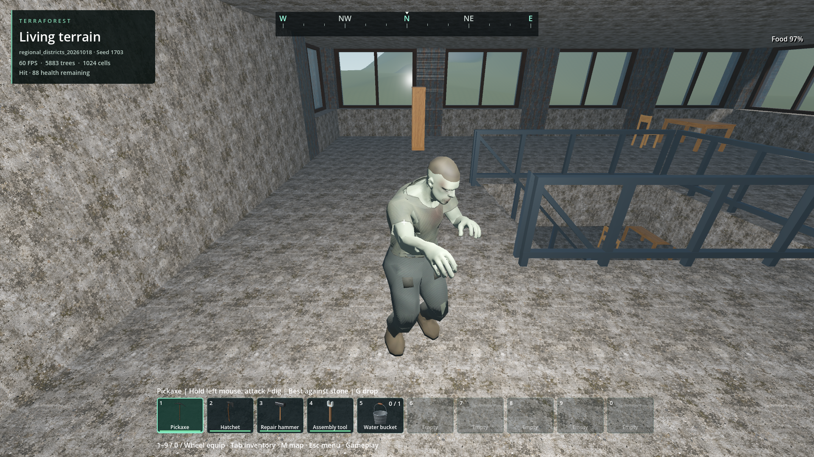
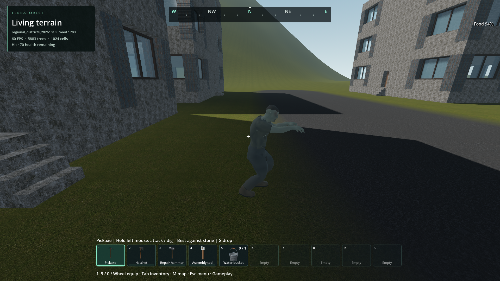
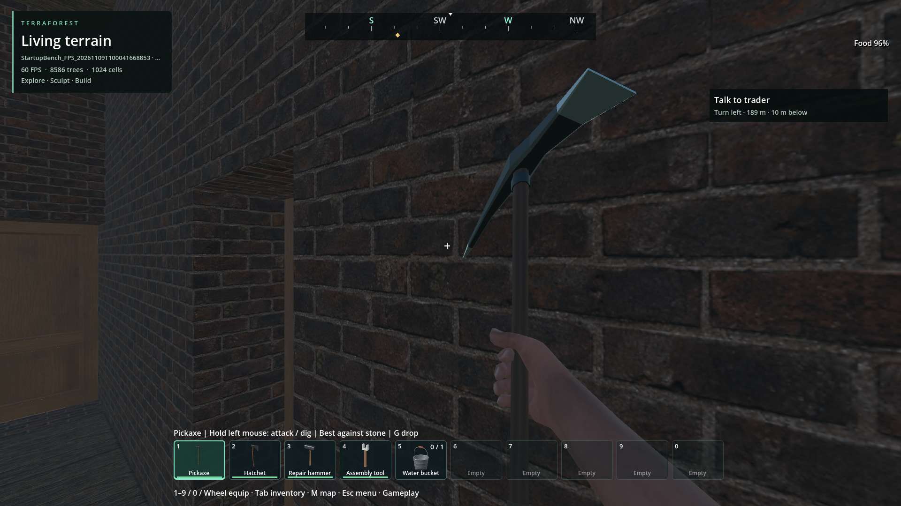

# World/player performance foundation — 2026-11-09

Status: implemented improvements; **stable 60 FPS with headroom is not achieved**.
This continues the [fresh-default investigation](rolling-trace-2026-11-09.md).
Original new code is 0BSD. Existing notices remain. The generated debris catalog
is original CC0 with its own source/engine/hash receipt; no new dependency.

## Changes and measured limits

The [subsequent anatomy investigation and bake](anatomy-geometry-2026-11-09.md)
localizes 46.603 ms of the first zombie's setup to render-mesh readback and removes
that readback with exact binary geometry. Its verification and remaining limits
are tracked separately; the original measurements below remain historical evidence.

| Path | Change | Evidence / practical limit |
| --- | --- | --- |
| First-person arrival | Activate the same depth-protected materials behind the opaque loading cover, before control release | Matched default-world release **223.587 → 26.603 ms**; draw **160.549 → 9.513 ms**. Covers the tested existing-photo arrival, not every cold driver/material or newly generated photograph |
| Existing arrival photograph | Decode/validate on a worker during loading, keep corrupt/missing-photo recovery | Release request **46.868 → 0.002 ms**. The first-ever clean screenshot still requires a GPU readback |
| Parked Ranger prototype | Optional adapter preparation hooks move receipt hashes/resource loading to a worker; readiness polls before activation | Prior prototype **81.998 ms** (distant parts 81.004); combined run's prototype stage maximum **4.014 ms**. Independent providers retain their normal parts and no-op hooks; tracing is optional |
| Zombie resource | Built-in model becomes an explicit threaded startup dependency; separate resource/instantiate/attach timings | First loading population hitch **190 ms → about 61 ms** in these runs. Remaining anatomy/attachment work is synchronous; admission and pursuit are not closed |
| Destruction transaction | Native compare-and-remove for up to 64 expected cells with revision/admission checks; blast chunks remain 24 and collapse chunks 12 | 64-cell workload publishes **3**, previously **64**, invalidations. Rejected batches retain cursor/damage/debris; undo history is cleared before publication |
| Debris collision | Offline binary catalog preserves the exact old convex-decomposition recipe for all 704 supported poses; bounded mesh/material sharing | **56,470 bytes**. Actual-world destructive calls **0.795–2.125 ms per batch**, versus **1.50–2.40 seconds** for the controlled per-cell/decomposition policy. No runtime decomposition for supported poses |
| Water save capture | Native copy-on-write region arrays; snapshot transfers handles and sums/encodes on the existing save worker | 1,024-region capture **2.652–9.196 → 0.248–0.328 ms**; concurrent edits preserve byte-identical frozen output. Same archive format, water quantity and 128 MiB pending cap |

The explosion result is a substantial source fix, not a full-frame guarantee.
The control uses the new removal primitive per cell and deliberately regenerates
the old convex resources; it excludes old undo-allocation cost. Two ABBA cycles
use identical 64-cell wood structures and 24-candidate slices in the actual world.
Main-thread batch work falls from seconds to milliseconds, but whole 64-cell
completion still spans physics frames (19–68 ms in the optimized samples).
No debris cap, lifetime, mass, CCD, impulse, geometry, damage falloff or settings
was reduced. CPU decomposition was the dominant discovered cost; moving this
immutable work offline is preferable to repeating it on a GPU during explosions.
[Godot's implementation](https://github.com/godotengine/godot/blob/master/scene/resources/mesh.cpp)
confirms that `create_convex_shape(true, true)` requests convex decomposition.
No upstream implementation was copied into project code.

## Reproducible evidence

Reports are local retained artifacts; failed attempts are retained too.

- Combined fresh-default clone: `reports/performance_changes/20261109T084818225689Z_combined_changes`.
  Continuous observation plus deduplicated triggered windows, 1080p Vulkan
  Forward+, i5-12450H / RTX 4050 Laptop, unchanged Quiet Mode/settings.
  Gameplay triggered-window p99 **26.479 ms**, maximum **91.449 ms**;
  root GPU mean **15.027 ms**, p99 **16.661 ms**. No 60 FPS qualification.
  Functional save/exit succeeded but the strict harness rejected one anonymous
  ObjectDB leak, also seen before these changes. It remains open.
- Water before/after: `reports/checks/20261109T084003030682Z` and
  `reports/checks/20261109T084202334145Z`; eight iterations each.
  Extended debug/release storage/contact/ocean/transfer/snapshot suite:
  `reports/water_patch/20261109T085539656865Z`.
- Actual compound water authoring, bucket, mining, partial-building and disk
  reopen: `reports/performance_changes/water_compound_graphical_20261109T090956Z`.
  All assertions pass. The retained external driver only adds offscreen ownership.
- Destruction before binary bake: `reports/performance_changes/destruction_20261109T090105Z`.
  After bake: `reports/performance_changes/destruction_baked_20261109T090750Z`.
  Both pass functional assertions. The screenshot is of the deliberately slow
  final control; its FPS counter is **not** evidence of optimized gameplay speed.
- Geometry parity: `reports/checks/20261109T090650617860Z` compares exact sorted
  convex vertices for cube, stairs, sphere, cylinder and modular shapes/rotations.
  Native edit contracts pass debug/release in `reports/block_cell_patch/20261109T085613752904Z`.
- Real combat: `reports/combat_world/20261109T084303350052Z`, 51 creation + 12 reopen
  assertions, including barrels, firearms, zombies and interrupted blast recovery.
  Blast image inspected; later binary geometry has its separate exact parity check.
  Installed executable repeats all **51 + 12** checks successfully in
  `reports/combat_world/20261109T091611473955Z`; its blast image was inspected.
- First-person close-wall, forest, lighting and world parity:
  `reports/checks/20261109T083024964303Z_first_person`; images inspected.
  Existing/corrupt photograph checks: `reports/checks/20261109T083439947845Z`.
- Independent vehicle providers: `reports/checks/20261109T085538372115Z`.
  Real prototype: `reports/checks/20261109T084256485580Z`.
  Zombie aggression/sleeper behavior: `reports/zombie_aggression/20261109T085007957459Z`.

### Final source and installed checks

- Source normal gameplay save: `reports/performance_changes/20261109T091958603709Z_save_capture_attribution`.
  Strict pass, including clean exit. Save capture stage **8.042 ms**, component
  capture **7.971 ms**, water **0.879 ms**, structures **5.873 ms**. Triggered
  gameplay p99 **30.172 ms**, maximum **34.573 ms**. This is a short repeated
  fixture, not proof of sustained or dense-world headroom.
- Final installed trace: `reports/performance_changes/20261109T092346795985Z_final_installed_capture`.
  Requested gameplay save completed successfully, shutdown publication verified,
  and zero pointer captures. **Strict FAIL:** three anonymous ObjectDB instances
  leaked at exit. An earlier installed run (`20261109T091458477218Z_installed_changes`)
  leaked seven; the original source baseline leaked one. The latest source clean
  exit does not resolve this intermittent issue or exclude a regression. The
  leaked IDs do not match the recorded water snapshot; their owners remain unknown.
  Gameplay triggered-window p99 **21.106 ms**, maximum **26.913 ms**; root GPU
  mean **11.981 ms**, p99 **13.425 ms**, maximum **14.150 ms**. Arrival is
  **26.913 ms**. Normal save stage **7.239 ms**, component capture **7.173 ms**,
  water **0.810 ms**, structures **5.173 ms**; the save frame is **24.580 ms**.
  First-zombie scene setup is **1.274 ms**, but anatomy still **39.050 ms**,
  hit areas **10.367 ms** and ragdoll **5.738 ms**. These timings do not qualify
  stable 60 FPS or remove the earlier observed 91 ms gameplay stall.
- Pack contracts: `reports/performance_changes/pack_contracts_20261109T091454Z`.
  Destruction admission/rejection **25 assertions**, exact debris geometry and
  custom-decoded audio pass. All five selected sounds have identical PCM hashes,
  rates and channels in source and package. Original WAV bytes are unchanged;
  raw import mode and PCK-compatible reads repair the prior export blocker.
- Final export passes building/notice/startup/resource gates, smoke and house
  lighting checks. Building report: `reports/building_standards/20261109T092241325430Z`.
  `dist/TerraForest.pck`: **556,519,008 bytes**, SHA-256
  `bbd8ab699e98383ae14c582cfe3d43354a5c79a19affbda7158464614dca7d6b`.
  All fourteen packaged native DLL hashes match source; the final trace's
  `run.json` records each hash. Root executable is unchanged. Peak sampled private
  commit **3,809,828,864 bytes**, dedicated GPU allocation **1,492,766,720 bytes**,
  within provisional budgets; instantaneous/driver peaks remain unqualified.

Trace percentile figures above cover deduplicated triggered windows, not an
unbiased whole-session distribution. Later short runs cannot establish a causal
improvement in GPU headroom; timing and thermal variation remain possible.

Failed setup checks are not hidden: `083239158841Z` used a graphical vehicle test
headlessly; water checks `085235037841Z`, `085552780291Z`, `085807464514Z` and
`090210469575Z` used legacy startup/headless assumptions, with the latter runs
waiting for a draw signal unavailable headlessly. The graphical water rerun
above supplies the missing integrated verification. `084203781107Z` lacked undo
history in its fixture; the corrected test passes. `085300589491Z` caught the
vehicle tracer assumption, subsequently fixed and retested.

## Pursuit, native lifetimes and rendering follow-up

The full furnished tower exposed a specific support error: a midpoint probe on
merged collision faces could select the next riser and combine two legal 25 cm
steps into one rejected 50 cm rise. The native route validator now establishes
the individual treads in travel order before its coarse capsule sweeps. All
existing step/slope/hazard/readiness limits and the cooperative planning budget
remain unchanged. `navigation_treads` changes from 12 checks / 3 failures to
12 / 0; `regional_navigation` changes from 18 / 2 to 18 / 0. The first corrected
cold tower query still takes **17.8 seconds**, so responsiveness remains open.

The subsequent saved-world journey exposed a second defect: after breaking the
entrance door and climbing both flights, live capsule clearance rejected a tight
upper-floor connection. The planner reused it until its stuck retry limit ended
the pursuit. The existing bounded rejected-waypoint memory now also handles this
clearance discrepancy. The existing overlap query supplies the blocking RID, so
declared conditional doors retain their authorized approach and remain solid.
The new regression fails two assertions before the change and passes 14/14 in
debug and release afterward. The renewed actual tower round trip passes 13/13,
including intact-door blocking, destruction, two flights, attack contact and
return. All 200 original save/sidecar files retain their hashes. Initial outbound
and return routes take **35.204 / 44.986 seconds**; total contact times including
door attacks and walking are 133.964 / 103.411 seconds. The same 48-unit cap holds,
with a 1.601 ms observed peak on the cooperative 750 us deadline. This is a
functional correction, not an acceptable latency result.
The first saved run also revealed a test issue: its return leg treated the prior
destination's blocked state as the new destination's failure in one tick. The
driver now waits for a matching destination before that early exit, and no longer
runs speculative state-changing motion guards merely to collect diagnostics.



Owned generator-12 / seed-1703 tower: the autonomous zombie reaches the player
beside the upper stair rail after breaking the entrance door and climbing both
flights. Scripted camera/test light, inspected 1080p capture; historical art and
district design are not accepted by this engineering check.



Same read-only world after the player moves back to the approach: autonomous
return and attack contact at street level. No teleport, waypoint hints or
movement calls are applied to the zombie. Sources/hashes are in the image manifest.

Temporary allocation-ID logging identified an orphaned **NativeBlockMapRegion**
in a leaking real-world run. Survey decoders were created on the archive worker
and passed as engine reference-counted objects through the main thread to the
building-horizon worker. The queues now retain immutable native payloads through
`shared_ptr<const ...>`; engine wrappers are created only by the consuming thread.
The horizon worker also receives the immutable payload directly. The model survey
decoder follows the same ownership contract. Checksums, reservations, cancellation,
checkpoint pins, archive formats and gameplay residency remain unchanged.

Three subsequent source world runs had clean strict shutdowns, but the first
refreshed packaged run still leaked one object. Those source runs did **not**
close the defect. A deterministic out-of-order queue test then retained **48 of
80 NativeBlockMapRegion wrappers**. The pinned godot-cpp Dictionary move assignment
abandons its old reference when `std::deque::erase` shifts interior completions.
Earlier in-order tests missed that path; explicitly clearing a shared dictionary
also concealed its leaked ownership by removing the object entry.

The native build now repairs that one binding translation unit for all fourteen
addon DLLs, retaining the pinned SDK version and MIT notices. The test releases
all 80 wrappers after this repair alone, and debug/release archive checks pass.
The worker also transfers exclusive dictionary ownership under its queue mutex
before a consumer can attach engine objects. Map-survey and distant-building
edit/reload checks pass. See [native build provenance](../../docs/NATIVE_DEVELOPMENT.md)
for the exact source hash and upstream equivalent. This closes the deterministic
leak mechanism; broader packaged/endurance qualification remains separate.
Temporary recursive ownership inspection was removed: it traversed a concurrently
changing array and produced one diagnostic-script failure, retained in the record.

The refreshed package passes four sequential default-world enter/save/turn/exit
checks (two short and two longer), with **no ObjectDB leaks** and fourteen matching
native libraries. Exported icon/geometry outputs are unchanged. Package SHA-256:
`ea5edd71f69b28a72548636d43257bd66dce80695a3cc4d7b8b159f376214ff6`.
These are scoped lifecycle checks, not long-session or performance acceptance.
Final packaged moving-goal recalculation, narrow-aisle route response and
furnished-room moving-target pursuit checks also pass. Release route sampling
and capability/collision contracts pass with the final native hashes. The
earlier full saved-tower journey verifies the route correction before the
binding repair; its cold search latency is still unacceptable.


Default sanctuary after a full turn and normal save; inspected against the prior
source arrival and short packaged run. Existing materials, geometry, held-tool
appearance and HUD agree. Prior art defects and user approval remain separate.
Capture provenance is in the image manifest; the FPS overlay is not timing proof.

GPU pass profiling identifies **point-light shadows at roughly 4–5 ms**, opaque
rendering near 4 ms, and directional/spot shadows around 1.4–1.7 ms in the default
sanctuary view. The native four-light pool now skips unchanged transform/energy
submissions. Its regression verifies zero redundant transform notifications and
correct movement when a source moves. A same-view ABBA comparison shows **no
established GPU speedup**: phase medians are 14.505, 13.601, 13.815 and 13.663 ms.
About 4,983–4,986 draw calls remain. This cleanup does not solve shadow cost.



Default Frontier generator 29 / seed 1703, 1080p; redundant-setter control phase.
The four selected lights, geometry and graphics settings match the guarded phase.


Same view with guarded setters. Inspected materials, shadows, doorway, held tool
and HUD geometry agree; notice text/time differ. Engineering inspection only,
not user visual approval. Sources/hashes are in `images/manifest.json`.

The third isolated source trace still has **p99 22.256 ms / maximum 70.435 ms**
in triggered gameplay windows. The largest frame spends 63.374 ms in drawing,
with root GPU time 12.364 ms, one physics tick, zombie update 0.352 ms and no new
draw/specialization pipelines. It is not explained by the fixed route failure.
Save capture is 6.923 ms, including 5.154 ms structures and 0.821 ms water.
The first repeat overlapped the next process during teardown/loading; retain it
for clean lifecycle evidence only, not a performance comparison. Triggered trace
percentiles are not an unbiased session distribution.

Final packaged runs remain outside the headroom target. The two short triggered
gameplay windows have p99 **28.862 / 24.364 ms** and maxima **73.516 / 32.807 ms**.
The longer run without verbose/GPU profiling has p99 **27.096 ms**, maximum
**36.532 ms**, and mean root GPU work **14.665 ms**. The longer profiled run catches
a **480.259 ms** interval, with **468.907 ms before game processing**, coarse
main-thread CPU time **31.25 ms**, root GPU time **15.196 ms**, eight catch-up
physics ticks, no new pipelines and no active trace writer. It does not recur in
the ordinary-output control; this single negative repeat does not identify its
cause or close it. Foreground scheduling/wait attribution is still required.

Available GPU-profile buckets from the long full-turn run have medians of
**5.125 ms point-light shadows**, **4.544 ms opaque**, and **1.649 ms directional/
spot shadows**. First zombie anatomy setup costs **51.080 / 59.877 ms** in the
two longer runs, versus roughly 0.1–0.25 ms for subsequent instances. The native
immutable anatomy preparation/admission path therefore remains a specific
follow-up; these measurements do not justify reducing shadows, actor anatomy,
hit regions or ragdoll fidelity.

The broad legacy `world_persistence` release check still fails unfinished-lake
shutdown capture and deleted lake-ID reuse. Both assertions fail identically
with the pre-repair native binaries from `c0f023a8` and the repaired binaries;
this repeats the existing foundation backlog entry rather than establishing a
new regression or a pass. Isolated release setup was repaired to include its
missing terrain-storage helper and water texture, and the terrain-planner setup
now includes its stream/backend dependencies. Targeted archive, inventory,
vehicle storage, cover, terrain-planner, water-runtime and entity checks pass.

## Required next work and acceptance

Working target: keep both CPU and GPU critical work around **12 ms or less** at
the unchanged 1080p quality, leaving margin inside the **16.67 ms** presentation
budget. A cap reading 60 FPS, a microbenchmark, or a screenshot is insufficient.

| Requirement | Still missing / return trigger | Closing evidence |
| --- | --- | --- |
| Rendering headroom | About 4,900 draw calls and ~15 ms root GPU cost remain; investigate pass costs and native instance/chunk batching before changing quality | Matched idle, walking, turning, driving and dense-settlement CPU/GPU traces; unchanged silhouettes, shadows, coverage and distances |
| Independent later stalls | 78–91 ms frames show 2–5 physics steps and large draw intervals without new pipeline compilation; stage totals do not establish the whole cause | Native/engine CPU stack or presentation trace plus a causal controlled fix; repeat beyond first minute |
| Zombie admission | Preloading addresses resource I/O, not all scene/anatomy/hit-area construction | Bounded/staged admission or reusable immutable anatomy preparation, tested during travel and spawning with pose/hit/ragdoll parity |
| Zombie route latency | Tread support and repeated clearance failures are corrected; cold planning still takes about 18 s in the fixture and 35–45 s in the full host | Improve topology/route reuse with native shared work; repeat multi-floor and moving-goal pursuit under the same collision/readiness budgets with substantially shorter response |
| Saves at large scale | Water capture improved to 0.81–0.88 ms in these default-world runs; structure snapshots still take 5.17–5.87 ms and whole save frames exceed budget | Normal gameplay autosave traces on edited populated worlds, exact concurrent-edit/reopen equality, bounded memory and worker backlog |
| Destruction under sustained load | Mutation/decomposition fixed; native chunk rebakes, physics insertion and 96 active bodies can still dominate a frame | Repeated real barrel chains and collapse across streamed chunk/water boundaries, bounded frame tails and exact interrupted recovery |
| First missing photograph / new materials | First screenshot readback and unprepared later material variants remain possible stalls | Cold generated-world and first weapon/effect traces; asynchronous readback/preparation if causal, unchanged capture and materials |
| Clean lifecycle | Reproduced out-of-order completion leak closed: 48/80 survivors becomes 0/80 in debug/release; four serial package saves/shutdowns clean | Long travel, cancellation under sustained load and multi-hour enter/leave coverage remain; retain historical failures rather than claiming all possible leaks eliminated |
| Multiplayer scale | Revision-checked edits and immutable snapshots are useful foundations, not network simulation | Authoritative command ordering, replication/recovery, native actor scheduling and latency/load tests at a declared population/world size |

Large-scale multiplayer, every-world 60 FPS, old-laptop/thermal endurance and user
visual acceptance remain unqualified. These are explicit continuation requirements,
not completed features. Compute shaders should be selected for a measured suitable
workload; authoritative edits and immutable asset preparation did not require them.

## Reproduction

```text
python tools/check_frame_trace_world.py --short --save --label fresh_changes
python tools/check_frame_trace_world.py --short --save --executable --label installed_changes
python tools/check_water_patch.py
python tools/check_block_cell_patch.py
python tools/run_godot_check.py destruction_batches --headless --timeout 45 --require "DESTRUCTION_BATCHES checks="
python tools/run_godot_check.py debris_geometry --headless --timeout 45 --require "DEBRIS_GEOMETRY failures=0"
```

Changing block shape sources requires `tools/bake_debris_geometry.gd`; export
rebuilds it automatically. `--check-only` verifies source/engine/output identity.
Normal play tracing remains opt-in, with Ctrl+Shift+F12 and automatic low-FPS
windows as documented in [FRAME_TRACE.md](../../docs/FRAME_TRACE.md).

## Implementation commits

- `5031fd07`: native immutable water snapshot storage and debug/release artifacts.
- `5db5aec6`: first-person loading preparation and worker photograph validation.
- `780ce4a4`: optional vehicle preparation and explicit default-zombie dependency.
- `df99e971`: native destructive batches and exact binary debris collision.
- `1bb63e94`: unchanged raw audio packaging and PCK-compatible custom decoding.
- `44adcc40`: gameplay save attribution and reproducible source/installed tracing.
- `c5626dd2`: assert successful normal gameplay save completion in the trace driver.
- `d50ea0c1`: immutable native survey handoffs, decoder lifetime checks and guarded light setters.
- `dad4a526`: legal tread sampling and recovery from blocked regional connections.
- `c81fd465`: unchanged shape-bake provenance after the native rebuild.
- `c0f023a8`: controlled GPU pass capture and pooled-light ABBA comparison.
- `ab5a6815`: deterministic Dictionary leak regression, binding repair across all native modules, exclusive completion handoff.
- `a3f59052`: complete release fixture dependencies for terrain and persistence checks.
- `130c8f05`: unchanged icon outputs with refreshed native provenance.

Follow-up receipts, including failed probes and repaired harness runs, are retained
in [pursuit/lifetime evidence](pursuit-lifetime-2026-11-09.json).
