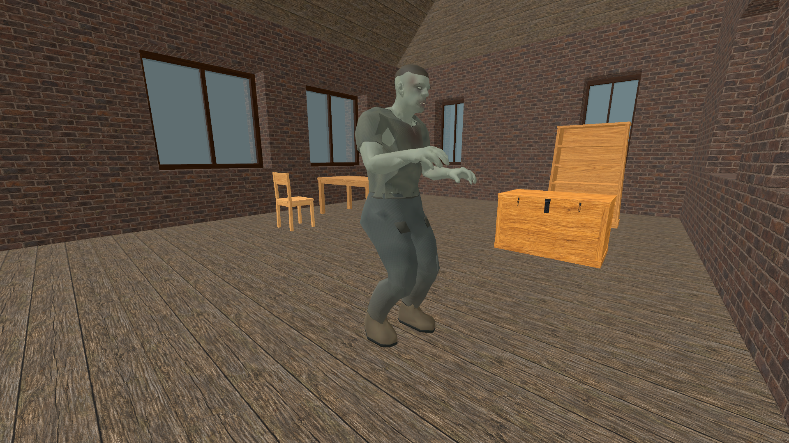

# Local navigation invalidation

Status: scoped improvement, implemented in `8eb01430`. Stable 60 FPS,
cold multi-floor pursuit latency and general world-scale performance remain open.
Continues [query-cost work](navigation-query-cache-2026-11-09.md).
[Exact receipts, hashes and comparison metrics](navigation-local-invalidation-2026-11-09.json)
retain the tested build and package identities.

## Cause and change

Every local terrain, water or vehicle obstacle notification cleared the shared
regional graph and restarted all regional pursuits. Building cell edits also
lost their native bounds at the script host. A distant edit could therefore
discard already verified connections and stop an unrelated pursuit.

The native graph now records conservative geometry dependencies for positive,
negative and partially sampled connections. An 8 m spatial index selects possible
sources for local invalidation; affected supports retire, incoming connections
reset and bounded free slots are reused with generation checks. Queries retain
their own dependency envelopes, including root/goal connectors and an old
continuation segment. Unaffected complete paths remain active. Native building
cell bounds now reach the zombie, settlement and trader navigation hosts.

Empty or malformed bounds, recipient exclusions, water-provider changes and
conditional-door policy changes still reset globally. Unbounded model, tree and
ground-interaction notifications also remain global. These are known follow-up
work: each owner must supply reliable old/new world-space bounds before its
barrier can safely become local. Door removal currently resets the full graph;
the saved-tower cold and post-door searches are not solved by this change.

All tread samples, collision readiness, hazards, capsule tests, movement guards,
48-work regional/12-work local limits and the cooperative 750 us budget remain.
There are no rendering, asset, density, movement-speed or world-recipe changes.
Graph storage stays at most 32,768 slots; certificate data increases the native
vertex from 176 to 384 bytes (12 MiB at the cap, excluding bounded indices and
the existing 3 MiB support cache). Broad edits can still scan the entire graph
synchronously. Height extrema are historical diagnostic values until a full
clear; they are not topology or residency authority.

The rolling navigation trace now includes cumulative local/global invalidation
counts and timing, plus the last scan/reset counts and current graph storage.
This distinguishes reset cost from the later search it causes without allocating
diagnostic dictionaries in ordinary unprofiled ticks.

## Verification and unresolved gates

The new fixture compares two distant detours, local/global replans, actual added
and removed barriers against cold rebuilds, repeated slot reuse, a moved floor,
missing residency, changed exclusions, live motion support and native building
bounds. It freezes simulation age while planning because its comparison queries
have no physical bodies; its work counts are valid, but its tick timings are not
an end-to-end pursuit benchmark.

The first fixture attempt failed the moved-floor assertion because it retained
the old target after teleporting the whole fixture. Resetting that test agent
establishes the new feet/goal explicitly; the failed attempt remains at
`reports/checks/20261109T140621955196Z`. No runtime targeting policy was relaxed.

Final source invalidation fixture: **30/30**; isolated release: **27/27** (the
three script-host checks run in the source project). Local replan work falls
**1,299 → 765**, or **41.1%**, with the exact same complete path. In the source
fixture, accumulated planning wall time falls **46.963 → 17.942 ms**; release
falls **44.800 → 16.693 ms**. These are sums across planning passes, not single
frame times. A local edit scans 100 of 212 live vertices, retires 20, resets 142
edges and only one pursuit, taking 24–32 us in the selected source/release runs.
Six repeated edits retain exactly 106 allocated slots. The second storey's
complete path survives a lower-storey edit at the same horizontal coordinates.

A slower historical cold fixture sample prompted removal of redundant bounds
merges inside every support sample. Two serial comparisons then load the previous
committed DLL and final DLL into otherwise matching isolated release projects.
**All eight route arrays, expansions and physics-query counts match in both
pairs.** Cold tower completion takes 755 → 759 and 723 → 677 physics ticks.
Measured query-category totals change 968.977 → 990.800 and 961.560 → 890.533 ms.
This does not show a consistent cold-search penalty or establish a cold-search
speedup. Both builds exhibit occasional multi-millisecond planning tails.

Nine release contracts pass: sampling, route policy, support reuse, local
invalidation, tread order, regional traversal, residency, zombie steps and player
cottage stairs. The saved tower passes **13/13**, including intact-door clearance,
destruction, both flights, contact and return; all **200 source save files remain
unchanged**. Cold outbound planning changes **31.883 → 39.445 s**, while return
changes **48.883 → 29.975 s**. The outbound sample is worse; no general full-host
latency improvement is claimed. An intermediate candidate's outbound took
20.921 s, further demonstrating the variability.

The new host counters observe two global resets after door destruction: 164 us
combined, including a 161 us maximum. Their direct cost is small; the subsequent
rebuild still delays pursuit. More seriously, the final host run records a
**69.363 ms planning pass and 106.449 ms physics interval**. Its once-per-second
query detail does not capture that exact pass. Repeat with per-physics rolling
trace and main-thread CPU/wait evidence before attributing or claiming to fix it.

The installed package is 556,864,812 bytes, with all 14 native libraries matching
the source build. Packaged replan/response/moving-interior checks pass **14/11/23**
assertions. Export smoke, building/light gates and these shutdowns report no
script errors or ObjectDB leaks. This preserves scoped leak-fix verification;
long-duration memory stability remains unqualified.

Inspected this cottage view and the retained house/stair view from
`reports/zombie_interior_pursuit/20261109T142744425121Z`. The zombie, furnished
geometry and materials remain present. These scripted views do not establish
pixel equality, broad visual acceptance or user approval. The image is an
unmodified project screenshot; underlying asset provenance and terms are retained.

Remaining gates: cold route/frontier discovery, scoped model/door changes,
maximum graph pressure and broad-edit latency, moving crowds and long edit/travel
endurance. The prior unexplained 97–503 ms stalls, travel render-selection cost,
first-use hit-area setup and general frame pacing remain separate open work.

## Provenance

New C++, tests and tooling changes are original AI-assisted project work under
0BSD. No third-party implementation, dependency, asset or license scope was added.

Reproduce the focused checks with `python tools/run_godot_check.py
navigation_invalidation --headless --timeout 240 --require "NAVIGATION_INVALIDATION
checks="` and `python tools/check_regional_release.py --sampling`. For the cold
comparison, use `python tools/check_regional_release.py --tests regional_navigation
--navigation-profile`, then repeat with `--baseline-native-ref 03a58891`. The
baseline option changes only the isolated project's DLL, never the installed one.
