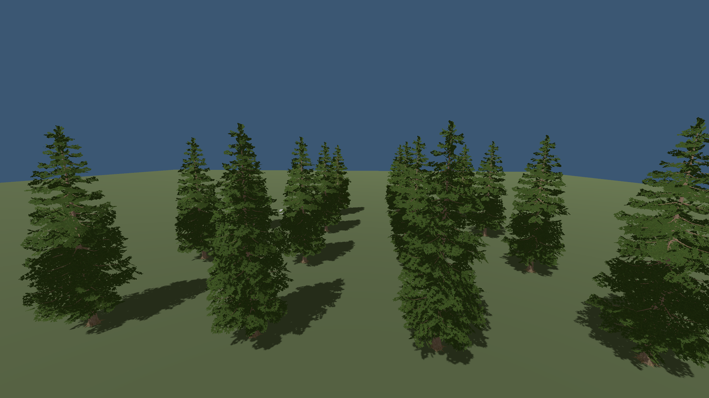

# Bounded model and door navigation changes

Status: implemented in `c6bc9ab3`, scoped verification; stable 60 FPS and cold pursuit latency
remain open. Continues [local graph invalidation](navigation-local-invalidation-2026-11-09.md).
[Machine-readable receipts](navigation-model-invalidation-2026-11-09.json) retain
native hashes, source checks, release checks and saved-world observations.

## Cause and implementation

A destroyed model published an unbounded obstacle change. Removing its RID from
the conditional-door policy then reset the whole navigation graph again. In the
previous saved tower, door destruction increased global resets from 41 to 43;
only 20 graph vertices remained at the next once-per-second observation.

The native model owner now publishes world-space bounds for insertions, removals
and moves, including the union of old/new geometry and deferred history changes.
Animated doors publish changed collision bounds while retaining their collision
RID. Vegetation receives a separate bounded notification, only at rest for an
animated door, covering the full swing. The original no-argument exclusion signal
is preserved for existing listeners. Whole-collection transforms, prototypes,
full restores and other unknown bounds still use a conservative global barrier.

The native navigator accepts at most 64 validated RID/bounds pairs for conditional
interactions. It retains old bounds until the replacement policy validates, resets
only intersecting connections/queries, and updates planning masks without clearing
unrelated continuations. Movement masks still collide with intact doors. Duplicate,
missing and malformed bounds reject atomically; legacy unbounded policies remain
global. The zombie and authorized trader adapters supply the actual model bounds.
An empty residency refresh now respects its existing 250 ms cadence instead of
refreshing every frame; transition from occupied to empty remains immediate.

No art, density, draw distance, movement speed, interaction permission, collision
envelope, tread spacing, hazard check or planner budget was reduced. This adds no
compute shader because the measured defect is invalidation ownership, not a GPU
workload. New implementation and fixture code are original 0BSD work; inherited
dependencies and notices remain unchanged.

## Navigation and visual verification

The new source and isolated release fixture each pass 22 checks. A door removal
retains the distant complete pursuit and shared graph; the subsequent local and
global rebuilds produce exactly the same path. Local planning uses **450 versus
1,299 work units** (65.4% less). Accumulated planning time is **3.550 versus
45.250 ms** in source and **4.208 versus 45.018 ms** in release. These are sums
across passes in a planning fixture, not single-frame or full-world timings.

Source invalidation passes 30 checks, authored door animation 32, static placement
and edit history 235, and admission/history 31. The release sampling suite passes
all five fixtures. The forest fixture runs with both a native block and a native
model: only the overlapping root is removed, while the other 15 roots and all
surviving MultiMesh transform/fade records remain identical across four rendered
frames. Door checks preserve authored handle/latch timing, intermediate collision,
blocked swing, mid-motion save/restore and byte-exact closed placement.

Release traversal also passes all five fixtures; release animation, static/history,
admission/history and modular door content pass 32/235/31/58 assertions. The first
door-content release attempt timed out after its isolated test project omitted
current script dependencies. Its log is retained in the receipts; copying the
missing location/codec/coal definitions fixes the harness, with no product behavior
changed. This failed attempt is not counted as a pass.

Both raw captures were inspected. They come from the original repository's real
forest renderer in the deterministic fixture, not generated replacement art.
They establish this edit's continuity, not general world visual acceptance.

The actual read-only saved tower passes **13/13**, including intact-door blocking,
authorized destruction, both authored stair flights, attack contact and return.
All **200 source files remain unchanged**, with no strict shutdown diagnostics.
Door removal changes invalidation count 41→43 while **global count stays 34**;
**862 graph vertices survive**. The coarse log observes the replacement complete
path two seconds after first observing removal, versus 22 seconds previously.
Those one-second observations are not precise contact-to-replan latency.

The installed package is 556,865,196 bytes, with all 14 native libraries matching
source. Building/export/startup/light gates pass. Packaged replanning, route response
and moving furnished interiors pass **14/11/23** assertions; both interior captures
were inspected. A normal rendered default-world clone saves successfully and exits
without ObjectDB or other strict diagnostics. Its five triggered windows contain
1,558 unique gameplay frames: **p99 23.210 ms**, maximum **27.710 ms**, GPU mean
**8.138 ms**. This is not an unbiased session distribution or evidence of stable
60 FPS. The longest frames include loading release, a 7.682 ms save-capture stage,
and draw intervals; these nested measurements must not be summed. No general
rendering improvement is attributed to this navigation change. The trace verifies
that the new thread measurements reach packaged rolling captures.

| Saved tower | Previous checkpoint | Scoped model/door changes |
| --- | ---: | ---: |
| First outbound complete path | 39.445 s | 19.809 s |
| Outbound attack contact | 126.833 s | 86.342 s |
| First return complete path | 29.975 s | 29.741 s |
| Return attack contact | 87.840 s | 87.622 s |
| Maximum planning pass | 69.363 ms | 4.422 ms |

These are serial observations, not a matched repeated performance experiment.
Cold timing has varied substantially across earlier runs; do not attribute its
entire improvement to this patch or claim that intermittent stalls are fixed.

## Remaining stalls and closing evidence

Profiled navigation now records current-thread cycles and quantized Windows CPU
time alongside wall time. The normal rolling recorder retains these in each
navigation tick. The saved-world driver also retains the 32 slowest passes above
2 ms, preventing its once-per-second route log from losing an isolated maximum.
The new 4.422 ms maximum contains 3.529 ms hazard time, 0.460 ms support time and
1,914,650 thread cycles; its CPU-time counter delta is zero. A second 3.232 ms
pass contains 3.035 ms support time and 917,309 cycles. Quantization and variable
CPU frequency prevent treating those zeroes as no CPU work or identifying a
specific scheduling/engine wait. The former 69 ms tail did not recur and remains
unexplained; keep per-tick wall/CPU evidence for its next occurrence.

Cold tower planning still takes about 20–30 seconds. Dense support/hazard sampling
and frontier discovery require further profiling and resumable bounded work;
collision semantics and path parity remain gates. Unbounded owner events need
reliable old/new geometry before becoming local. Broad-edit cost, moving crowds,
long travel/destruction endurance and leaks beyond the already reproduced binding
repair remain open. Native cover selection travel cost and GPU/draw waits retain
their separate [rendering evidence](native-cover-partitions-2026-11-09.md).
Closure requires repeated full-host and packaged traces, representative physical
journeys and unchanged visuals, not only these fixtures.
