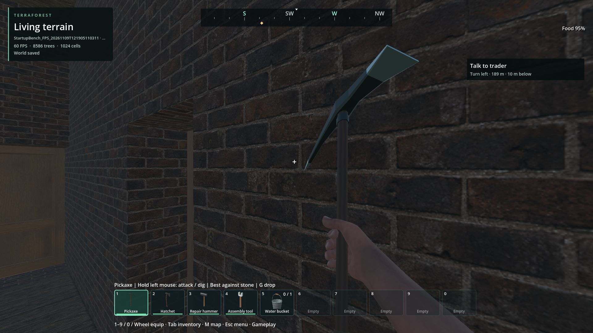

# Native pursuit query costs and exact support reuse

Status: scoped improvement; **cold pursuit latency and stable 60 FPS remain open**.
Continues [anatomy admission](anatomy-geometry-2026-11-09.md) and the
[world/player foundation](foundation-2026-11-09.md). New code is original 0BSD.
Implementation: `2e730410`. [Machine-readable evidence](navigation-query-cache-2026-11-09.json)
retains source, native and package hashes, failed attempts and comparison data.

## Cause and implementation

The previous saved-tower trace keeps the same graph revision throughout its
initial 35–45 second searches. Whole-graph invalidation is wasteful for local
edits, but it does not explain these cold searches. Opt-in native query timers
now separate readiness, dense support rays, hazard admission and capsule
clearance. In the saved-world diagnostic, support consumes about **69%** of
measured query time, hazards **19%**, readiness and clearance about **6% each**.
The isolated regional fixture spends about 90% on support.

The navigator now shares exact downward-ray answers within the same graph
revision and query policy. Keys retain every floating-point origin component
and endpoint height; there is no coordinate rounding or widened tolerance.
Each collision/exclusion/water/conditional-door invalidation changes the cache
generation. A direct-mapped table holds at most 65,536 numeric entries,
**3,145,728 bytes per navigator** in the pinned single-precision build. Hash
collisions replace entries and only reduce the hit rate. No scene/resource
references or unbounded per-ray allocations are retained.

Reuse applies only while planning. Every edge still checks current collision
coverage, and every original 2.5 cm support sample is evaluated. Floor normal,
step height, hazards and capsule sweeps retain their existing rules. Physical
movement guards always query live physics. The twelve/local, 48/regional and
cooperative 750 us scheduling limits are unchanged; individual calls and OS
scheduling can still exceed that deadline.

The rolling recorder enables these timers only while attached and now retains
each navigation physics tick before the next draw. A later cheap catch-up tick
cannot erase an earlier expensive one. Each rendered frame retains up to sixteen
immutable samples and explicitly counts any omitted ticks. The previous-recorder
elapsed metric includes this new capture work. Native timings remain wall time,
not CPU time; their presence affects diagnostic planning throughput slightly.

## Evidence and limits

- Profile baseline fixture: `reports/checks/20261109T115311605076Z/result.json`,
  20 checks. Cached fixture: `reports/checks/20261109T120215494203Z/result.json`,
  20 checks. **All eight complete route-point arrays match exactly**, with the
  same expansions, 19,265 edges, 456,667 support samples and capsule query counts.
  The cache avoids **229,983 / 456,667 rays** (50.36%). Total support time changes
  from 944.467 to 553.735 ms; the tower's 314-expansion search changes from
  640 to 404 physics ticks. These are separate process runs, not a hardware-wide
  performance guarantee.
- The targeted cache fixture compares live/cached detours in one process and
  checks changed floor height, changed recipient exclusions, unavailable coverage,
  live motion after support removal, bounds and physical-query accounting.
  Its first attempt had a GDScript type-inference error, retained at
  `reports/checks/20261109T120036232816Z`; corrected and final checks pass.
- Saved-world profile control: `reports/checks/20261109T115338031599Z`.
  Cached run: `reports/checks/20261109T120234225518Z`. Both pass all 13 assertions
  and preserve all 200 source files, including door destruction, both stair
  flights, contact and return. First planning changes **40.551 → 33.125 seconds**;
  return planning changes **46.059 → 50.411 seconds**. Return latency therefore
  did not improve in this comparison. Other query categories vary substantially;
  no general full-host latency win is claimed. Reported peak planning wall time
  reaches 28.519 ms in the control and 82.786 ms in the cached run; this remains
  an unresolved tail, not a hard-budget success.
- The final release suites pass support sampling, route contracts, cache parity,
  tread order, the full regional fixture, residency, zombie stepping and player
  cottage stairs. Recorder tests retain slow earlier physics ticks without
  later mutation; its three analyzer tests pass.
- Final packaged replan/response checks pass 14/11 assertions; moving-target
  furnished interiors pass 23. Both packaged world runs complete their normal
  save and strict shutdown checks without reported ObjectDB leaks. This is
  scoped shutdown evidence, not an endurance leak guarantee.
- Final short/long packaged captures retain 2,161/4,146 navigation ticks,
  at most three per draw, with zero dropped ticks and consistent actual-ray
  accounting. These ordinary local routes have **zero cache hits**; do not
  extrapolate the regional fixture's benefit to this gameplay sample.
- Rendering remains over budget: gameplay triggered-window p99 is
  **33.338/33.251 ms**, maximum **37.944/45.913 ms**, GPU mean
  **17.028/16.725 ms**. The previous anatomy package sample averaged 14.120 ms
  GPU. Draw counts also differ slightly (about 4,968 versus 4,989–5,001).
  This is an unresolved worse sample, not a matched rendering A/B or proof
  that the cache caused it. The long run's worst frame spends 39.816 ms in
  the draw interval while its reported GPU time is 15.773 ms; timers may lag.
  Recorder overhead averages 0.186/0.204 ms with p99 0.376/0.419 ms.

Inspected final long-run arrival: brickwork, door, HUD and held item remain
present. This wall-facing view cannot qualify zombie traversal visuals. The
inherited pickaxe grip limitation remains; no human visual approval is implied.

## Remaining / resume here

Require repeatable full-host route latency with matched start/goal and scene
state before calling pursuit responsive. Investigate the remaining hazard cost,
cache locality on mutation, the large frontier and planning wall-time tails.
Preserve the same full stairs/doors/coverage/hazard/movement contracts. The
native graph still clears globally on local invalidation; this is explicitly
unfinished. Rendering shadows/opaque passes, draw waits, first-use hit regions,
endurance and large-population/multiplayer qualification remain in the linked
foundation backlog. No graphical fidelity or gameplay limit was reduced.
