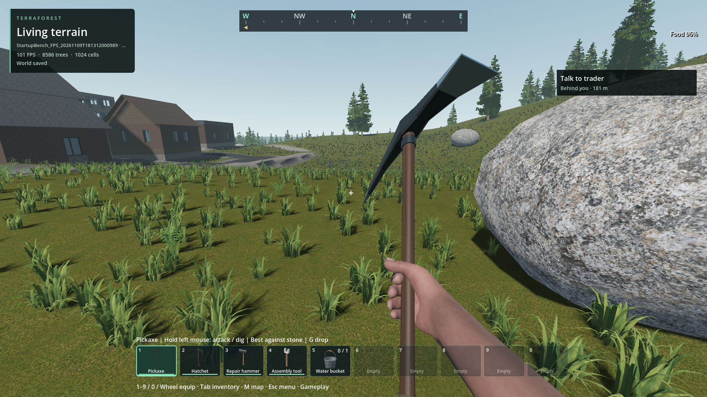

# Render setup and delayed frame attribution

Status: source implementation `81b56061` and scoped checks pass; package refresh pending.
Stable 60 FPS, whole-world headroom and general nonregression remain open.
User visual review: not received. [Exact evidence](render-stage-attribution-2026-11-09.json).

The previous pass captured expensive drawing independently of zombie physics.
Viewport rendering CPU time alone did not account for all of that interval.
The normal rolling recorder now adds Godot's shared render-setup CPU timer and
keeps separate process-frame and drawn-frame identities. The continuous driver
uses the same process-frame key as the recorder.

An optional `--render-stages` diagnostic enables engine GPU profiling and reads
completed RenderingDevice CPU markers. Reads are capped at 256 markers; only the
eight largest adjacent CPU gaps survive in each row. Missing devices, wrong-thread
callbacks, repeated device frames, reversed timestamps and truncation remain
explicit. Normal recording does not instantiate this helper. It performs no GPU
readback, GPU wait or extra timestamp insertion.

The offline analyzer associates marker gaps by absolute CPU timestamp ranges,
and only when the whole range fits inside a retained draw interval. The device
frame ID does not identify the gameplay callback reporting it. This matters in
the actual run: a 9.409 ms marker gap reported at process frame 3818 belongs to
frame 3817. A gap crossing missing history is reported unmatched, not assigned
to a nearby frame. Existing overlap deduplication and nested-stage caveats remain.

## Findings

The source probe uses the retained default Frontier world, generator 29/seed
1703, normal graphics and world services, with an uncapped 16 m outdoor camera
sweep. The follow-up control retains ordinary recording without engine profiling
or device marker collection. Both save and shut down without error/leak messages.

| Observation | Detailed probe | Ordinary recorder control |
| --- | ---: | ---: |
| Shared render setup median / maximum, ms | 0.313 / 3.202 | 0.320 / 2.601 |
| Recorder median / maximum, ms | 0.656 / 1.990 | 0.277 / 1.050 |
| Peak private commit, GB | 4.016 | 4.003 |
| Peak dedicated GPU memory, GB | 1.503 | 1.503 |

The recorded gameplay marker count reaches 163; none hit the 256 cap. These
separate runs are not an isolated estimate of profiler overhead. The detailed
mode has additional engine profiling/console work and must not qualify pacing.
The control GPU clocks range from 210 to 1545 MHz across startup and gameplay,
with software power/thermal flags in the retained CSV. It is not comparable to
the earlier 2.4–2.5 GHz runs as an absolute code-performance comparison.

In the detailed run, repeated large CPU marker gaps lie between `Setup 3D Scene`
and `Setup Sky`; the largest ordinary-view gap is 9.409 ms. The matching engine
source places render-list filling/sorting, environment setup, instance-data
preparation and dirty-pipeline work in this interval. This narrows the region;
it does not identify one individual call or prove an engine defect. Frame 3817
has 16.121 ms drawing and a 29.295 ms total interval. Another 224.394 ms frame
spends 215.664 ms before process with 31.25 ms of quantized CPU time; its owner
remains unexplained. It is retained as a profiled observation, not blamed on
screenshots or asserted to represent ordinary gameplay.

The ordinary control still has a 28.331 ms trace frame with 21.930 ms drawing,
0.275 ms shared render setup and a 2.715 ms viewport CPU reading. Another travel
frame has 6.713 ms process and 17.126 ms drawing. GPU/viewport readings can lag;
phase intervals overlap. This rules out treating shared setup as the explanation
for every stall. The continuous control sweep median/p99/max is
13.877/24.999/28.357 ms. These are still failing frame times under the observed
hardware state; no FPS improvement is claimed for instrumentation.

## Whole-world follow-up, without another engine run

Offline review of the ordinary control joins 3,708 retained frames to the
continuous process-frame samples; callback timestamps differ by at most 1.004 ms.
Loading, preparation, screenshots and saves are excluded. All 535 sweep samples
have corresponding trace rows. This is analysis of the existing run, not a new
performance comparison or runtime change.

| Independent target | Evidence in the ordinary control | Next investigation |
| --- | --- | --- |
| Rendering / presentation | Frame 4050: 21.930 ms drawing, 1.337 ms process | Separate scene-list preparation from other draw work and waits |
| Native cover selection | Sweep p99/max 2.092/2.881 ms; frame 4248 has 7.375 ms process | Nine collections can reselect together; inspect candidate sorting, per-page allocations and publication invalidation |
| Surface-result callbacks | Sweep p99/max 1.988/2.833 ms; frame 4861 has 7.539 ms process | Synchronous consumer publication runs inside the receive timer; its soft budget is checked after a whole reply |
| Physics / actors | Frame 4166: 9.517 ms across two physics steps, including 2.506 ms central zombie update | Attribute remaining body/animation/engine work; preserve response and collisions |

These rows are not additive budgets. Surface-result time includes nested cover
preparation/publication, and central zombie update is inside physics, not the
process interval. Cover-native process p99/max during the sweep is 2.240/3.171 ms;
selection is its largest measured subphase. The source uses per-page ordered
sets during selection; their allocation cost is a candidate for a controlled
change, not an isolated measured cause. Uninstrumented native block horizon,
residency and collision work also needs attribution before assigning residual
process time. Existing world/player gaps, destruction, leaks and cold pursuit
remain separate requirements. No visual or gameplay change was made in this
offline follow-up.

## Verification and visuals

- Headless recorder fixture passes, including bounded marker reads, explicit
  unavailable data, reverse timestamps and duplicate-device-frame handling.
- Five analyzer tests pass, including delayed frame identity and refusal to
  attribute markers outside retained draw intervals.
- Python compilation and diff checks pass. Godot generated the new resource UID.
- Two source default-world saves/shutdowns pass. Control outdoor start/end
  captures were inspected; no gameplay or visual setting was changed by the
  recorder. Other images are retained without claiming exhaustive inspection.
- The first harness invocation used the wrong required success text. Its script
  reported zero failures, but the harness correctly failed its marker gate.
  The corrected invocation passes; both receipts remain available.

Source default Frontier outdoor endpoint, 1920×1080, uncapped diagnostic with
ordinary recording. Ground cover, boulder, buildings and first-person view remain
visible. Scoped inspection only; no continuous-walking or user art approval.

## Remaining and resume criteria

The installed PCK remains the prior verified occlusion build
`112c554377f8693b2ad37af9a47d3807a512039bcaadb08e105f829a89b0a176`.
An interactive game in another checkout became active after the source checks.
Leave it intact. Once no competing developer/game session is active, export and
run the installed marker-availability/save/shutdown check. The tool now fails a
requested detailed probe if no marker data is actually collected.

Next isolate render-list/instance preparation and unmeasured native world work;
retain normal-graphics controls rather than attributing all stalls to pursuit.
The 0.18–0.26 ms open-view occlusion CPU overhead from the preceding milestone
also needs policy refinement or broader controlled evidence. Dense explosives,
long-session leaks, traversal, cold pursuit, weak hardware and multiplayer scale
remain open, as do earlier water/interaction failures. This instrumentation does
not resolve or replace those requirements.

New helper, tests and analyzer changes are original AI-assisted 0BSD code. No
external code/assets/dependency was imported. API/source references were read
for semantics only:

- [RenderingServer setup timer](https://docs.godotengine.org/en/stable/classes/class_renderingserver.html#class-renderingserver-method-get-frame-setup-time-cpu)
- [RenderingDevice CPU timestamps](https://docs.godotengine.org/en/stable/classes/class_renderingdevice.html#class-renderingdevice-method-get-captured-timestamp-cpu-time)
- [Exact running engine revision: rendering server](https://github.com/godotengine/godot/blob/ed1daf0bf/servers/rendering/rendering_server_default.cpp)
- [Exact running engine revision: clustered renderer](https://github.com/godotengine/godot/blob/ed1daf0bf/servers/rendering/renderer_rd/forward_clustered/render_forward_clustered.cpp)
