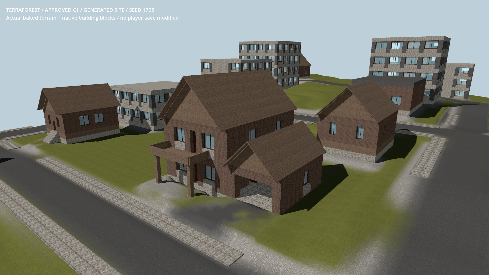

# Building and POI terrain fit

- Status: Improved generation standards / scoped engineering checks; player review pending.
- Updated: 2026-10-28. Existing building designs and saved worlds stay unchanged.
- Native fitting now surveys the full building envelope plus a one-metre apron,
  at at most one-metre spacing. The existing 2 m fill / 3 m cut limits still apply.
- Five-metre garage access is surveyed across its width before choosing the lot.
  Unsuitable sites relocate instead of exceeding terrain budgets.
- Native rectangular grading replaces overlapping rounded foundation-strip ends.
  Four-metre transition shoulders remain local to each building, not a town plateau.
  A bounded native height cache reuses candidate samples; no new per-frame work.

Seed 1703, C1 origin `(1052,52,423)`, rotation 0. Actual native terrain and blocks;
same approved house, but a different fitted site from the older C1 comparison.
No vegetation/actors in this fixture. Inspected; not populated-world art approval.
Earlier site and scooped shoulders remain in `../large-house-c1/images/`.

- Checks: 19 site-rule assertions across four coastal seeds; seven inland planner
  seeds; actual terrain/paving support with zero mismatches; C1 traversal/storage
  56/56 and rendered fixture 58/58. Logs: `reports/checks/20261028T073536531798Z/`,
  `20261028T072944360210Z/`, `20261028T072948070566Z/`, and
  `reports/site_standards/graphical/`.
- Retained failures: reserving the entire roof envelope as a ground-level road
  obstacle prevented complete layouts. Existing ground-support collision rules
  remain; below-grade houses retain their full-envelope corridor exclusion.
  The first corner fixture incorrectly used integer queries for fractional points;
  corrected continuous-density probes pass without changing terrain tolerances.
- Still review populated sites, additional POI designs, driving and landscape
  transitions. Passing fixtures do not approve all world geography or old saves.
- Installed package repeats all 19 site assertions without diagnostics:
  `reports/checks/20261028T082918413737Z_queued_pack/site_fit_standards/`.
  Actual production data generation creates 20 buildings, saves and reopens through
  the game loader: `reports/checks/20261028T081755681198Z/`. That headless fixture
  skips photographs/map raster baking; it is not a populated visual approval.
