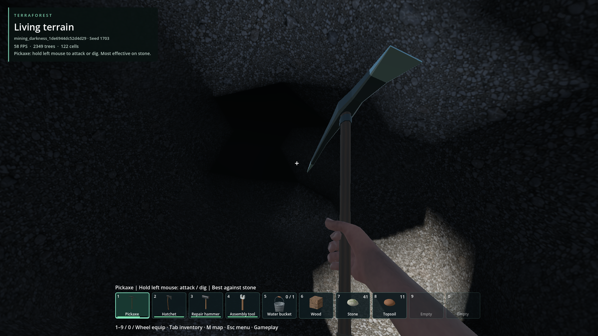
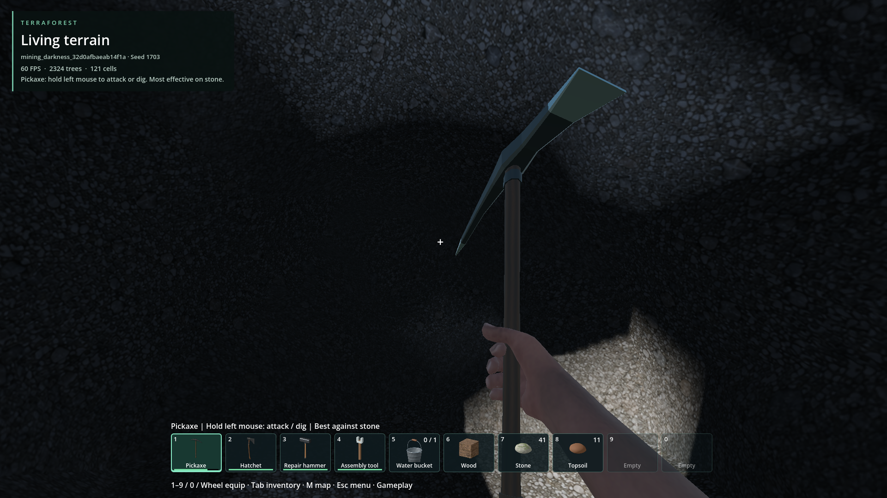
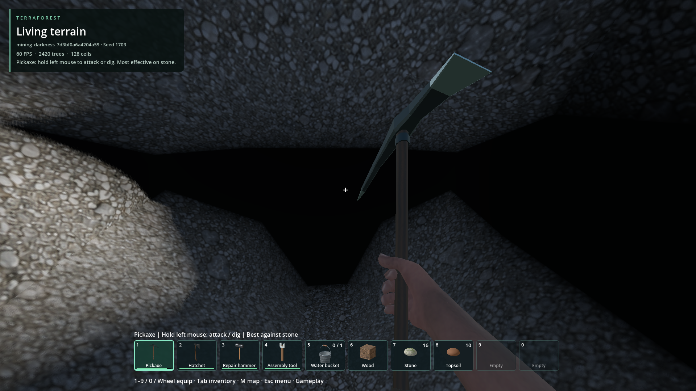
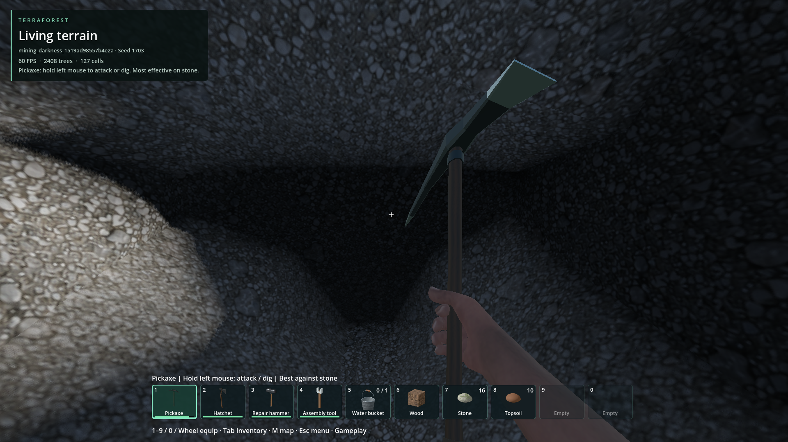

# Black terrain patches while mining

- **Status: Improved / partial.** Recurrence reproduced; faint terrain visibility added.
- Updated: 2026-10-26. Shader readability follow-up to `f28859c2` / `86bf75b1`.
- User review: faint visibility in enclosed caves approved; latest images await review.
- Symptom: Mined faces turn flat black until lit by the headlamp.

## Latest recurrence / before and after

Hidden_Hills, seed 1703; backup saved feet (986.9822, 38.99959, 1023.823).
Same camera and serialized density; headlamp **off**. HUD slot names differ because
each diagnostic uses a separate copy; streamed tree counts are not a lighting metric.

**Before:** a nearby newly exposed recess still becomes flat black.

**After:** the installed shader retains faint rock texture, including sealed caves.

- This recess mostly has no direct sky visibility, even with 256 diagnostic rays.
  Removing cached sunlight alone does not repair it; this is not the distant tree mask.
- Default `minimum_cave_fill=0.12` floors the existing terrain fill multiplier.
  No extra bake, rays, textures or render passes; one shader maximum. Native lighting,
  headlamp/directional shadows and distant canopy shadows remain unchanged.
- This is intentional gameplay readability, **not** physically bounced GI.
  Value `0` restores strict darkness for comparisons; no extra settings UI.
- Source/packaged same-save and zero-light shader controls pass. Terrain density
  and original saves are unchanged. [Evidence, rejected trials and reproduction](readability/README.md).

## Earlier improvement / retained history

Hidden_Hills, seed 1703; saved feet (986.2361, 39.93774, 1023.084).
Same saved camera/density; headlamp **off**. This is the nearby F5 reproduction,
not the exact framing of the original user screenshots.

**Before:** false-black band across intact rock.

**After:** shaded texture without the headlamp; real shadows remain.

[Image provenance](images/manifest.json).

## Earlier changes / verification

- Earlier repair kept visibility probes in air rather than neighboring rock.
- `f28859c2` added bounded sky sampling near edited pages, avoided sharing a nearby
  dark result, and cached exact-position results. It had no ambient brightness floor;
  the newer user-approved readability policy above intentionally changes that.
- Saved-view/package, sealed/open chamber and cache checks pass; 1,200-edit workload
  passes existing gates. Player saves and serialized terrain remain unchanged.

## Remaining / resume here

- Tiny openings can evade finite samples; untouched caves retain the old sampling.
  No bounced GI; sealed caves now intentionally retain faint terrain visibility.
- For recurrence, compare albedo, sky visibility and headlamp-off/on at the F5 pose.
  Preserve native baking/cache budgets. Judge the new fill against bright exterior
  and deep-cave controls before changing its strength. Await the player's visual
  review; broader cave/material/hardware qualification remains open.
- Code: [lighting core](../../addons/volumetric_terrain/native/core.cpp),
  `visibility_origin`, `diffuse_sky_visibility`, `shade_visibility`,
  [terrain shader](../../addons/volumetric_terrain/terrain.gdshader).
- Tests: [native regression](../../tests/native/mining_light_regression.cpp),
  [saved-view diagnostic](../../tests/mining_darkness.gd),
  [zero-light shader control](../../tests/terrain_cave_readability.gd).

## Reproduce / history

`python tools/check_mining_darkness.py --slot Hidden_Hills --pack`

Requires the local save; harness uses an isolated read-only copy and fresh cache.
New reports need their own saved viewpoint. No private world data is committed.
F5 is not an immutable checkpoint: subsequent autosave/save-and-quit can replace it.
The latest recurrence was recovered from `.trw.bak` using `--backup`; retention of
that particular state is not guaranteed after another save.

- [Initial probe-origin repair](../../docs/evidence/mining_darkness/README.md).
- [Refinement, timings, rejected trials](../../docs/evidence/mining_darkness/refinement/README.md).
- [Build/test provenance](../../docs/evidence/mining_darkness/refinement/qualification.json).
