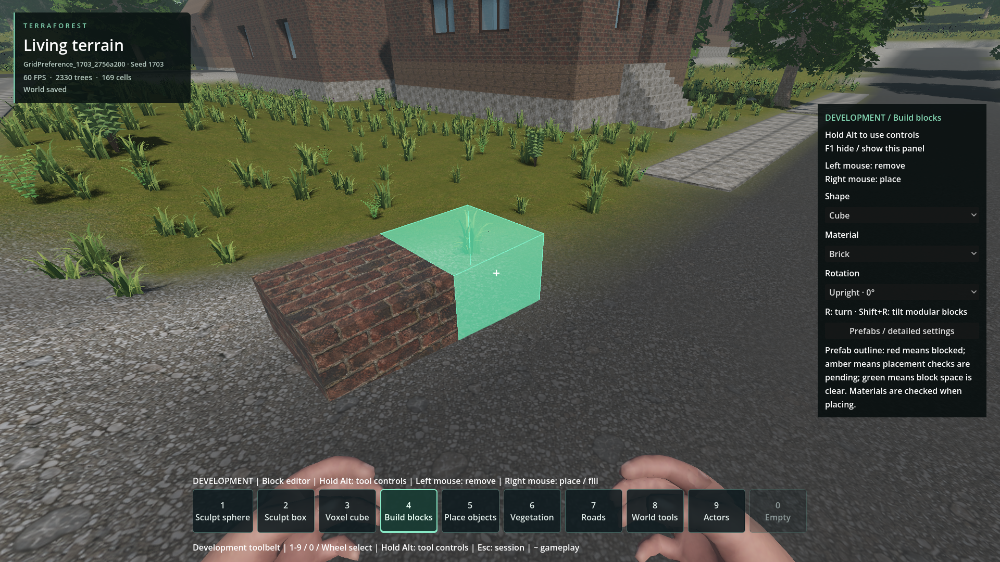
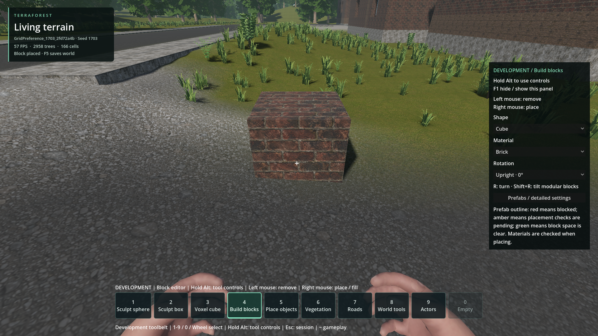

# Terrain/road fit to the building grid

- **Status: Improved / unresolved.** Do not mark solved.
- Updated: 2026-10-26; engineering evidence records the 2026-10-25 work.
- User review: Improvement approved as default, not universal gap/burial quality.
- Symptom: Blocks float above or sink too far into roads, shoulders and terrain.

## Relevant images

**Player report:** burial in GridPreference_1703_2756a200, seed 1703. Original
attachment preserved; exact screenshot build/date are not established. Subsequent
F5 audit records feet (951.6663, 35.641, 1139.778), target cell (953,35,1137).

**Later generation-contact review:** shoulder still fails after improvement.
Different camera and review-world copy; **not** a pixel-matched comparison.

[Image provenance](images/manifest.json).

## Changes / verification

- Soft terrain preference and native footprint-aware road/support grading before
  baking; shared contact policy, bounded cut/fill and cached binary plans.
- Grouped terrain/road options enabled by default for new worlds (`40e2f0c8`).
  Old saved recipes/worlds stay unchanged.
- 44/45 reviewed collision footprints pass. Shoulder burial improves 39.82 →
  30.12 cm, still beyond the 25 cm diagnostic limit. Gaps are measured separately.
- One-metre grid, approved buildings/plates and building freedom stay intact.
  No per-placement terrain repair or automatic foundation mounds.

## Remaining / resume here

- Evaluate the final composed surface: shoulders, caps, crossings, yards,
  protected entrances and natural slopes. Keep the rejected shoulder as a fixture.
- Closure needs multi-seed rendered/collision evidence without concealing gaps
  behind extra burial, changing the grid or relaxing thresholds.
- Unimplemented ideas: GPU-friendly sharper block-aware/faceted terrain rules;
  optional softened grid adaptation during editor terrain changes.
- Start with [placement contract](../../docs/PLACEMENT_STANDARD.md),
  [world standard](../../docs/WORLD_BUILDING_STANDARD.md) and
  [native contact policy](../../addons/volumetric_terrain/native/generation_contact.hpp).

## Reproduce / history

- [Concise unresolved marker](../../TERRAIN_GRID_FIT_UNRESOLVED.txt).
- [Latest policy, measurements and commands](../../docs/evidence/generation_contact_native/README.md).
- [Original saved shoulder rejection](../../docs/evidence/connected_grid_roads/rejected_shoulder/README.md).

Follow the linked reproduction guide using a separate review world and its
F6/F7/F8/F9 cases. Never regenerate or overwrite the player's original world.
