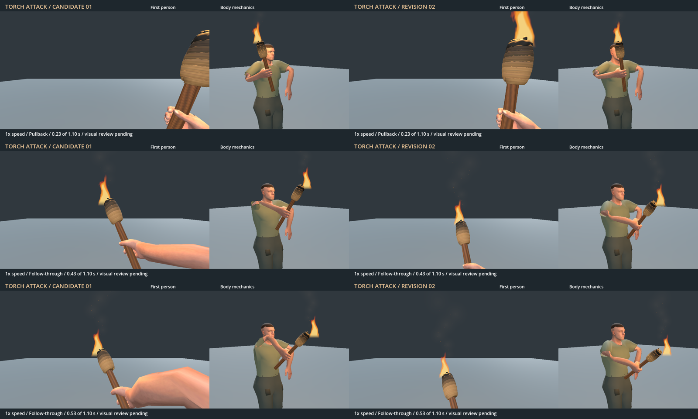

# Torch attack arm deformation and motion

- Status: Integrated for first person; third-person presentation remains unfinished.
- Updated: 2026-11-04. Rejected candidate: `b7acbe0c`; revision is in the commit adding this issue.
- User review: Candidate 01 was imperfect; frame review identified shoulder/upper-arm collapse, a first-person forearm bulge, a weak stroke, frozen support motion and stop-start timing. Player requested a fix.
- Integration decision: 2026-11-04 — user requested integration of revision 02 for first-person use and explicitly deferred third-person fixes.
- Symptom: The elbow rises above the shoulder and twists the sleeve sharply during the strike; recovery unwinds the limb awkwardly.

## Images

Left column: rejected candidate 01. Right: revised motion. Rows show 0.233 s
pullback, 0.433 s proposed contact and 0.533 s follow-through. Each panel retains
its original first-person and side/front rendering. Godot 4.7.2 Forward+, RTX
4050, same neutral stage, 75-degree 16:9 first-person camera and same side/front
camera. No world/seed or saved-player state. Full source images and hashes are
in [the manifest](images/manifest.json). Rejected evidence is preserved at
[its original location](../../docs/evidence/torch_attack/README.md).

## Changes and verification

The old solver made the elbow chase the wrist/tool orientation and replaced the
upper-arm roll with a hinge frame. It allowed a 142.52-degree upper-arm turn,
an elbow 147.52 mm above the shoulder and shoulder edges stretched to 4.879 times
their carry length. The original 11 checks covered the hand but missed this.

Revision 02 preserves the carry roll, solves against a low outward elbow pole,
and derives tool orientation from the forearm/hand with bounded wrist flex.
Continuous trajectory tangents remove the contact pause; a small torso turn
and free-arm counter motion support the stroke. Root, hips and feet stay fixed.

The expanded 15 checks pass, including 133 sampled poses and 389 CPU-skinned
shoulder/sleeve triangles. The rejected candidate fails four expanded checks.
Detailed measurements, logs and limitations are in
[revision 02](../../docs/evidence/torch_attack/revision02/README.md).

The reviewed library is now copied byte-for-byte into runtime assets and loaded
by the normal tool presenter. Hold left mouse to attack: one live target query
at frame 26 (0.433 s), then recovery through 1.10 s. Shared world melee applies
5 base damage to stone/wood and 10 to other targets/zombies, with ordinary
progression modifiers. Zombie impacts use the existing blunt melee adapter.
Torch durability remains unchanged (no wear/fuel consumption); no ignition,
burning status or fire spread is added. Equip, hidden tools, inventory and focus
changes use existing cancellation. [Integration checks and in-world evidence](../../docs/evidence/torch_attack/integration/README.md).

## Remaining / resume here

Third-person attack art is explicitly deferred at the user's request. The shared
rig currently plays the same functional clip in third person; it is not approved
as finished third-person presentation. Return when that art pass is requested:
rework full-body arm/shoulder, torso and sleeve appearance, capture multi-angle
third-person playback, retain first-person approval and contact timing, and get
explicit third-person review. Inherited sleeve/skin finish and the upright flame
remain. The user can also reopen first-person motion with an exact time/view.
The [existing carry-hand review](../torch-hand-deformation/README.md) remains open.

## Reproduce / history

Open [revision 02 video](../../docs/evidence/torch_attack/revision02/Torch-attack.preview.mp4).
Author with `tools/author_torch_attack.py`, convert using
`tools/import_torch_attack.gd`, run `tests/torch_attack_candidate.gd`, render with
`tools/preview_torch_attack.gd`, then encode with `tools/encode_torch_attack_preview.py`.
New motion/review assets use CC0; new code uses 0BSD; inherited notices remain.
