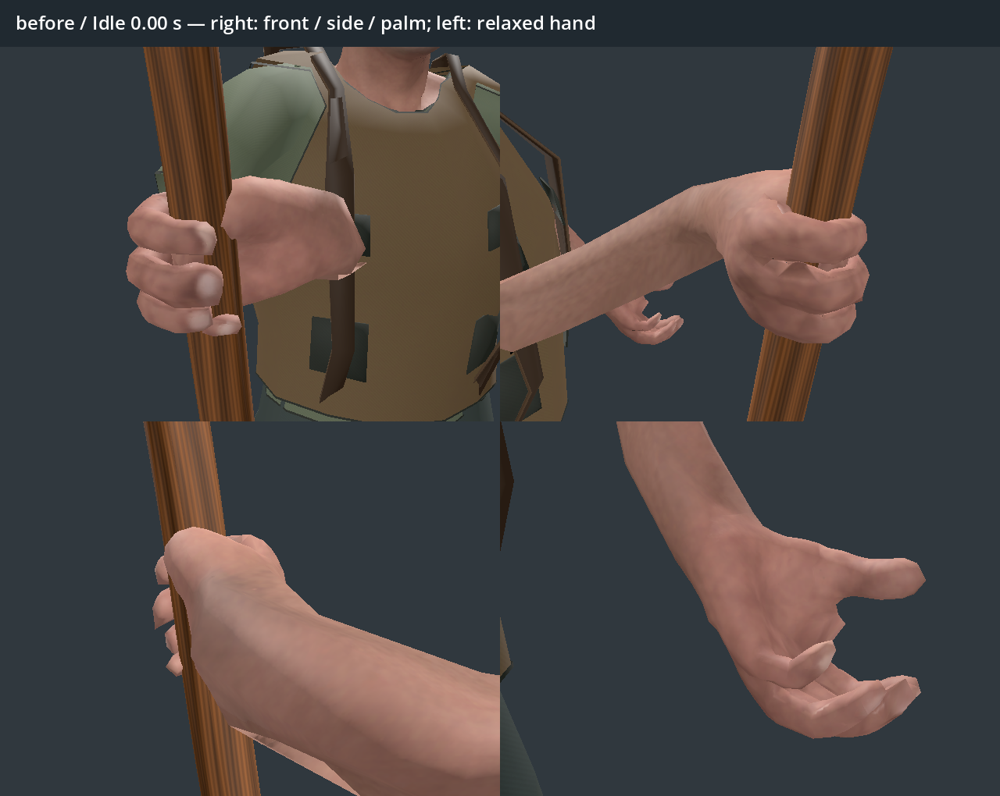
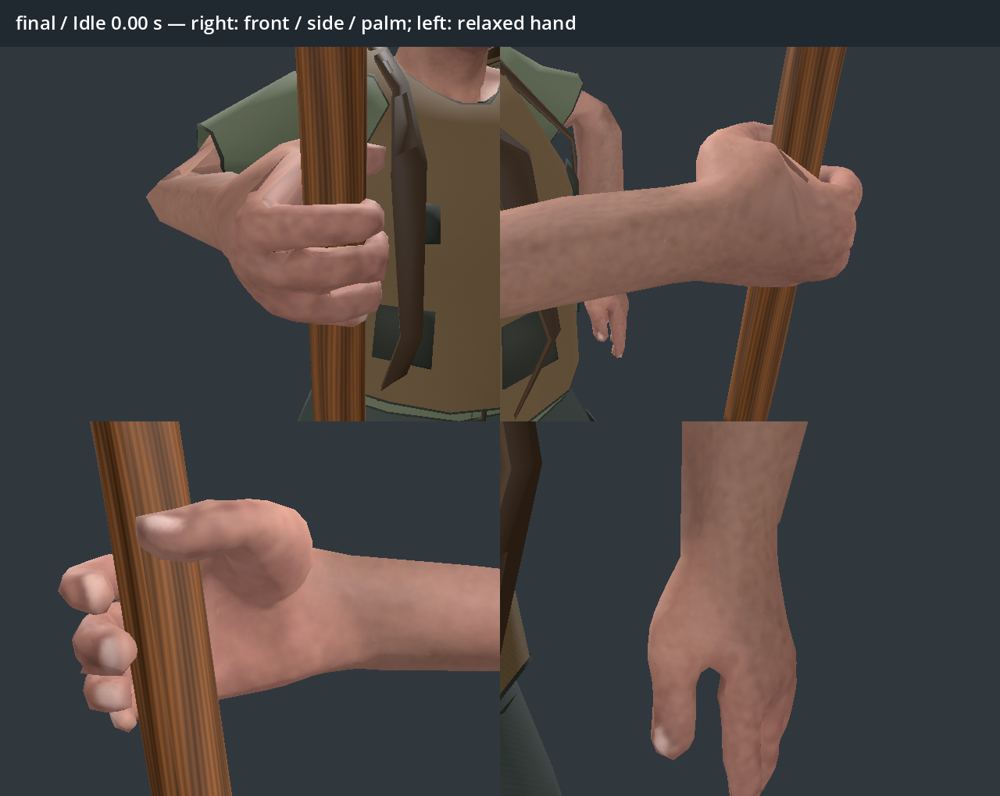
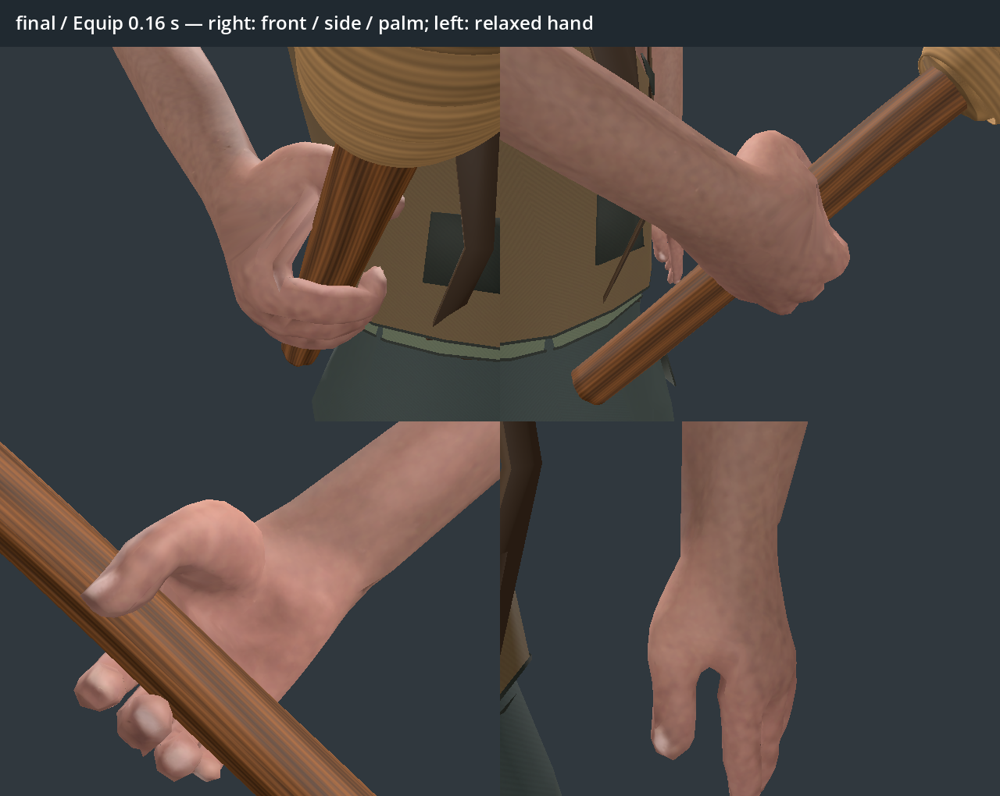
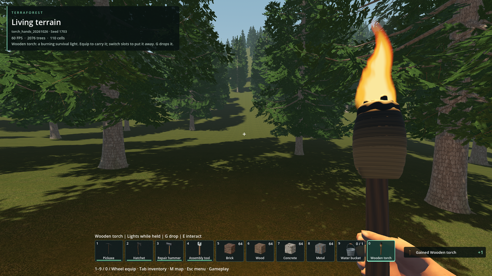

# Torch hand deformation

- Status: Improved-partial; revised hands await player review.
- Updated: 2026-10-26. Baseline: `6aa2f563`; repair in the commit adding this record.
- User review: Original hands rejected as completely broken; requested per-frame fixes.
- Symptom: Sideways folded wrist, misplaced thumb, fingers intersecting the shaft and an unnatural free hand.

## Images

Rejected baseline, idle frame 0. Runtime R11 character in a controlled neutral
stage, Godot 4.7.2 Forward+, RTX 4050. Four 640×480 views: right front, side and
palm, then left hand. No world/seed. Fire hidden to reveal the skin. Cameras track
the hand position with fixed world-space offsets; the reoriented hand changes
the visible surfaces. Captured before editing, using `review_torch_hands.gd`.

Revised idle, same stage, view offsets and lighting. Wrist/forearm alignment and
each finger were rebuilt in Blender; the free hand faces inward with relaxed
fingers. These images are engineering review evidence, not user acceptance.

Revised equip at 0.16 seconds, near the previously found elbow-frame flip.
The new 0.45-second raise keeps the same grip through its entire motion.

[Ten-second motion preview](Torch-hands.preview.mp4): equip 0–0.45 s, idle to
2 s, walk to 4 s, run to 5.6 s, jump to 7.1 s, crouch to 8.1 s, then idle.
First-person rendering and two close-ups at normal speed; close-ups hide fire.
The preview seeks the authored clips directly; transition checks exercise the
runtime player separately. Crouch is shown here for inspecting the full-body
clip; actual first-person crouching keeps the existing camera/motor behavior.

## Changes and verification

- Original right wrist bent 105–107 degrees. The earlier fixed-grip test passed
  because it checked attachment consistency, without checking whether the pose
  was anatomically usable. The rejected thumb also reused a punching pose.
- Refit all five digits against 627 deformed hand vertices. Rebuilt both arm
  chains and keyed every 60 Hz frame of idle/walk/run/jump/equip. Derived crouch
  keeps the same complete upper-body hold. Original rig and global hand weights
  are preserved.
- Keep elbow-frame handedness consistent during the raise. The former
  world-X sign selection caused a 180-degree flip between adjacent equip keys.
- Mount the torch directly on the right hand using its imported grip transform.
  This keeps movement crossfades from independently interpolating the weapon
  away from the fingers. Cross-tool equip starts the keyed raise without
  blending incompatible hand poses.
- `tests/torch_hand_deformation.gd` checks every key and half-key at 120 Hz:
  wrist angle, arm rotation continuity, actual CPU-skinned hand clearance from
  the curved shaft, fingertip proximity, six equip entries and movement blends.
  The shaft profile check allows 0.5 mm for polygon approximation.
- Final qualification results and asset hashes: `qualification.json`.
  All 194 scoped checks pass: hand deformation 36, torch presentation 28, actual
  world 16, pickaxe locomotion 24, bucket presentation 63 and attack timing 27.
  Icon dependency receipt is current. The hand audit covers 936 key/half-key
  poses; right wrist stays within 10.27 degrees and left within 21.69 degrees.
  Smallest sampled vertex clearance is 0.22 mm outside the shaft profile.
  Detailed [frame audit](verification/hand-frames.json) and
  [rejected baseline](verification/rejected-hand-frames.json) are preserved;
  full local reports remain under `../../reports/torch_hands/`.

Actual native world, seed 1703, temporary slot `torch_hands_20261026`, 1920×1080.
Captured after crafting, native drop/recollect persistence and equip. No player
save was written. [Other clip close-ups](images/manifest.json) have source paths
and hashes. The original first-person/third-person pose differences are retained.

## Remaining / resume here

Player review of in-game carry, free hand and equip is still required. The
original character's low-poly skin/clothing finish is retained. For a remaining
deformation, capture the clip/time, camera angle and equipped item immediately
before the torch; inspect both the exported skeleton and deformed surface at
that frame. Reopen this same record. Engineering checks do not establish
universal anatomical or visual correctness.

## Reproduce / history

Select Wooden torch (item 6) from Dev Bag or craft with one Wood and two Plant;
walk, run, jump, crouch in third person and switch to it from other tools.
Use a temporary world for automated checks; no saved player world is changed.

Run `tests/torch_hand_deformation.gd` headlessly. Render close-ups with
`tools/review_torch_hands.gd -- --tag=review`, and video frames with
`tools/preview_torch_hands.gd`. Encode using Blender background mode and
`tools/encode_wooden_torch_preview.py -- --hands-review`.

The [original torch evidence](../../docs/evidence/wooden_torch/README.md),
including its rejected video, remains intact. The first repair fit left the
grip too loose and was superseded before delivery; local images remain under
`reports/torch_hands/fit1_*`. Fit 2 still intersected the little finger and was
also superseded. Source and regeneration instructions:
[WOODEN_TORCH.md](../../addons/characters/authoring/WOODEN_TORCH.md).
