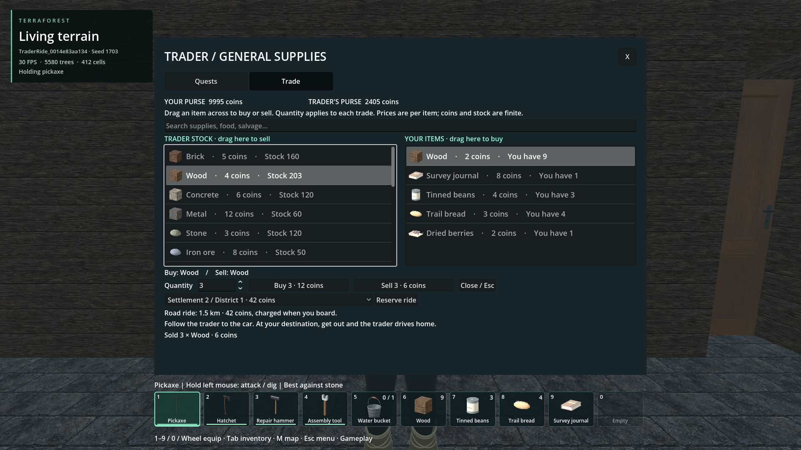
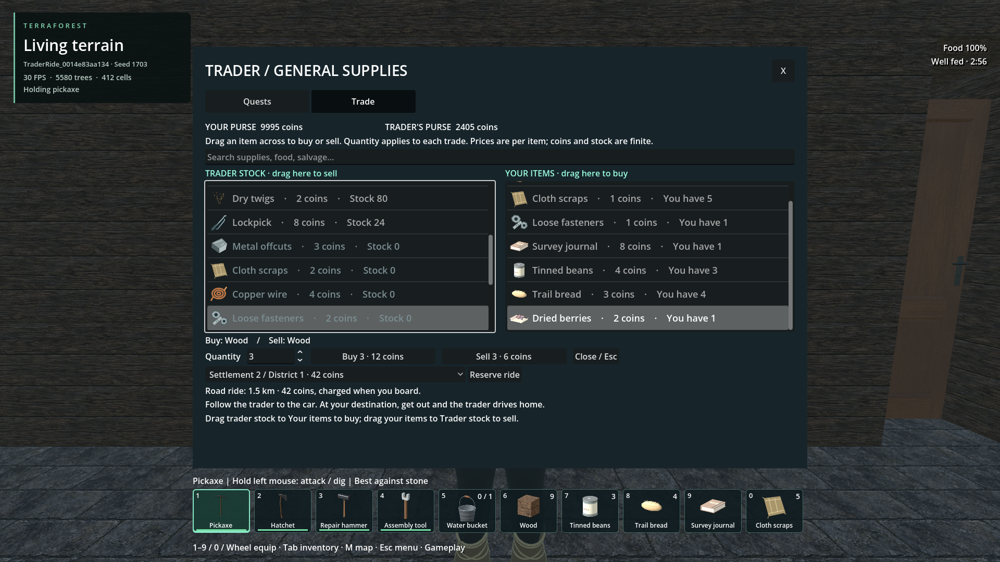

# Quiet notices, town salvage and trading

- Status: Installed / scoped checks pass, 2026-11-03.
- Request: quiet routine action toasts, useful scrap in town chests, and a trader
  interface with drag-and-drop and item listings.
- User visual/economy review remains separate.

## Behavior

The animated centre notice now accepts explicit buff and quest events. Equipping,
headlamp toggles, collection, building and routine saves do not enqueue it.
Activity/interaction feedback and inline UI errors remain. Buff gain and expiry
announce once; countdown ticks do not. Existing quest-added notices remain, with
rare completion and reward-collection notices.

Four original salvage items have icons, batched world-drop silhouettes, finite
trade prices and recycling recipes:

| Item | Recycling | Trader buys / sells, coins each |
| --- | --- | --- |
| Metal offcuts | 3 to 1 metal | 1 / 3 |
| Cloth scraps | 2 to 3 plant fibre | 1 / 2 |
| Copper wire | 2 to 1 copper ore | 2 / 4 |
| Loose fasteners | 4 to 1 metal | 1 / 2 |

Generation previously stocked only its approximately one-in-five locked-chest
selection. Otherwise unseeded unlocked chests now receive modest deterministic
scrap bundles, with occasional twigs/bread. Richer locked/authored stock remains.

Older worlds receive one contents upgrade for empty chests within 224 m of a
published town centre. Nonempty player contents are preserved. A saved ledger
tracks up to 4,096 visited identities and the initial identity upper bound,
including unloaded model records. Paging can visit other original chests later.
Identities above that bound are excluded; marked emptied chests never refill.
Four records are considered per process step; processing stops after the resident
pass. Read-only snapshots do not seed supplies. This is not periodic loot respawn.

The trader has separate stock and saleable-player-item lists, icons, search,
per-item prices, counts, purses and a quantity control. Dragging a listing across
commits that quantity through the existing native atomic exchange. Buy/Sell
buttons use the same contract. Cancelled drags change nothing; stale/replayed
offers and old UI sessions reject mutation. Stock and funds remain finite. Old
merchants acquire the new goods when players sell them. Quests and rides remain.

## Verification

Exact commands, hashes, sampled resources and retained failures:
[verification record](verification.json).

- Salvage/trading 24, notices 15, existing interaction 10, merchant inventory 16
  and quest offers 29 pass.
- Native model/identity regression passes 60 assertions in both debug and release.
  Native changes add only `last_identity` to model statistics.
- Normal Generate & play creates an owned seed-1703 world: 37 checks pass through
  ordinary generation, loot, trade, food/reading and save. Corrected fresh-process
  restoration passes 14 checks, preserving finite supplies and buffs.
- Actual root executable and exported PCK pass 23 copied-town shop checks and 15
  fresh-process restore checks. Includes real Godot GUI drag/drop, exact prices,
  collected salvage, saved stock, an empty chest staying empty, durable closes,
  zero pointer captures and strict sampled memory gates. Original player worlds
  are not opened by the test drivers.
- Export dependency/notice/building gates and pack smoke pass. The separate
  unfinished parking hook/helper are excluded and their files preserved exactly.
  The shipping dependency index reflects the tracked generation hook.

Earlier quantity tests used a programmatic SpinBox value before layout; the
corrected harness enters its LineEdit as a player does. A model assertion was
accidentally duplicated into an unrelated fixture and removed there. Initial
restore retained a selected-listing visibility failure; the UI now scrolls after
layout and the harness checks the visible Trade tab. The first export correctly
refused a stale startup graph before it was rebuilt. Failed reports are retained,
not relabelled as passes. No universal world/performance acceptance is claimed.

## Images

Inspected actual-executable view after a three-item drag purchase and return sale.
Listings, quantity, total prices and both purses are readable.

Inspected diagnostic view after collecting a chest bundle. New icons and carried
scrap are visible. This scripted selection capture retains the prior button
summary; the preceding GUI trade and transaction checks provide interaction
evidence. Inherited character/clothing/world limitations remain separate.

Unedited image sources and provenance: [manifest](images/manifest.json).

## Reproduce and provenance

Use `tools/run_godot_check.py trade_scrap --headless --timeout 45 --require
"TRADE_SCRAP checks="`, or `player_notices` with its completion marker. For the
integrated package use `tools/check_trader_ride_world.py --executable
--source-report reports/player_survival_world/<owned-fixture> --stage shop`, then
`--stage shop-restore --resume-report reports/trader_ride_world/<shop-report>`
with that same source fixture. These create/reuse only private test worlds.

New code is original AI-assisted 0BSD work. New SVG artwork is CC0-1.0, recorded
in `addons/player_runtime/art/salvage/provenance.json`. Drop silhouettes are built
by original code. Inherited assets retain existing licenses and authorship; no
third-party material or dependency upgrades were introduced.
