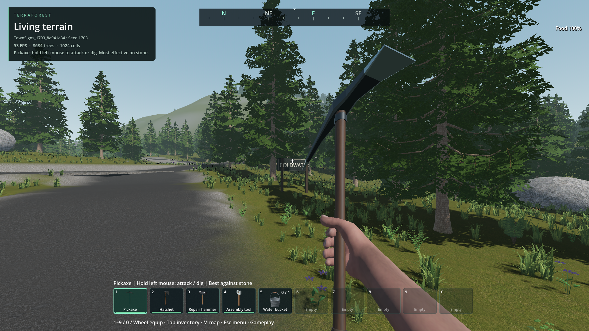
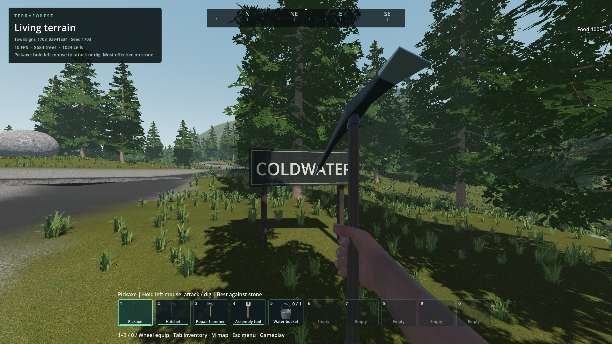
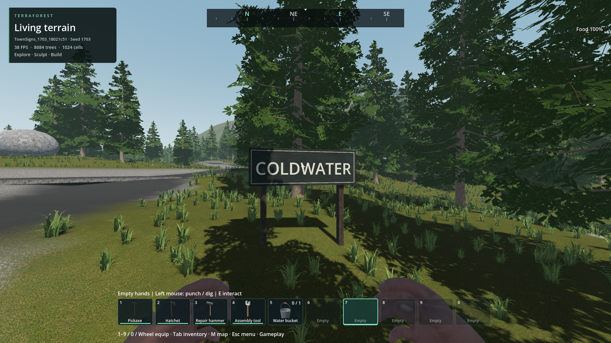
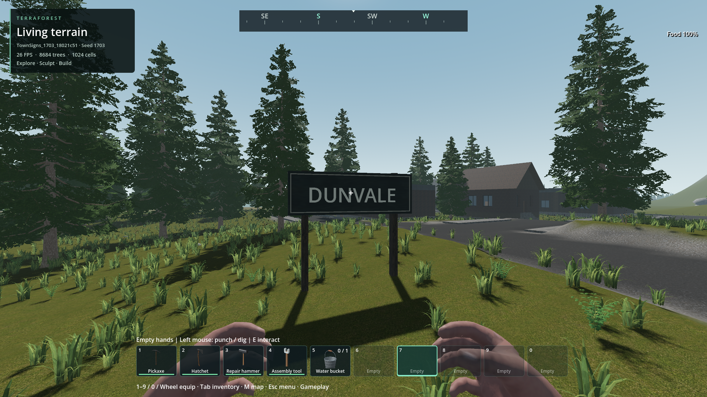
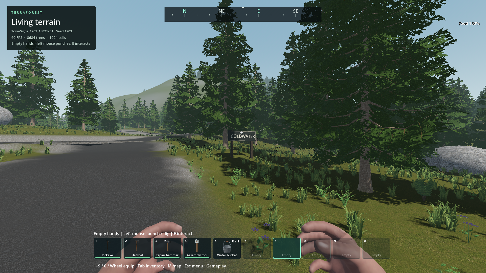

# Town names beside approach roads

- Status: Installed; normal generation and fresh-process restore pass. Final images inspected; user visual review pending.
- Updated: 2026-11-01. Source: `2c0de278`; main integration: `20cabe9b`.
- User review: Requested one or two town/city name signs; appearance not reviewed.
- Request: Identify towns from their roads without blocking driving or walking.

## Behavior and ownership

New worlds using the normal **Connected countryside** recipe and other integrated
settlement recipes receive one or two signs per town (maximum six). Deterministic
names are shared by all districts of a town, the map and its signs. Existing worlds
are not renamed or regenerated. Native model ownership retains collisions, damage,
salvage, save/reload and region streaming; lettering follows the resident body and
is removed when that body is destroyed. There is no per-frame sign script.

Approach candidates prefer actual connections between towns, then outer street
ends. The transformed board clears roads, shoulders, pedestrian space and building
lots. Publication uses bounded native rays against the **edited** terrain at the
board corners and both posts; no terrain grading is added for decoration. Generation
requires at least one admitted sign per town and stops rather than publishing a
known unsupported sign. Broader seed admission remains a separate coverage follow-up.

The dark painted board, rough timber posts and physical cream lettering use
original 0BSD procedural code plus the approved E2 weathered timber/patinated zinc
image-generated textures. No new imported
bitmap, model or font asset is introduced. Godot's existing fallback font renders
lettering under the engine's retained terms; it is not relabeled CC0. Existing
texture notices and optional legacy materials remain unchanged.

## Changes and verification

`addons/world_runtime/town_sign_plan.gd` plans names and safe approaches;
`town_signs.gd` owns static presentation and native persistence registration.
Original runtime-generated sign geometry is contributed under CC0-1.0 by TerraForest
contributors to the extent they hold rights; its original code is 0BSD. Reused E2
material provenance remains in `addons/structures/textures/expansion_v2/`.
Normal `generate_world_task.gd` publication occurs before ecology reconciliation
and saving; `custom_world_plan.gd` version 38 invalidates old preview metadata.

Parser checks pass. `tests/town_signs.gd` passes 18 checks including native body/name
roundtrips, old empty metadata, destruction without ghost lettering, native salvage,
long-name fit, road clearance and facing incoming traffic. Receipt:
[focused check](../../reports/checks/20261101T173939579713Z/run.json).

## Generated-world evidence

Normal **Generate & play** passed 17 checks, then ordinary **My worlds → Open**
passed 18 checks in a fresh process. Seed 1703 has two Coldwater signs and two
Dunvale signs. The names match the map, both towns stream their bodies/lettering,
physical rays hit the boards and both post feet penetrate the edited terrain.
[Creation/restore receipt](../../reports/town_signs_world/20261101T173151258077Z/run.json).
The owned review world is `TownSigns_1703_8a941a34`; no played save was regenerated.

The first inspected images exposed posts overlapping the board face. Their
geometry/colliders were moved behind the board, followed by another **18 passing
fresh-process checks** in [corrected-post receipt](../../reports/town_signs_world/20261101T173519352892Z/run.json).
Retained comparisons below are not final visual approval. All runs were at 1080p,
60 FPS cap/VSync with concurrent native compilation; timed frame samples were
explicitly skipped. Visible HUD FPS is not a performance acceptance measurement.


First generated Coldwater approach: rejected post placement; held tool partly obscures lettering.


Corrected assembly: board in front of posts and feet grounded. Still an incomplete
review view because the held pickaxe covers part of the text. Exact screenshot
sources, settings and hashes are retained in [manifest](images/manifest.json).

## Installed verification and final images — 2026-11-01

The coordinated combined build passes **17 normal Generate & play checks and 18
fresh-process My worlds → Open checks** using the actual installed
`TerraForest.exe`, explicit PCK and matching dist libraries. The integrated native
sign check also passes 18 checks. No developer content flags are required.
[Installed creation/reopen receipt](../../reports/town_signs_world/20261101T184013933118Z/run.json).

The owned review world is **`TownSigns_1703_18021c51`**, normal **Connected
countryside**, seed 1703. Coldwater and Dunvale each receive two signs. Names match
the map; resident bodies/text, board collisions and both posts against edited
terrain survive reopening. Existing player worlds were not regenerated.

- PCK SHA-256: `4295d8f9717cda70175cba36671fc10b259f39e0b8b6454f2fed6211d3a14afe`.
- Installed engine SHA-256: `981c1a194797a3ebb3153b5e5ece7bcfc6573e874f4cd6250ed120d309b511a5`.
- All 14 native libraries matched the coordinated package. The user-owned executable
  was launched without replacement; no source or native build ran during this window.

Final views use an ordinary empty belt slot. Timber grain runs vertically up the
rear posts, sampling inside one plank; the flat painted board avoids the zinc
texture's folded roof seams. The unobstructed close and road views were inspected.
This completes the outstanding final UV/photo and installed integration checks.



Final Coldwater board, physical lettering and rear timber posts.



Final Dunvale assembly and town frontage after fresh-process restore.



The approach keeps the road, shoulder and walking space clear. These are unretouched
runtime captures. HUD FPS may include earlier PNG compression and is not the clean
frame sample. Source paths, hashes and settings are in the [manifest](images/manifest.json).

### Scoped frame samples

Each sample contains 120 stationary frames before screenshot readback, at 1080p,
60 FPS cap/VSync and unchanged Quiet Mode, without competing game renders/builds.

| Phase / town | p95 frame | Worst frame |
| --- | ---: | ---: |
| Create / Coldwater | 16.941 ms | 17.613 ms |
| Create / Dunvale | 16.968 ms | 23.367 ms |
| Restore / Coldwater | 17.623 ms | 18.426 ms |
| Restore / Dunvale | 17.261 ms | **67.101 ms** |

The restored Dunvale outlier remains unexplained. These short samples do not qualify
travel, foreground presentation, broad world performance or a locked 60 FPS. There
is no matched signs-disabled baseline, so they do not isolate sign overhead. Sampled
process commit and dedicated VRAM stayed within project budgets.

## Remaining / resume here

Implementation and scoped installed checks are complete. User visual approval
remains open. Broader seeds/recipes and travel/frame-cost coverage belong to the
next world-generation/performance review; preserve the 67.101 ms outlier and compare
matched scenes before attributing it. Do not regenerate played saves for testing.

To reproduce on a coordinated matching package and reserved runtime window:

```powershell
python TerraForest/tools/check_town_signs_world.py --pack
```
