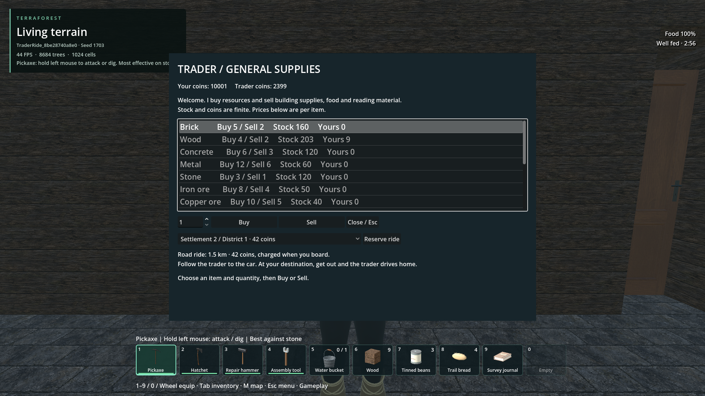
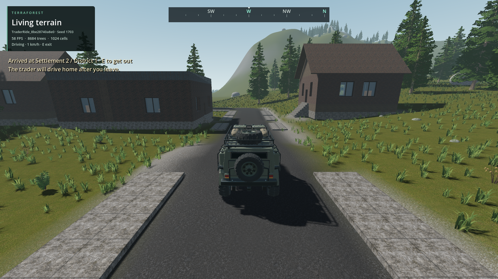
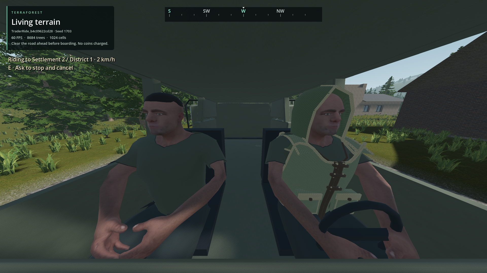
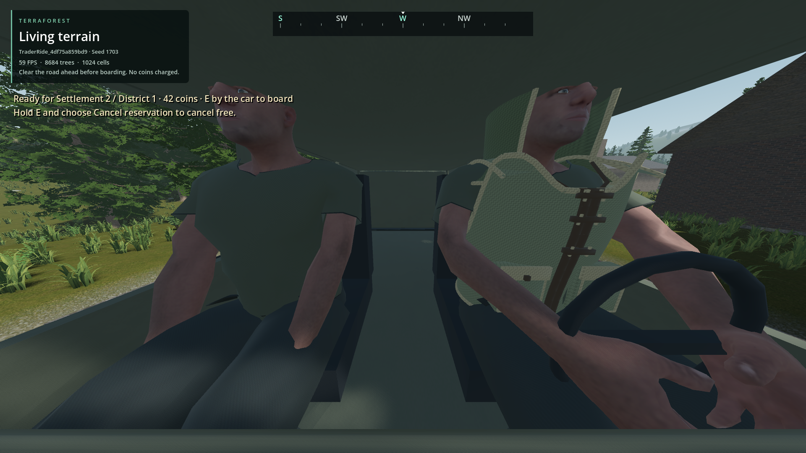

# Trader rides between settlements

- Status: Implemented in source / complete generated-world trip and return
  reproduced; final UI/cancellation and return-reload checks pass. Coordinated packaging pending.
- Updated: 2026-11-01. Requested: destination selection, both occupants travelling
  by car on roads, and trader returning after the player gets out.
- User review: Not reviewed. No visual/gameplay acceptance claimed.

## Changes and verification

Native published-road graph, road-distance quotes, heading-constrained departure
and bounded controls pass 27 debug and 27 release assertions. The optional
vehicle callback is unset in normal play and retains the existing native chassis
integrator. The actual-car fixture passes nine checks: ordinary W/A/handbrake,
two autonomous corners, stopped arrival and hold while S/R keys are pressed.
Maximum centre-line deviation is 2.006 m; this is not a complete chassis-clearance
claim. Existing policy parity (3,600 samples) and motion parity (240) also pass.

Exact sources, hashes, scope and retained outcomes:
[verification record](verification.json), [physical report](logs/physical_final.json),
[physical log](logs/physical_final.log), [debug](logs/native_debug.log) and
[release](logs/native_release.log). These are retained foundation results, not
evidence that the later service implementation completed a production ride.

The current integration adds the menu, mobile shopkeeper, two seated views,
passenger controls, atomic fare/refund, reserved identity, compound service save
and bounded remote terrain/model/block/tree/boulder interests. The updated graph
passes 30 debug/release checks and routes the captured generated world to the
other town (1,507 m) and back (1,691 m). Five-metre approach roads and half-cell
street endpoints were previously excluded. The shop's original footprint now
explicitly authorizes ordinary animated door opening, without bypassing its
native obstruction checks.

Current scoped checks: service archive 35 per variant; fare/refund 15 per variant;
navigation residency 14; model paging 26; block paging 31; existing trader
inventory, cross-inventory transfer (29) and native quests (53 per variant).
The generated-world run passed both the trader's counter-to-car walk and the
player's physical walk. The first boarding attempts safely rejected payment:
the goods-exchange API requires nonempty goods both ways. A new atomic aggregate
commodity transfer fixes fee-only payment and refunds. Actual paid boarding,
fresh-process reboarding without another fare, all 1.5 km outward, stopped safe
exit, all 1.69 km back, and the trader's walk to the counter pass. The player and
terrain focus remain in the destination town. Repeat booking uses the same car;
early disembarkation physically stops and refunds the exact fare.

[Integrated evidence](integration_verification.json) records exact native hashes,
reports, resources and retained failures. The long journey passes 16 functional
assertions but retains its overall failure for a final offscreen pointer-capture
assertion. The mouse helper now explicitly denies offscreen capture; the later
27-check cancellation run passes with zero captures. A repeat-booking run retained
one UI assertion sampled before host publication; the harness now waits for that
update. Final UI/cancellation passes 30/30 and unoccupied return/refund reload
passes 11/11. Original failures remain retained rather than relabelled as passes.

Retained integrated runs:
- `reports/trader_ride_world/20261101T171755385121Z`: unrelated concurrently added
  mine icons were not yet imported; cancelled owned process, then re-imported.
- `reports/trader_ride_world/20261101T172118627580Z`: 11 menu/world checks passed;
  inspected 1920×1080 menu layout, before the other-town graph fix.
- `reports/trader_ride_world/20261101T172240556220Z`: trader and player walks pass;
  fee-only exchange rejection prevents boarding. No payment was lost.
- `reports/trader_ride_world/20261101T172527802066Z` and
  `20261101T172846042960Z`: unpaid reservation reload/boarding diagnostics retain
  the failure; final reach, selected body and scene ray all pass.
- `reports/trader_ride_world/20261101T175017950478Z`: 22 paid departure, obstacle,
  pause and durable save checks pass.
- `reports/trader_ride_world/20261101T175223024902Z`: complete paid reload/outward/
  exit/remote return/home walk pass; overall 16 pass/1 failure for pointer capture.
- `reports/trader_ride_world/20261101T180138538968Z`: 27 cancellation/refund checks
  pass with zero captures after the explicit offscreen mouse guard.
- `reports/trader_ride_world/20261101T180310509234Z`: same returned car can be
  booked, driven and cancelled; refund and zero captures pass. The premature
  help-publication assertion remains as a recorded failure.
- `reports/trader_ride_world/20261101T182542058854Z`: final source UI/cancellation
  30/30 pass; fitted seats inspected, exact refund, zero captures.
- `reports/trader_ride_world/20261101T182722483062Z`: 11/11 fresh-process unoccupied
  return/refund checks pass; same car travels again, player stays on foot, no duplicated refund.

Initial graph test: 18 assertions passed in
`reports/checks/20261101T163427413803Z/engine.log`.
The first physical fixture [failed four of five assertions](logs/physical_initial_failure.log):
the follower retained the old segment while rounding a corner. It now switches
when the adjacent segment is closer. A later fixed two-second player-brake
[fixture assertion failed](logs/player_brake_fixture_failure.log); using the
existing bounded eight-second braking convention passes at 0.06756 m/s, with no
production braking changes. Original runs remain in
`reports/checks/20261101T163642775038Z/` and `20261101T164241440094Z/`.
Fixture results do not establish production-world travel or performance.

## Images

Seed 1703, private generated-world copy, source 1920×1080: another town is quoted
at 1.5 km and 42 coins. Inspected; player approval separate.

The same car stopped at the selected town after a paid fresh-process reload.
Inspected source view; the old top-line “Driving” telemetry was subsequently
changed to “Passenger”.

Actual world, source 1920×1080: both seated characters fit within the cabin;
passenger hands rest above the lap and the driver faces the visual wheel. The
earlier blocked-boarding notice remains briefly in this immediate diagnostic view.
Inspected; existing garment fitting remains [a separate limitation](../woven-clothes/README.md).

Rejected earlier pose: occupants intersected the roof. Fitting now lowers/scales
the views, places arms within the cabin and supplies original visual seat/wheel
fittings. Final proof is shown above. Existing garment
fitting and opaque exterior glass remain separate from ride functionality.

Unedited screenshot sources, captions and hashes: [manifest](images/manifest.json).
Long-run Godot process-delta sampling: p95 19.09 ms, worst 133.31 ms, peak private commit
3.84 GiB and dedicated GPU 1.40 GiB. World active policy was 60 FPS despite the
launch requesting 30; earlier frame-record wording is explicitly corrected in
the evidence. These earlier deltas are not independent wall-clock frame intervals;
the final short runner measures those explicitly (p95 19.11 ms, worst 51.84 ms).
Startup is excluded, harness sampling included. Two sampled tight-
corner road-footprint holds recovered; home walking waited for publication. This is
fixture evidence, not universal performance or world-quality acceptance.

## Remaining / resume here

Exact flow, dependencies and closure evidence:
[travel contract](../../docs/TRADER_TRAVEL.md). The requested physical trip and
return now complete, including the short help/refund-return reload checks. Coordinate
the combined native artifacts and packaged smoke with the
main work. Do not represent a source run as installed-build evidence. User visual
approval, inherited clothing fit and every possible edited/generated road network
remain separate. A blocked/unpublished road stops controls; cancellation refunds
the fare without teleporting or inventing a U-turn.

## Reproduce

Run `python tools/check_trader_ride.py` and again with `--release` for isolated
debug/release native checks. `--state`, `--payment`, and
`--plan reports/trader_ride_world/<run>/plan.json` cover service archives, atomic
fares/refunds, and the actual published intertown road graph. The owned world
runner is `tools/check_trader_ride_world.py --source-report
reports/player_survival_world/<owned-run> --stage depart`, followed by `--stage
complete --resume-report reports/trader_ride_world/<departure-run>` to reopen the
paid trip in a fresh process. Alternatively use
`tools/run_godot_check.py trader_road_journey --headless --timeout 60
--require "TRADER_ROAD_JOURNEY checks="` for graph/control contracts and
`tools/run_godot_check.py trader_ride_physics --headless --timeout 90
--require "TRADER_RIDE_PHYSICS checks="` for the real chassis on an isolated flat
road fixture. These checks do not touch player saves.

New code/tests are original AI-assisted 0BSD work for this request. Existing car
code/visuals retain their notices; no imported assets or new license exception.
