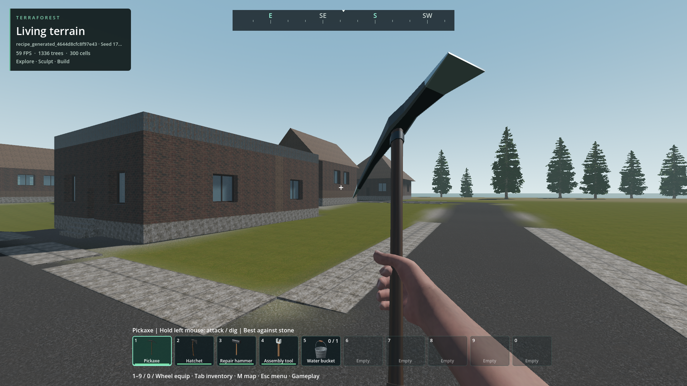
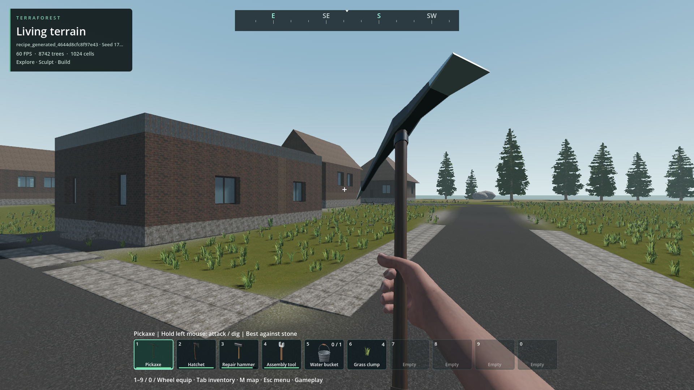

# Extended vegetation LOD

- Status: Improved-partial / installed; driving-speed continuity and player review remain open.
- Updated: 2026-10-30. Original LOD implementation `e2d0e548`; driving follow-ups below.
- Forests: existing 6592/192/12-triangle tiers retained; visibility 448 -> 576 m.
- Native circular preload: 640 m, maximum 405 wanted owners, 441 admission cap;
  two jobs and one 36-candidate batch/frame unchanged. No density/identity changes.
- Ferns: distant 392 -> 154 triangles; bushes 294 -> 154; twigs 136 -> 80.
  Nearby geometry, ordinary shadows and four grass tiers remain unchanged.

## Evidence

[448 m baseline](images/forest_448.png): identical 1024-tree grid fixture, 1080p,
same camera/light; artificial rows test coverage, not proposed forest distribution.

Fresh temporary seed 1703 world, moving camera, unchanged natural distribution.
No played world was read or modified. Images inspected, not user-approved.
Provenance/hashes: `images/manifest.json`.

- `tests/vegetation_extended_lod.gd`: 17 assertions; all tested owner corners,
  world edges and angles cover the visible/preload disk. Same near geometry and
  stable IDs; finite bounded nondegenerate meshes.
- `tests/scatter_priority.gd`: 23,131 parity/validation cases retain legacy API behavior.
- `tests/woodland_accents.gd`: 66 geometry, harvesting, picking and persistence checks.
- `tests/vegetation_native_selection.gd`: 2000-root/180-frame script/native parity,
  removals, transitions and sparse buffer parity pass.
- `reports/checks/20261028T150527803046Z/run.json`: 3200-plant renderer fixture;
  distant Godot primitive counter 1118 -> 544, nearby counter unchanged. This
  counter is not a claim about total hardware triangles including instancing.
- `reports/checks/20261028T151314789385Z/run.json`: actual world, 405 owners,
  5294 roots initially; bounded publication, travel and zero mouse captures.
  RTX 4050 Laptop GPU: median GPU 9.14 ms stationary / 9.15 ms moving;
  moving median/p95/max frame intervals 16.61/20.90/26.07 ms, forest CPU
  p95 0.577 ms, coordinator p95 0.225 ms. 240 frames each, offscreen 1080p,
  capped; no claim of universally smooth 60 FPS or isolated LOD speedup.
- Detailed fixture data: `reports/vegetation_lod_visual/result.json` and
  `reports/vegetation_lod_world/result.json`. Screenshots excluded from timed samples.
- Initial test-only parse errors and incorrect completion-text requirements remain
  in the 15:03/15:04 reports; corrected reruns pass, no suppressed engine errors.
- Populated city/forest approaches also pass with 391–405 resident owners:
  [city evidence and timings](../city-buildings/README.md#generated-world-integration).
  Pack startup passes; all 14 exported native DLL hashes match source.

## Remaining / resume here

- Longer/weak-hardware travel, teleport publication and longer city+forest comparison.
  Extra coverage increases resident roots and surface sampling; inspect spikes
  before extending range again. Current moving p95 exceeds a 16.67 ms frame.
- Ground mesh index switches are screen-error selected, not crossfaded. Trees retain
  their existing complementary dithering. Reopen for a visible change with camera/FOV
  and same-view comparison; do not reduce plant density to disguise it.
- No new species, new tree impostor bake or fully seamless arbitrary-speed streaming.

## Driving-speed streaming — 2026-10-29

- Confirmed: ground-cover owners fall behind fast travel; forest residency kept up
  in this fixture. This is not primarily a GPU rendering limit in these samples.
- Native root-support sampling now reuses a request-local 256-entry lattice cache
  (5 KiB stack, no persistent files). Current/original terrain and material flags
  remain distinct; edits cannot reuse a previous request's samples.
- Ground cover replenishes up to eight 64-point jobs instead of waiting for each
  four-job wave. One complete owner still publishes atomically with all 16 layers.
  Density, meshes, visibility ranges, harvesting IDs and collision rules are unchanged.
- The existing terrain worker services at most four support batches / 1.5 ms soft
  budget between background mesh work. Mutations, saves, interaction collision,
  target queries, water jobs and unknown job types remain ordering barriers.
- 160 support batches across four profiles, two seeds, boundaries, mining, filling
  and asphalt match old bytes exactly: 610 assertions. Mean 64-point native batch
  0.727→0.293 ms (2.49×). No cross-frame cache or new thread pool.
- 170 coordinator assertions include rolling/out-of-order replies, partial admission,
  invalidation, failed packets, teleport, harvest and authored plants. Worker-order,
  support, retirement, water continuation, target-readiness and vehicle collision
  readiness checks pass. Detailed receipts: [driving evidence](driving-evidence.json).

### Measured limits

Seed 1703 disposable recipe fixture; 585.6 m controlled road-camera sweep,
1080p/60 cap, RTX 4050 Laptop. **Not a physical vehicle handling qualification.**
Early physical-driver probes veered off the road and do not qualify fast driving.
Disk owner counts include off-screen/empty owners; they are not counts of visible holes.

| 160 km/h sweep | Frame p95 | Missing ground owners within 64 m, mean / max |
| --- | --- | --- |
| Original native build | 30.14 ms | 9.92 / 18 |
| Cache + rolling four jobs | 29.28 ms | 9.60 / 17 |
| Eight jobs | 28.82 ms | 6.66 / 14 |
| Bounded worker service | 23.73 ms | 4.46 / 11 |
| Installed-pack repeat | 26.47 ms | 4.31 / 12 |

The native cache alone did not fix streaming. The final 160 km/h runs still have
late cover and frames above 16.67 ms. All measured forest-visible owners were resident.
Installed 160 km/h peak: 3.30 GiB private RAM / 1.38 GiB dedicated GPU allocation;
422.7 MB distributable. Source save hash unchanged; zero mouse captures.
Installed 100 km/h sweep: frame p95 21.54 ms, mean/max missing near owners 1.75/8;
forest-visible owners all resident, peak 3.34 GiB private RAM / 1.37 GiB GPU.
There is no matched 100 km/h baseline, so this is a remaining-limit measurement,
not an improvement percentage. Both installed runs pass save/mouse/resource gates.

Same route endpoint immediately after the speed sweep, before the eight-second
recovery. First image is the insufficient cache/four-job intermediate, not the
original build. More ground cover is ready in the second; this is not full-route
visual acceptance. Wind/time and streamed off-screen counts differ. Provenance in
`images/manifest.json`; prior images remain intact.

### Remaining / alternatives

- Require sustained real-car straightaways, turns, city/forest transitions, 100–198
  km/h, camera turns and weaker hardware before claiming seamless driving. Return
  to native chunk preparation/delivery and publication budgets, not lower density.
- Candidate next architecture: compact, versioned, pre-baked vegetation-owner
  records with bounded native decoding and upload; invalidate terrain/building
  dependencies and apply harvested/authored changes separately. Any disk cache
  must share the existing 3 GiB quota. This is **not implemented**. Keep the current
  renderer initially; these profiles do not justify replacing it with GPU scatter
  or new tree impostors. Compare complete visible coverage, visual equality, edit
  persistence, CPU/GPU timings, memory and cold/warm cache performance first.
- The integrated six-tool/edit test passed 71/72 checks, including durable removal,
  neighbours, tree collision and regeneration, but maximum-volume publication was
  26.475 ms for 18,532 queried instances, failing its 16 ms limit. Attribution to
  this change versus the prior build is unverified; retain the failure, compare
  the same fixture on the prior build before treating it as a regression or fix.
  No threshold was raised. This separate large-edit budget remains unresolved.
- Retained failed trials: invalid test asphalt/material arguments, physical driver
  setup/steering, missing ground-cover test flag, and packaged driver initially
  referencing excluded test code. Corrected harnesses are retained with receipts;
  none constitutes a production fix or successful fast-car acceptance.

Reproduce the controlled sweep:
`python tools/profile_runtime.py --slot recipe_generated_4644d8cfc8f97e43 --speed-sweep --speed-kph 160 --pack --label driving_repeat --require-resource-budget`.
Historical `--driving` is an alias for this controlled workload, not autonomous driving.

## Residency notifications — 2026-10-30

- Root cause: unchanged model and block admission/retirement emitted the same
  world-edit notifications as authoring. That dirtied every wanted ground-cover
  owner, discarded in-flight scatter work and incorrectly requested another save.
- Native model content notifications now distinguish residency. Blocks reuse their
  existing native content revision. Snapshot-cache invalidation and collection
  observers remain intact; actual edits, undo/redo, full restore and prefabs still
  invalidate vegetation. No new worker, cache, density reduction or range change.
- Validation also caught a missing content-revision increment in staged block-only
  prefabs; fixed before final qualification rather than suppressing that edit.
- Same seed 1703, 585.6 m/160 km/h controlled camera sweep, RTX 4050 Laptop,
  1080p/60 cap. Counts are disk owners, including empty/off-screen owners, not
  visible pixels. They do not qualify physical driving or arbitrary travel.

| Build | Missing near owners mean / max | Missing visible-radius owners mean / max | Frame p95 |
| --- | --- | --- | --- |
| Installed baseline `13788225` | 3.65 / 11 | 27.09 / 40 | 22.66 ms |
| Model notification fix only | 0.62 / 8 | 12.62 / 32 | 23.10 ms |
| Block + model fix, source | 0 / 0 | 0.17 / 3 | 27.32 ms |
| Block + model fix, first pack | 0 / 0 | 0.63 / 4 | 27.52 ms |
| Final pack, prefab revision regression fixed | 0 / 0 | 2.27 / 8 | 30.06 ms |

The source/first-pack runs recorded no cover exclusion-revision change or dirty
owner during the measured route. Forest-visible owner misses stayed zero.
The final repeat retains zero near misses and a constant exclusion revision;
outer coverage and timings vary, so the earlier best sample is not universal.
**This is a continuity improvement, not a frame-time improvement.** More cover
actually becomes ready; frame pacing is worse in these samples and remains open.
Do not hide this by lowering vegetation density. Return to bounded owner delivery
and render publication, then require matched repeated physical-car, sharp-turn,
zoom, edit/reload and weak-hardware/endurance evidence. Pre-baked owner records
remain only a candidate, not an implemented replacement.

Detailed reports, build identities, failed fixtures and final installed checks:
[residency evidence](residency-evidence.json). Earlier evidence is preserved.

Unedited 1080p captures immediately after travel, before recovery. The far roadside
has more ready ground cover; near plants/buildings retain their appearance.
These inspected endpoints do not show every transient hole or qualify seamless
motion. Wind/time differ; provenance is in `images/manifest.json`. User review pending.
