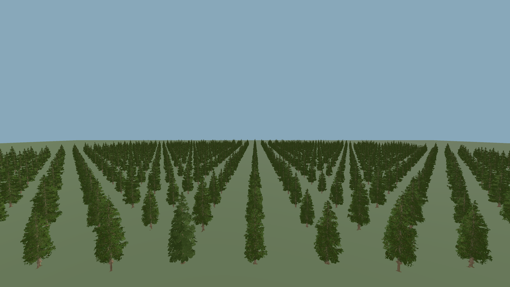
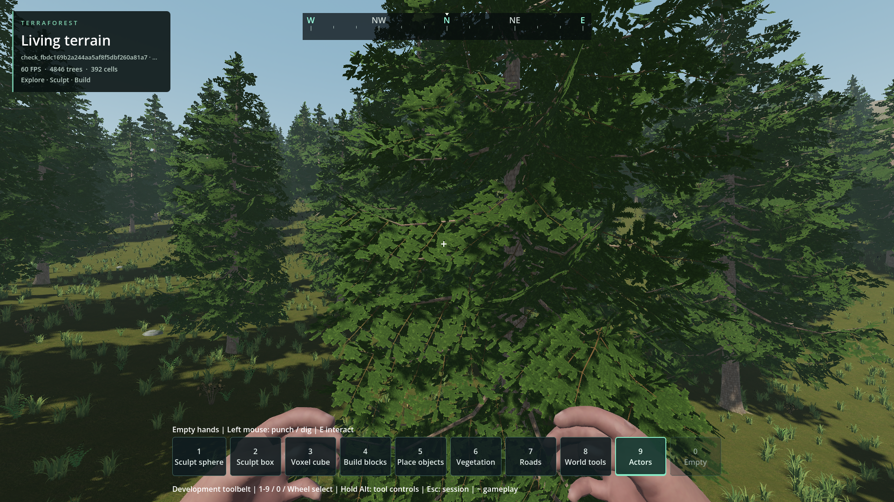

# Extended vegetation LOD

- Status: Installed / scoped checks; player visual review pending.
- Updated: 2026-10-28. Implementation `e2d0e548`; installed with approved-city integration.
- Forests: existing 6592/192/12-triangle tiers retained; visibility 448 -> 576 m.
- Native circular preload: 640 m, maximum 405 wanted owners, 441 admission cap;
  two jobs and one 36-candidate batch/frame unchanged. No density/identity changes.
- Ferns: distant 392 -> 154 triangles; bushes 294 -> 154; twigs 136 -> 80.
  Nearby geometry, ordinary shadows and four grass tiers remain unchanged.

## Evidence

[448 m baseline](images/forest_448.png): identical 1024-tree grid fixture, 1080p,
same camera/light; artificial rows test coverage, not proposed forest distribution.

Fresh temporary seed 1703 world, moving camera, unchanged natural distribution.
No played world was read or modified. Images inspected, not user-approved.
Provenance/hashes: `images/manifest.json`.

- `tests/vegetation_extended_lod.gd`: 17 assertions; all tested owner corners,
  world edges and angles cover the visible/preload disk. Same near geometry and
  stable IDs; finite bounded nondegenerate meshes.
- `tests/scatter_priority.gd`: 23,131 parity/validation cases retain legacy API behavior.
- `tests/woodland_accents.gd`: 66 geometry, harvesting, picking and persistence checks.
- `tests/vegetation_native_selection.gd`: 2000-root/180-frame script/native parity,
  removals, transitions and sparse buffer parity pass.
- `reports/checks/20261028T150527803046Z/run.json`: 3200-plant renderer fixture;
  distant Godot primitive counter 1118 -> 544, nearby counter unchanged. This
  counter is not a claim about total hardware triangles including instancing.
- `reports/checks/20261028T151314789385Z/run.json`: actual world, 405 owners,
  5294 roots initially; bounded publication, travel and zero mouse captures.
  RTX 4050 Laptop GPU: median GPU 9.14 ms stationary / 9.15 ms moving;
  moving median/p95/max frame intervals 16.61/20.90/26.07 ms, forest CPU
  p95 0.577 ms, coordinator p95 0.225 ms. 240 frames each, offscreen 1080p,
  capped; no claim of universally smooth 60 FPS or isolated LOD speedup.
- Detailed fixture data: `reports/vegetation_lod_visual/result.json` and
  `reports/vegetation_lod_world/result.json`. Screenshots excluded from timed samples.
- Initial test-only parse errors and incorrect completion-text requirements remain
  in the 15:03/15:04 reports; corrected reruns pass, no suppressed engine errors.
- Populated city/forest approaches also pass with 391–405 resident owners:
  [city evidence and timings](../city-buildings/README.md#generated-world-integration).
  Pack startup passes; all 14 exported native DLL hashes match source.

## Remaining / resume here

- Longer/weak-hardware travel, teleport publication and longer city+forest comparison.
  Extra coverage increases resident roots and surface sampling; inspect spikes
  before extending range again. Current moving p95 exceeds a 16.67 ms frame.
- Ground mesh index switches are screen-error selected, not crossfaded. Trees retain
  their existing complementary dithering. Reopen for a visible change with camera/FOV
  and same-view comparison; do not reduce plant density to disguise it.
- No new species, new tree impostor bake or fully seamless arbitrary-speed streaming.
