# ★ Extended vegetation LOD

- Starred: [Notable investigation](../notable/README.md); [investigation lessons](LESSONS.md). Human playtest confirmed the flicker improvement on 2026-11-27; remaining requirements stay open.
- Status: Latest source vegetation fades and nearby projection correction **human-verified on 2026-11-28**, approved for commit/push. Tag `playtest/vegetation-fades-2026-11-28`. Broader coverage and the earlier GPU-tail target remain open.
- Corrected regression: [nearby foreground bands](SHADOW_BANDS.md), caused by invalid far-proxy projection. 107 causal checks, 48 exact nearby comparisons, 189 m physical gameplay and human standing/walking review pass.
- Source restoration: shared DLLs contain unrelated native work and are excluded. Rebuild the structures addon for the committed page-overlap change; this is not a packaged-release claim.
- Updated: 2026-11-28. Original LOD implementation `e2d0e548`; follow-ups below.
- Forests: existing 6592/192/12-triangle tiers retained; visibility 448 -> 576 m.
- Native circular preload: 640 m, maximum 405 wanted owners, 441 admission cap;
  two jobs and one 36-candidate batch/frame unchanged. No density/identity changes.
- Ferns: original distant 392 -> 154 triangles; final filtered far tier uses seven
  frond quads (14 triangles). Bushes 294 -> 154; twigs 136 -> 80.
  Nearby geometry, ordinary shadows and four grass tiers remain unchanged.

## Distant stone transitions — 2026-11-28

The [transition investigation](TRANSITIONS.md) proves two faults in our previous
far-stone proxy: fragment-stage matrices lost the individual MultiMesh transform,
misplacing reconstructed depth and lighting; projection orientation could also
select the rear hemisphere. Fixed-resident moving controls exclude streaming and
native surface selection as necessary causes. The opaque/proxy contrast step
falls from 4.887× to 1.021×, versus 1.015× for ordinary approach with fixed opaque
geometry. Independently submitted MeshInstances agree with the corrected proxy
within one RGB byte per channel.

The corrected proxy and a 32 m outer fade retain the same normal 124 m visibility
endpoint. The full-frame comparison gives exact nearby pixel parity, +0.0021%
ground / +0.0185% elevated mean brightness, and no added draw pass or texture.
Paired GPU observations and failed tests are recorded in the investigation; they
do not close the earlier detail-tail target. Final physical gameplay passes
220.169 m, 2,162/2,162 grounded ticks and 192 independently hash-verified 1080p
frames, including four witnessed stone LOD crossings. Normal actors, streaming,
collision and source/save hashes are retained. [Moving review and limits](TRANSITIONS.md#normal-moving-gameplay).
**Accepted for checkpoint/push on 2026-11-28**, tagged
`playtest/stone-transitions-2026-11-28`. This does not close the new near-LOD and
rectangular-patch complaint. Shared DLLs are excluded; source restoration needs
a native rebuild.

## Near handoffs and rectangular patches - snapshot checkpoint

The [near-handoff investigation](NEAR_HANDOFFS.md) proves grouped 16 m LOD
changes. The per-plant fade finishes before the original batch
cutoff, preserving exact nearby endpoints. A 312.75 m physical walk passes
with 192 hash-verified consecutive frames and five captured near-boundary
crossings. Mean display brightness changes by 0.03537%; local paired median
GPU cost is about +0.2 ms. Human moving-play validation, broader coverage and
the earlier GPU-tail target remain open. The user requested commit/push of this
snapshot on 2026-11-28, tagged `snapshot/near-lod-fade-2026-11-28`. This approval
is for a source checkpoint, not universal visual/performance closure. Shared
native DLL changes remain excluded; restoring source requires a native rebuild.

## Remaining cover handoffs - uncommitted experiment

The [remaining-handoff audit](REMAINING_HANDOFFS.md) isolates substantial fern,
bush, flower and twig batch switches missed by the grass-only fade. Adjacent
opaque tiers now fade per plant in an uncommitted candidate. Fixed-population
controls, real-scene nearby/brightness/cost checks, and a 280.342 m physical walk
with 33 changed-LOD crossings pass. Nearby pixels remain exact; human validation
is still required. The [far-handoff continuation](FAR_HANDOFFS.md) now covers the
filtered proxies, grass horizon and grouped shadows. Its lab controls and 280.067 m
physical walk pass, including 21 proxy / 12 horizon crossings and 75 shadow toggles
at zero remaining coverage. Nearby pixels remain exact; mean brightness changes
-0.01337%. Local median GPU overhead is +0.328 to +0.6205 ms, with increased tails.
This remains uncommitted, pending human review; it does not make every transition
seamless or close the earlier performance target.

## Human playtest and source snapshot — 2026-11-27

After launching the latest project/source in Homestead Valley, the user reported:
“Yeah you seem to have solved it”. This confirms the visible flicker correction
in that playtest; it is not universal coverage or performance approval. The shared
shader SHA-256 is `a16616cfd6d2f15d73f8b894f9191047d9f85f0259aa754be2aa73ea839fbae1`.

The user then reported small stones popping in farther away while approaching.
Its regression status was unproven at the snapshot; the later lab above identifies
our proxy as a cause. Acceptance of the symptom's correction stays open,
along with the requested subtle LOD/distance fade and the earlier GPU-tail target.
No new fade or stone-pop-in changes are included in this snapshot. Next work must
isolate transition, visibility and streaming causes, then repeat normal movement
with nearby appearance and terrain brightness preserved.

The user explicitly requested snapshot `0fbcb895`, tagged
`snapshot/vegetation-flicker-2026-11-27`, before further work. It preserves
vegetation source, the lab and evidence. Shared native DLLs now include unrelated
work and are excluded: **restoring this source snapshot requires rebuilding the
native libraries before running**. The current checkout and running game retain
their existing binaries. Historical test receipts retain their exact runtime hashes;
this source snapshot is not an archive of the complete playtested executable.

## Shared shader-domain correction — 2026-11-27

Earlier far-LOD work and selected-point/crop tests missed a fault in the shared
opaque shader used by multiple species and the near/middle representations.
On thin triangles, extrapolated shader inputs made the squared edge multiplier
negative. Bounds on the authored edge, root-shading and canopy-shading ranges
correct that computation. Geometry, textures, light settings, material parameters
and LOD distances are unchanged; valid authored-domain shading is identical.
No textures, draw passes, history buffers or runtime allocations are added.

Full-viewport run `20261127T193738421329Z` measures 337 raw 1920x1080 frames with
matched camera/time, diagnostic witnesses, a no-cover control and an exact
baseline repeat. Up to 1,983 negative-colour markers become zero in all 48
corrected views. Edge-only bounding leaves up to four, proving why the extra
interpolant bounds are needed. In the elevated matched frame, extra extreme
dark/white impulses over the no-cover image fall from 328/1 to 0/0. Average frame
luminance changes +0.183% at ground level and +0.020% elevated. These are scoped
whole-frame results; they do not assert every kind of shimmer is universally gone.

[Full-size baseline](../../reports/checks/20261127T193738421329Z/baseline_24.png) ·
[Full-size corrected view](../../reports/checks/20261127T193738421329Z/bounded_interpolants_24.png) ·
[Matched moving baseline](../../reports/checks/20261127T193738421329Z/baseline.mp4) ·
[Matched moving correction](../../reports/checks/20261127T193738421329Z/bounded_interpolants.mp4)

Normal source gameplay `20261127T194802773430Z` covers 194.161 m with all
2,162 physics ticks grounded, 1,024 forest cells, 8,461 trees, live actors and
normal cover streaming. All 192 consecutive 1080p frame hashes agree between
Godot and the independent raw-pixel analyzer. Recorded cadence is 16 ms median,
26 ms p95. The 3.2-second full-resolution review clip is H264; measurements use
raw pixels. Source and canonical save hashes remain unchanged.

[Full-frame physical walking clip](../../reports/checks/20261127T194802773430Z/gameplay.mp4) ·
[Lossless gameplay context](../../reports/checks/20261127T194802773430Z/walking.png) ·
[Lab evidence](fullframe-evidence.json) · [Gameplay evidence](fullframe-gameplay-evidence.json)

This diagnostic isolates the invalid black-pixel mechanism. Bright-pixel control
results must not be generalized into proof that all pale-object coverage noise
is solved at every distance. Review the actual source and motion before approval.
GPU observations are unpaired; concurrent headless work was recorded, so they do
not qualify a cost reduction or close the previous detail-tail target. The extended
test's bounded frame buffer produces a 5.46 GiB private-commit warning, below the
6 GiB limit; that buffer is test-only and adds nothing to ordinary gameplay.
Both full-frame reports are receipt-owned and pinned ready for human review.
The subsequent human playtest and explicit snapshot request are recorded above.
Earlier rejection and uncommitted-status notes below describe their historical stages.

## Small-stone and flower follow-up — 2026-11-27

The [67-case lab](LAB.md) separates the remaining species and mechanisms.
Stone normal-map, specular, texture, fade and fixed-LOD controls leave moving
noise: undersampled silhouette coverage is the dominant tested cause. Flowers
have that coverage problem plus an unbounded procedural edge-shading multiplier.
Bounding that one term reduces the isolated strafe residual from .096622 to
.027319; changing canopy or rib shading does not materially help.

The source now uses an area-matched analytic far-stone silhouette (2 triangles)
and four flower groups (8 triangles), keeping pale crowns separate from green
stems. Nearby authored geometry/materials, grass/fern rendering, lighting and
normal visibility fade remain. Existing textures/shaders are shared; there is no
new texture atlas, history buffer or per-instance CPU update. Fully faded stone
vertices skip projection and silhouette-area work. Large boulders/fractures retain
their original geometry.

Integration `20261127T183409513441Z` verifies runtime/prototype geometry and shader
expressions, exact nearby/reference pixels, source/save/population preservation
and lossless motion hashes. Stone strafe/approach residual is .012497/.023216 →
.002893/.007173; flower is .097045/.095538 → .005133/.007676. These registered
luminance changes include motion and occlusion, not universal flicker percentages.
The inspected field's mean brightness changes by approximately -0.036%, without
a global lighting change.

Quiet ABBA groups 0/2/3 add +.29275/-.013/+.1535 ms GPU median and
+.4005/+.0155/+.136 ms p95 versus the grass/fern baseline. Group 1 overlaps another
render job and is rejected. **The .3 ms incremental tail target remains open**;
the candidate is a measured visual improvement with a small cost, not a free or
universally qualified optimization. Human validation is required before any commit.

Left: previous grass/fern renderer. Right: integrated far stone/flower fix.

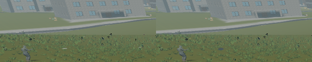

Normal source gameplay `20261127T190137324274Z` passes without trial overrides:
194.182 m, all 2,162 movement physics ticks grounded, 1,024 forest cells and 8,461
trees, live actors/streaming and active far pages for all four detail species.
All 48 captures are consecutive and decoded-pixel verified. Measured capture
intervals are 15 ms median / 32 ms p95. No overlapping engine job was observed
during the gameplay interval. GPU phase medians are 4.86–5.69 ms; this single run
is not a paired performance comparison. Source/save hashes remain unchanged.

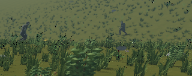

[Full gameplay context](images/gameplay-stones-flowers-context.png). The full view
and source frames 0/15/31/47 were inspected; no terrain-brightness band is apparent.
Human acceptance remains open. Review the project/source: the packaged executable
was not rebuilt. No commit is authorized before user validation.

Rejected costly
per-triangle/lookup variants and failed framing/integration attempts remain in
[the evidence record](lab-evidence.json). Full raw packets may be cold-retained;
archive receipts and versioned review images preserve their identity.

## Uncommitted coverage and submission follow-up — 2026-11-27

The user requested controlled laboratory evidence before further rendering
changes. That freeze ended only after the complete candidate passed its scoped
quality/cost gates in `20261127T164801248443Z`. The [diagnostic lab](LAB.md)
adds a 42-case, one-factor matrix, repeatability/framing checks and separate cost
and gameplay gates. Eight negative-control checks and engine parsing pass. Verified
lighting/species and geometry batches support undersampled silhouettes as the
dominant tested grass cause: fixed low LOD still flickers, while shadow/specular/
wind controls do not solve it. Nearby/reference equality passes. Filtering fern
leaves also improves motion, but the 154-kernel version is rejected for about
1.6–1.8 ms added GPU cost. The seven-frond version now uses a shared startup mesh
and shader in the normal source path; the production expressions and geometry
are checked against the validated prototype.
Final integration run `20261127T170227179839Z` passes source/prototype equality,
exact nearby/reference frames and lossless pixel hashes. Three quiet paired
groups reduce GPU median by 0.195–0.295 ms and p95 by 0.163–0.252 ms versus
grass-only. There are 29 more draws in this view, but less total GPU time.
The field's mean display luminance changes by +0.56% versus grass-only; no global
lighting adjustment is used. Whole-run overlap during preparation is recorded;
all three accepted cost windows have no observed overlap within six-second margins.

Default-runtime gameplay `20261127T171249751501Z` passes without trial overrides:
194.253 m of physical walking/turning, all 1,024 forest cells and 8,461 trees,
live actors, unchanged save/runtime hashes, and 48 consecutive pixel-verified
lossless captures. Capture intervals are 16 ms median / 32 ms p95, not a claim
of constant 60 fps footage. Single-run GPU medians are 5.31–6.00 ms across
walking, turning and strafing; those are not a matched performance comparison.

Matched lab motion, left grass-only / right integrated seven-frond fern filter:

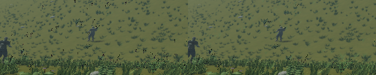

Normal production gameplay, native hillside crop while walking/turning:

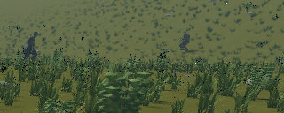

[Full gameplay context](images/gameplay-runtime-context.png). Failed controls,
contended timing runs and human review remain explicit in the lab report.
Legacy lossy previews are labelled; current captures carry decoded-pixel hashes.

The user explicitly stopped automatic commits. All changes in this follow-up
remain uncommitted and are not human-approved. Earlier failures below remain
evidence; the issue is still open.

The filtered-source isolation in `reports/checks/20261127T132623323188Z` identifies
the remaining contributors, rather than assuming every speck is a highlight.
In the same 360x140 hillside tile, 970 dark and 97 bright local outliers remain.
Removing opaque grass removes 689 dark/60 bright; removing filtered grass removes
40 dark/zero bright. Ferns remove 199 dark/two bright, stones four dark/27 bright.
Counts can overlap. Dark means >0.10 below the 5x5 median; bright means >0.48 and
>0.10 above it; removal means a >0.05 luminance change at that candidate pixel.

The far coverage threshold moves from 0.06 to 0.045, preserving the authored near
mesh/material and the 0.02 low tier. In the later 0.045 capture, this tile has
350 dark/45 bright outliers, with mean display luminance 0.396271 versus 0.396089
(+0.046%). This is a local contrast measurement, not a universal flicker metric.
There is no new lighting, albedo, normal or global antialiasing adjustment.

The native renderer now selects a single-surface mesh where the other surface is
inactive. Boundary/shadow pages retain the original combined mesh. Selection uses
camera projection, viewport width, render scale, batch bounds and LOD bias; the
one-metre boundary guard permits reuse within half a metre of camera movement.
Uploads, zoom, resolution, transform and shadow changes invalidate that reuse.
It allocates no additional instance buffers and does no per-instance CPU work.
The relationship follows the engine's
[LOD selection](https://github.com/godotengine/godot/blob/ed1daf0bf/servers/rendering/renderer_rd/forward_clustered/render_forward_clustered.cpp#L976)
and [projection multiplier](https://github.com/godotengine/godot/blob/ed1daf0bf/core/math/projection.cpp#L831).

The first submission run (`20261127T130830871399Z`) passed 31 assertions, including
near pixel parity, save/population/instance-buffer preservation. Added draw calls
fell from 150 to six; paired GPU median was 5.686 versus 5.635 ms and p95 6.188
versus 6.254 ms. This was the 0.06 version before movement reuse. Both native
targets were rebuilt in the existing checkout; no export was produced.

The later whole-frame 35-degree FOV comparison failed. Aligning main LOD
thresholds did not clear it. A repeated unoptimized reference then also failed:
the optimized comparison differed by only 18 color bytes, maximum one, beginning
in HUD text. The corrected check still requires exact equality, over the entire
3D field between the HUD and toolbelt (1920x580), and checks reference repeats.
Run `20261127T134356372384Z` passes both 75-degree positions, the 35-degree view,
and full-frame nearby-grass equality. Its engine passed; post-run archival failed
because shared report storage exceeded its budget. Earlier failed runs remain
failed receipts. Another graphical job overlapped the later timing run, so it
does not qualify final performance.

Real physics gameplay runs `20261127T131141824545Z` and `20261127T131346639512Z`
travelled about 197 m with actors/streaming active and save bytes unchanged.
Their captured crop followed the road/pickaxe; those clips are rejected as
far-vegetation visual evidence. The driver now captures the hillside earlier,
keeps actual capture intervals, and excludes readback phases from timing.
The corrected gameplay and GPU gates subsequently pass above; remaining other-species
flicker and user visual approval stay open. Older captures are cold-retained
under verified `homestead.archive.json` receipts, not deleted.

## Filtered far-grass coverage — 2026-11-27

The user confirmed that the screenshots came from the source project. Earlier
shading changes and aggregate measurements were insufficient: they did not isolate
pixel coverage, and their viewpoints did not reproduce the supplied scene. The
new test retains the currently saved camera (`b8f04e1d07b4...`, eye
`1772.481, 68.63347, 1684.51`). This save has moved since the supplied screenshot;
it is not an attribution of every circled pixel or the editor's full residency.

**White points were traced separately.** In an inspected hillside tile, 118 pixels
were brighter than 0.48 display luminance and 0.10 above their 5x5 local median.
Removing specular or backlight removed **zero** candidates by the diagnostic's
0.05-luminance criterion. Removing grass removed 80, small stones 26, and white
flowers five; these one-at-a-time counts can overlap. Removing the grass texture
removed only five and increased average candidate brightness. This rules out
shininess as the main explanation in this tile; it does not identify every point
in the original screenshot. Coupled with the isolated silhouette test below,
unresolved lit/shaded blade coverage is a confirmed major contributor.


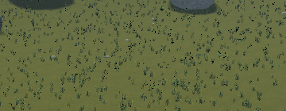
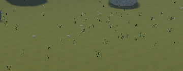
Unscaled, lossless crops of the same tile. Removing grass is diagnostic only.

**The source experiment filters coverage instead of raising grass lighting.**
`filtered_grass.gd` builds a second, far-only surface at startup. Each far triangle
becomes a projected Gaussian coverage approximation using its area, centroid and
covariance. A half-pixel reconstruction footprint suppresses subpixel on/off
changes; fractional alpha blends over the actual shaded terrain behind it. This
is an approximation, not exact integration of triangle occlusion or terrain light.
Original blade normals/colors and conservative leaf shading remain; no upward
normal/full-AO brightness substitution, new atlas, temporal history or per-instance
CPU loop is introduced. Birth and outer-distance coverage fade continuously.

The original near/low surface and original nearby shadow casters remain. Far
LOD error thresholds change from 0.12/0.20 to 0.06/0.10; keeping the old thresholds
missed much of the visibly distant 72-triangle tier. An earlier-LOD-only control
separates that effect from filtering. This applies to ground-cover grass only;
other vegetation, small stones, palette previews, density and world identity stay
unchanged. No native build or export was made. Global antialiasing stays at 2x MSAA.

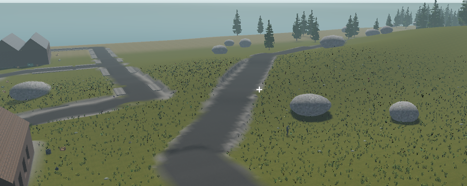

Matched source camera, lighting, time and population. These inspected images show
softer distant clumps without the rejected broad bright band. They are not user
approval. [Normal source startup](images/filter-source.png) also exercises the
production surface and uniform setup; its paused startup HUD is not an FPS result.

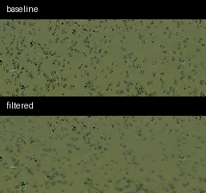
1.6 m continuous sideways camera travel, captured at 30 fps; unscaled 256x96
portions of retained 640x160 frames. The [forward/turn comparison](images/filter-route.webp)
covers 25.5 m with an 11.5-degree turn, sampled every eighth rendered frame at
60 Hz. Actors and streaming are paused for matched rendering; this is not physical
car handling, normal streaming or an endurance qualification. Selected frames
across both replays and the source context were visually inspected.

| Sideways crop measurement | Baseline | Earlier opaque LOD | Filtered far grass |
| --- | ---: | ---: | ---: |
| Mean display luminance | 0.400994 | 0.401904 | 0.402670 |
| Bright local-contrast pixels / frame | 355.6 | 154.8 | 73.7 |
| Dark local-contrast pixels / frame | 2668.9 | 1961.3 | 617.9 |
| Best horizontal-alignment residual | 0.023403 | 0.018253 | 0.012093 |

The filtered crop has 79.3% fewer bright and 76.8% fewer dark high-contrast pixels,
with +0.42% mean luminance. These are descriptive crop statistics, **not a
percentage of all gameplay flicker**. They include other plants/stones, real motion,
occlusion and contrast. The near view, including lighting, is byte-identical.
All 77,660 cover instances, removal state, native pages/transform allocations and
the canonical save hash are preserved.

**Cost remains an open requirement.** The final interleaved 1080p/RTX 4050 Laptop
replay excludes image readback/analysis from timing:

| Cost | Baseline | Filtered |
| --- | ---: | ---: |
| GPU median | 12.865 ms | 12.975 ms |
| GPU p95 | 14.149 ms | 14.873 ms |
| CPU render median | 3.069 ms | 3.208 ms |
| Draw calls | 2176 | 2326 |

Peak process RAM was 3.80 GiB and dedicated GPU allocation 1.64 GiB, within the
existing limits. The extra surface adds 150 draws here; earlier LODs reduce geometry.
The +0.724 ms pooled GPU-tail increase **fails the previous 0.3 ms criterion**.
Paired tail increments were +0.260/+0.520/+1.325 ms. A passing runner means
fixture/source/save/resource checks passed, not that the cost target passed.
Do not advertise this as free, universally stable, or fully qualified performance.

The TAA control also softened the image, but was global, visibly blurred motion,
and its run exceeded the RAM ceiling (6.10 GiB). It is not enabled. A combined
single-surface/alpha-prepass trial failed full near-image parity, retained the
extra draw count and worsened timings; it is not used. Invalid custom-attribute,
LOD-buffer and shader prototypes, plus the first source integration's missing
shadow-surface entry, are retained as failed evidence. The corrected normal-source
run `20261127T121058080923Z` passes 31 fixture assertions with no engine errors.
See [inputs, measurements, failed runs and source identities](filter-evidence.json).
The historical cause-loader regression `20261127T122513602769Z` also passes
30 assertions after explicitly restoring its opaque baseline; the new far wind
shader cannot silently contaminate those older paired controls.

Remaining: qualify the GPU/frame tails, normal gameplay/streaming, close-to-far
transitions at other FOVs/resolutions, terrain/light variation and weaker hardware;
trace residual other-species/stone artifacts without hiding density. Return to
per-page submission/pass costs if retaining this representation; the global
alpha-prepass experiment did not remove them. Player review is pending. Earlier
rejected comparisons below remain historical evidence, not accepted fixes.

Reproduce the source comparison read-only:

```powershell
python tools/run_godot_check.py vegetation_reconstruction --isolated-render --timeout 300 --require "VEGETATION_RECONSTRUCTION failures=0" -- --stability-source-slot=Homestead_Valley --early
python tools/analyze_vegetation_reconstruction.py reports/checks/<owned-run>
```

`--attribution-only` isolates white-point sources. `--shader-only --early` checks
the production coverage shader; `--single` preserves the rejected alternative for
diagnosis. The TAA control is selected without those mode flags. All outputs use
the admitted/receipt-owned lifecycle; no player world is copied or written.

## Far-LOD cause isolation — 2026-11-27

Clarified user direction: the softer/different distant-LOD appearance was liked.
The excessive brightness, failure to match surrounding terrain, and persistent
pixel flicker were the problems. Preserve that useful far-representation direction;
this is not a request to redesign nearby grass or change the whole grass system.
The rejected implementation remains removed, not the design objective.

**Confirmed contributor: subpixel silhouette coverage.** The new
`tests/vegetation_causes.gd` places 64 isolated production grass meshes at 90 m,
with fixed rotations and fixed LODs. It renders white masks on black, removing
wind, texture, lighting, shadows, terrain, dither and streaming. The camera samples
16 quarter-pixel offsets. Stationary captures are byte-identical. Summed linearized
pixel coverage should be constant under these translations, but the current 2x
MSAA produces large changes:

| Fixed mesh | Triangles | Median covered pixels | Median coverage range / mean |
| --- | --- | --- | --- |
| Full detail | 468 | 4.20 | 48.5% |
| First reduced tier | 72 | 2.64 | 88.1% |
| Far tier | 8 | 2.70 | 55.9% |
| Horizon tier | 3 | 3.01 | 48.8% |

These are per-plant coverage fluctuations over sample phases, not percentages of
all gameplay flicker. They establish that the silhouette alone can shimmer; an
LOD switch or animated wind is not necessary. The 8x MSAA diagnostic reduces the
72/8-triangle coverage ranges to 40.0%/32.9%, but does not eliminate them. It is
not proposed as a production setting. Adding triangles is not a reliable cure
when individual blades remain unresolved.

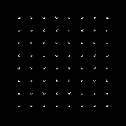
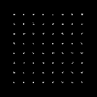
Unscaled 160x160 probe crops, 90 m, 2x MSAA. No light/texture/fade changes.

**Actual visible LODs were checked, not inferred from hidden roots.** Temporary
fragment tags identify grass at true 60–124 m distance after depth testing. Four
view directions were inspected from an elevated diagnostic camera. The selected
view contains 7,108 tagged pixels from the 72-triangle tier and 3,025 from the
eight-triangle tier; no full-detail or three-triangle tags occur. Pixel counts
are not instance counts. Optimizing only the last/horizon tier would miss most
of this visible far grass. The current saved-world hash is `d4fb3582ec5c...`;
it is not the earlier coastal camera or a reconstruction of the user's screenshot.

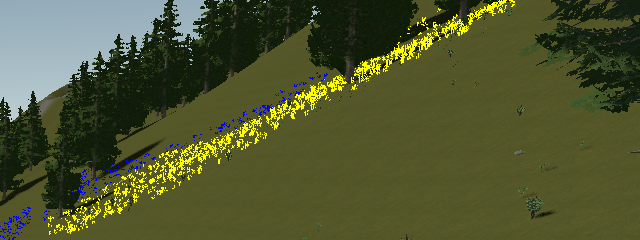
Yellow: 72-triangle tier; blue: eight triangles. Unlit colors and disabled fog/MSAA
are diagnostic tags, not proposed artwork. [Context](images/causes-world-context.jpg).

Matched 0.48 m sideways camera travel isolates individual features in the same
visible region. Wind is frozen in all these comparisons. The descriptive screen
difference includes expected image motion and contrast; it is not a pure shimmer
score or a quality/performance acceptance gate.

| Diagnostic override | Screen difference relative to baseline | Interpretation |
| --- | --- | --- |
| Grass hidden | 0.391 | Grass contributes much of this region's variation; remaining plants/terrain still contribute |
| Grass distance fade disabled | 1.013 | Does not remove the main effect here |
| Grass shadow reception disabled | 1.006 | Cast-shadow reception is not the main cause here |
| Grass texture disabled | 1.371 | Higher contrast worsens this measure; the existing texture is not the explanation here |
| Full-detail meshes forced | 1.337 | Extra geometry does not cure unresolved silhouettes |
| Flat unlit grass | 0.684 | Lower difference but wrong brightness; explicitly not a fix |
| Far LOD thresholds 0.08 / 0.14 | 0.882 | Useful LOD-only trend; visible speckling remains |
| Far LOD thresholds 0.06 / 0.10 | 0.833 | Useful LOD-only trend; visible speckling remains |

The threshold experiments preserve the original near/first-tier threshold 0.02,
all vertex arrays and the original lighting. Average crop luminance changes only
+0.20% / +0.17%, avoiding the previous broad brightening in this view. Their
[moderate](images/causes-world-far-lod-moderate.png) and
[earlier](images/causes-world-far-lod-early.png) captures were inspected. These
remain **test-only experiments**, not enabled runtime changes or user-approved
results. Continuous-play transition quality, nearby pixel parity at relevant
FOV/resolutions and isolated performance still need qualification before adoption.

**Brightness is a separate mismatch.** Woodland foliage uses leaf normals,
Burley lighting, ambient light and backlight. Terrain uses Lambert lighting,
ambient-disabled custom sky fill, surface normals and material textures. The
discarded upward-normal/full-AO/color-multiplier approximation reproduced none
of that terrain calibration. Native ground placement uses support normals to
reject steep slopes, but keeps upright instance bases; those bases do not encode
the terrain normal. A new far blend must account for actual terrain light/color
and slope, rather than merely choosing another global brightness multiplier.

Evidence: [compact measurements, inputs and identities](causes-evidence.json).
Runs `20261127T110001831123Z` (53 fixture assertions),
`20261127T110233221983Z` (nine low-tier assertions), and
`20261127T110629799826Z` (30 world/threshold assertions) all pass. Passing means
diagnostic integrity, not that flicker or visual acceptance is solved. All 88,725
ground-cover instances, native page/shadow/transform allocations and canonical
save hash remain unchanged within each world run. Production source is unchanged.

Reproduce using the existing save, read-only:

```powershell
python tools/run_godot_check.py vegetation_causes --isolated-render --timeout 300 --require "VEGETATION_CAUSES failures=0" -- --stability-source-slot=Homestead_Valley
```

`--probe-kind=low` restricts the silhouette probe; `--world-only` skips it.
The runner admits 12 MiB, with an enforced 8 MiB image ceiling and bounded
JSON/logs, zero new worlds/builds/exports. Receipt-owned retention archives older
members after exit, keeping two ordinary ready runs. The first full run is now
cold-retained; its manifest and versioned selected evidence remain available.
Original diagnostic code is 0BSD, original capture contributions CC0-1.0, with
underlying project-asset terms preserved. No external content or dependency added.

Next: improve far-LOD coverage/transition stability and terrain-calibrated contrast
together, preserving the liked softer distant appearance and near grass. Require
visible-surface motion evidence, brightness/terrain comparison and GPU/frame-tail
checks; do not substitute fewer plants or a lower aggregate metric for acceptance.
LOD-boundary popping, other species, exact supplied viewpoint, varied terrain/light,
zoom, physical travel and broader hardware remain unqualified.

## Moving distant-cover trial — 2026-11-27

**Rejected by the user:** the whole distant band becomes too bright relative to
its surroundings, and flicker remains strong. The measured residual improvement
did not represent acceptable visuals. Runtime `woodland.gdshader` and
`ground_cover.gd` have been restored exactly to `6e87ed07`, retaining the earlier
double-sided-normal correction. The following records the rejected experiment,
not the current runtime or an accepted partial fix. Its captures and failed cost
gates are preserved.

The brightness mismatch came from replacing original leaf normals/occlusion with
upward normals, full AO and a constant color multiplier. Terrain instead uses
its own ambient-disabled/custom-fill lighting model; an upward leaf normal does
not reproduce that terrain shading. Simply lowering the color multiplier again
does not solve silhouette coverage or establish a correct blend.

Wind isolation after rejection: `reports/checks/20261127T104035438622Z` compares
normal and frozen wind with identical original shading and camera movement.
Twenty fixture/preservation assertions pass, including byte-identical restored
near renders and unchanged canonical save. Noise/performance acceptance gates are
explicitly **not evaluated** in this diagnostic. In the controlled field, far
residual is 0.13703 with wind versus 0.13749 frozen (ratio 1.00335): removing wind
does not materially improve it. Six motion pairs were inspected. This supports
further silhouette/rasterization diagnosis, not a unique root-cause claim.

The saved world changed before this run (hash `d4fb3582ec5c...`, camera
`(1498.941, 67.46824, 905.6166)`, 88,725 ground-cover instances). Its inspected
camera faces rising terrain that obscures projected far roots, so its far-band
number is **unqualified**. Do not compare it with the prior coastal camera or
call it visible far-foliage evidence. A root's geometric distance alone does not
prove that it is the visible surface at its projected pixel. Add visibility/depth
qualification before using that metric for actual-world acceptance. The input
save hash is unchanged within the diagnostic; it is never rewritten or replaced.
[Diagnostic summary and identities](wind-isolation-evidence.json).

The initial diagnostic launch stopped before engine startup because another
receipt-owned archive writer held the lease. After it exited, the normal admitted
runner completed; no lease was bypassed or budget raised. The two newest ordinary
vegetation runs remain ready; earlier rejected captures are cold-retained.

Reproduce the diagnostic on current source:

```powershell
python tools/run_godot_check.py vegetation_stability --isolated-render --timeout 240 --require "VEGETATION_STABILITY failures=0" -- --stability-source-slot=Homestead_Valley --diagnose-wind
```

Frozen wind is a test-only override, not enabled in runtime. The subsequent
historical measurements describe the rejected lighting trial.

The rejected experiment used the following approach. At 1080p and 75-degree FOV,
woodland foliage gradually loses unresolved wind, fine shading and leaf-normal
contrast from 32 to 80 metres. The transition uses squared distance and scales
with projection size for zoom/resolution. Fully distant foliage uses a simple
ground-facing normal and a calibrated 0.65 color multiplier. This is a visual
approximation, not terrain-color sampling or translucency. Stones retain their
existing shader path. Existing coverage/dither fade remains unchanged.

Nearby grass retains its original geometry, shading and wind: the isolated near
render is byte-identical, and near-band motion measurements match exactly. There
are no new textures, geometry, draw passes or per-instance script loops. Existing
native pages, shadow pages, transform bytes, plant identities and densities remain
unchanged. Projection parameters update through the existing view-change path.
The removed trial exposed `distant_stability` for comparison.

Final source replay: `reports/checks/20261127T102434433909Z`, Godot 4.7.2
`ed1daf0bf`, Forward+, RTX 4050 Laptop, 1920x1080, 60 FPS cap. Baseline is the
shader after normal correction `6e87ed07`, frozen in
`tests/fixtures/woodland_pre_stability.gdshader`. Both shaders run the same
120-frame continuous camera path: 1.2 m/s sideways and 0.6 m/s forward, with
deterministic wind time, repeated in ABBA order. Measurements sample every frame;
lossless previews retain every fourth frame at 15 FPS. Timings exclude readback.

| Check | Synthetic field | Read-only Homestead Valley |
| --- | --- | --- |
| Far temporal residual, baseline → trial | 0.13703 → 0.08098 (40.9% lower) | 0.05365 → 0.03947 (26.4% lower) |
| Median of GPU p50 windows, baseline → trial | 5.532 → 5.605 ms | 6.952 → 6.977 ms |
| Worst paired GPU p95 increase; gate ≤0.3 ms | **+0.615 ms, failed** | **+0.397 ms, failed** |

**23 of 25 checks pass; both conservative GPU-tail gates fail.** Do not claim a
performance-qualified fix or zero GPU cost. Eight short ABBA timing groups retain
the adverse windows; no threshold was relaxed. Native instance buffers and draw
counts pass the synthetic check. The real world retains all 58,829 ground-cover
instances, page/shadow/transform allocations and persistent edits, and its
canonical save hash is unchanged. No world copy, save write, native rebuild or
installed-package export was performed.

The metric is display-luminance change at fixed anchors around actual grass
roots, using true 3D distance bands (near 8–28 m, middle 28–80 m, far 80–120 m),
320 anchors per band. It includes wind, silhouette coverage, lighting and possible
occlusion by nearer objects. It is not a pure aliasing measurement or a percentage
of all visible flicker. Actors/publication are frozen during the rendering replay;
the camera moves. This is not a physical driving or streaming/endurance test.

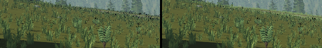
Left: pre-trial shader. Right: stability trial. Lossless 1:1 crops, matched camera
and wind time; no resizing/interpolation. The crop contains the densest tile of
projected distant-root anchors plus intervening nearer plants. Six evenly spaced
frame pairs and the full context stills were inspected. Distant dark speckles
soften, but clumps and color contrast remain; the transition is not seamless or
user-approved. [Before context](images/stability-world-before.jpg) and
[trial context](images/stability-world-after.jpg) are JPEG stills, not the metric
inputs. Frozen metrics/hashes: [stability-evidence.json](stability-evidence.json).

Retained earlier attempts (cold captures remain recoverable through their
`homestead.archive.json`; logs and run receipts remain at their original paths):

- `20261127T100346328273Z` and `20261127T100602937537Z`: oversized motion crops
  exceeded the declared 5 MiB limit. Reduced crop dimensions, not the budget.
- `20261127T100904585253Z`: visually rejected bright distant color band and failed
  long-window GPU gates; also an invalid global draw-count assertion during
  publication. Frozen trial shader/driver and rejected captures are retained.
- `20261127T101521899054Z`: storage admission stopped before engine launch.
  Receipt-owned archival subsequently freed space without changing limits or saves.
- `20261127T101738641573Z`: corrected color, short interleaved timings and frozen
  publication; synthetic tail gate still failed. Its global draw comparison was
  incorrectly across camera poses, and its flat-plane motion sampler misclassified
  hillside distances. Those distance claims are superseded by the final true-root
  sampler and within-pose draw check, not reclassified as passing evidence.

Historical lighting-trial command, using source revision `29e3b360` and the
recorded input save (current runtime has been restored and no longer contains
that trial; never replace the player's save to recreate it):

```powershell
python tools/run_godot_check.py vegetation_stability --isolated-render --timeout 300 --require "VEGETATION_STABILITY failures=0" -- --stability-source-slot=Homestead_Valley
python tools/analyze_vegetation_stability.py reports/checks/<run>
```

The current final run intentionally reports failure for its two unmet cost gates.
The runner admits 16 MiB (5 MiB motion packets, 6 MiB paired previews, 3 MiB context
stills, 2 MiB metadata/logs), zero saved worlds. After process exit,
`tools/maintain_homestead_captures.py --apply` owns only declared report members and
cold-retains older runs with hashes/receipts under the two-ready-run policy.
Versioned tracker images stay outside Godot imports/exports. Original code is
0BSD; original capture contributions are CC0-1.0, with underlying project-asset
terms preserved. No external implementation, dependency or asset was imported.

Remaining: isolate and reduce the worst GPU/frame-tail cost before qualifying the
minimal-cost requirement; inspect the exact supplied camera, other light/terrain
colors, zoom/resolution transitions and shadowed slopes; compare real driving and
longer/weak-hardware travel. Return with matched repeated timings and moving
captures showing both stable silhouettes and acceptable terrain contrast, then
obtain player visual acceptance. Installed-package qualification remains open.

## Distant grass speckles — 2026-11-27

The user's supplied overview crop shows small dark flecks mixed with pale cover,
including outside the building shadow. Its exact saved world, camera and distance
are unknown; the synthetic comparison below is not a reconstruction of that view.

Confirmed shading defect: `woodland.gdshader` manually inverted `NORMAL` on
back-facing leaves after Godot's `cull_disabled` path had already inverted it.
The production fragment therefore restored the wrong lighting direction. Removed
that second inversion. This affects the shared woodland foliage material, including
near leaves; stones keep their own path. Meshes, native batches, population,
interaction, shadows, fade distances and save formats are unchanged. No blending
pass, texture lookup or extra geometry is introduced; no GPU speedup is claimed.
The engine behavior was checked against its
[Forward+ shader](https://github.com/godotengine/godot/blob/ed1daf0bf/servers/rendering/renderer_rd/shaders/forward_clustered/scene_forward_clustered.glsl#L1168-L1175)
and [double-sided mode definition](https://github.com/godotengine/godot/blob/ed1daf0bf/servers/rendering/renderer_rd/forward_clustered/scene_shader_forward_clustered.cpp#L786),
then demonstrated on the installed Godot 4.7.2 `ed1daf0bf`.

`tests/vegetation_shading.gd` first reproduced view-normal output 1/0 for the
front/back of a double-sided leaf. With the correction both are 1/1. The original
production shader failed this assertion; the corrected source passes all seven
checks, including exact frozen-baseline repeat and unchanged buffers for 9,984
instances. Three matched camera offsets retain the original mesh LODs and density.
The simple fixture disables cast shadows to isolate material lighting; actual
world shadow reception and terrain shape are not qualified by this check.

The inspected meadow images retain obvious distant clumps and speckling after the
correction. The count of very dark samples changes from 2,441 to 2,236 in the
defined image region, but that threshold is descriptive, not an acceptance gate.
This is a confirmed normal correction and partial visual improvement, **not a fix
for all black spots or seamless grass**. Earlier
[fade/self-shading](../../docs/evidence/vegetation_far_diagnostic/README.md) and
[LOD/MSAA](../../docs/evidence/vegetation_lod_diagnostic/README.md) comparisons also
failed to eliminate the speckling; those rejected trials remain intact.

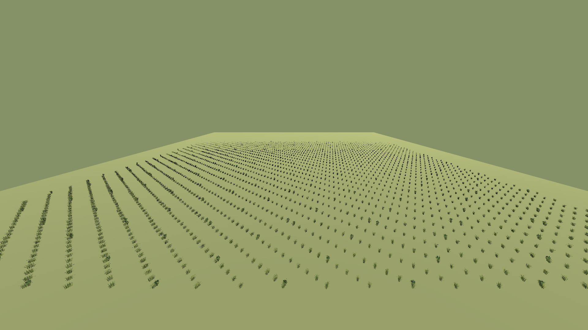
Synthetic 1080p meadow, 9,984 production foliage instances; old duplicate normal
inversion, fixed wind, no cast shadows. The regular placement is diagnostic only.

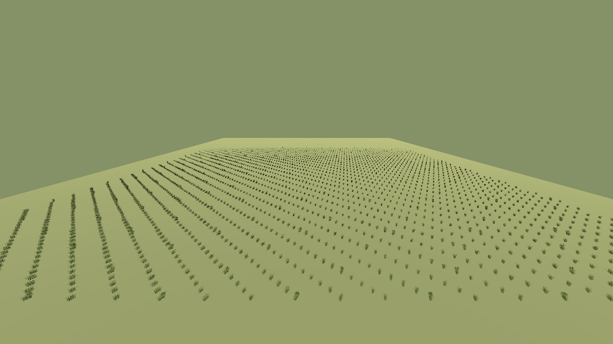
Same camera, instances and materials, with the duplicate inversion removed.
Dark flecks are slightly reduced; sparse silhouettes remain visible. Neither
image is the user's world or user-approved artwork. Provenance and hashes are in
`images/manifest.json`; these original diagnostic captures are CC0-1.0.

Retained receipts:
- `reports/checks/20261127T094006354473Z/run.json`: initial generic storage
  reservation rejected before the engine launched; no limits raised or evidence
  evicted. The fixture now declares 24 MiB reports, a 20 MiB encoded-image ceiling,
  and zero saved-world allocation. It creates no export or saved world.
- `reports/checks/20261127T094139317069Z/run.json`: initial fixture parse failure;
  fixed the explicit float type. This was not a production test result.
- `reports/checks/20261127T094225737180Z/vegetation_shading.json`: expected original
  production normal failure, with baseline/corrected image controls.
- `reports/checks/20261127T094327665114Z/vegetation_shading.json`: seven checks pass;
  paired camera-offset captures inspected. No frame-time benchmark or continuous
  motion/shimmer acceptance. The matching run receipt records native/engine/source
  hashes. The adjacent identity helper uses Godot's ResourceUID generator for the
  new test sidecar; it changes no runtime assets.

Reproduce:

```powershell
python tools/run_godot_check.py vegetation_shading --isolated-render --timeout 90 --require "VEGETATION_SHADING failures=0"
```

After the owned process exits, `tools/maintain_homestead_captures.py` owns these exact report
members and cold-retains older runs under the existing two-ready-run policy.
Tracker images remain versioned outside Godot imports/exports.

Follow-up: the moving distant-cover trial above now supplies a representative
populated-world camera, motion comparison and unchanged-population/save checks.
The exact supplied view, species/LOD attribution, GPU/frame tails and user
acceptance remain open. Its shading approximation improves the measured residual
without changing the existing dither fade; a wider fade remains unqualified.
Original diagnostic code is 0BSD; no external implementation or asset was imported.

## Ground draw-page backlog — 2026-11-01

Completed the pending draw-page experiment: the 8 KiB upload allowance forced
128-instance pages, so dense visible owners created too many render submissions.
Use a bounded 64 KiB allowance / 1,024-instance page instead. Existing residency
byte ceilings, plant density, identities, ranges, shadows and meshes are unchanged.
Native rendering still owns selection and uploads; no new per-frame script scan.

Matched October 30 installed-pack 160 km/h camera sweeps, same 586 m road:
pending pages mean/max **190.95/280 → 0.12/2**; mean draw calls **1,327.63 →
1,169.52**; ground-render CPU **565.82 → 400.01 µs**. Actually drawn instances
increase **57,421 → 79,170**; this is less deferred content, not reduced density.
Frame p95 **24.189 → 22.582 ms** still misses 60 FPS. This controlled camera
sweep does not qualify physical car handling, all coverage or seamless LOD.

The combined installed build is checked for paid block placement/removal,
per-rendered-frame grass continuity, all six terrain tools, largest-volume edits,
removal persistence and 8/32/64 KiB native pages. Exact runs and retained failures:
[gameplay evidence](../runtime-performance/gameplay-evidence.json). Test fixtures
explicitly opt out of mouse capture, including external packaged drivers.
The populated maximum excavation removes 18,517 plants: support publication is
15.987 ms, just below the 16 ms fixture gate, and total edit latency is 984.515 ms.
That is not comfortable performance headroom or an ordinary pickaxe timing.
Large-edit/endurance, outer-owner coverage, foreground/weak-hardware and full-frame
budgets remain open; do not treat this page change as their completion.

## Evidence

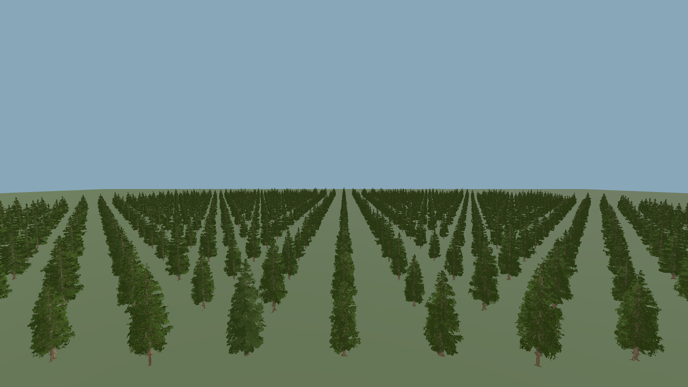
[448 m baseline](images/forest_448.png): identical 1024-tree grid fixture, 1080p,
same camera/light; artificial rows test coverage, not proposed forest distribution.

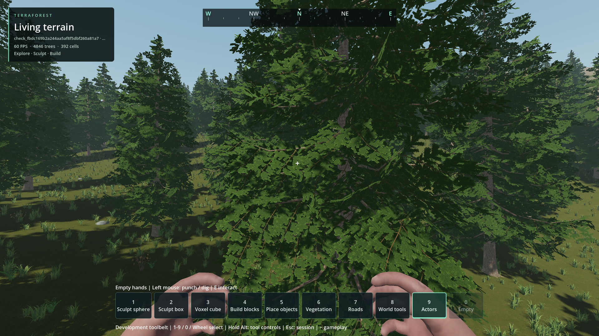
Fresh temporary seed 1703 world, moving camera, unchanged natural distribution.
No played world was read or modified. Images inspected, not user-approved.
Provenance/hashes: `images/manifest.json`.

- `tests/vegetation_extended_lod.gd`: 17 assertions; all tested owner corners,
  world edges and angles cover the visible/preload disk. Same near geometry and
  stable IDs; finite bounded nondegenerate meshes.
- `tests/scatter_priority.gd`: 23,131 parity/validation cases retain legacy API behavior.
- `tests/woodland_accents.gd`: 66 geometry, harvesting, picking and persistence checks.
- `tests/vegetation_native_selection.gd`: 2000-root/180-frame script/native parity,
  removals, transitions and sparse buffer parity pass.
- `reports/checks/20261028T150527803046Z/run.json`: 3200-plant renderer fixture;
  distant Godot primitive counter 1118 -> 544, nearby counter unchanged. This
  counter is not a claim about total hardware triangles including instancing.
- `reports/checks/20261028T151314789385Z/run.json`: actual world, 405 owners,
  5294 roots initially; bounded publication, travel and zero mouse captures.
  RTX 4050 Laptop GPU: median GPU 9.14 ms stationary / 9.15 ms moving;
  moving median/p95/max frame intervals 16.61/20.90/26.07 ms, forest CPU
  p95 0.577 ms, coordinator p95 0.225 ms. 240 frames each, offscreen 1080p,
  capped; no claim of universally smooth 60 FPS or isolated LOD speedup.
- Detailed fixture data: `reports/vegetation_lod_visual/result.json` and
  `reports/vegetation_lod_world/result.json`. Screenshots excluded from timed samples.
- Initial test-only parse errors and incorrect completion-text requirements remain
  in the 15:03/15:04 reports; corrected reruns pass, no suppressed engine errors.
- Populated city/forest approaches also pass with 391–405 resident owners:
  [city evidence and timings](../city-buildings/README.md#generated-world-integration).
  Pack startup passes; all 14 exported native DLL hashes match source.

## Remaining / resume here

- Longer/weak-hardware travel, teleport publication and longer city+forest comparison.
  Extra coverage increases resident roots and surface sampling; inspect spikes
  before extending range again. Current moving p95 exceeds a 16.67 ms frame.
- Ground mesh index switches are screen-error selected, not crossfaded. Trees retain
  their existing complementary dithering. Reopen for a visible change with camera/FOV
  and same-view comparison; do not reduce plant density to disguise it.
- No new species, new tree impostor bake or fully seamless arbitrary-speed streaming.

## Driving-speed streaming — 2026-10-29

- Confirmed: ground-cover owners fall behind fast travel; forest residency kept up
  in this fixture. This is not primarily a GPU rendering limit in these samples.
- Native root-support sampling now reuses a request-local 256-entry lattice cache
  (5 KiB stack, no persistent files). Current/original terrain and material flags
  remain distinct; edits cannot reuse a previous request's samples.
- Ground cover replenishes up to eight 64-point jobs instead of waiting for each
  four-job wave. One complete owner still publishes atomically with all 16 layers.
  Density, meshes, visibility ranges, harvesting IDs and collision rules are unchanged.
- The existing terrain worker services at most four support batches / 1.5 ms soft
  budget between background mesh work. Mutations, saves, interaction collision,
  target queries, water jobs and unknown job types remain ordering barriers.
- 160 support batches across four profiles, two seeds, boundaries, mining, filling
  and asphalt match old bytes exactly: 610 assertions. Mean 64-point native batch
  0.727→0.293 ms (2.49×). No cross-frame cache or new thread pool.
- 170 coordinator assertions include rolling/out-of-order replies, partial admission,
  invalidation, failed packets, teleport, harvest and authored plants. Worker-order,
  support, retirement, water continuation, target-readiness and vehicle collision
  readiness checks pass. Detailed receipts: [driving evidence](driving-evidence.json).

### Measured limits

Seed 1703 disposable recipe fixture; 585.6 m controlled road-camera sweep,
1080p/60 cap, RTX 4050 Laptop. **Not a physical vehicle handling qualification.**
Early physical-driver probes veered off the road and do not qualify fast driving.
Disk owner counts include off-screen/empty owners; they are not counts of visible holes.

| 160 km/h sweep | Frame p95 | Missing ground owners within 64 m, mean / max |
| --- | --- | --- |
| Original native build | 30.14 ms | 9.92 / 18 |
| Cache + rolling four jobs | 29.28 ms | 9.60 / 17 |
| Eight jobs | 28.82 ms | 6.66 / 14 |
| Bounded worker service | 23.73 ms | 4.46 / 11 |
| Installed-pack repeat | 26.47 ms | 4.31 / 12 |

The native cache alone did not fix streaming. The final 160 km/h runs still have
late cover and frames above 16.67 ms. All measured forest-visible owners were resident.
Installed 160 km/h peak: 3.30 GiB private RAM / 1.38 GiB dedicated GPU allocation;
422.7 MB distributable. Source save hash unchanged; zero mouse captures.
Installed 100 km/h sweep: frame p95 21.54 ms, mean/max missing near owners 1.75/8;
forest-visible owners all resident, peak 3.34 GiB private RAM / 1.37 GiB GPU.
There is no matched 100 km/h baseline, so this is a remaining-limit measurement,
not an improvement percentage. Both installed runs pass save/mouse/resource gates.


Same route endpoint immediately after the speed sweep, before the eight-second
recovery. First image is the insufficient cache/four-job intermediate, not the
original build. More ground cover is ready in the second; this is not full-route
visual acceptance. Wind/time and streamed off-screen counts differ. Provenance in
`images/manifest.json`; prior images remain intact.

### Remaining / alternatives

- Require sustained real-car straightaways, turns, city/forest transitions, 100–198
  km/h, camera turns and weaker hardware before claiming seamless driving. Return
  to native chunk preparation/delivery and publication budgets, not lower density.
- Candidate next architecture: compact, versioned, pre-baked vegetation-owner
  records with bounded native decoding and upload; invalidate terrain/building
  dependencies and apply harvested/authored changes separately. Any disk cache
  must share the existing 3 GiB quota. This is **not implemented**. Keep the current
  renderer initially; these profiles do not justify replacing it with GPU scatter
  or new tree impostors. Compare complete visible coverage, visual equality, edit
  persistence, CPU/GPU timings, memory and cold/warm cache performance first.
- The integrated six-tool/edit test passed 71/72 checks, including durable removal,
  neighbours, tree collision and regeneration, but maximum-volume publication was
  26.475 ms for 18,532 queried instances, failing its 16 ms limit. Attribution to
  this change versus the prior build is unverified; retain the failure, compare
  the same fixture on the prior build before treating it as a regression or fix.
  No threshold was raised. This separate large-edit budget remains unresolved.
- Retained failed trials: invalid test asphalt/material arguments, physical driver
  setup/steering, missing ground-cover test flag, and packaged driver initially
  referencing excluded test code. Corrected harnesses are retained with receipts;
  none constitutes a production fix or successful fast-car acceptance.

Reproduce the controlled sweep:
`python tools/profile_runtime.py --slot recipe_generated_4644d8cfc8f97e43 --speed-sweep --speed-kph 160 --pack --label driving_repeat --require-resource-budget`.
Historical `--driving` is an alias for this controlled workload, not autonomous driving.

## Residency notifications — 2026-10-30

- Root cause: unchanged model and block admission/retirement emitted the same
  world-edit notifications as authoring. That dirtied every wanted ground-cover
  owner, discarded in-flight scatter work and incorrectly requested another save.
- Native model content notifications now distinguish residency. Blocks reuse their
  existing native content revision. Snapshot-cache invalidation and collection
  observers remain intact; actual edits, undo/redo, full restore and prefabs still
  invalidate vegetation. No new worker, cache, density reduction or range change.
- Validation also caught a missing content-revision increment in staged block-only
  prefabs; fixed before final qualification rather than suppressing that edit.
- Same seed 1703, 585.6 m/160 km/h controlled camera sweep, RTX 4050 Laptop,
  1080p/60 cap. Counts are disk owners, including empty/off-screen owners, not
  visible pixels. They do not qualify physical driving or arbitrary travel.

| Build | Missing near owners mean / max | Missing visible-radius owners mean / max | Frame p95 |
| --- | --- | --- | --- |
| Installed baseline `13788225` | 3.65 / 11 | 27.09 / 40 | 22.66 ms |
| Model notification fix only | 0.62 / 8 | 12.62 / 32 | 23.10 ms |
| Block + model fix, source | 0 / 0 | 0.17 / 3 | 27.32 ms |
| Block + model fix, first pack | 0 / 0 | 0.63 / 4 | 27.52 ms |
| Final pack, prefab revision regression fixed | 0 / 0 | 2.27 / 8 | 30.06 ms |

The source/first-pack runs recorded no cover exclusion-revision change or dirty
owner during the measured route. Forest-visible owner misses stayed zero.
The final repeat retains zero near misses and a constant exclusion revision;
outer coverage and timings vary, so the earlier best sample is not universal.
**This is a continuity improvement, not a frame-time improvement.** More cover
actually becomes ready; frame pacing is worse in these samples and remains open.
Do not hide this by lowering vegetation density. Return to bounded owner delivery
and render publication, then require matched repeated physical-car, sharp-turn,
zoom, edit/reload and weak-hardware/endurance evidence. Pre-baked owner records
remain only a candidate, not an implemented replacement.

Detailed reports, build identities, failed fixtures and final installed checks:
[residency evidence](residency-evidence.json). Earlier evidence is preserved.

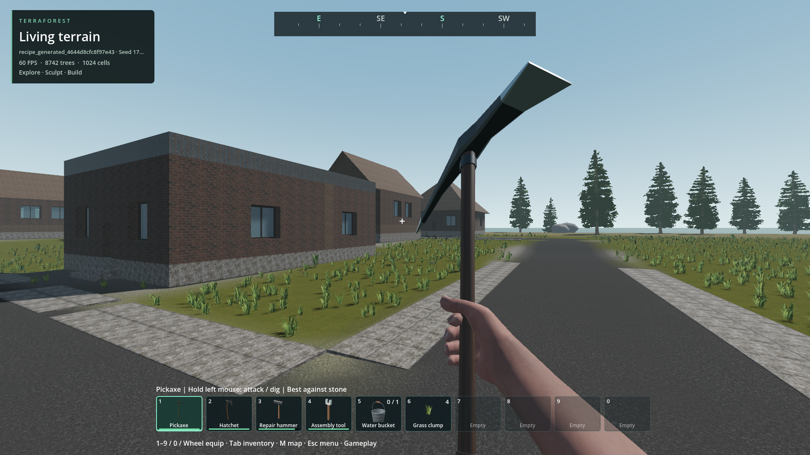
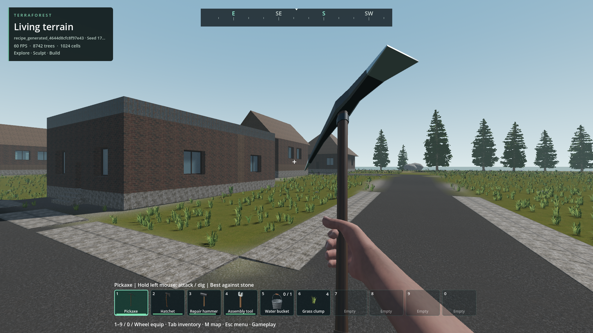
Unedited 1080p captures immediately after travel, before recovery. The far roadside
has more ready ground cover; near plants/buildings retain their appearance.
These inspected endpoints do not show every transient hole or qualify seamless
motion. Wind/time differ; provenance is in `images/manifest.json`. User review pending.
