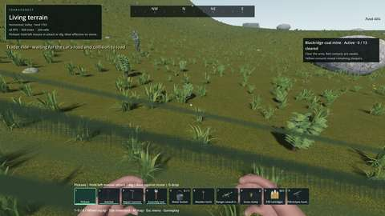
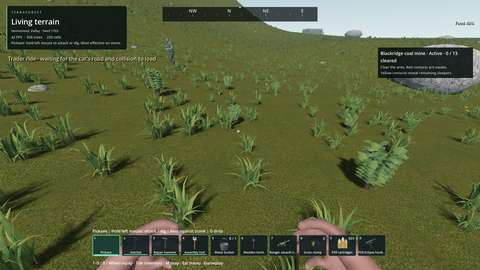

<!-- SPDX-License-Identifier: CC0-1.0 -->
# Nearby terrain bands — projection fault reproduced and corrected, 2026-11-28

**Human acceptance — 2026-11-28:** The user verified the latest source after checking
standing still and walking, and authorized commit/push. Milestone:
`playtest/vegetation-fades-2026-11-28`. This accepts the current fade/projection
snapshot, not universal seamlessness or the earlier GPU-tail target. Historical
failed and rejected controls below remain evidence. Shared DLLs are excluded;
restoring the native page-overlap change requires rebuilding the structures addon.

The human playtest of the uncommitted far-proxy/horizon/shadow candidate reports
frequent gray or shadow-like bands on terrain very close to the player while
walking. That version was **not accepted**. The earlier batch-cutoff test and fixed nearby
endpoint did not qualify this moving near-ground symptom. The correction was held uncommitted until the user validation recorded above.

The source launched in `reports/playtests/20261128T082757550627Z` matched the
vegetation and native structures hashes of the passing engineering walk. The
player closed it for diagnosis; its log records normal save publication. The
diagnostic reads that existing Homestead Valley save without modifying it.

`tests/vegetation_shadow_bands.gd` replays identical camera motion in the source
world, both at the saved angle and looking farther down. Separate controls disable
the new shadow-distance fade, LOD masks in the shadow pass, vegetation casting,
and all directional shadowing. Production remains unchanged during diagnosis.
Native-resolution nearby hashes/repeats accompany small previews and reduced
luma motion; the latter are diagnostic aids, not a claim of visual resolution.

First run `20261128T083707316225Z` rendered all controls and repeated near views
exactly, but exhausted its capture cap before writing the final measurement JSON.
Its sampled close PNG is identical with shadow-distance fading disabled; that
alone does not identify the reported moving artifact. The failed capture and its
exact driver remain pinned. Preview sizes were reduced and compact motion added.
Run `20261128T084205120483Z` failed parsing after a Windows newline conversion
introduced doubled carriage returns. Its exact driver is retained; line endings
were corrected. Neither run counts as a passing diagnostic.

The new diagnostic admits 3 MiB and caps its own payload at 2.5 MiB. Two older,
identical completed mining traces matched their historical backup catalog and
were cold-retained with verified local restoration manifests, freeing 14,781,578
loose bytes using only 126,742 new compressed bytes. Full evidence remains in
`reports/mining_visual/trace.archive.json` and
`reports/mining_locality/c78caef9d8134842/0/visual/trace.archive.json`.
No storage limit was raised and no save was removed.

Required closure: reproduce and isolate the actual nearby band pattern, correct
its cause, repeat matched controls and normal physical movement, preserve close
grass/material brightness, then obtain human validation. Prior engineering
results remain historical and do not override this regression report.

## Confirmed cause and correction

The user's [unaltered screenshot](images/nearby-proxy-bands-user.png) shows green-gray
strips covering nearby plants as well as terrain. They also flicker when standing
still. This is **far-proxy geometry projected into the foreground**, not the new
shadow-distance fade. The earlier shadow-only hypothesis did not explain it.

Our analytic grass/fern/flower proxies divided their support points by perspective
`w` before checking the camera plane or off-screen support. A plant far to the side
can still belong to a visible render page. If its support crosses the eye/near plane,
its projected covariance and generated quad can span the foreground; animated wind
changes that invalid projection without any camera movement. Expanding the far
surface into the base/overlap buffers for seamless transitions exposed this missing
projection-domain check. Batch culling and subsequent hardware quad clipping cannot
repair geometry already expanded from invalid support.

`proxy_projection.gdshaderinc` now checks support before the divide. It rejects
camera-plane crossings and support wholly outside a doubled side frustum (leaving
room for legitimate filtered tails). The stone approximation gets a corresponding
center/depth check. Only far proxy vertex shaders use it. Opaque nearby geometry,
lighting, textures, colour expressions, LOD thresholds, density and shadows are
unchanged. No additional draw call, texture, CPU instance iteration or temporal
buffer is introduced; rejected support skips projection and fragment overdraw.

| Faulty guard-disabled control | Production guard |
| --- | --- |
|  |  |

These 480×270 previews share pose, wind time, population and lighting. Assertions
use the native 1520×400 foreground region, not these compressed previews.

## Causal evidence and rejected controls

- `20261128T084320829853Z`: 57 checks pass, but the old saved view did not reproduce
  the reported bands. All 48 nearby frames were identical with distance shadow
  fading disabled. Not a visual-resolution claim.
- `20261128T085257719995Z`: the new saved pose reproduces the strips. The diagnostic
  guard used a forbidden shader processor `return`, failed compilation and crashed
  the renderer. Failed run/source retained and pinned; not counted as validation.
- `20261128T085454418489Z`: camera-plane-only guard improves the picture but only
  42/48 foreground frames equal the proxy-free control. Six still contain smaller
  off-screen projection leakage. Rejected as incomplete. Original runtime shaders
  frozen with SHA-256 before production changes; cold restoration remains available.
- `20261128T085749197376Z`: camera-plane plus side-support guard produces exact
  native foreground equality with the proxy-free control in **48/48** frames.
  Shadow-disabled baseline retains the artifact. The faulty baseline is exact on
  repeat and differs from the proxy-free foreground in 42/48 frames.
- `20261128T090059765752Z`: **integrated production guard, 107 checks, zero failures**.
  Same 42-frame reproduction, 48/48 corrected foreground comparisons, exact faulty
  repeat, and unchanged clean baseline foreground in six frames. Includes 24 fixed
  camera/wind-animation frames and 24 moving/wind-animation frames. Population,
  removal records, draw/shadow pages, instance bytes and canonical save hash match.
  Driver, shader sources, raw reduced motion, native hashes and controls are retained
  in `reports/checks/<run>/`; receipt-owned cold retention is authoritative.

Four paired ABBA GPU cycles at the reproduced bad view exclude image readback.
Median of window medians: **14.007 ms faulty → 8.382 ms corrected**. Median window
p95: **14.558 → 8.580 ms**. All windows report **3,870 draw calls**. This measures
removal of pathological overdraw at this scene, not a universal performance gain
or closure of the earlier far-detail GPU-tail target.

Normal physical gameplay checks pass as recorded below. Human validation passed on 2026-11-28; commit/push is authorized for the corrected snapshot. Broader projections, views and earlier transition
acceptance requirements remain open.

### Physical setup rejection and evidence retention

`20261128T090320883722Z` captured 192 raw-hash-verified frames, but **failed** the
40 m traversal requirement (19.232 m). Inspection exposed a setup failure:
normal enemies defeated the saved 46-health player before capture, and the test
walked inside the respawn shelter. The captured pictures are not outdoor vegetation
validation. No loading/death happened inside its measurement interval, explaining
why that older gate alone missed the setup problem. The rerun uses the existing
outdoor route setup at (1740, 0, 1700), normal floor snap and a clear heading,
with actors/collision/health untouched and no position edits during measurement.

The post-run archival attempt also reached its 10 GiB archive limit. All original
captures survive. Lossless level-9 recompression reclaimed **3,146,800 bytes** from
678 chunks; each raw SHA-256 and restored byte stream was verified before/after.
Receipt: `reports/checks/20261128T090320883722Z/archive_recompression.json`.
Historical `20261127T220816122408Z` and previous human-candidate walk
`20261128T081702404738Z` have explicit ready pins while archive capacity is constrained
and human review was pending. Storage maintenance must revisit them after validation
and adequate archival headroom; neither evidence nor saves may be silently evicted.
The near-band moving review now has an **8 MiB** admission, **6 MiB** media cap and
6 Mbit/s review-video ceiling, retaining the original 192 native raw-frame hashes.
This reduces planned output rather than increasing any storage limit.

## Normal gameplay verification

`20261128T091042690963Z` passes all engine gameplay checks: **189.448 m travelled**,
**2,163/2,163 grounded physics frames**, normal actors/streaming/collision, and an
unchanged canonical save. All **192 native 1080p capture hashes** independently
match the analyzer. The first 96 captured frames stand still with live wind;
the remaining 96 move physically. The complete route also walks, turns and strafes.
Measured GPU medians are 8.079 / 7.542 / 7.036 ms (walk / turn / strafe), with p95
9.223 / 8.971 / 8.201 ms. This route is not a paired before/after cost comparison.

The 16-frame [motion review](../../reports/checks/20261128T091042690963Z/motion-review.jpg)
was inspected: no broad foreground strips are visible. The
[3.2-second review video](../../reports/checks/20261128T091042690963Z/gameplay.mp4)
and native capture hashes are retained. Runtime source hashes still match the
current implementation. This is engineering evidence for the reproduced case,
not universal visual acceptance. Human validation subsequently passed, with commit/push authorized on 2026-11-28.

The outer launcher returned an archival error **after** successful engine tests and
raw-frame analysis: another older 13.5 MB capture (`20261127T221540936288Z`) could
not fit in the full archive. It is explicitly pinned pending capacity maintenance;
originals and partial chunks remain intact. The completed check's `run.json` records
`result.passed=true`; the overall wrapper invocation is not represented as passing.
Final report size including the contact sheet is 7.05 MiB, within its 8 MiB admission.
The additional capacity pin has the same return trigger as the earlier pins above.

Approval revisited the retention prerequisites on 2026-11-28: human review is now
complete, but archival headroom is still missing. Ready pins remain until safe
receipt-owned archival can run while gameplay is idle; no evidence is discarded.
