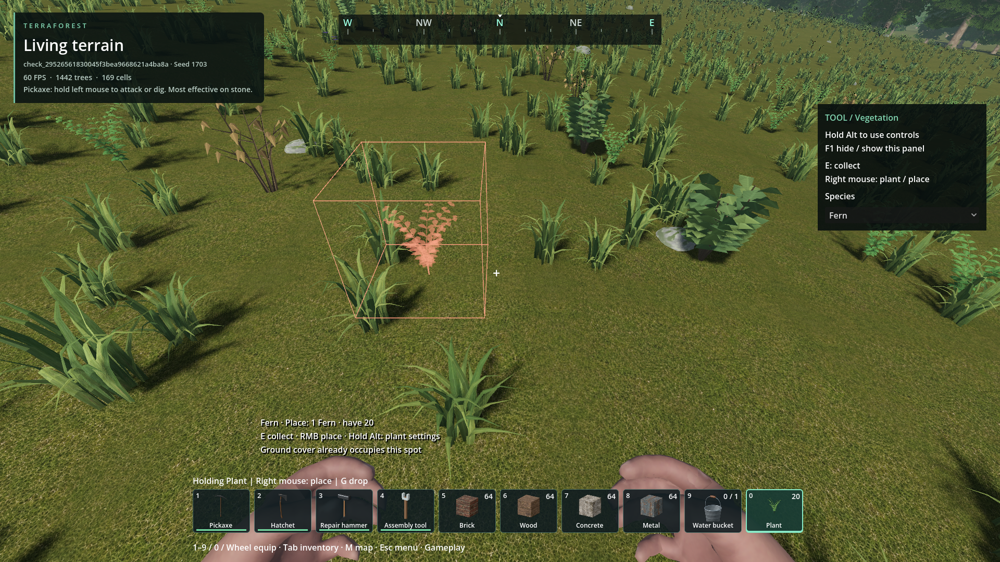
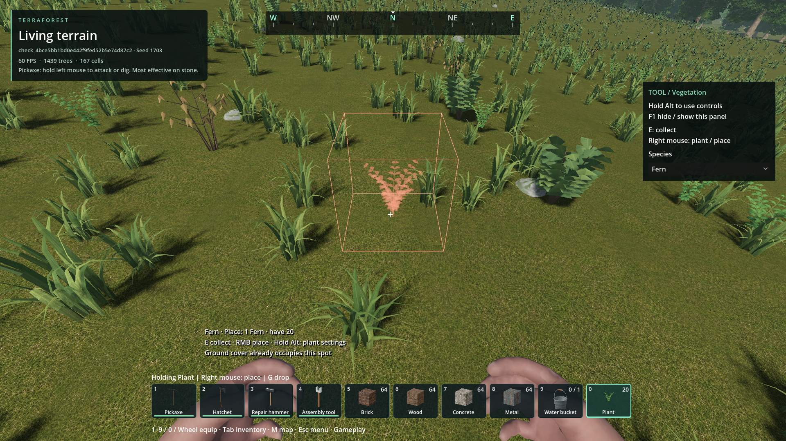
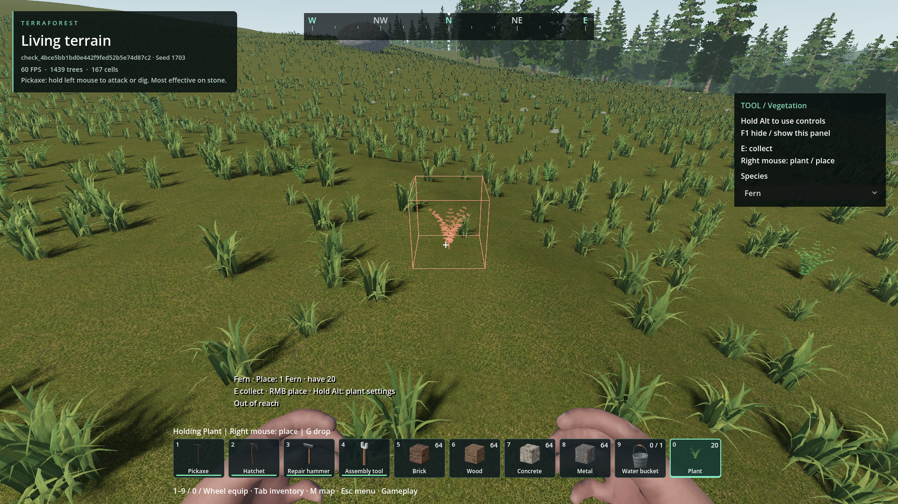

# Vegetation placement preview disappearing during movement

- Status: Corrected for reproduced movement/reach cases; installed and packaged checks pass. Original-location user review pending.
- Updated: 2026-10-27. Baseline: `2c8c05f8` plus this fix.
- Report: Both the outline and translucent plant disappear/reappear while moving and aiming at ground. No exact saved location was supplied for this recurrence.

## Confirmed causes and changes

- The preview's stationary timer also throttled moving/turning cameras. In a 120-frame, 9.9 m/s controlled running trajectory over real streamed terrain, only 30 frames matched the live ray target; the marker fell up to 0.532 m behind.
- The 3.5 m gameplay ray also served as the preview's search boundary. Crossing it removed the entire target instead of distinguishing out-of-reach ground. A fixed-plane control showed only two of five targets spanning 3.35–4.0 m.
- Camera displacement/turning, species changes and terrain epoch/revision changes now invalidate the advisory cache immediately. Unchanged cameras retain the bounded stationary polling interval. No frozen old target is retained after a true ray miss or UI/focus/tool change.
- Placement uses one bounded native scene ray up to 8 m for visual feedback, but validates against the original requested reach. Gameplay placement/collection reach stays 3.5 m; developer reach stays 8 m. Further ground appears red, labelled Out of reach, rather than blinking off at the gameplay boundary. Preview and click endpoints share the same reach helper.
- Every click still probes afresh, respects intervening solids, readiness, existing vegetation, structures, water and inventory, and pays only for accepted placements. No terrain generation, caching, collision or vegetation scattering rules changed.

## Verification

- Before-change run failed the intended moving-target, immediate-species and reach-boundary assertions: `reports/checks/20261027T093639022507Z_player_navigation/vegetation_target_motion`. Its metrics and rejected evidence remain retained.
- Installed package: **70 assertions** across `vegetation_target_motion` (22) and the existing player/menu/map integration suite (48), at `reports/checks/20261027T094707782693Z_player_navigation_pack`. All 14 native DLL hashes match. [Package/source/test hashes and measurements](verification.json).
- Running trajectory: 120/120 live targets match, no hidden marker on available hits, maximum positional discrepancy 0.000123 m. Looking across the ground: 60/60 hits match. Stationary queries remain 30 per 120 simulated 60 Hz updates; all five reach-boundary targets remain visible. These are controlled camera/body trajectories using actual terrain physics, not a manual playthrough of the user's exact location.
- Separate fixed-plane range controls isolate the reach boundary; they are not terrain-physics evidence. Further clicks spend/place nothing. A separate actual-terrain in-range placement consumes exactly one item and publishes the authored plant after final support checks. Solid occlusion, pending-update marker, species switching, sky and inventory suppression pass.
- Current-machine moving-preview CPU samples: median 215 µs, p95 281 µs, maximum 401 µs. These measure the update call only, not total-frame cost or all settlement/hardware conditions. Moving cameras deliberately do more current-target work; stationary work remains throttled. No new mesh generation, scene traversal, shader pass, density request or baking job.
- Successful test caches were pruned; logs, metrics and images remain. Player worlds were not opened or modified.

## Images

Same temporary seed-1703 running trajectory and final view, before and after. Scene streaming/wind timing differs; these are not pixel-parity comparisons. Red here means existing vegetation occupies the spot, not a missing target.

Fixed-plane range control at 4 m, inside the same temporary world; added turning tests changed this control's camera position from the earlier run. This image demonstrates feedback, not an accepted placement or independent terrain support. All images are unedited; [provenance](images/manifest.json).

## Reproduce / remaining

- Equip a carried plant, run while looking down, turn across ground, and cross the normal 3.5 m placement boundary. Close targets should stay aligned; farther ground should remain red within the 8 m advisory ray. Aiming into sky, beyond that ray, losing focus, opening UI or switching tools still intentionally hides the marker.
- User review at the original location and representative dense settlements/lower-end hardware remain unqualified. If it recurs within near, visible ground, save with F5 and retain world/location plus whether the outline and ghost both vanish. Inspect short/long scene-ray hits and gate states; do not hide a physics miss with a permanently pinned or falsely green preview.
- Reproduce with `python tools/check_player_navigation.py --pack --checks vegetation_target_motion player_navigation`.
