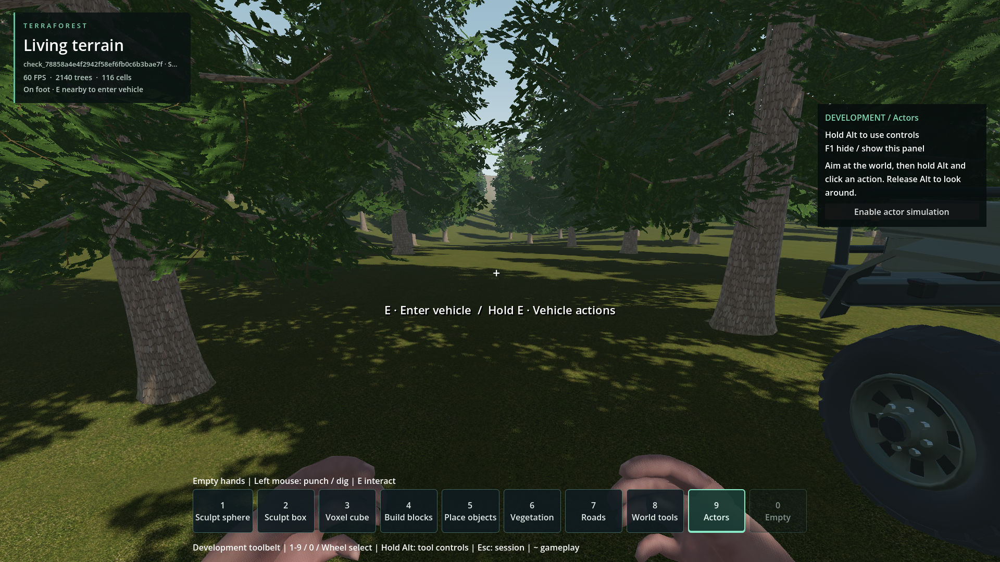
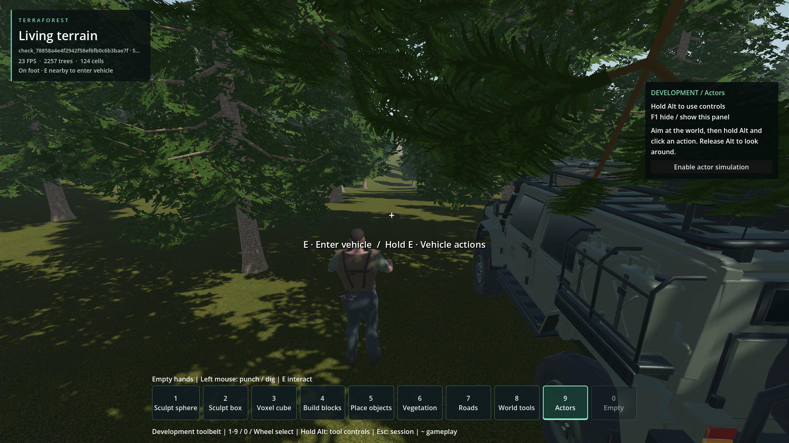

# Player faces the old direction after leaving a turned vehicle

- Status: Fixed for reproduced behavior / scoped engineering checks; user review pending.
- Updated: 2026-10-26. Correction is in the vehicle exit adapter; no native code change for this fix.
- User review: User asked whether the mismatch exists, then requested the repair after confirmation. Corrected behavior has not yet received user visual review.
- Symptom: The player can exit facing sideways or backwards relative to the car's current front.

## Reproduction and cause

The pre-fix probe entered facing one direction, rotated the vehicle, ran the real
vehicle camera follower and called the real exit method. With 0/90/180-degree
vehicle turns, the player's body and view were 0/90/180 degrees away from the
vehicle front after exit. [Measurements](logs/vehicle_facing_probe.json.gz),
[probe source](logs/vehicle_facing_probe.gd.gz), [baseline run](logs/baseline_run.json.gz).
The baseline uses the gameplay code before this correction; its small harness
did not capture a full native-source manifest.

Exit restored the old camera-local transform but left the player's pre-entry yaw
unchanged. Driving's chase camera follows the car independently, so it did not
update the walking controller's heading either.

## Correction

[The exit adapter](../../addons/vehicle_runtime/world_vehicle.gd) now faces the
player along the car's current horizontal forward direction, converting the car's
**+Z** convention to the player's **-Z** convention. The player remains upright;
vehicle pitch/roll is not copied. When the car's front is vertical and has no
usable horizontal projection, the vehicle's right axis supplies a finite heading.

The camera returns to its normal eye position and retains the pre-entry look
pitch within the existing mouse-look limits, with no residual local yaw or roll.
The host's yaw/pitch fields are synchronized so the next real mouse event continues
from the new heading. The actual world's on-foot save capture also uses that yaw.
Hosts without those optional controller fields continue to work.

Alignment happens only after a clear, loaded exit is accepted. Denied/unloaded
exits preserve the seated body, view and input heading. The existing temporary
contact guard and stable-parking behavior remain in use.

## Verification

| Final check | Result |
| --- | --- |
| [Focused fixture](../../tests/vehicle_exit_facing.gd) | **65 checks pass** across eight vehicle poses: front/back/side headings, wraparound, tilt, inversion and vertical front. Covers denied/unloaded exits, upright body, retained pitch, synchronized input and pose codec. [Receipt](logs/fixture_final_run.json.gz), [measurements](logs/vehicle_exit_facing.json.gz) |
| [Actual-world facing test](../../tests/vehicle_exit_facing_world.gd) | **45 checks pass**, six E exits at 0/90/180-degree vehicle headings in first/third person. Tests body/eye alignment, real save capture and the next real mouse-motion handler without snap-back. [Receipt](logs/world_facing_run.json.gz), [measurements](logs/vehicle_exit_facing_world.json.gz) |
| Existing world adapter | Pass. Camera restoration uses approximate transform equality because Euler reconstruction changes floating-point representation. [Receipt](logs/adapter_final_run.json.gz) |
| Existing exit collision/lifecycle regression | All **13 cases** pass, including support slopes, unequal wheel heights, temporary-contact cleanup, re-entry, holds and removal/restore. [Receipt](logs/collision_regression_run.json.gz) |
| Existing actual-world moving-exit regression | All **nine repeated exits** at 0/0.3/3 m/s pass; no player/chassis impacts or large sinking, and ordinary parking still completes. [Receipt](logs/world_exit_regression_run.json.gz) |

The first focused fixture accidentally put the unloaded-provider assignment after
`return` inside its inline admission callable. Its supposed blocked exit therefore
succeeded, causing 16 harness assertion failures; the assignment is now outside
the callable. [Failed receipt](logs/fixture_harness_failed_run.json.gz).
The old adapter check also failed strict camera-transform equality after Euler
reconstruction, while its other checks passed; the final check uses Godot's
approximate transform comparison and passes. [Earlier receipt](logs/adapter_exact_comparison_failed_run.json.gz).
Both failures remain visible rather than being discarded.

No existing player saves or persisted camera preferences were changed. Tests ran
with unrelated concurrent workspace work; receipts retain revision/dirty-state,
test and native hashes at launch. [Correction source hashes](logs/source_hashes.json).
Godot generated both new script UID sidecars; [editor import log](logs/vehicle_exit_facing_uid_import.log.gz).

## Images



Actual eye view immediately after an E exit from a car set to 90 degrees world
yaw, following a different entry direction. Temporary generator 1 / seed 1703,
Godot 4.7.2 Steam / Forward+ / 1920x1080, normal foliage/collision. The car remains
beside the player and the eye looks along its front. Vehicle orientation was set
and held for this controlled facing test; this is not a turn-driving benchmark.



Same controlled heading in third person: player body and vehicle front point
the same way. Normal shoulder-camera perspective/parallax remains. Both captures
were inspected; they are not performance measurements. [Provenance](images/manifest.json).

## Reproduce / resume

```powershell
python tools/run_godot_check.py vehicle_exit_facing --headless --timeout 45 --require 'VEHICLE_EXIT_FACING checks=65 failures=0'
python tools/run_godot_check.py vehicle_exit_facing_world --timeout 100 --require 'VEHICLE_EXIT_FACING_WORLD checks=45 failures=0'
```

The original direction mismatch and input snap-back risk are covered for accepted
E exits. User review in ordinary play is pending; reopen with the vehicle pose,
view mode and next input if it recurs. The separate
[reported high-speed return](../vehicle-fast-exit-return/README.md) remains
unconfirmed and is not resolved by this facing change.
