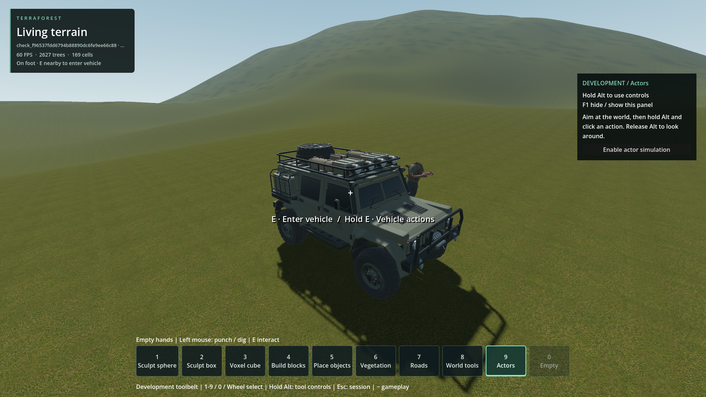

# Vehicle sinks into terrain on exit

- Status: Fixed for the reproduced exit failure / scoped engineering checks; user review pending.
- Updated: 2026-10-26. Script correction implemented after the separate diagnosis commit `f1446eb4`; native binaries unchanged.
- User review: User reported intermittent sinking, then authorized the repair after diagnosis. Corrected gameplay has not yet been reviewed by the user.
- Symptom: Exiting can drive the chassis below the surface, then leave it frozen there or falling until automatic reset.

## Implemented correction and verification

The accepted exit temporarily excludes only the exiting player/car collision pair.
The player keeps normal collision layers/masks for ground, objects and actors.
The exception expires by physics-frame count after the kinematic relocation has
completed, including exits initiated inside a physics callback. Rapid re-entry
refreshes the same owned transition; restore, removal and teardown clean it up.
Existing host-owned collision exceptions are preserved.

Parking now runs after the vehicle's physics callback and requires this tick's
successful wheel samples, support on both axles, low linear/angular velocity and
**0.25 seconds** of consecutive stable observations. Render updates cannot freeze
the car from seated readings. Loading holds and skipped contact passes reset the
quiet window. The session physics callback stops when no transition/coasting
work remains. Native suspension still samples/applies its forces once per tick.

| Final check | Result / retained evidence |
| --- | --- |
| 13 flat/slope/unequal-height support cases | No exit shove; includes rapid re-entry, loading holds, host-owned exceptions, removal/restore and actual walking into the parked car after contact resumes. [Receipt](logs/fix/fixture_run.json.gz), [measurements](logs/fix/fixture_measurements.json.gz) |
| 9 repeated real-world exits, generator 1 / seed 1703 | Three exits each at 0, 0.3 and 3 m/s; zero player/car contacts, maximum height loss under 8 mm, collision restored and car settles. [Receipt](logs/fix/world_default_run.json.gz), [measurements](logs/fix/world_default_measurements.json.gz) |
| 9 repeated real-world exits, generator 4 / seed 1703 | Same outcomes and height bound with the mountain/lake terrain preset. [Receipt](logs/fix/world_generator4_run.json.gz), [measurements](logs/fix/world_generator4_measurements.json.gz) |
| Existing world adapter, streaming, braking and persistence | Pass; braking has 24 assertions; disk persistence reopens an independent world instance. [Adapter](logs/fix/adapter_run.json.gz), [streaming](logs/fix/streaming_run.json.gz), [braking](logs/fix/braking_run.json.gz), [persistence](logs/fix/persistence_run.json.gz) |
| Actor exit occupancy and vehicle route invalidation | Pass after correcting an older fixture's two-exit assumption. [Receipt](logs/fix/actors_run.json.gz) |

The original actor fixture failed identically against the pre-fix car/session
scripts: it blocked two side positions, then incorrectly required all five exit
candidates to be unavailable. It now occupies each remaining supported candidate
before asserting refusal; actor collision and route invalidation assertions remain.
The [original failure](logs/fix/actor_old_fixture_failure_run.json.gz) and
[baseline failure](logs/fix/actor_baseline_old_fixture_failure_run.json.gz) are retained.
An initial baseline-copy harness doubled CRLF and could not parse; its failed
receipt/logs are also retained, followed by the normalized baseline check.
The first braking run executed all 24 checks successfully but its launcher was
given a 28-check completion string; that receipt is retained as a harness error,
and the rerun with the correct marker passes.

All gameplay checks use temporary or test-owned unique worlds. Existing player
saves are untouched. These are correctness checks, with no frame-rate guarantee.
[Source hashes](logs/fix/source_hashes.json) identify the corrected runtime/tests.



Actual corrected state after a stopped exit, temporary generator 4 / seed 1703,
Godot 4.7.2 Steam / Forward+ / 1920x1080. Foliage is hidden only for this capture;
the car pose is not replayed and no freeze is injected. Same camera arrangement
as the historical clear comparison, but a different terrain preset. Full-foliage
gameplay was also inspected: [capture](images/fixed-stopped-full-foliage.png).
The existing first-person character presentation is unchanged.


Actual final state after exiting at 3 m/s in the same fixture; foliage hidden for
capture. The car brakes and parks through the ordinary corrected host loop.

## Confirmed baseline mechanism

Before correction, `world_vehicle.update()` kept the player's disabled collision
body at the car's origin while seated. `exit_vehicle()` found a clear capsule
position beside the car, changed the player's scene position and immediately
restored collision without guarding the car/player pair.
The physics body's kinematic position still occupies the seated location for the
pending physics step. The car/player pair becomes active during that transition,
producing a severe contact instead of an ordinary stationary dismount.

In the generated-world stopped case, the immediate scene position was
`(797.2347,49.70772,1302.969)`, while the physics body remained at
`(800.0311,50.14341,1302.962)`. The next contact gave the previously stationary
car approximately **-32.6 m/s vertical velocity and 42.1 rad/s roll velocity**,
dropping its origin about 1.23 m immediately. It subsequently fell through the
surface until the existing below-world reset recovered it. No terrain edit is
needed: a static box floor reproduces the initial displacement too.

The engine-side behavior is consistent with [Godot 4.7 kinematic body source](https://github.com/godotengine/godot/blob/4.7-stable/modules/godot_physics_3d/godot_body_3d.cpp#L332):
kinematic transform changes queue a target, and integration derives velocity
from displacement divided by the physics timestep. Both recorded physics/scene
positions and the collision A/B controls support the diagnosis; it is not inferred
from the screenshot alone.

A second problem could preserve the bad pose. `world_vehicle.update()` parked a
coasting car when loaded-wheel counts and velocities appeared settled. On the
exit frame those readings could predate the contact. In the flat-floor reproduction
the car moved down **1.261 m**, then froze with the earlier four-wheel suspension
readings and zero velocity. Removing parking allowed the initial shove but did
not prevent it. This explains two observed outcomes, persistent burial and a
fall/reset, without treating parking as the source of the first contact.

## Baseline controlled comparisons (diagnosis commit `f1446eb4`)

Twelve fixture cases use unchanged production car/entry/exit code, the real
standing capsule dimensions, flat and 0.15-radian sloped static floors.

| Diagnostic variation | Result on both floors |
| --- | --- |
| Normal exit | Player contact; initial downward displacement over 1.1 m |
| Player collision disabled after exit | No player contact; height change under 0.1 mm |
| Keep physics at 120 Hz | Same initial shove; changing to 60 Hz is not required |
| Remove parking | Same initial shove; vehicle continues simulating |
| Force scene transform notification | Same initial shove; this alone does not synchronize the kinematic step |
| Exclude only the car/player pair through one physics step, then restore it | No contact or shove; ground collision stays enabled |

The last row is an **experimental control inside the probe**, not shipped behavior.
Wheel support rays recorded no player hits, separating chassis/player contact
from false wheel support.

Six integrated cases use the real temporary generated world, player controller,
streaming readiness, host process loop and E-key handler. Normal exits at
**0, 0.3 and 3 m/s** all recorded the player contact and downward failure. Matched
controls with player collision disabled recorded no contact; maximum vehicle
height loss was under **0.008 m**. Disabling the whole player's collision lets
the control player fall and is deliberately unsuitable as a gameplay fix.

Both final diagnostic runs completed with their expected defect/control outcomes
and no runtime errors. Their success means the defect was reproduced and isolated,
**not** that vehicle exits pass a corrected-behavior regression.

## Baseline images


Original user screenshot: HUD shows generated_world_v4 / seed 1703. Exact pose,
build and terrain-edit history are unknown. The cause of the visible depression
itself is unestablished; this diagnosis concerns vehicle penetration.


Engineering visualization: temporary default generator 1 / seed 1703, native
Godot 4.7.2 Steam debug libraries, Forward+, 1920x1080. After observation, the
first measured displaced car transform is replayed and frozen for a readable
capture; this is **not an uninterrupted post-exit screenshot**. Foliage is hidden
visually, while terrain/tree collision was active during observation. Player pose
and animation are from the later replay time. No production fix is present.


Same temporary fixture/camera, stopped control with player collision disabled.
Foliage hidden for the capture. Shows the stable vehicle height; not a proposed
player behavior. The initial tree-obstructed views remain in `images/` and are
marked rejected in [the provenance manifest](images/manifest.json).

## Baseline evidence and current regression commands

- [Fixture regression](../../tests/vehicle_exit_diagnosis.gd); original baseline [measurements](logs/vehicle_exit_diagnosis.json.gz), [run receipt](logs/fixture_run.json.gz), [console](logs/fixture_console.log.gz).
- [Integrated regression](../../tests/vehicle_exit_world_diagnosis.gd); original baseline [measurements](logs/vehicle_exit_world_diagnosis.json.gz), [run receipt](logs/world_run.json.gz), [console](logs/world_console.log.gz).
- [Production enter/exit and parking adapter](../../addons/vehicle_runtime/world_vehicle.gd).
- Both probes use disposable worlds/floors. No existing player save was opened or changed.
- Receipts preserve engine/test/native hashes, revision and dirty-tree metadata. Other chats were running unrelated work concurrently; these are correctness observations, not performance measurements.
- Godot generated the matching new script UIDs. The short editor scan reported pre-existing duplicate UIDs under `reports/rejected_ramp_20261025/snapshot` and scan cancellation on exit; [log](logs/uid-import.log). This is not a successful full project import claim.

The scripts now assert corrected behavior. The historical receipts above refer
to the diagnosis versions preserved at `f1446eb4`. Current commands, from the
project directory:

```powershell
python tools/run_godot_check.py vehicle_exit_diagnosis --headless --timeout 120 --require 'VEHICLE_EXIT_REGRESSION failures=0'
python tools/run_godot_check.py vehicle_exit_world_diagnosis --timeout 180 --require 'VEHICLE_EXIT_WORLD_REGRESSION failures=0'
```

## Remaining / resume here

- The bounded contact transition, fresh settling window and corrected-behavior
  regressions are implemented; the originally listed engineering gates above pass.
- The original saved depression/location has not been replayed. Unequal wheel
  supports and generated terrain are covered, but arbitrary excavations, fleet
  travel and extreme-speed dismounts are not qualified by these runs. Reopen with
  a failing pose or reproduction if sinking recurs.
- User review of ordinary exits in the existing world is pending. Preserve this
  scoped status until the user checks the original workflow; no claim that every
  terrain collision problem is resolved.
