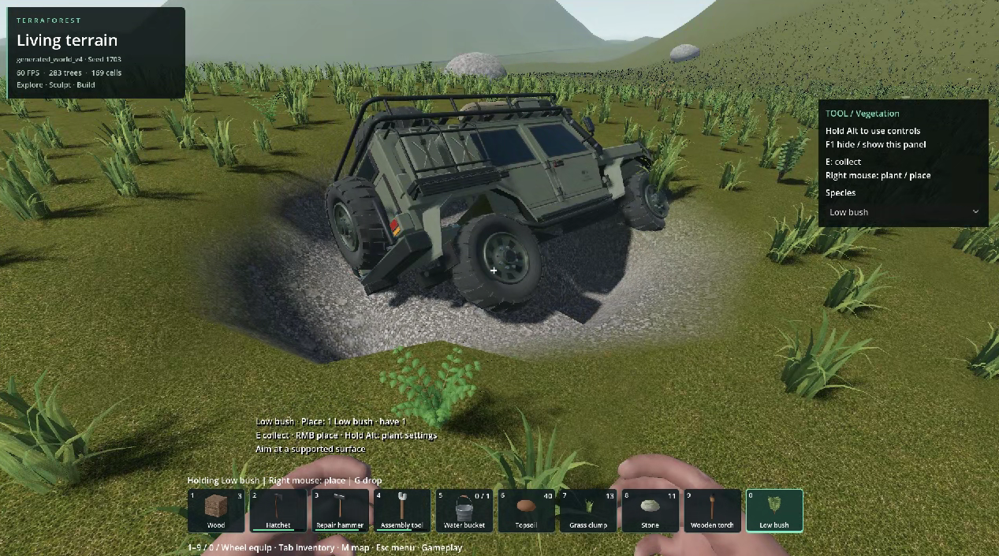
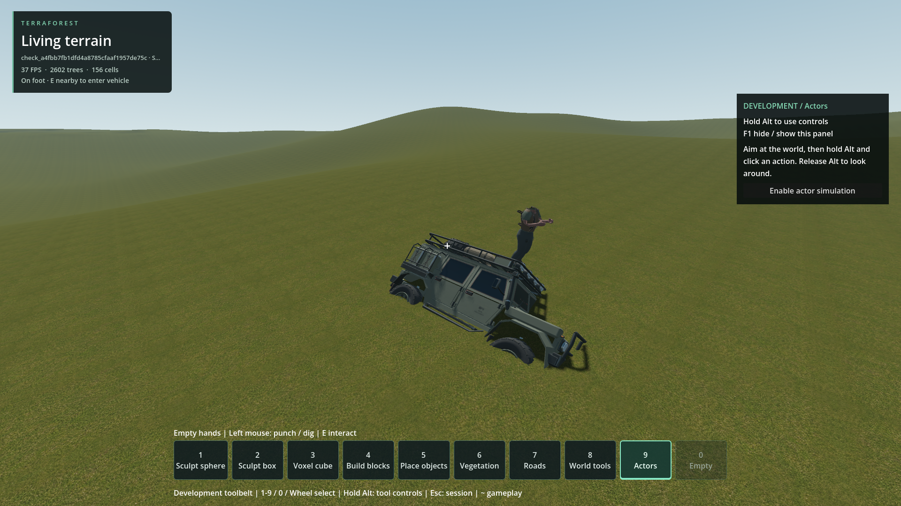
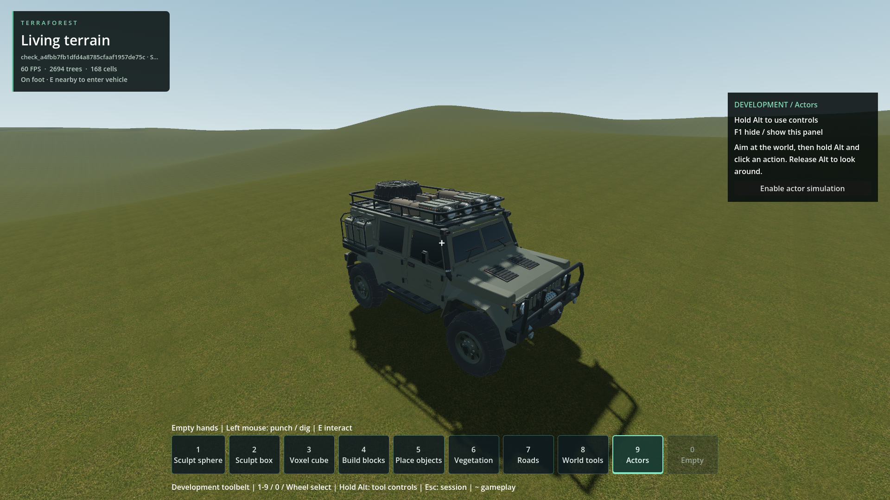

# Vehicle sinks into terrain on exit

- Status: Investigated / reproduced; production fix **not implemented**.
- Updated: 2026-10-26. Diagnosis uses the existing gameplay/native binaries.
- User review: User reports intermittent sinking on exit, including possible slow movement. User requested reproduction and diagnosis before fixes.
- Symptom: Exiting can drive the chassis below the surface, then leave it frozen there or falling until automatic reset.

## Confirmed mechanism

`world_vehicle.update()` keeps the player's disabled collision body at the car's
origin while seated. `exit_vehicle()` finds a clear capsule position beside the
car, changes the player's scene position and immediately restores collision.
The physics body's kinematic position still occupies the seated location for the
pending physics step. The car/player pair becomes active during that transition,
producing a severe contact instead of an ordinary stationary dismount.

In the generated-world stopped case, the immediate scene position was
`(797.2347,49.70772,1302.969)`, while the physics body remained at
`(800.0311,50.14341,1302.962)`. The next contact gave the previously stationary
car approximately **-32.6 m/s vertical velocity and 42.1 rad/s roll velocity**,
dropping its origin about 1.23 m immediately. It subsequently fell through the
surface until the existing below-world reset recovered it. No terrain edit is
needed: a static box floor reproduces the initial displacement too.

The engine-side behavior is consistent with [Godot 4.7 kinematic body source](https://github.com/godotengine/godot/blob/4.7-stable/modules/godot_physics_3d/godot_body_3d.cpp#L332):
kinematic transform changes queue a target, and integration derives velocity
from displacement divided by the physics timestep. Both recorded physics/scene
positions and the collision A/B controls support the diagnosis; it is not inferred
from the screenshot alone.

A second problem can preserve the bad pose. `world_vehicle.update()` parks a
coasting car when loaded-wheel counts and velocities appear settled. On the
exit frame those readings can predate the contact. In the flat-floor reproduction
the car moved down **1.261 m**, then froze with the earlier four-wheel suspension
readings and zero velocity. Removing parking allowed the initial shove but did
not prevent it. This explains two observed outcomes, persistent burial and a
fall/reset, without treating parking as the source of the first contact.

## Controlled comparisons

Twelve fixture cases use unchanged production car/entry/exit code, the real
standing capsule dimensions, flat and 0.15-radian sloped static floors.

| Diagnostic variation | Result on both floors |
| --- | --- |
| Normal exit | Player contact; initial downward displacement over 1.1 m |
| Player collision disabled after exit | No player contact; height change under 0.1 mm |
| Keep physics at 120 Hz | Same initial shove; changing to 60 Hz is not required |
| Remove parking | Same initial shove; vehicle continues simulating |
| Force scene transform notification | Same initial shove; this alone does not synchronize the kinematic step |
| Exclude only the car/player pair through one physics step, then restore it | No contact or shove; ground collision stays enabled |

The last row is an **experimental control inside the probe**, not shipped behavior.
Wheel support rays recorded no player hits, separating chassis/player contact
from false wheel support.

Six integrated cases use the real temporary generated world, player controller,
streaming readiness, host process loop and E-key handler. Normal exits at
**0, 0.3 and 3 m/s** all recorded the player contact and downward failure. Matched
controls with player collision disabled recorded no contact; maximum vehicle
height loss was under **0.008 m**. Disabling the whole player's collision lets
the control player fall and is deliberately unsuitable as a gameplay fix.

Both final diagnostic runs completed with their expected defect/control outcomes
and no runtime errors. Their success means the defect was reproduced and isolated,
**not** that vehicle exits pass a corrected-behavior regression.

## Images



Original user screenshot: HUD shows generated_world_v4 / seed 1703. Exact pose,
build and terrain-edit history are unknown. The cause of the visible depression
itself is unestablished; this diagnosis concerns vehicle penetration.



Engineering visualization: temporary default generator 1 / seed 1703, native
Godot 4.7.2 Steam debug libraries, Forward+, 1920x1080. After observation, the
first measured displaced car transform is replayed and frozen for a readable
capture; this is **not an uninterrupted post-exit screenshot**. Foliage is hidden
visually, while terrain/tree collision was active during observation. Player pose
and animation are from the later replay time. No production fix is present.



Same temporary fixture/camera, stopped control with player collision disabled.
Foliage hidden for the capture. Shows the stable vehicle height; not a proposed
player behavior. The initial tree-obstructed views remain in `images/` and are
marked rejected in [the provenance manifest](images/manifest.json).

## Evidence and reproduction

- [Fixture probe](../../tests/vehicle_exit_diagnosis.gd), [measurements](logs/vehicle_exit_diagnosis.json.gz), [run receipt](logs/fixture_run.json.gz), [console](logs/fixture_console.log.gz).
- [Integrated probe](../../tests/vehicle_exit_world_diagnosis.gd), [measurements](logs/vehicle_exit_world_diagnosis.json.gz), [run receipt](logs/world_run.json.gz), [console](logs/world_console.log.gz).
- [Production enter/exit and parking adapter](../../addons/vehicle_runtime/world_vehicle.gd).
- Both probes use disposable worlds/floors. No existing player save was opened or changed.
- Receipts preserve engine/test/native hashes, revision and dirty-tree metadata. Other chats were running unrelated work concurrently; these are correctness observations, not performance measurements.
- Godot generated the matching new script UIDs. The short editor scan reported pre-existing duplicate UIDs under `reports/rejected_ramp_20261025/snapshot` and scan cancellation on exit; [log](logs/uid-import.log). This is not a successful full project import claim.

From the project directory:

```powershell
python tools/run_godot_check.py vehicle_exit_diagnosis --headless --timeout 110 --require 'VEHICLE_EXIT_DIAGNOSIS failures=0'
python tools/run_godot_check.py vehicle_exit_world_diagnosis --timeout 180 --require 'VEHICLE_EXIT_WORLD_DIAGNOSIS failures=0'
```

## Remaining / resume here

1. Implement a bounded exit transition that restores car/player contact only
   after the player's physics body has reached the validated exit, preserving
   blocked-exit behavior and solid ground/other obstacles. The one-step pair
   exclusion is a diagnostic result, not yet a complete lifecycle design.
2. Require fresh post-integration support/motion observations before freezing a
   car; do not park from stale pre-impact readings.
3. Replace the known-defect expectations with corrected-behavior regressions;
   exercise repeated stationary/slow/moving exits, both sides, rough/dug terrain,
   blocked/unloaded exits, re-entry and save/restore, including actors.
4. Run the existing relevant vehicle/actor/streaming checks and inspect normal
   full-foliage gameplay captures. Obtain user visual review before resolution.

The original saved location has not been replayed, and the experiments do not
claim to explain every possible terrain collision failure. The confirmed exit
failure is sufficient to direct the first production repair.
