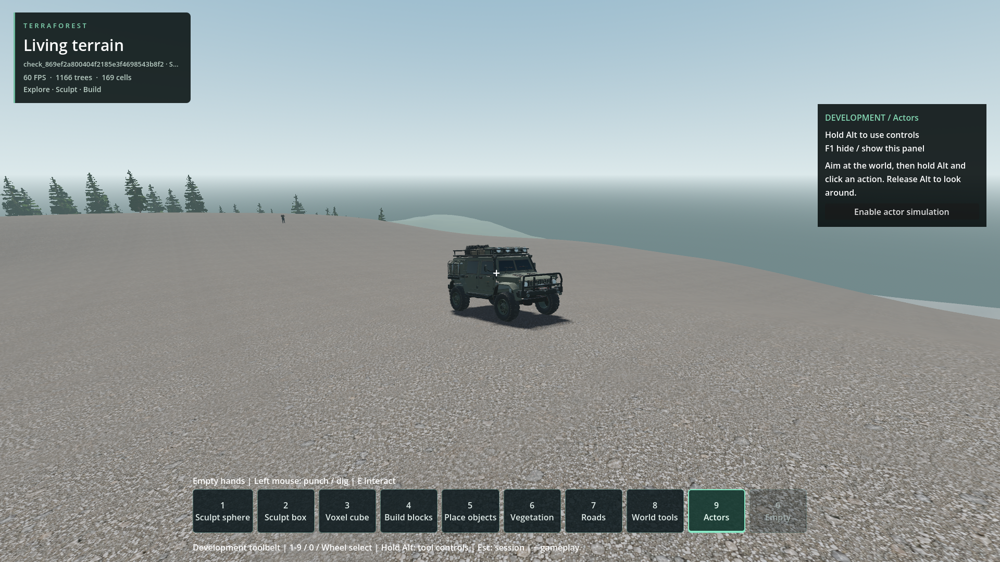
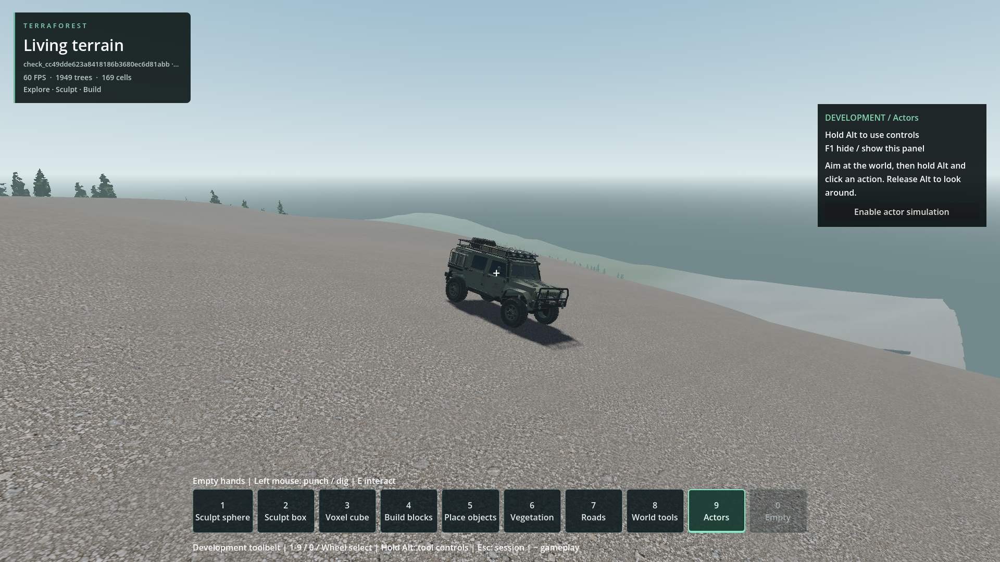

# Reported car return after a fast, distant drive and exit

- Status: **Unconfirmed / not reproduced on the current build.** This is not a resolution or a declaration that the report is false.
- Updated: 2026-10-26. Tested production source at `cb209aab`, including the prior exit-contact repair. No gameplay/native code changed for this investigation.
- User review: A modder reportedly drove far at "super speed," exited, and saw the car return to the same position. Exact build, modifications, speed and meaning of "same position" are unknown. User requested reproduction first.
- Symptom under investigation: Unexpected relocation to an earlier position after a high-speed exit.

## Qualified observations

The probes log per-physics-frame positions after exit, vehicle identity/state,
fleet record positions, and every production `reset_vehicle` / `restore_parked`
call through a diagnostic subclass that calls the unchanged implementation.
The rendered world probe uses the actual host, player controller, E handler,
vegetation/building collision and streaming. Existing player saves were not opened.

| Actual-world run | Drive / accepted exit | Observation |
| --- | --- | --- |
| Built-in W+Shift, single vehicle | Over 128 m; exit about 132 km/h | No return/reset/restore in the next 12 seconds |
| Built-in W+Shift, single vehicle | Over 384 m; exit about 183 km/h | No return/reset/restore in the next 12 seconds; ordinary braking/parking at the new location |
| Initial speed injected to 72 m/s, fleet enabled | Over 265 m; exit about 148 km/h after an airborne section | No return/reset/restore in the next 12 seconds; fleet record follows the new pose |
| Initial speed injected to 100 m/s, single vehicle | Over 192 m; exit about 349 km/h | No return/reset/restore in the next 12 seconds |

These distances are straight-line 3D displacement from departure, not path length.
Exit speeds are rigid-body velocity magnitudes; vertical velocity contributes
on hills/in flight. The fleet run's first exit attempts were unavailable while
airborne; it was accepted later. It is not a level-ground 72 m/s dismount test.
Largest observed per-tick displacement after the four valid world exits was
under 1.72 m, with no jump back to spawn or another logged position.

Seven additional resident-floor cases drove the actual vehicle at least 128 m
over box and segmented single-sided concave floors. Injected initial speeds were
30, 72 and 100 m/s on each floor. The built-in W+Shift case travelled about **883 m**
and exited at **60 m/s (216 km/h)**. All seven completed nine seconds of post-exit
observation with no reset/restore, player/chassis contacts or return.
Their headless fixture simulates foreground control capture, preserving native
boost blending when DummyDisplayServer cannot capture a mouse; it does not replace
the graphical actual-world checks. Injecting speed is a diagnostic control,
not evidence that the reporter used the same modification.



Actual final state after the 384 m stock-boost run: temporary generator 1 / seed
1703, Godot 4.7.2 Steam, Forward+, 1920x1080, diagnostic observer camera with normal
terrain/vegetation/structure collision. The car coasted forward and parked rather
than returning. This is a negative reproduction attempt, not a fix comparison.



Actual final state after the 192 m injected-speed run in the same temporary profile.
No pose replay or forced parking was used. Captures were inspected; other concurrent
work and frame caps mean these runs are not performance measurements.
[Image provenance](images/manifest.json).

## Source finding, not a confirmed cause

[The original vehicle controller](../../vehicle_demo/scripts/car.gd) automatically
calls `reset_vehicle()` if its Y position falls below **-10 m**. That method places
the car at its stored spawn transform plus 0.04 m upward. R can also request reset
while controls are enabled. Thus a return to spawn has an existing mechanism.
**No valid run here triggered it.** Its presence alone does not establish why the
modder's car returned, or that the reported position was the spawn point.

The [prior exit-contact defect](../vehicle-exit-terrain/README.md) is a separate,
reproduced problem already repaired at `cb209aab`. The reporter's build date is
unknown; this investigation does not assume they have that repair or attribute
their report to the older defect.

## Evidence and retained unsuccessful attempts

- [Resident probe](../../tests/vehicle_fast_exit_return.gd), [measurements](logs/vehicle_fast_exit_return.json.gz), [passing receipt](logs/resident_final_run.json.gz), [console](logs/resident_final_console.log.gz).
- [Actual-world probe](../../tests/vehicle_fast_exit_world.gd) and [observation-only car subclass](../../tests/vehicle_return_trace_car.gd).
- World receipts: [stock 128 m](logs/world_boost_128_run.json.gz), [stock 384 m](logs/world_boost_384_run.json.gz), [fleet](logs/world_fleet_72_run.json.gz), [injected 100 m/s](logs/world_injected_100_run.json.gz).
- World measurements: [stock 128 m](logs/vehicle_fast_exit_world_boost.json.gz), [stock 384 m](logs/vehicle_fast_exit_world_boost_d384.json.gz), [fleet](logs/vehicle_fast_exit_world_injected_72_d256_fleet.json.gz), [injected 100 m/s](logs/vehicle_fast_exit_world_injected_100_d192.json.gz).
- [Production and probe source hashes](logs/source_hashes.json); run receipts also retain engine/native/test hashes and launch arguments. The earlier 128 m world-probe version is preserved in [source](logs/vehicle_fast_exit_world_d128.gd.gz).
- A fleet attempt targeted 384 m while still above 50 m/s, but only reached about 309 m before slowing. It never attempted exit and is **inconclusive**, not evidence against the report: [receipt](logs/fleet_target_unmet_run.json.gz), [measurements](logs/vehicle_fast_exit_world_injected_72_d384_fleet.json.gz).
- Initial headless probe versions failed their intended input/speed contract. An incorrectly wound concave floor also provided no initial wheel support and generated below-world recoveries. Those are **invalid-fixture resets**, not a spontaneous reproduction of the report. [Cancelled first attempt](logs/invalid_headless_floor_attempt_run.json.gz), [invalid-floor attempt](logs/invalid_floor_attempt_run.json.gz).
- A later resident attempt drove correctly but its boost was repeatedly cleared by the headless focus gate and failed the requested 60 m/s target. It still recorded no post-exit returns: [receipt](logs/boost_target_unmet_attempt_run.json.gz). Final probe preserves boost through the simulated foreground gate and verifies initial wheel support and actual drive qualification.
- Godot generated the three matching script UIDs during the editor import. Both short/full import logs are retained. No native rebuild was required.

From the project directory, current diagnostic commands:

```powershell
python tools/run_godot_check.py vehicle_fast_exit_return --headless --timeout 140 --require 'VEHICLE_FAST_EXIT_DIAGNOSIS failures=0'
python tools/run_godot_check.py vehicle_fast_exit_world --timeout 150 --require 'VEHICLE_FAST_EXIT_WORLD_DIAGNOSIS failures=0'
python tools/run_godot_check.py vehicle_fast_exit_world --timeout 150 --require 'VEHICLE_FAST_EXIT_WORLD_DIAGNOSIS failures=0' -- --return-speed=72 --return-distance=256 --vehicle-fleet
python tools/run_godot_check.py vehicle_fast_exit_world --timeout 130 --require 'VEHICLE_FAST_EXIT_WORLD_DIAGNOSIS failures=0' -- --return-speed=100 --return-distance=192
```

Passing means a diagnostic completed. Always inspect `long_fast_drive_qualified`,
`exit_accepted`, `returned_to_spawn`, events and samples; an unmet target is not a
negative reproduction. These are finite attempts, not universal no-return assertions.

## Remaining / resume here

The report remains open because the exact modded workflow is unavailable, not
because a correction has been partially implemented. No speculative fix was made.
Resume when the reporter can supply the build/commit, modification and speed
setting, world/route, steps after exiting, and whether the destination is the
original spawn point, a last saved point or the exit position. A short recording
or copied save would help identify the route, but is not yet available.

Replay that configuration with the existing probes, including return after
walking away/reloading if those were part of the actual sequence. Closure requires
a qualified trace that either reproduces and explains the relocation or a matching
retest with the reporter; current negative attempts do not close it.
