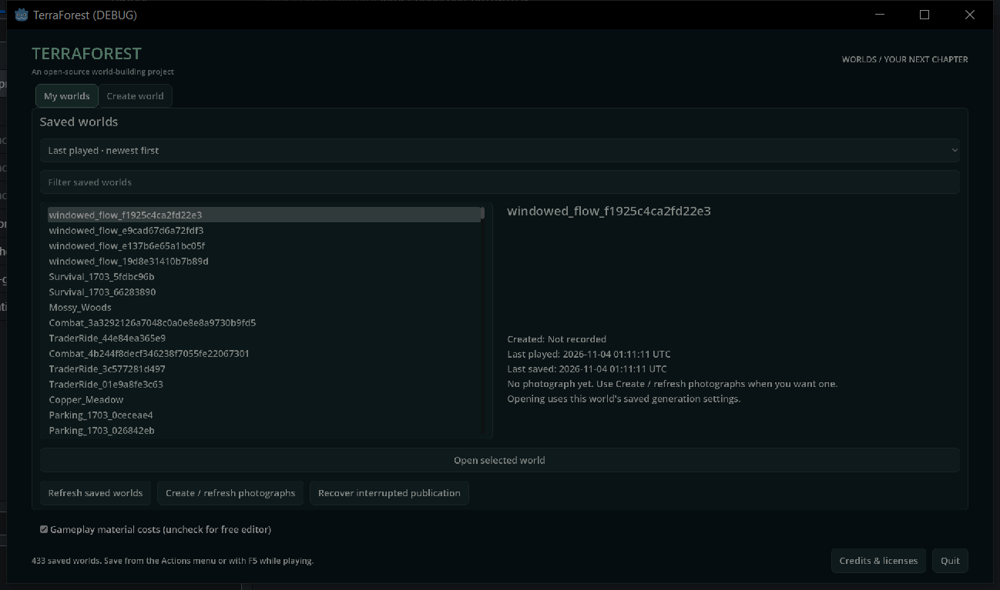
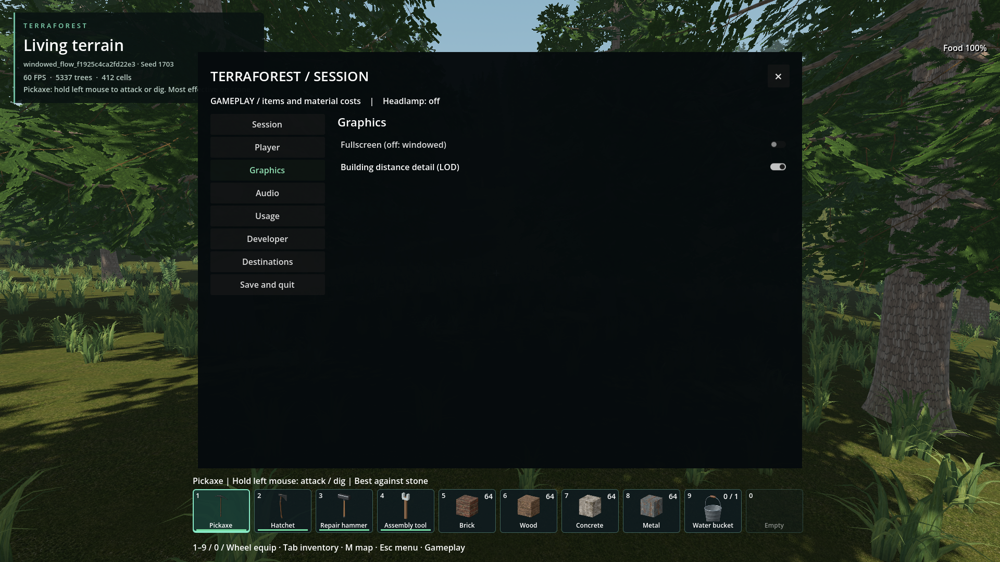
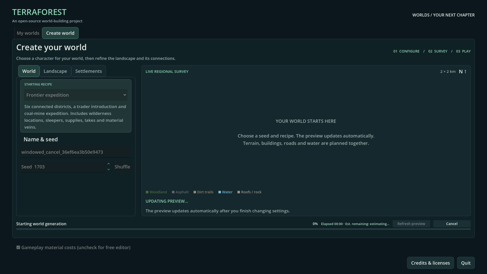

# Windowed mode across stages

- Status: Installed / scoped source and actual-executable checks pass.
- Updated: 2026-11-04. User review: Pending.
- Symptom: A saved windowed choice was ignored by the browser and forced-fullscreen launch paths; F11 was owned only by gameplay.

## Changes and verification

The persistent `WorldSession` host now applies the shared preference before the
initial scene, after scene changes and on focus return. It handles F11 before
scene input, including generation/loading and embedded dialogs. Graphics choices
persist even in temporary worlds; explicitly non-persisted API choices survive
scene changes for the current process. The boot window is decorated 1280x720,
so saved windowed launches do not begin with a fullscreen splash. Browser, normal
Python/desktop launchers and world/photograph/generation command construction no
longer unconditionally force fullscreen. Fullscreen still defaults on when no
preference exists. Already-windowed geometry and minimized windows are preserved.

- `tests/window_modes.gd`: repeated fullscreen/windowed cycles, same native handle,
  saved and session-only choices, and idempotent application pass.
- `tests/windowed_stages.gd`: 22 source assertions pass, 1,515 observed frames,
  zero windowed-mode violations across browser, native generation/cancellation,
  resource loading, gameplay, embedded confirmation, save/return and reopening.
  F11, held-key suppression, Graphics and focus recovery also pass.
  [Source run](../../reports/checks/20261104T010843706484Z/run.json),
  [console](../../reports/checks/20261104T010843706484Z/console.log).
- Actual main executable with rebuilt PCK: the same 22 assertions pass across
  1,464 observed frames with zero windowed-mode violations. All 14 native DLLs
  match. Fresh source and packed starts have 241/239 native decorated-window
  samples with zero undecorated samples; the player graphics file hash is unchanged.
  [Pack run](../../reports/windowed_pack/run.json),
  [fresh-start observations](../../reports/windowed_boot/result.json), and
  [retained verification identities](verification.json). Installed PCK SHA-256:
  `b2cf4535e0727de402c4e539e257dbc87b2eb44b9f771e3ca5f2e8f7ced56cb5`.
- Export notice, startup index, authored asset, building contract/catalog, release
  and packaged smoke/house-light gates pass. Ten launcher/process-runner tests pass.
- F11 also synchronizes an already-open Graphics checkbox. The first clean
  source run before that addition passed 20 assertions/1,509 observed frames
  ([earlier run](../../reports/checks/20261104T010619615964Z/run.json)).
- Startup dependency index refreshed for the changed command builders; regeneration
  also includes previously stale committed trade/storage dependency edges.
- Original AI-assisted implementation and test code for this request; new standalone
  code is 0BSD. No external source, dependency or asset was imported.

## Images

Actual main executable and rebuilt PCK, saved windowed startup; visible OS title
bar and minimize/maximize/close controls. Agent inspected, user review pending.

Isolated woodland seed 1703, Graphics off after F11 and toggle round trips.
This is the 1920x1080 render viewport, not the physical window dimensions.

Source seed 1703, native generation before cancellation; render viewport only.
DisplayServer mode, decorations and native handle are observed by the test.
Hashes and capture origins are in `images/manifest.json`; inherited project asset
notices still apply.

## Remaining / resume here

Source/package qualification and agent image inspection pass within the scopes
above. User desktop review remains separate from the automated checks. The existing Windows decorated
maximized fallback remains for the engine fullscreen-exit anomaly. No monitor
tearing, multi-monitor or other-hardware acceptance claim is made.

The first test attempt passed its window checks but failed strict diagnostics:
a missing test-lambda null guard and the pre-existing `DirAccess.include_hidden`
cache API error. The guard is fixed; the presentation fixture now disables
derived caching. [Retained first run](../../reports/checks/20261104T010509177703Z/console.log).
Cache API compatibility remains separate work; a normal cached run reporting that
error is the return trigger for that investigation.

## Reproduce

Turn Fullscreen off in ESC > Graphics, then save/return, open another world,
generate/cancel, or restart via `Worlds.cmd`/the main executable. The browser,
loading screens and gameplay must remain decorated/windowed. F11 must switch once
per press on each stage, and the next launch must retain the selection.

For isolated checks run `python tools/run_godot_check.py windowed_stages --timeout
240 --require "WINDOWED_STAGES checks=22 failures=0"`. The test uses a unique
graphics configuration and generated worlds; it does not rewrite player saves.
