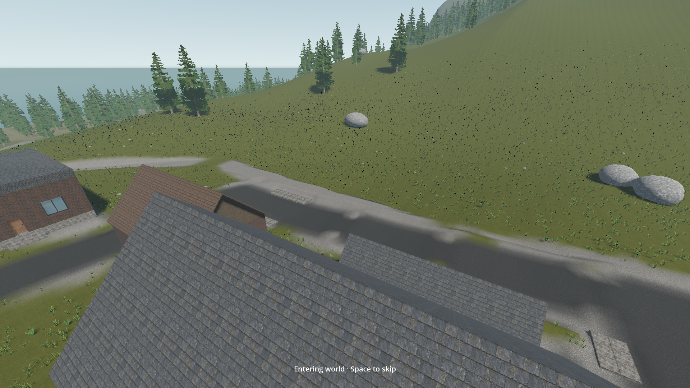
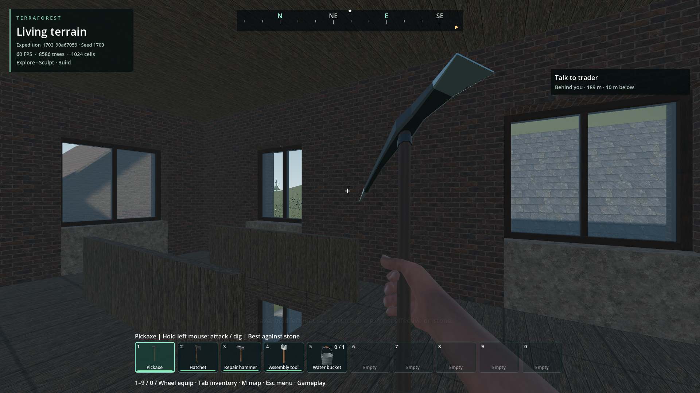
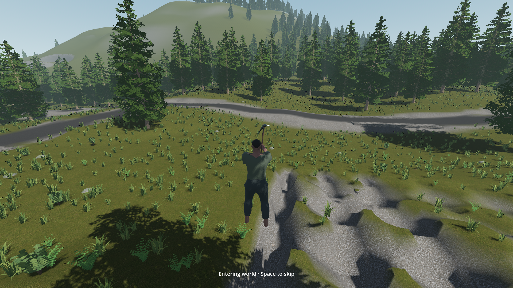

# World entry fly-in

- Status: Fixed for reproduced entry/waking cases; installed executable passes 75 checks. User motion review and older performance work remain open.
- Original implementation: `d34557e0`; original integration: `4fbca4e9`. Entry/waking correction accompanies this 2026-11-02 update.
- Updated: 2026-11-02.
- User review: Enabled-by-default preference approved; motion and images not reviewed.
- Request: An optional three-second descent from above the world into the current player's first-person camera after world loading.

## Behavior

ESC → Player → **World entry fly-in (3 seconds)**. Enabled by default, saved in
`user://player_view.cfg` independently of world saves. The next ordinary world load
runs the entry after terrain, forest, buildings and physical spawn are ready.
Space skips the flight and still starts pending waking; Escape opens the ordinary
pause menu, deferring pending waking until it closes. Flight pauses on focus loss.
Indoor/cave and submerged arrivals approach above the exterior surface, fade out,
then reveal the saved character view. Enabling the setting mid-session takes effect
at the next world load. Respawn retains its direct wake-up sequence.
The entry ends in first person for that session; it does not erase a stored
third-person preference. Disable entry to retain that preference on every load.

A temporary camera renders the actual world and current player model. It never
moves the eye, body, saved position, physical focus, mouse or OS focus. World
interaction, player movement, survival and nearby actor simulation are suspended
for the entry. Near collision/ecology stay at the player; remote rendering uses
the existing overview path. The camera is freed and its processing stops afterward.
Tools/offscreen/temporary diagnostics opt out unless given `--entry-fly-in`.

## Missing entry / waking correction — 2026-11-02

The new upstairs introduction set `wake_pending`, and `begin()` returned directly
to waking before creating the fly-in camera. Subsequent indoor reloads also bypassed
the flight at the roof guard. The user explicitly requested fly-in followed by
waking. The revised sequence uses a bounded top-down exterior roof query and a
fade into the saved eye, then consumes waking once. Camera progress measures
visible frame time, so focus loss and loading stalls cannot consume it unseen.

Earlier failed checks remain in `reports/entry_fly_in_pack`: async startup made
the old harness inspect unbuilt menu controls and change offscreen eligibility
before later saved-pose rearming. The harness now waits for the actual entry owner,
verifies ordinary eligibility, and opts its later offscreen rearming in explicitly.
An isolated repeat-wake test also needed to arm a new entry before testing Space.
These failures are retained rather than counted as passing feature evidence.

Final installed check: **75/75** across browser entry (31), populated read-only
reload (30), and the actual upstairs room (14). [Receipt](../../reports/entry_fly_in_pack/20261102T195333848002Z/run.json).
Pack SHA-256: `cb2b9313a8406ecdfa17ab73aa48ad86907d946fda98d32f2c20e7838eb58e00`;
all 14 external native libraries match. Source waking isolation also passes 25/25.
The upstairs test re-arms only the in-memory waking bit after genuine restoration;
previously played saves had consumed it. An earlier copy-only fixture failed because
regional archives depend on external owner files; it was discarded and the verified
test copy removed. Original save hashes remain unchanged.


Actual saved upstairs building: the camera remains above its roof before the fade.


Same saved position after one fly-in and one wake-up, with the selected tool returned.
These images were inspected; motion approval and foreground performance are separate.

## Verification / images

Source parser/import pass. Existing populated world: **24 checks pass**
([receipt](../../reports/checks/20261101T162215549658Z/run.json)). Ordinary browser
launch of a new owned Original woodland / seed 1703 world: **25 checks pass**,
without an entry diagnostic flag
([receipt](../../reports/checks/20261101T162329590648Z/run.json)). Checks cover
loading/spawn readiness, real viewport, whole-world visual coverage, unchanged body,
eye, save pose, physical focus and building residency; skip/Escape/focus loss;
roof fallback; persistent setting; restoration of first-person/third-person/overview.
The read-only populated fixture remains byte-identical. Sampled process memory and
VRAM stayed within project budgets. The existing renderer's LOD/performance limits
remain tracked in [world overview](../world-overview/README.md).

The first run failed its roof query and a focus assertion
([retained failed receipt](../../reports/checks/20261101T161505969845Z/run.json)).
The roof ray exceeded the native 256 m cap; two bounded segments fix it. The test
compared physical focus with the body's post-step position instead of its actual
initial focus. Corrected checks pass. Initial image inspection also rejected early
camera rotation that lost the character; the revised shoulder approach retains it.
Initial capture PNG writes stalled the animation under test; the recording fixture
now buffers screenshots for compression after the fly-in. These old capture timings
are not clean runtime performance measurements. Final buffered package recording
and exact installed verification are now retained below.


Revised source, existing Exploration world / seed 1703, full terrain and forest.


Revised source, same saved player, before the head handoff. These screenshots were
inspected; user motion and visual approval remain pending.


Earlier rejected source: rotation lost the player. Preserved for comparison.
Capture provenance and hashes: [manifest](images/manifest.json).

The check is `tests/entry_fly_in.gd`. `--entry-slot=<owned-fixture>` opens it read-only;
`--entry-browser` exercises ordinary persistent browser launch with a new unique
owned slot. Its ready callback contains automation mouse ownership only after the
ordinary default preference/eligibility path has executed. It never changes real
camera preferences. New implementation and check are original AI-assisted 0BSD;
no imported art or code was added.

## Clean source frame-time measurement — 2026-11-01

The first no-capture measurement is **not a locked-60-FPS qualification**.
RTX 4050 Laptop GPU, 1920×1080 Forward+, 60 FPS cap, VSync enabled, unchanged
Legion Quiet Mode; existing Exploration / seed 1703 with 64 terrain roots and
1,024 forest owners, normal actors and vehicle-fleet flags. No competing game
render ran. No screenshots, readback, compression or disk writes occurred during
sampling. The read-only saved world remained unchanged.

| Phase | Average FPS | 95th percentile frame | Worst frame |
| --- | ---: | ---: | ---: |
| Full initial fly-in (3.004 s) | 53.27 | 27.12 ms | 31.07 ms |
| First five seconds after entry | 53.72 | 22.26 ms | **143.33 ms** |
| Next five seconds in first person | 59.21 | 18.41 ms | 33.44 ms |

The flight had no frames above 33.34 ms. The 143.33 ms stall was the **first
first-person frame**, with measured GPU 17.36 ms and render-thread CPU 2.46 ms;
its cause is not established by those counters. Do not call the handoff smooth
or attribute the stall solely to the camera without a baseline/profile. The warm
attempt ended early (2.345 s sampled), so its 55.02 FPS average does not qualify a
matched full three-second replay. Sampled peak process commit was 3.36 GiB and
dedicated VRAM 1.39 GiB, within project limits.

[Raw timings](../../reports/entry_fly_in/performance_clean/timing.json) ·
[run receipt](../../reports/checks/20261101T164831640512Z/run.json).
Harness: `tests/entry_fly_in_performance.gd` (original AI-assisted 0BSD). This run
used the automation/offscreen ownership guard and did not establish actual OS
foreground presentation. The harness now records foreground-frame counts and
whether each attempt completed three seconds; that metadata enhancement awaits
the next run. Engine validity is separate from performance acceptance.

Remaining: repeat on the coordinated installed build, measure a no-entry baseline
at the same spawn, and profile/correct any reproducible handoff stall. Retain
60 FPS/VSync/Quiet Mode, scene quality and whole-world coverage. Broader gameplay
performance remains in [runtime performance](../runtime-performance/README.md).

## Requested performance follow-up — 2026-11-01

The user explicitly wants to return to the rendering cost and optimization
opportunities. Keep this work open; the current FPS measurements and functional
checks are not performance approval. Optimization is deferred for a dedicated
profiling pass after the coordinated build is stable. This does not cancel the
separate installed feature/browser/visual checks, completed below.

Resume from the existing raw timings and fixture, with no competing game renders:

1. Compare entry enabled/disabled at the same saved spawn in the installed build;
   distinguish first-load work, warmed rendering and the first-person handoff.
2. Attribute main-thread, render-thread and GPU costs. Investigate the 143 ms first
   first-person frame separately from the aerial view's sustained frame cost.
3. Evaluate evidence-supported changes to LOD/culling, distant submission and
   transition resource preparation. These are investigation candidates, not known
   causes or promised fixes. Preserve actual world coverage, terrain/building
   quality, player appearance, collision behavior and responsiveness.
4. Keep 1080p, the 60 FPS cap, VSync and Quiet Mode fixed for before/after evidence.
   Report averages, p95/p99, worst frames and hitch counts; capture visual review
   separately so image readback/compression cannot contaminate timing. Close only
   with measured improvement, the handoff stall addressed or explicitly attributed,
   and matching visual/gameplay review. Averages alone cannot establish smoothness.

Return trigger: the stable installed build and a dedicated performance pass/user
request. Runtime optimization is not being added to the current integration freeze.

## Frozen package qualification — 2026-11-01

Explicit PCK browser/default entry passes **25 checks** and the populated read-only
world passes **24 checks**, including unchanged source-save hash. Receipt in main:
`reports/entry_fly_in_pack/20261101T170600240310Z/run.json`. The package SHA-256 is
`d7b203e3062724747406624fcc2876b95f0937d18aa0dea4f095fa8f4ea078be`.
All 14 native libraries matched that package at test launch. The driver used the
Steam Godot 4.7.2 executable, not the separately hashed installed TerraForest.exe;
this is package verification, not exact executable qualification.

Aerial, descent, shoulder approach and restored first-person images were inspected.
Buffered populated capture covers the complete 3.115-second entry; browser entry
lasted 3.010 seconds. These captures still perform GPU readback and are **not clean
performance samples**. Raw frames/timestamps remain beside the receipt. Human motion
review and the separately requested performance follow-up remain open.

Retained failed launch: `reports/checks/20261101T170350930985Z/run.json` used only
`--godot TerraForest.exe`, so `--path` resolved mutable source and hit the unbuilt
vehicle class before camera startup. The replacement runner explicitly sets the
PCK, dist directory, external driver and installed executable. Its attempted exact
executable rerun stopped before starting Godot because source/dist native parity
had changed during concurrent work. No player save or preference was changed.

## Exact installed-executable qualification — 2026-11-01

The actual user-owned `TerraForest.exe`, explicit installed PCK/dist and external
check driver pass **25 ordinary-browser checks plus 24 populated-world checks**.
The populated fixture `Exploration_1703_8f8d4c8f` remains byte-identical. All 14
native libraries match the coordinated export. This closes the earlier engine and
build-parity dependency; the prior failed and package-only receipts remain above.
[Installed receipt](../../reports/entry_fly_in_pack/20261101T183739770167Z/run.json).

- Engine SHA-256: `981c1a194797a3ebb3153b5e5ece7bcfc6573e874f4cd6250ed120d309b511a5`.
- PCK SHA-256: `4295d8f9717cda70175cba36671fc10b259f39e0b8b6454f2fed6211d3a14afe`.
- Complete browser entry: 3.015 s; populated entry: 3.078 s.
- Sampled process commit and dedicated VRAM stayed within project budgets.



Installed populated world, current player visible before first-person handoff.
Aerial, approach and first-person frames were inspected. The complete populated
recording retains 65 buffered frames with original timestamps, encoded to 960×540
at 30 FPS, followed by a 0.75-second first-person hold:
[installed entry motion](images/installed-entry.mp4).

The driver ran passive off-desktop 1080p windows with 60 FPS/VSync and unchanged
Quiet Mode during a reserved serial test window. Captures include GPU readback;
their frame timings are **not performance qualification**. Human motion approval
and foreground presentation remain distinct. Encoding uses existing external
FFmpeg 9.0.2; no runtime dependency or imported game asset was added.

## Remaining / resume here

Scoped installed feature verification is complete. User motion/visual review and
the explicitly deferred profiling/optimization pass remain open. Resume performance
work from the clean source measurement and the four-step follow-up above: obtain a
matched installed on/off baseline, attribute sustained rendering and the 143 ms
handoff stall, preserve quality and fixed power/frame settings, and verify actual
foreground presentation. Do not infer performance acceptance from captured motion.

For a future coordinated package regression check:

```powershell
python TerraForest/tools/check_entry_fly_in_pack.py --project "C:/Users/windows10/Documents/ChatGPT/Godot Terrain/TerraForest"
```
