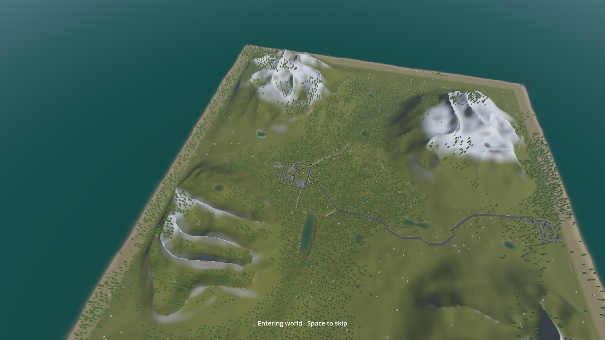
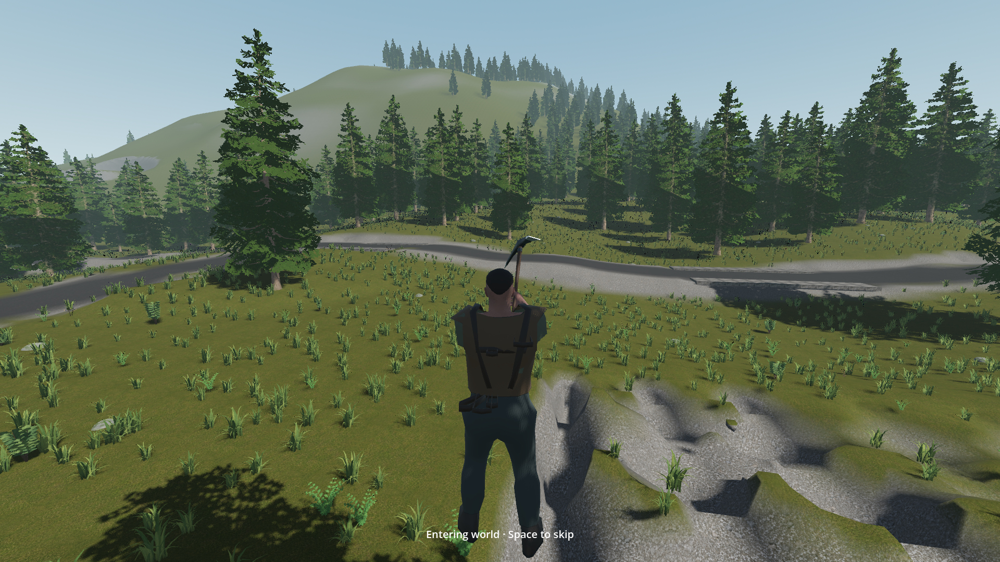
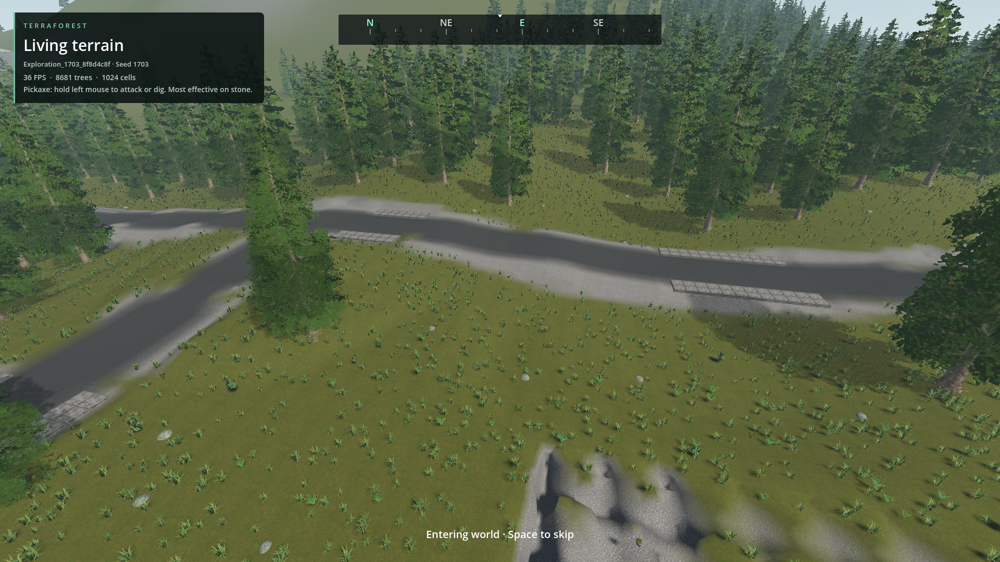

# World entry fly-in

- Status: Integrated in main source; combined installed verification pending.
- Source: `d34557e0`; main integration: `4fbca4e9`.
- Updated: 2026-11-01.
- User review: Enabled-by-default preference approved; motion and images not reviewed.
- Request: An optional three-second descent from above the world into the current player's first-person camera after world loading.

## Behavior

ESC → Player → **World entry fly-in (3 seconds)**. Enabled by default, saved in
`user://player_view.cfg` independently of world saves. The next ordinary world load
runs the entry after terrain, forest, buildings and physical spawn are ready.
Space skips; Escape ends the entry and opens the ordinary pause menu. Opening
inventory/map or losing focus also ends it. Indoor/cave and submerged spawns enter
directly. Enabling the setting mid-session takes effect at the next world load.
The entry ends in first person for that session; it does not erase a stored
third-person preference. Disable entry to retain that preference on every load.

A temporary camera renders the actual world and current player model. It never
moves the eye, body, saved position, physical focus, mouse or OS focus. World
interaction, player movement, survival and nearby actor simulation are suspended
for the entry. Near collision/ecology stay at the player; remote rendering uses
the existing overview path. The camera is freed and its processing stops afterward.
Tools/offscreen/temporary diagnostics opt out unless given `--entry-fly-in`.

## Verification / images

Source parser/import pass. Existing populated world: **24 checks pass**
([receipt](../../reports/checks/20261101T162215549658Z/run.json)). Ordinary browser
launch of a new owned Original woodland / seed 1703 world: **25 checks pass**,
without an entry diagnostic flag
([receipt](../../reports/checks/20261101T162329590648Z/run.json)). Checks cover
loading/spawn readiness, real viewport, whole-world visual coverage, unchanged body,
eye, save pose, physical focus and building residency; skip/Escape/focus loss;
roof fallback; persistent setting; restoration of first-person/third-person/overview.
The read-only populated fixture remains byte-identical. Sampled process memory and
VRAM stayed within project budgets. The existing renderer's LOD/performance limits
remain tracked in [world overview](../world-overview/README.md).

The first run failed its roof query and a focus assertion
([retained failed receipt](../../reports/checks/20261101T161505969845Z/run.json)).
The roof ray exceeded the native 256 m cap; two bounded segments fix it. The test
compared physical focus with the body's post-step position instead of its actual
initial focus. Corrected checks pass. Initial image inspection also rejected early
camera rotation that lost the character; the revised shoulder approach retains it.
Initial capture PNG writes stalled the animation under test; the recording fixture
now buffers screenshots for compression after the fly-in. These old capture timings
are not clean runtime performance measurements. Final buffered package recording
and installed verification remain required.



Revised source, existing Exploration world / seed 1703, full terrain and forest.



Revised source, same saved player, before the head handoff. These screenshots were
inspected; user motion and visual approval remain pending.



Earlier rejected source: rotation lost the player. Preserved for comparison.
Capture provenance and hashes: [manifest](images/manifest.json).

The check is `tests/entry_fly_in.gd`. `--entry-slot=<owned-fixture>` opens it read-only;
`--entry-browser` exercises ordinary persistent browser launch with a new unique
owned slot. Its ready callback contains automation mouse ownership only after the
ordinary default preference/eligibility path has executed. It never changes real
camera preferences. New implementation and check are original AI-assisted 0BSD;
no imported art or code was added.

## Clean source frame-time measurement — 2026-11-01

The first no-capture measurement is **not a locked-60-FPS qualification**.
RTX 4050 Laptop GPU, 1920×1080 Forward+, 60 FPS cap, VSync enabled, unchanged
Legion Quiet Mode; existing Exploration / seed 1703 with 64 terrain roots and
1,024 forest owners, normal actors and vehicle-fleet flags. No competing game
render ran. No screenshots, readback, compression or disk writes occurred during
sampling. The read-only saved world remained unchanged.

| Phase | Average FPS | 95th percentile frame | Worst frame |
| --- | ---: | ---: | ---: |
| Full initial fly-in (3.004 s) | 53.27 | 27.12 ms | 31.07 ms |
| First five seconds after entry | 53.72 | 22.26 ms | **143.33 ms** |
| Next five seconds in first person | 59.21 | 18.41 ms | 33.44 ms |

The flight had no frames above 33.34 ms. The 143.33 ms stall was the **first
first-person frame**, with measured GPU 17.36 ms and render-thread CPU 2.46 ms;
its cause is not established by those counters. Do not call the handoff smooth
or attribute the stall solely to the camera without a baseline/profile. The warm
attempt ended early (2.345 s sampled), so its 55.02 FPS average does not qualify a
matched full three-second replay. Sampled peak process commit was 3.36 GiB and
dedicated VRAM 1.39 GiB, within project limits.

[Raw timings](../../reports/entry_fly_in/performance_clean/timing.json) ·
[run receipt](../../reports/checks/20261101T164831640512Z/run.json).
Harness: `tests/entry_fly_in_performance.gd` (original AI-assisted 0BSD). This run
used the automation/offscreen ownership guard and did not establish actual OS
foreground presentation. The harness now records foreground-frame counts and
whether each attempt completed three seconds; that metadata enhancement awaits
the next run. Engine validity is separate from performance acceptance.

Remaining: repeat on the coordinated installed build, measure a no-entry baseline
at the same spawn, and profile/correct any reproducible handoff stall. Retain
60 FPS/VSync/Quiet Mode, scene quality and whole-world coverage. Broader gameplay
performance remains in [runtime performance](../runtime-performance/README.md).

## Requested performance follow-up — 2026-11-01

The user explicitly wants to return to the rendering cost and optimization
opportunities. Keep this work open; the current FPS measurements and functional
checks are not performance approval. Optimization is deferred for a dedicated
profiling pass after the coordinated build is stable. This does not cancel the
separately pending installed feature/browser/visual checks.

Resume from the existing raw timings and fixture, with no competing game renders:

1. Compare entry enabled/disabled at the same saved spawn in the installed build;
   distinguish first-load work, warmed rendering and the first-person handoff.
2. Attribute main-thread, render-thread and GPU costs. Investigate the 143 ms first
   first-person frame separately from the aerial view's sustained frame cost.
3. Evaluate evidence-supported changes to LOD/culling, distant submission and
   transition resource preparation. These are investigation candidates, not known
   causes or promised fixes. Preserve actual world coverage, terrain/building
   quality, player appearance, collision behavior and responsiveness.
4. Keep 1080p, the 60 FPS cap, VSync and Quiet Mode fixed for before/after evidence.
   Report averages, p95/p99, worst frames and hitch counts; capture visual review
   separately so image readback/compression cannot contaminate timing. Close only
   with measured improvement, the handoff stall addressed or explicitly attributed,
   and matching visual/gameplay review. Averages alone cannot establish smoothness.

Return trigger: the stable installed build and a dedicated performance pass/user
request. Runtime optimization is not being added to the current integration freeze.

## Remaining / resume here

Main source integration is complete (`4fbca4e9`). The installed executable still
requires the coordinated export: new starter-clothing/loot work and vehicle road
travel are active in main. “Merge terrain and forest addons” owns that export and
has been asked to wake this camera chat with the installed revision/PCK milestone
and a released render window. Do not overwrite their working source or install an
older package. No additional camera implementation is waiting on those features.

Resume with actual-main-executable checks from the main checkout:

```powershell
python TerraForest/tools/run_godot_check.py entry_fly_in --godot "C:/Users/windows10/Documents/ChatGPT/Godot Terrain/TerraForest/TerraForest.exe" --require 'failures=0' --timeout 180 -- --entry-browser --entry-output=res://reports/entry_fly_in/installed_browser
python TerraForest/tools/run_godot_check.py entry_fly_in --godot "C:/Users/windows10/Documents/ChatGPT/Godot Terrain/TerraForest/TerraForest.exe" --require 'failures=0' --timeout 180 -- --entry-slot=Exploration_1703_8f8d4c8f --entry-video --entry-output=res://reports/entry_fly_in/installed_populated
```

First confirm installed PCK and native DLLs match the coordinated source milestone.
Inspect the buffered motion/frames, retain receipt and provenance, then update this
tracker/index/foundation status together. These steps are required to close installed
qualification. User motion/visual approval is a separate remaining review.
