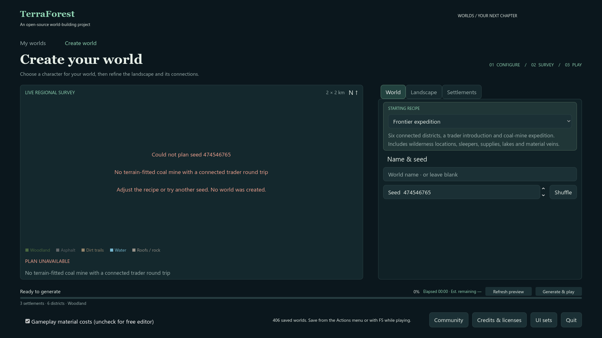
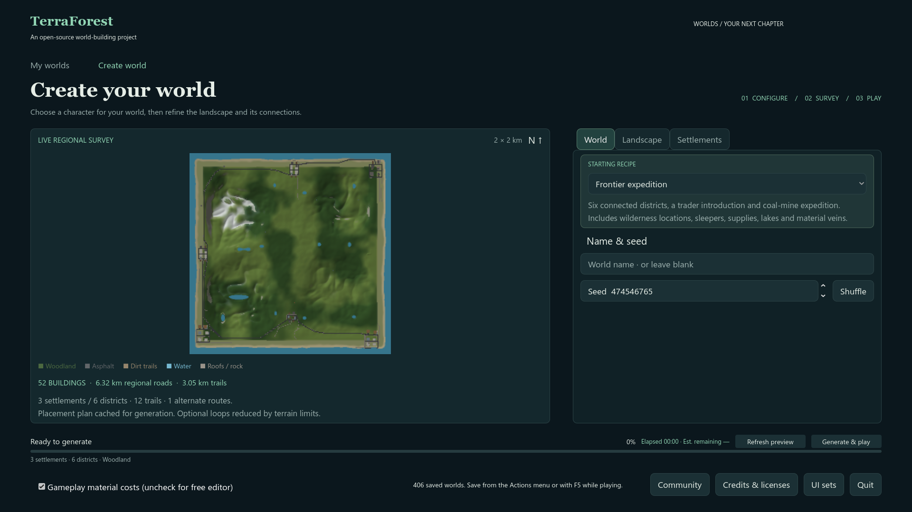
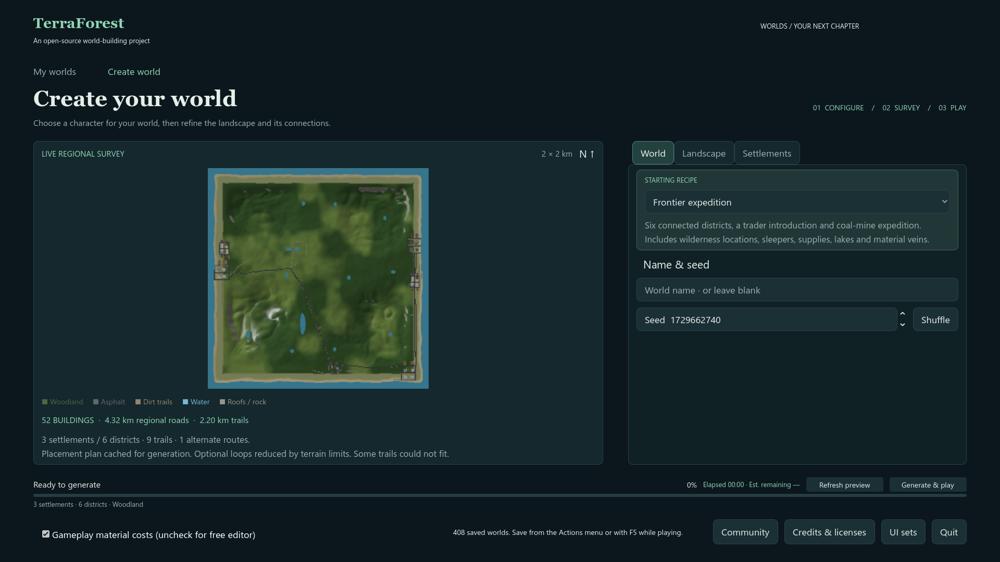
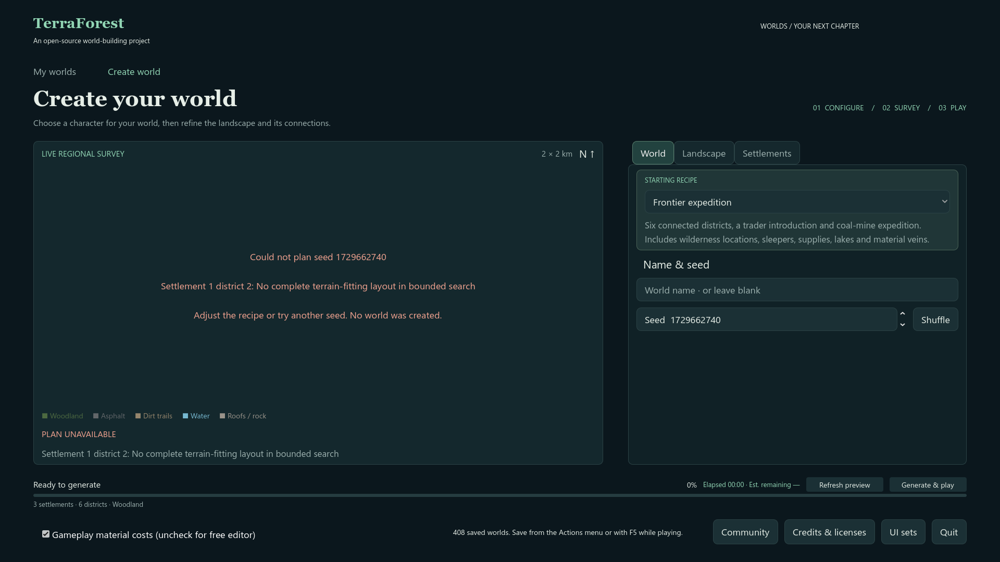
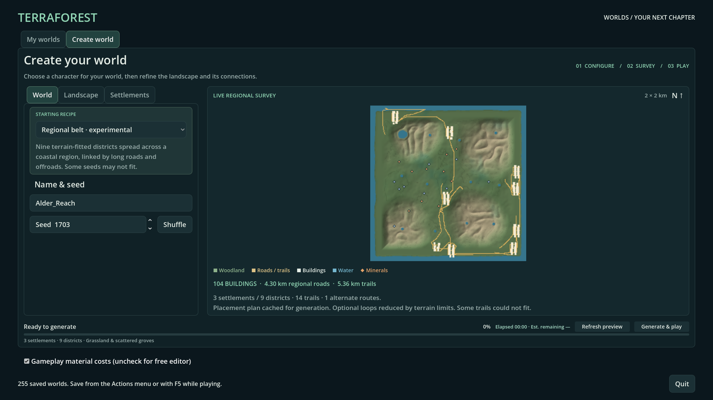
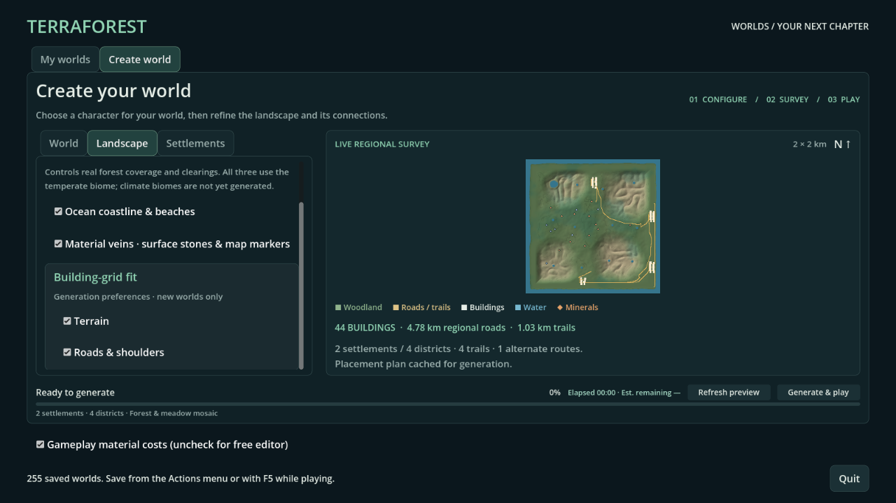
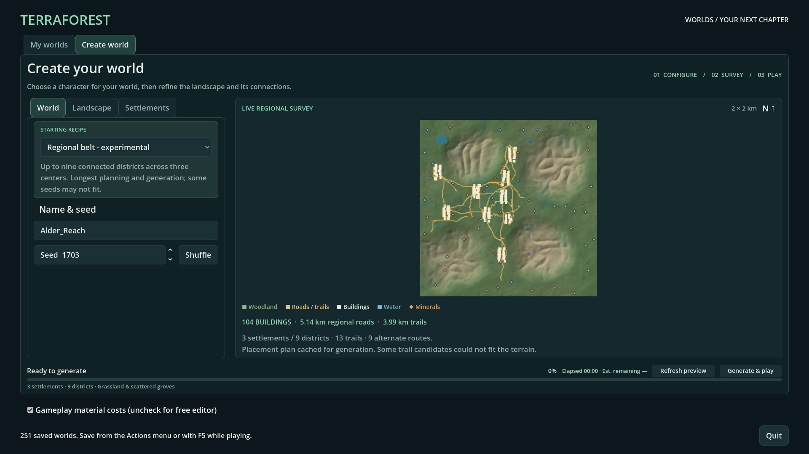
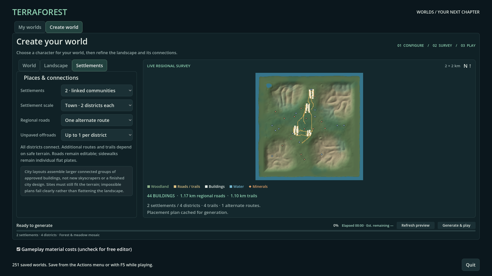
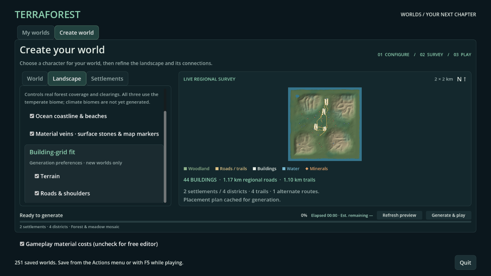

# World generator UI and larger connected regions

- Status: Reported Shuffle failures fixed and installed; 32 default seeds verified. Broader world quality remains unreviewed. Updated: 2026-11-13.
- User review: New UI and larger layouts not yet reviewed. Existing house approvals stay separate.
- Request: Professional creation UI, controllable towns/cities, connected roads, offroads and biome choices; distributed lakes/settlements and faster generation/loading.

## Shuffle failures — 2026-11-13

Reported seeds **474546765** and **1729662740**, **Frontier expedition**; the ordinary UI enables buildable terrain (generator 29).
The green `PLAN UNAVAILABLE` headline concealed the useful explanation below
its map. Failures now use a contrasting error color and put the seed, cause and
recovery guidance inside the empty map. Resource/worker failures use the same
path; stale results cannot replace a newer recipe's message. Reasons are logged.

Installed corrections in plan v52:

- Direction-aware native road search retains incoming-edge state, so valid
  forward return loops can revisit a junction; illegal reversals remain rejected.
- Regional route construction chooses shortcuts with incoming-direction state,
  preventing backwards bends. Existing street/crossing heights participate in
  corridor search, instead of rejecting the same completed route repeatedly.
  Short fitted street sections remain in published navigation.
- A failed mine/trader fit excludes that civic site from the next bounded layout
  attempt; changing unrelated settlement hints no longer repeats the same site.
- Mine surveying now receives stops with legal forward routes out and back,
  rather than every node in an undirected road component. Native incoming-edge
  traversal and reverse reachability preserve the actual shortest outward route.
- Mine access tries bounded alternative stops and deterministic survey orderings
  before relocating settlements. Terrain/roof/road limits remain unchanged.
- Native street planning surveys the complete support and shoulder footprint (7.5 m
  for the current grid policy), with a small grade tolerance reserve, instead of
  selecting grades from the earlier 5.5 m strip. Legacy sampling stays unchanged.
- If preferred district locations fail, a deterministic bounded survey searches
  the whole region, retaining all requested districts, buildings and terrain limits.
- District candidates validate the final road support envelope before selection;
  unsuitable sites can be replaced instead of failing only after global routing.
- Generation packets omit curve-table suffixes beyond the native sampled bounds,
  avoiding duplicate data that exceeded the unchanged 4 MiB command budget for
  seed 1253652533. Prefix indices stay unchanged to preserve exact voxel bytes.
  Native admission failures now return explicit format/count/byte-budget reasons.
- Cubic road endpoints use their authoritative shared endpoint heights to avoid
  false fixed-grade disagreement from floating-point evaluation.
- Introduction-enabled civic districts use their sixth lot for the existing
  approved C1 house. Preview checks the same upstairs spawn contract as generation
  (within 200 m of the trader); cached reconstruction retains this recipe choice.
  Existing saves and approved building geometry remain unchanged.

Survey UI, 1920×1080: regression-injected original failure reason for seed
474546765. Inspected message layout; this is not a claim that the corrected seed
still fails.

Actual automatic preview for seed 474546765, Frontier expedition, terrain 29, v48:
52 buildings, six districts, 6.32 km regional roads and 3.05 km trails.
Inspected source UI; ground-level world-quality approval remains separate.

Actual installed-PCK automatic preview for seed 1729662740, Frontier expedition,
buildable terrain 29, v52: 52 buildings, six districts, 4.32 km regional roads
and 2.20 km trails, using the supported diagnostic engine. Inspected; optional
loops/trails remain terrain-dependent.

The user's original error injected into the real UI for a presentation regression;
seed and reason are visible in the map area and the heading uses the error color.
Earlier source [success](images/shuffle-1729662740-success-2026-11-13.png) and
[error](images/shuffle-1729662740-failure-2026-11-13.png) captures are retained.

Engineering evidence:

- `reports/checks/20261113T083907907846Z`: reported seed 1729662740 passes actual
  default terrain 29, complete preview bake, six districts, 50 settlement
  buildings, nearby approved spawn and cached plan identity.
- `20261113T084005808581Z`: ordinary asynchronous UI preview succeeds for that
  seed and terrain 29; error color/reason/reset checks pass. Both 1920×1080
  captures were inspected and retained as `shuffle-1729662740-*-2026-11-13.png`.
  Broader default-mode and installed-package results follow below.
- `20261113T085528677851Z`: actual default terrain 29, seed 1729662740, passes
  all ten data-generation/game-reopen checks with the graphical renderer:
  52 buildings, 7,616 edits, 12 lakes, exact recipe, ore continuity and unchanged
  canonical bytes during read-only verification. The fixture skips photographs
  and map-raster capture; it does not establish ground-level visual acceptance.
  Saved fixture `queued_generation_c1e95b4a14ca` remains ready; its derived plan
  is hash-verified in the report's receipt-owned archive.
- `20261113T084119892558Z`, `20261113T084344352878Z`,
  `20261113T085905407676Z` and `20261113T090152933952Z`: all **32 distinct default
  terrain-29 seeds pass**, including both reports, all ten permanent cases and
  22 deterministic random seeds. Every case passes preview bake, cache/spawn,
  district/building counts and non-trail regional forward-turn checks.
- `20261113T090611104228Z`: 43 road-journey assertions pass, including short
  fitted sections in published navigation and legal mine stop/return filtering.
  `20261113T090630708400Z`: connected-grade/collision checks pass.
  `20261113T090643205508Z`: exact curve-compaction terrain parity, three legacy
  bake/staging cases, transaction rollback and explicit 4 MiB rejection pass.
- Export gate `reports/building_standards/20261113T090825869264Z` passes all
  source/release building checks. Installed PCK is 628,451,508 bytes with 14
  matching external DLLs; packaged startup and house-light checks pass.
  Follow-up packaged default UI, 43 road assertions, terrain parity and all ten
  known seed cases pass in `reports/shuffle_pack/20261113T091241131222Z`.
  Both exported UI captures were inspected and retained in this issue's images.
- `reports/shuffle_pack/20261113T091722671446Z/release_native/absolute_cache`:
  both reported seeds pass planning and native terrain baking with the exact
  installed PCK and all seven **release** native libraries. The native variant
  and installed terrain DLL hash are asserted/recorded. The first probe used a
  read-only resource path for its cache and is retained as a failed harness run;
  the corrected filesystem-cache run is clean. Private cache/native hardlinks
  are hash-verified in `native_cache.archive.json`, with drivers/logs retained.
- `reports/shuffle_pack/20261113T092424264289Z/queued_generation`: default seed
  1729662740 passes all ten installed-package data-generation/game-reopen checks.
  `fresh_process_reopen` then passes all ten checks in a **separate process**;
  before/after canonical hashes match the creation receipt. These graphical
  checks use the supported diagnostic engine with the installed PCK/DLLs.
  `shipping_startup` separately passes startup of the actual standalone executable.
  The executable intentionally disables external script/path overrides; no
  external-driver result is presented as a standalone-executable UI check.
  Exact final sources, package and receipts are recorded in that folder's
  `verification_summary.json`.
- Failed default-mode investigations are retained in `20261113T082502859060Z`,
  `20261113T082635835893Z`, `20261113T082743028573Z`, `20261113T083002008268Z`,
  `20261113T083203091672Z`, `20261113T083356190153Z`, `20261113T083551613715Z`
  and `20261113T083720968675Z`. The last two isolated route simplification and
  crossing validation; all earlier failed attempts remain evidence, not passes.

- `reports/checks/20261113T062136813869Z`: 39 native road-journey assertions pass,
  including a forward loop that revisits a shared departure/return junction.
- `20261113T062204749813Z`: connected grading, cubic-endpoint regression and baked
  collision checks pass without changing cut/fill limits.
- `20261113T064154850015Z`: previews, cache identities and approved nearby starting
  houses pass for 1703, 474546765, 42 and 123456789.
- `20261113T063135741149Z`: error/reset/missing-reason checks and real asynchronous
  recovery of the reported seed pass; both captures inspected.
- `20261113T063247864036Z`: all 10 production data-generation/save/reopen checks
  pass for seed 474546765 in terrain 31: 52 buildings, 10,245 edits, 12 lakes, exact recipe and
  ore continuity. Photographs/map raster generation is deliberately skipped by
  this fixture; it does not prove every entrance or visual quality.
- Retained failures: `20261113T061610911158Z` (four original shuffled failures),
  `20261113T062058318386Z` (intermediate partial correction),
  `20261113T062704075731Z` (previously unchecked introduction-house distance),
  `20261113T062913881303Z` (extra house incorrectly treated as civic map metadata),
  `20261113T063024251763Z` (old generation fixture omitted normal vehicle provider).
  The fixture now uses the same fleet provider flag as normal generation.

Retained investigation history: v48 still failed 2147483647 and the user's
new seed 1729662740. These exposed incomplete road-footprint surveying and local
site-search exhaustion; v50 corrects both mechanisms. The v50 sweep in
`reports/checks/20261113T065133471997Z` passed all nine known regression seeds
(including both user reports, 2147483647 and 987654321) plus four deterministic
random seeds before it was deliberately stopped to avoid interfering with the
human FPS capture in another chat. This interrupted run is not a 32-seed pass.
The completed final-binary sweep `20261113T070732584514Z` then passed 31/32
previews and caught seed 1253652533 exceeding the bake command byte limit.
Retained diagnostic `20261113T071748680601Z` records 4,234,848 bytes.
After lossless curve suffix compaction, `20261113T071957579099Z` passes exact
terrain-byte parity for curved roads in both directions, ordinary/staged baking
for three legacy seeds, and rollback checks. The corrected sweep `20261113T072132520978Z` passes all 32 distinct seeds in
terrain 31 (natural ground),
including all ten permanent regressions and deterministic random coverage. Every
case completes preview baking, cache digest/spawn checks, all six districts and
all 50 settlement buildings (plus two optional fitted lookouts in this sample).
The first packaged UI check (`reports/shuffle_pack/20261113T075011544963Z`)
exposed a fixture mismatch: the UI selects terrain 29 with buildable ground on,
but the inherited sweep hard-coded 31. Its failed trader/mine route is retained;
the 32-seed natural-ground pass is supplementary, not proof of default readiness.
Tests now derive terrain mode from the same launch helper as the UI. The newer
default-mode preview, UI and graphical save/reopen checks above pass; the full
default sweep and scoped final package validation above are now complete.
The terrain-31 headless generation run `20261113T073707273410Z` passed all ten
functional checks but logged a dummy-renderer error; it is not a clean check.

Earlier failed trials remain evidence, including `20261113T064205074856Z` and
`20261113T064910326806Z`. No cut/fill budget or requested content was reduced.
User visual approval and all-seed/world-quality acceptance remain open.

## Images

The later [natural-map update](../natural-world-map/README.md) replaces default
gold road/mineral annotations and switches Regional belt to woodland. The images
below retain the earlier grassland/overlay baseline. Town clustering is unchanged
by that follow-up, as requested by the user.

Current installed package, seed 1703, coastal grassland, twelve lakes and nine
districts across all four quadrants. Actual plan: 104 buildings, 4.30 km regional
links and 5.36 km trails. Optional loops reduced by terrain limits, as reported
in the UI. Inspected at 1920×1080; ground-level world quality awaits player review.

Current package, seed 1703, custom four-district coastal recipe at 1280×720.
Settings and generation actions remain accessible alongside the actual plan.

### Earlier baseline — retained comparison

Earlier source build, seed 1703, inland grassland, three centers × three districts. Actual
planning preview: 104 buildings, 5.14 km regional roads, 3.99 km trails. Inspected
at 1920×1080; not a ground-level quality approval of all nine districts.

Source build, seed 1703, custom two-town/four-district coastal recipe. Settings
are independent controls, not merely names for unchanged generation. Inspected.

1280×720, Landscape tab scrolled to the grouped grid preferences. Inspected for
reachability; controls scroll independently of the live map and generation actions.

## Changes and verification

### Distributed generation follow-up

- Cause: four fixed lake anchors and central/west-biased town hints limited spread.
  New terrain profiles 24–27 spread up to twelve irregular lakes and use northern,
  southern and opposite-side settlement search regions. Expanded multi-town
  layouts require eastern districts; the largest preset is now coastal.
- Regional routing shares a bounded native graph, rejects retraced optional
  links and deduplicates grading segments. Unsafe optional loops are reported
  and reduced, not allowed to break required connections or terrain-fit limits.
- Native map surveys skip proven-empty height ranges; roofs, excavation and
  water visibility retain the old raster results. Generation-only batching
  increases throughput without raising gameplay worker admission.
- Loading twelve lakes exposed contact-vector over-allocation: 140,112,600 bytes
  after restore versus 123,112,824 with exact reservation on the original deep
  seed-1703 fixture. The former exceeded the existing 128 MiB capture limit.
  New distributed small basins are five metres deep, leaving more storage headroom;
  legacy terrain fields and player saves are unchanged. Unmodified ocean caches
  are omitted from storage capture; edited sea and lake quantities remain exact.
- A two-point regional route exposed an out-of-range photograph index; the middle
  view now selects a valid segment, with empty/single/two/multi-point regression cases.
- Early retained failures: `20261028T103706_distributed_flow` (four-lake catalog
  cursor), `20261028T103939_distributed_flow` (two-point photograph),
  `20261028T104525_distributed_flow`, `20261028T105306_distributed_flow`,
  `20261028T105714_distributed_flow`, `20261028T105918_distributed_flow` (water capture),
  and `20261028T110248159767Z` (deep-basin budget and test-held snapshot reference).
- `20261028T105103_distributed_flow` timed out with 26/28 nearby vegetation regions
  ready during photography. This isolated timeout remains unconfirmed, not declared
  fixed by the water allocation change; reproduce with pending cover-job diagnostics.
- Final source: `20261028T110852397084Z` passes all five presets / 46 assertions;
  `20261028T111750707316Z` checks all 104 baked clearance envelopes.
  `20261028T110804419225Z` passes 61 distribution, old-field and cache assertions:
  twelve lakes / four quadrants for seeds 0, 42 and 1703 in all four new profiles,
  eighteen byte-identical legacy field signatures and three smaller inland plans.
  `20261028T104501961542Z` passes five photograph segment cases.
- `20261028T110748705072Z`: three twelve-lake bake/restore/capture cases pass.
  Resident storage is 89.7–90.2 MB; snapshots 48.4–48.9 MB, inside unchanged limits.
  `20261028T110309330218Z` checks pristine/edited/empty ocean storage ownership;
  existing frozen-snapshot and deferred-save suites also pass.
- `20261028T110929_distributed_flow`: full 104-building creation, photo/map baking,
  publication, play, save and reload pass 42 assertions in one window. Creation
  phase: 96.19 s; full fixture: 177.23 s including travel/reopen. Different terrain
  and water coverage prevent treating the earlier baseline as a controlled timing
  comparison. Report: `generation_reports/6811c419491ae9e2add2d97837d38cd5/run.json`
  in TerraForest app userdata; fixture: `reports/world_generator_city/result.json`.
- Installed package: `20261028T111244_distributed_pack/run.json` records all DLL
  hashes and passing recipe, distribution, map, water-storage and rendered UI tests.
  Pack SHA-256: `9413c5e6bd942b24e8bb7dc02ece301a97520a3f6b220c5642f5d96abac95c0e`.
- Controlled nine-case native map comparison retains identical pixel/visibility
  hashes. Aggregate visibility work: 201.188 → 8.451 ms; patch work: 267.229 →
  5.543 ms; calls: 250 → 75. Evidence: `reports/pack_distributed/map_efficiency/result.json`.
  These are isolated operations on this machine, not total loading or FPS claims.

### Earlier UI / larger-recipe baseline

- Three settings tabs, five editable presets, live actual-plan map and counts.
- Native recipe v6: up to nine districts, interconnected roads, existing offroad/biome controls.
- Bounded outer site search and consistent claimed-site reservations; unchanged cut/fill limits.
- Extended finite generation budgets and binary plan caching; no per-frame planner work.
- Production generation caught false buried-house failures: clearance sampled rounded-down
  lattice points instead of the fractional probe position. It now uses native interpolation.
  The small cellar also declares the same five-metre surface band as its buried shell;
  solid rooms are still rejected, underground walls are not mistaken for filled rooms.
- `reports/checks/20261028T092859632590Z/`: 104-building production data generation,
  6,190 native edits, save/reopen, exact recipe and ore continuity, no cursor capture;
  10 assertions pass. Photos/map rasters deliberately skipped in this fixture.
- `reports/checks/20261028T093027047714Z_generator_ui/`: rendered UI, both resolutions,
  preset/custom propagation, debounce/stale work and largest actual map pass.
- `20261028T091621467943Z`, `20261028T091622465312Z`, `20261028T091624334323Z`:
  native road-contact/collision, staged generation rollback and legacy recipe checks pass.
- `20261028T093308150442Z_city_flow`: full nine-district creation, photo/map baking,
  publication, play, save/reopen and exact approved-building cells pass 42 assertions
  in one OS window. Entire check takes 190.6 s, including travel/reopen/verification;
  it is not a generation-time or gameplay-FPS benchmark. Player worlds stay untouched.
- `20261028T093808352136Z`: all five presets pass 45 native-plan/codec/cache assertions.
  `20261028T093835072262Z`: all 104 building clearance envelopes are clear after baking.
  `20261028T093904660667Z`: 56 C1 geometry, traversal and default-plan assertions pass.
- `20261028094212Z_generator_pack`: packaged 45-option checks, binary navigation
  restore and rendered UI pass with all 14 external DLL hashes matching source.
  Pack SHA-256: `44d31313cb5a082871f4bec4b2fc16ebd8bce70666a6d6a7225ffea90ecb3cad`.
- Release-DLL recipe and road-contact/collision checks pass separately; evidence:
  `reports/world_recipe_native_release.json`, `reports/connected_road_native_release.json`.

## Remaining / resume here

- Maximum inland seed 1703 now fits nine districts / 86 buildings, including the
  approved city additions. An eastern-half fallback replaces the failed narrower
  search without relaxing terrain budgets or accepting a west-only cluster.
  Plan evidence: `reports/checks/20261028T154736525012Z`; production data generation
  and fresh loader: `20261028T153306904424Z`. The earlier failed trial remains;
  multi-seed maximum-layout and world-quality qualification are still open.
- Current biomes only alter temperate woodland/meadow coverage. Climate materials,
  weather and new asset ecosystems require explicit native/asset work and review.
- Experimental city regions reuse approved buildings. Zoning, a continuous urban
  street plan and all-district access are not accepted yet. Six newly approved
  designs now form mixed-use expansion districts; [populated-world evidence](../city-buildings/README.md#generated-world-integration)
  includes all six player/NPC approaches and six vehicle bays, not universal access.
- More seeds, weak-hardware profiling, all-district vehicle traversal and long-play budgets need
  dedicated evidence before claiming universal generation success or city quality.
- The earlier full-flow fixture failed to open its background map for the screenshot.
  The current fixture opens it explicitly; its inspected `material_map.png` shows
  all nine district labels while derived layers are still updating. It is not a
  completed water-raster image; completed baking checks and creation-map images
  are separate evidence. Capture the fully settled map for final visual review.
- Preserve current player saves. New controls apply to new worlds; do not regenerate old saves.

## Reproduce / retained failures

- Worlds → Create world → Regional belt; seed 1703; Generate & play creates a new slot.
- Headless: `python tools/run_godot_check.py queued_generation --headless --timeout 300 --require "QUEUED_GENERATION checks=10 failures=0" -- --city-generation --distributed`.
- Failed initial UI/plan runs remain in `reports/checks/`: `20261028T085659510035Z_generator_ui`
  (small-window layout), `20261028T090030901239Z` (reserved exits),
  `20261028T090257388444Z`, `20261028T090922368468Z` (footprint cap),
  `20261028T091025504385Z` (mineral command cap), `20261028T091318457135Z` (plan cache),
  `20261028T091945984578Z`, `20261028T092702417247Z` (production clearance).
- `20261028T092302754186Z` retains the 42 small-cellar wall probes that exposed
  missing surface-band metadata. Do not count these failures as passes.
- Implementation contract: [WORLD_GENERATION_RECIPES.md](../../docs/WORLD_GENERATION_RECIPES.md).

Original code changes and regression fixtures are AI-assisted implementation for
the reported Shuffle failure; no external code/assets or dependency upgrades were
introduced. Existing prefab geometry, notices and third-party terms are retained.
