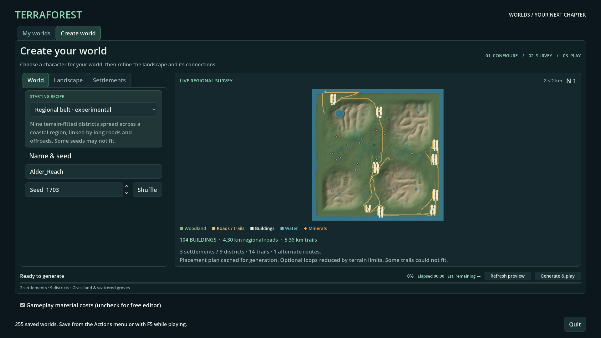
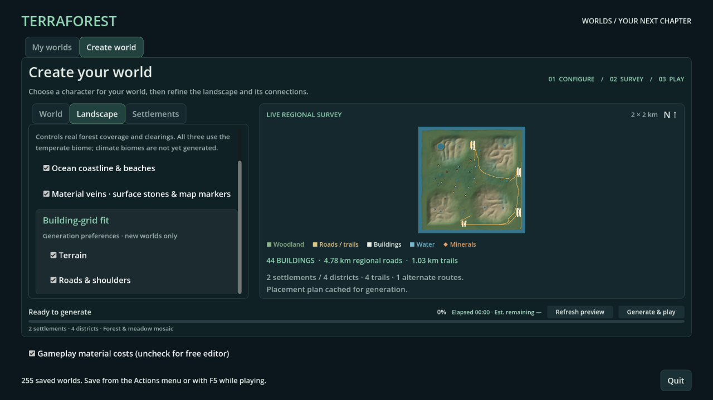
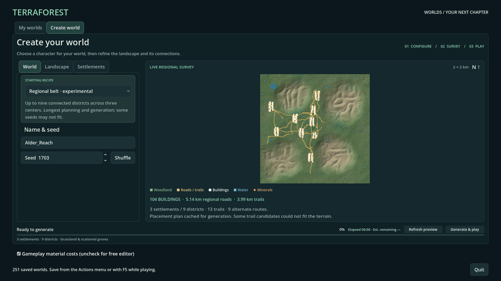
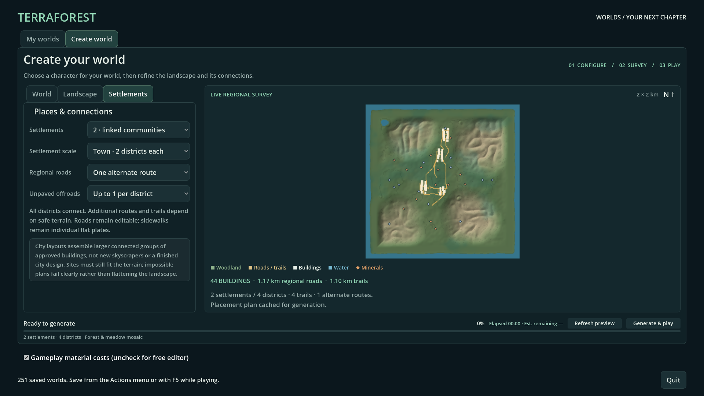
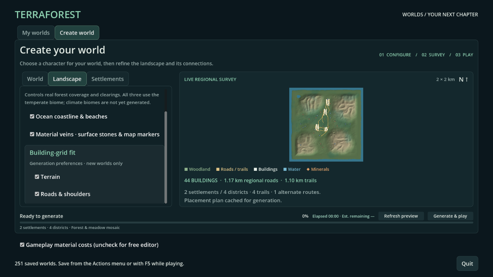

# World generator UI and larger connected regions

- Status: Installed; scoped checks pass. Updated: 2026-10-28.
- User review: New UI and larger layouts not yet reviewed. Existing house approvals stay separate.
- Request: Professional creation UI, controllable towns/cities, connected roads, offroads and biome choices; distributed lakes/settlements and faster generation/loading.

## Images

Current installed package, seed 1703, coastal grassland, twelve lakes and nine
districts across all four quadrants. Actual plan: 104 buildings, 4.30 km regional
links and 5.36 km trails. Optional loops reduced by terrain limits, as reported
in the UI. Inspected at 1920×1080; ground-level world quality awaits player review.

Current package, seed 1703, custom four-district coastal recipe at 1280×720.
Settings and generation actions remain accessible alongside the actual plan.

### Earlier baseline — retained comparison

Earlier source build, seed 1703, inland grassland, three centers × three districts. Actual
planning preview: 104 buildings, 5.14 km regional roads, 3.99 km trails. Inspected
at 1920×1080; not a ground-level quality approval of all nine districts.

Source build, seed 1703, custom two-town/four-district coastal recipe. Settings
are independent controls, not merely names for unchanged generation. Inspected.

1280×720, Landscape tab scrolled to the grouped grid preferences. Inspected for
reachability; controls scroll independently of the live map and generation actions.

## Changes and verification

### Distributed generation follow-up

- Cause: four fixed lake anchors and central/west-biased town hints limited spread.
  New terrain profiles 24–27 spread up to twelve irregular lakes and use northern,
  southern and opposite-side settlement search regions. Expanded multi-town
  layouts require eastern districts; the largest preset is now coastal.
- Regional routing shares a bounded native graph, rejects retraced optional
  links and deduplicates grading segments. Unsafe optional loops are reported
  and reduced, not allowed to break required connections or terrain-fit limits.
- Native map surveys skip proven-empty height ranges; roofs, excavation and
  water visibility retain the old raster results. Generation-only batching
  increases throughput without raising gameplay worker admission.
- Loading twelve lakes exposed contact-vector over-allocation: 140,112,600 bytes
  after restore versus 123,112,824 with exact reservation on the original deep
  seed-1703 fixture. The former exceeded the existing 128 MiB capture limit.
  New distributed small basins are five metres deep, leaving more storage headroom;
  legacy terrain fields and player saves are unchanged. Unmodified ocean caches
  are omitted from storage capture; edited sea and lake quantities remain exact.
- A two-point regional route exposed an out-of-range photograph index; the middle
  view now selects a valid segment, with empty/single/two/multi-point regression cases.
- Early retained failures: `20261028T103706_distributed_flow` (four-lake catalog
  cursor), `20261028T103939_distributed_flow` (two-point photograph),
  `20261028T104525_distributed_flow`, `20261028T105306_distributed_flow`,
  `20261028T105714_distributed_flow`, `20261028T105918_distributed_flow` (water capture),
  and `20261028T110248159767Z` (deep-basin budget and test-held snapshot reference).
- `20261028T105103_distributed_flow` timed out with 26/28 nearby vegetation regions
  ready during photography. This isolated timeout remains unconfirmed, not declared
  fixed by the water allocation change; reproduce with pending cover-job diagnostics.
- Final source: `20261028T110852397084Z` passes all five presets / 46 assertions;
  `20261028T111750707316Z` checks all 104 baked clearance envelopes.
  `20261028T110804419225Z` passes 61 distribution, old-field and cache assertions:
  twelve lakes / four quadrants for seeds 0, 42 and 1703 in all four new profiles,
  eighteen byte-identical legacy field signatures and three smaller inland plans.
  `20261028T104501961542Z` passes five photograph segment cases.
- `20261028T110748705072Z`: three twelve-lake bake/restore/capture cases pass.
  Resident storage is 89.7–90.2 MB; snapshots 48.4–48.9 MB, inside unchanged limits.
  `20261028T110309330218Z` checks pristine/edited/empty ocean storage ownership;
  existing frozen-snapshot and deferred-save suites also pass.
- `20261028T110929_distributed_flow`: full 104-building creation, photo/map baking,
  publication, play, save and reload pass 42 assertions in one window. Creation
  phase: 96.19 s; full fixture: 177.23 s including travel/reopen. Different terrain
  and water coverage prevent treating the earlier baseline as a controlled timing
  comparison. Report: `generation_reports/6811c419491ae9e2add2d97837d38cd5/run.json`
  in TerraForest app userdata; fixture: `reports/world_generator_city/result.json`.
- Installed package: `20261028T111244_distributed_pack/run.json` records all DLL
  hashes and passing recipe, distribution, map, water-storage and rendered UI tests.
  Pack SHA-256: `9413c5e6bd942b24e8bb7dc02ece301a97520a3f6b220c5642f5d96abac95c0e`.
- Controlled nine-case native map comparison retains identical pixel/visibility
  hashes. Aggregate visibility work: 201.188 → 8.451 ms; patch work: 267.229 →
  5.543 ms; calls: 250 → 75. Evidence: `reports/pack_distributed/map_efficiency/result.json`.
  These are isolated operations on this machine, not total loading or FPS claims.

### Earlier UI / larger-recipe baseline

- Three settings tabs, five editable presets, live actual-plan map and counts.
- Native recipe v6: up to nine districts, interconnected roads, existing offroad/biome controls.
- Bounded outer site search and consistent claimed-site reservations; unchanged cut/fill limits.
- Extended finite generation budgets and binary plan caching; no per-frame planner work.
- Production generation caught false buried-house failures: clearance sampled rounded-down
  lattice points instead of the fractional probe position. It now uses native interpolation.
  The small cellar also declares the same five-metre surface band as its buried shell;
  solid rooms are still rejected, underground walls are not mistaken for filled rooms.
- `reports/checks/20261028T092859632590Z/`: 104-building production data generation,
  6,190 native edits, save/reopen, exact recipe and ore continuity, no cursor capture;
  10 assertions pass. Photos/map rasters deliberately skipped in this fixture.
- `reports/checks/20261028T093027047714Z_generator_ui/`: rendered UI, both resolutions,
  preset/custom propagation, debounce/stale work and largest actual map pass.
- `20261028T091621467943Z`, `20261028T091622465312Z`, `20261028T091624334323Z`:
  native road-contact/collision, staged generation rollback and legacy recipe checks pass.
- `20261028T093308150442Z_city_flow`: full nine-district creation, photo/map baking,
  publication, play, save/reopen and exact approved-building cells pass 42 assertions
  in one OS window. Entire check takes 190.6 s, including travel/reopen/verification;
  it is not a generation-time or gameplay-FPS benchmark. Player worlds stay untouched.
- `20261028T093808352136Z`: all five presets pass 45 native-plan/codec/cache assertions.
  `20261028T093835072262Z`: all 104 building clearance envelopes are clear after baking.
  `20261028T093904660667Z`: 56 C1 geometry, traversal and default-plan assertions pass.
- `20261028094212Z_generator_pack`: packaged 45-option checks, binary navigation
  restore and rendered UI pass with all 14 external DLL hashes matching source.
  Pack SHA-256: `44d31313cb5a082871f4bec4b2fc16ebd8bce70666a6d6a7225ffea90ecb3cad`.
- Release-DLL recipe and road-contact/collision checks pass separately; evidence:
  `reports/world_recipe_native_release.json`, `reports/connected_road_native_release.json`.

## Remaining / resume here

- Maximum inland seed 1703 cannot fit the required eastern district within the
  unchanged lot standards (`20261028T102435403661Z` retained trial). Use the coastal
  largest preset; custom inland fails explicitly rather than accepting a west-only
  cluster. Resume bounded lot-layout work and require all requested districts,
  quadrant coverage and full-envelope/crossing checks across multiple seeds.
- Current biomes only alter temperate woodland/meadow coverage. Climate materials,
  weather and new asset ecosystems require explicit native/asset work and review.
- Experimental city regions reuse approved buildings. Zoning, a continuous urban
  street plan, architecture variety and all-district access are not accepted yet.
- More seeds, weak-hardware profiling, vehicle traversal and long-play budgets need
  dedicated evidence before claiming universal generation success or city quality.
- The earlier full-flow fixture failed to open its background map for the screenshot.
  The current fixture opens it explicitly; its inspected `material_map.png` shows
  all nine district labels while derived layers are still updating. It is not a
  completed water-raster image; completed baking checks and creation-map images
  are separate evidence. Capture the fully settled map for final visual review.
- Preserve current player saves. New controls apply to new worlds; do not regenerate old saves.

## Reproduce / retained failures

- Worlds → Create world → Regional belt; seed 1703; Generate & play creates a new slot.
- Headless: `python tools/run_godot_check.py queued_generation --headless --timeout 300 --require "QUEUED_GENERATION checks=10 failures=0" -- --city-generation --distributed`.
- Failed initial UI/plan runs remain in `reports/checks/`: `20261028T085659510035Z_generator_ui`
  (small-window layout), `20261028T090030901239Z` (reserved exits),
  `20261028T090257388444Z`, `20261028T090922368468Z` (footprint cap),
  `20261028T091025504385Z` (mineral command cap), `20261028T091318457135Z` (plan cache),
  `20261028T091945984578Z`, `20261028T092702417247Z` (production clearance).
- `20261028T092302754186Z` retains the 42 small-cellar wall probes that exposed
  missing surface-band metadata. Do not count these failures as passes.
- Implementation contract: [WORLD_GENERATION_RECIPES.md](../../docs/WORLD_GENERATION_RECIPES.md).
